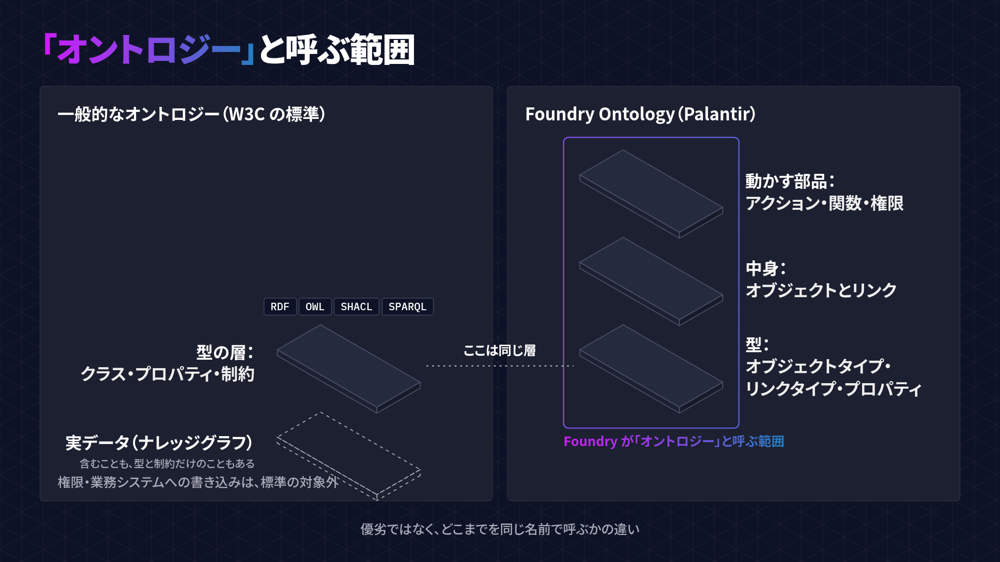
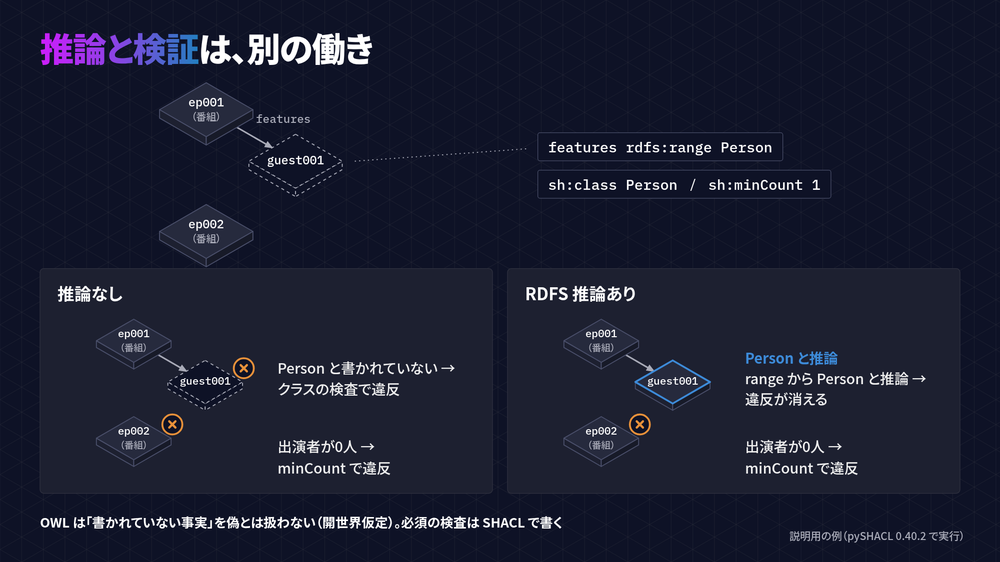
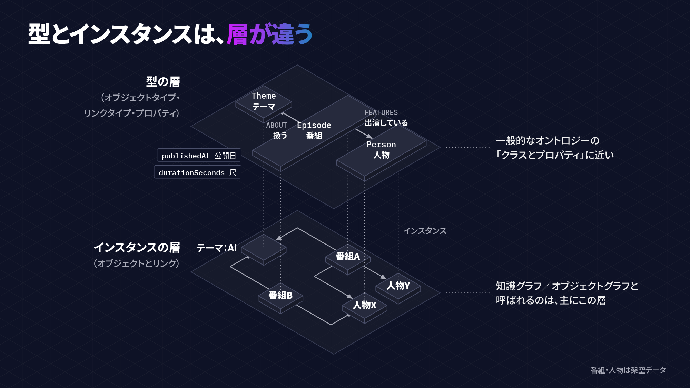
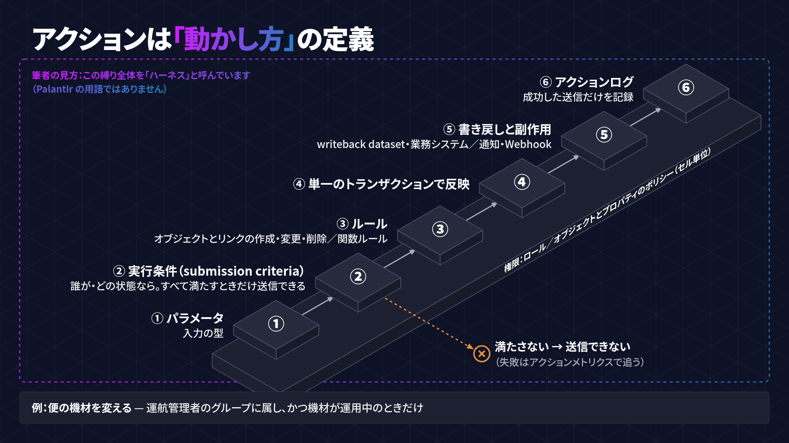
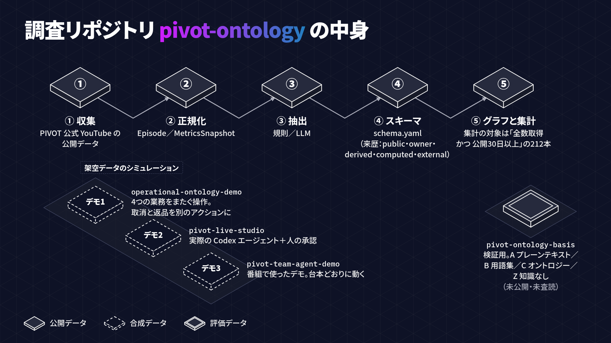
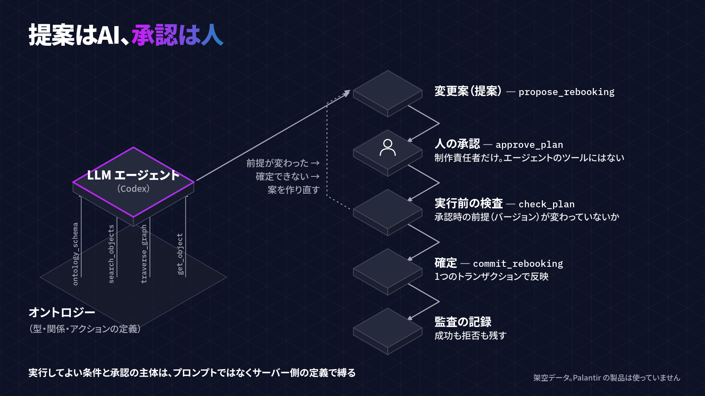
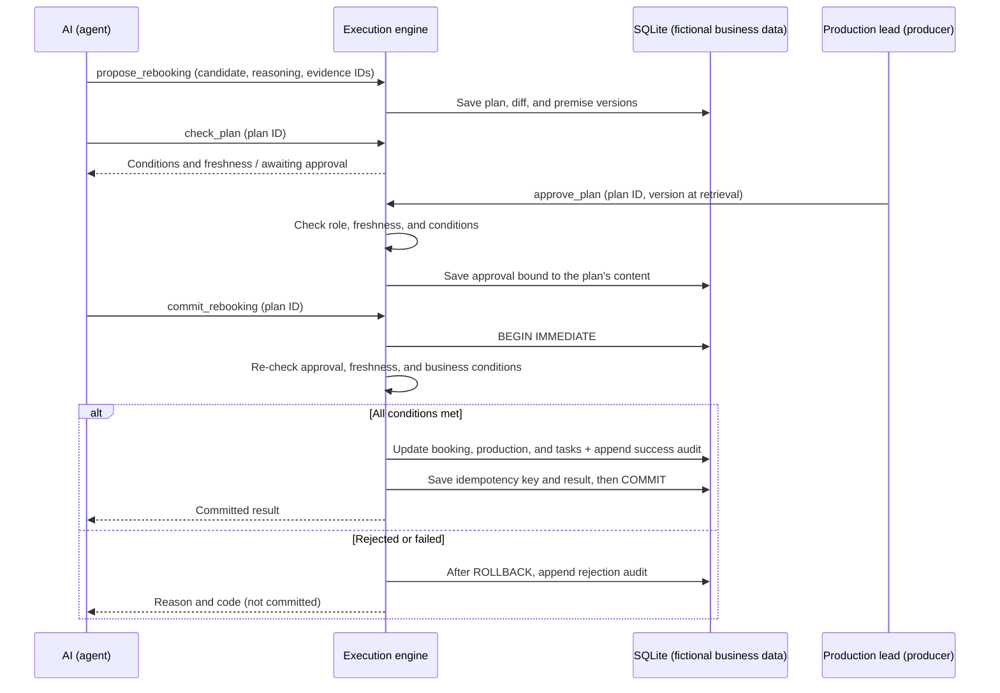
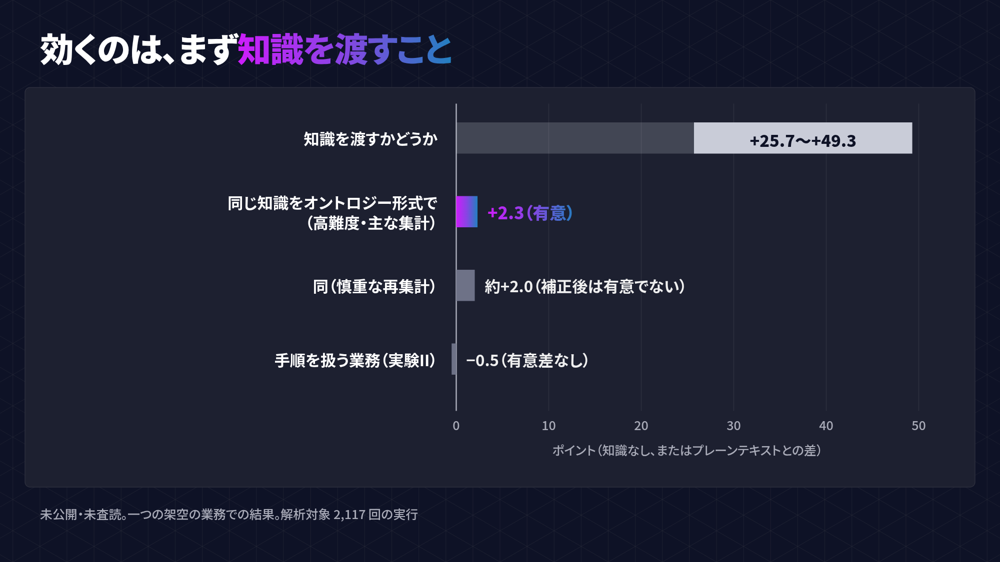

# Reading Palantir's Foundry Ontology as DDD Domain Modeling

> *This is an English version of my original Japanese article on the Canly Tech Blog, published on November 17, 2026 (JST): [「【PIVOTでオントロジーを解説しました】PalantirのFoundry OntologyはDDDのドメインモデリングとして読めるという話」](https://zenn.dev/canly/articles/121db874319244) (Japanese). Code excerpts are quoted verbatim from my research repository. I've translated the code comments, but UI labels and error messages in the code are still in Japanese, as in the original. Links marked "(Japanese)" go to Japanese-language sources.*

I'm Takahiro Hagino, CAIO (Chief AI Officer) at Canly.

My third appearance on a Japanese business TV show was released on November 14, 2026! This time the theme was "ontology." I talked about how far companies can automate their work with AI, and why they need an ontology to do it. Please watch, like, and share!

https://www.youtube.com/watch?v=_V7IF1XdNLQ

An article version of the episode is on [the show's website (Japanese)](https://pivotmedia.co.jp/movie/15261).

## Picking up where the show left off, for engineers

The show is a business program, so I deliberately left out the technical details. For a general audience, I've written [a note post (Japanese)](https://note.com/haginota/n/nbf04863132cf) that summarizes what I said on the show and follows up on points raised in the comments.

This article is the technical companion to that post. Before the recording, I read through the primary sources on ontology and built demos and experiments in a research repository. Here I write up what I worked out there, in terms of code and specifications.

Honestly, the details I left out of the show are the part I most wanted to write about.

I'll cover seven topics:

- **What the word covers**: Ontology in the general sense (RDF / OWL / SHACL / SPARQL) and Palantir's Foundry Ontology use the same word for different scopes
- **Types and instances**: Keeping the blueprint layer separate from the graph of real data
- **Domain modeling**: Reading ontology in terms of DDD (Domain-Driven Design)
- **Actions**: Breaking Foundry's "components that make things happen" down into parameters, rules, submission criteria, writeback, and logs
- **Implementation**: How I built the action gate and the connection to LLM agents in the research repository (with code excerpts)
- **Moving toward production**: Testing, writeback that doesn't duplicate on retry, schema changes, and how to build it with OSS
- **How big the effect is**: How much the "form" of the ontology helped in my own experiments (unpublished and not peer-reviewed)

A few disclaimers first:

- These are my personal views, not the official position of the show's production company, Palantir, or my employer. This is not a partnership or sponsored article.
- Facts are linked to their sources. My own opinions are marked with phrases like "I think" and "in my view." I checked the sources on November 16, 2026 (JST).
- Every demo in the research repository is a simulation that runs on fictional data. None of them represent the organization, policies, systems, or business results of the show's production company.



## 1. First, agree on what "ontology" covers

On the show, I used the one word "ontology" for two different things and moved straight from one to the other: ontology in the general sense, and Palantir's Foundry Ontology. A commenter said "the layers are getting mixed up," and I think my failure to separate the two was part of the reason. So let me separate them now.

Use one word for two things back to back, and of course the layers sound mixed. I'm the one who mixed them, so it's a fair criticism.

### 1.1 Ontology in general: types, relationships, and constraints

The definition most often cited in computer science is [Gruber's "an explicit specification of a conceptualization"](https://tomgruber.org/writing/ontolingua-kaj-1993.pdf). [Studer et al.](https://doi.org/10.1016/S0169-023X%2897%2900056-6) restated it as "a formal, explicit specification of a shared conceptualization."

The W3C standards for writing down ontologies each play a different role.

| Standard | Role |
|---|---|
| [RDF](https://www.w3.org/TR/rdf11-concepts/) | A data model that represents a graph as a set of subject–predicate–object "triples" |
| [OWL 2](https://www.w3.org/TR/owl2-overview/) | A language for formally defining classes, properties, individuals, and their meaning. [Can also be written as an RDF graph](https://www.w3.org/TR/owl2-mapping-to-rdf/) |
| [SHACL](https://www.w3.org/TR/shacl/) | A language for validating whether an RDF graph meets given conditions |
| [SPARQL 1.1 Update](https://www.w3.org/TR/sparql11-update/) | A language for inserting triples into and deleting triples from RDF graphs in a graph store |

Here is the "dots and lines" example from the show, written in Turtle (one of the syntaxes for RDF). I wrote it for illustration, and the values are made up.

*pivot-example.ttl*
```turtle
@prefix ex:   <https://example.org/pivot#> .
@prefix owl:  <http://www.w3.org/2002/07/owl#> .
@prefix rdfs: <http://www.w3.org/2000/01/rdf-schema#> .
@prefix xsd:  <http://www.w3.org/2001/XMLSchema#> .

# Types (schema)
ex:Episode  a owl:Class .
ex:Person   a owl:Class .
ex:features a owl:ObjectProperty ;
    rdfs:domain ex:Episode ;
    rdfs:range  ex:Person .
ex:publishedAt a owl:DatatypeProperty ;
    rdfs:range xsd:date .

# Instances (actual data; values are made up for illustration)
ex:ep001 a ex:Episode ;
    ex:publishedAt "2026-11-14"^^xsd:date ;
    ex:features ex:guest001 .
ex:ep002 a ex:Episode .
```

The key technical point is that `rdfs:range ex:Person` is **not a constraint** that says "whatever features points to must be a Person." Under RDFS and OWL semantics, it means "you may **infer** that whatever features points to is a Person." The [OWL 2 Primer](https://www.w3.org/TR/owl2-primer/) uses domain and range examples to show how a reasoner can derive an individual's class. The same Primer also says that OWL 2 is not a database framework, and that a fact that isn't stated is treated not as false but as something that "may simply be missing" (the open-world assumption).

If you want a check like "every episode must have at least one guest," you write it in SHACL.

*pivot-shapes.ttl*
```turtle
@prefix ex:  <https://example.org/pivot#> .
@prefix sh:  <http://www.w3.org/ns/shacl#> .
@prefix xsd: <http://www.w3.org/2001/XMLSchema#> .

ex:EpisodeShape a sh:NodeShape ;
    sh:targetClass ex:Episode ;
    sh:property [
        sh:path ex:features ;
        sh:class ex:Person ;
        sh:minCount 1 ;
    ] ;
    sh:property [
        sh:path ex:publishedAt ;
        sh:datatype xsd:date ;
        sh:maxCount 1 ;
    ] .
```

I ran validation with pySHACL 0.40.2 twice: once without inference and once with RDFS inference.

*Output (showing only the Focus Node and Message lines)*
```text
--- inference=none conforms=False
Focus Node: ex:ep001
Message: Value does not have class ex:Person
Focus Node: ex:ep002
Message: Less than 1 values on ex:ep002->ex:features
--- inference=rdfs conforms=False
Focus Node: ex:ep002
Message: Less than 1 values on ex:ep002->ex:features
```

Without inference, the class check fails because `ex:guest001` has no `a ex:Person` statement. With RDFS inference on, the range lets the processor derive "guest001 is a Person," so that violation disappears. `ex:ep002`, which has no guests at all, fails both times. The same type information produces different results depending on whether it works as inference or as validation.

The difference comes from two different underlying assumptions. OWL rests on the open-world assumption, so when a reasoner sees `ex:ep002` with no guest stated, it doesn't conclude "there are no guests." It treats the guest as possibly just not written down yet. [SHACL](https://www.w3.org/TR/shacl/) checks whether the data graph under validation satisfies the conditions in the shapes. Whether inference is also applied depends on the processor's settings or on `sh:entailment`. In the run above, I switched inference on and off in the processor's (pySHACL's) settings. And if you write something like `sh:minCount 1`, a missing value is a violation in itself.

Most business rules take the second form. Some are conditions that must hold at all times (invariants, e.g. "the total cost of confirmed bookings must not exceed the budget"). Others decide whether a given operation is allowed (preconditions, e.g. "an order that has already shipped cannot be canceled"). Neither is about filling in missing facts. Both are pass/fail checks against the data as it stands.

Inference is being honest when it treats what isn't written as possibly just not written yet. But business needs an answer: given the data in hand right now, do we let this through or stop it?

If you write rules as inference, data that breaks a rule can produce a new derived fact instead of a violation. That's what happened in the example above: `ex:guest001` was inferred to be a Person, and the class check passed.

So in my view, business invariants and preconditions are easier to manage when written as validation rather than inference. By validation I mean SHACL, or the submission criteria on actions that we'll look at in Section 4. Inference suits cases where filling in facts is acceptable, such as classification or mapping between vocabularies.



You can write graph updates in SPARQL 1.1 Update.

*update.rq*
```sparql
PREFIX ex: <https://example.org/pivot#>
DELETE { ?ep ex:features ex:guest001 }
INSERT { ?ep ex:features ex:guest002 }
WHERE  { ?ep a ex:Episode ; ex:features ex:guest001 }
```

But the standard only goes as far as "how to rewrite the triples." **Who may make this update, under what conditions it may run, and how it gets reflected in external business systems** are outside the scope of these standards. The security considerations section of SPARQL 1.1 Update does urge implementations to apply their own permission mechanisms, but it doesn't define those mechanisms. Of course, platforms built on OWL or RDF may well have their own permission and write mechanisms.

### 1.2 Foundry Ontology: the blueprint, extended to the contents and the "components that make things happen"

[Palantir's Core concepts](https://www.palantir.com/docs/foundry/ontology/core-concepts) describes an ontology as "a categorization of the world" and explains that in Foundry it is "the digital twin of an organization." It frames the Ontology as datasets and models mapped to object types, properties, link types, and action types, and brought together in one place.

The [Ontology overview page](https://www.palantir.com/docs/foundry/ontology/overview) says the Ontology includes both **semantic elements** (objects, properties, links) and **kinetic elements** (actions, functions, dynamic security). The [architecture explainer](https://www.palantir.com/docs/foundry/architecture-center/ontology-system) goes further and states outright that the Ontology is not a "semantic layer." Its reasoning is that nouns (objects) can't represent decisions unless they're paired with verbs (actions).

Here are the building blocks, using the official definitions.

| Element | Palantir's definition (summarized) |
|---|---|
| Object type | A schema definition of a real-world entity or event. An object is a single instance of it ([Core concepts](https://www.palantir.com/docs/foundry/ontology/core-concepts)) |
| Property | A schema definition of a characteristic of an object type |
| Link type | A schema definition of a relationship between two object types. A link is a single instance of it. [Link types are bidirectional](https://www.palantir.com/docs/foundry/object-link-types/link-types-overview) |
| Action type | A definition of a set of changes to objects, property values, and links that a user makes at once. Includes side effects on submission ([Action types](https://www.palantir.com/docs/foundry/action-types/overview)) |
| Function | Code logic that takes inputs and returns outputs. Written in [TypeScript and Python](https://www.palantir.com/docs/foundry/functions/overview) |
| Role | The Ontology's central permission model ([Core concepts](https://www.palantir.com/docs/foundry/ontology/core-concepts)) |
| Interface | A type that describes the shape and capabilities of object types and provides polymorphism |

[Core concepts](https://www.palantir.com/docs/foundry/ontology/core-concepts) also maps these to datasets: an object type corresponds to a dataset, an object to a row, a property to a column, and a link type to a join. Here too, **types and instances are clearly kept apart**.

### 1.3 Side by side

| Item | Ontology in general (W3C standards) | Foundry Ontology |
|---|---|---|
| Core units | Classes, properties, individuals, and axioms (statements that define things such as relationships between classes). Represented as triples | Object types, properties, link types, action types |
| Actual data | May include it, or may hold only types and constraints | Includes it. Objects and links are treated as instances of types |
| Inference / checks | OWL inference, graph validation with SHACL | Submission criteria (checks before an action is submitted) |
| Writes | Graphs can be updated with SPARQL 1.1 Update | Actions (a single transaction), writeback |
| Permissions | Outside the standards' scope. Handled by the platform that uses them | Roles, object and property policies |
| Logic | Outside the standards' scope | Functions (TypeScript / Python) |
| Status | Public external standards | One company's product specification |

"Outside the scope" means the standards don't specify it. This isn't a comparison of which is better. I see it as **a difference in where you draw the line around what you call "ontology."**

That doesn't make the broader scope the better one; that's a separate question. What differs is where the line is drawn, not which one ranks higher.

## 2. Types and instances: "knowledge graph" vs. "object graph"



On the show, I said that "an ontology itself is not a graph" (around 15:02). I'll say it more precisely here. [An OWL ontology can also be written as an RDF graph](https://www.w3.org/TR/owl2-mapping-to-rdf/), so flatly saying "it is not a graph" went too far. What I meant was that **the type definitions and the graph of actual data you build from them sit in different layers**.

Getting the idea right doesn't make an imprecise statement precise. Treat this restatement, not what I said on the show, as the correct version.

Around 14:47 on the show, I also described a graph as "points connected by lines." By "graph" I don't mean the graph of a function. I mean [a graph in the graph-theory sense](https://diestel-graph-theory.com/): a pair G=(V,E) of a set of vertices and a set of edges. A viewer pointed this out, and they were right. I go into more detail in [section 3-1 of my note post (Japanese)](https://note.com/haginota/n/nbf04863132cf).

Palantir's own wording also varies from one document to another.

- The July 2023 [white paper for the semiconductor industry](https://www.palantir.com/assets/xrfr7uokpv1b/2T3BgBpe3drnqBaSTCXl6O/bdc9445d10053eb84b3f9487e63fc2d7/Whitepaper_-_Accelerating_Research_and_Development_in_the_Semiconductor_Industry.pdf) includes a diagram of a "knowledge graph" that is built through the ontology and placed at the center.
- A [2022 official blog post](https://blog.palantir.com/ontology-finding-meaning-in-data-palantir-rfx-blog-series-1-399bd1a5971b) says you define objects, attributes, and relationships, link them together, and build the "object graph" that the ontology defines.
- The [product documentation](https://www.palantir.com/docs/foundry/ontology/core-concepts) doesn't lead with a graph at all. Its central phrase is a "digital twin of the organization."

I read these as different descriptions of the same thing, each emphasizing a different aspect. Here's how I'd lay it out:

- The type layer: object types, link types, and properties. Close to the "classes and properties" of an ontology in the general sense.
- The instance layer: objects and links. Viewed as points and lines, this is what people call a knowledge graph or an object graph.
- The layer that makes things happen: actions, functions, and permissions. It determines who may change the instance layer, under what conditions, and how.

General discussions of ontology mostly cover the first two. Foundry calls all three together "the ontology."

One more thing: the same blog post uses the phrase "the centralized contract the ontology represents." The context is that if the logic tied to objects is also kept in a form that can be changed, applications can use that contract more easily. When I said on the show that it's "closer to a contract than to AI memory," that was my own analogy. Palantir's product documentation doesn't use the word "contract" to explain it. In the product's own vocabulary, the closest terms are permissions, submission criteria, and auditing.

## 3. Reading the ontology as domain modeling

Of all the takes on ontology I read, the one that resonated most with me is the view that Foundry's ontology is what software design calls **domain modeling**. Domain modeling is the work of mapping the things and events in a business, along with their relationships and rules, onto the structure of software.

When I asked myself why it resonated so strongly, the answer was simple: it let me read an unfamiliar product's vocabulary in the familiar vocabulary of software design. That's all. Not "the same thing," only "readable as." I intend to keep that distance throughout.

### 3.1 gura's "reverse domain modeling"

gura worked through Palantir Foundry's official training courses and then wrote an article titled ["The true nature of ontology is 'reverse domain modeling'"](https://x.com/gura105/status/2077153028982133080) (Japanese). The article maps the terms as follows (quoted from the article):

- Object = entity (domain object)
- Link = association between entities
- Action = method / command (an operation with business rules attached)
- Ontology as a whole = domain model

gura's argument centers on the order of construction. A typical business application is built in the order "(requirements →) model → physical → application." In Foundry, the order is "(requirements →) physical → model → application." You first gather the data scattered across existing systems, then give it business meaning. gura calls this reversed process "reverse domain modeling."

The other point is whether you can only read, or also write. The article contrasts data warehouses and BI, which are "Read Only," with Foundry, which is "Read & Write." Because writing requires business rules, the article argues, you need domain modeling, which carries behavior and rules. In gura's view, "Operational Ontology" (an ontology you can operate on), as distinct from read-only ones, is the name closer to what it actually is.

In the article's notes, gura adds three caveats:

- What is "reversed" is the order of the process, not how the model is built. You still model by looking at the real business, just as in everyday development; only the starting point differs. As support, gura cites a line from Palantir's design guidance: "model the real world, not the source data."
- DDD (domain-driven design) has the concept of a "bounded context." Sales' "order" and accounting's "order" may be different concepts, and attempts to build a single unified model for the whole company tend to fail. gura wants to check real deployment cases to see how far Foundry gets past this hard problem.
- Reversing the process is not unusual in itself. Engineers do "physical → model" all the time when rebuilding an application on top of an old database. What's new about Foundry, gura says, is not the direction but the attempt to carry it all the way through as a product, company-wide, with writes.

I strongly agree with this view. It gives me a software engineer's vocabulary for the part I couldn't sum up briefly on the show when asked "What is an ontology?"

### 3.2 Mapping to DDD terms and to code in the research repository

From here on, the breakdown is my own. For DDD terms, I follow the definitions in Eric Evans's [DDD Reference](https://www.domainlanguage.com/ddd/reference/). The right-hand column shows the corresponding pieces in the research repository.

| Ontology component | DDD term | Counterpart in the research repository |
|---|---|---|
| Object type | Entity: something distinguished and tracked by identity rather than by attributes. If you make it the unit that protects consistency as a whole, an aggregate | `Production` (a production project). Bookings, tasks, and change proposals hang off this project via links. I see it as close to an aggregate root |
| Property | Attribute. Things without identity that are meaningful as a combination of values are value objects | The `start` and `end` pair (a recording slot), `fee` (appearance fee) |
| Link type | Association. Exists both inside an aggregate and between aggregates | `linkTypes` in `ontology.json`. `HAS_BOOKING` (project → booking; inside the aggregate) and `BOOKS` (booking → person; to another aggregate) |
| Action type | Command: an operation with business rules attached | `commit_rebooking`, `cancelOrder`, `requestReturn` |
| Submission criteria | Enforcing invariants and operation preconditions | `SHIPPED_ORDER_CANNOT_BE_CANCELLED` in `getPlan` |
| Action log | Has one side close to an audit trail and another close to domain events (see below) | The `audit` table and the audit log (these are audit trails) |
| Shared vocabulary | Ubiquitous language: language structured around the domain model and used by everyone on the team within a single bounded context | `label` and the tool descriptions. Humans and AI agents read the same words. Vocabulary that spans multiple contexts, however, is closer to a mapping table than to a single language (Section 3.4) |
| Scope of the ontology | Bounded context: the range within which a given model is defined and applies | The four mock systems: sales, warehouse, accounting, and support |

The last row is easiest to see in code. `operational-ontology-demo` keeps the "status" of each of the four systems as a separate field.

*demos/operational-ontology-demo/business-engine.mjs (lines 7–12)*
```js
const CONTEXTS = {
  sales: { name: '販売管理', type: 'Order', key: 'orderNo', field: 'status' },
  warehouse: { name: '倉庫・出荷', type: 'Shipment', key: 'shipmentNo', field: 'state' },
  accounting: { name: '請求・会計', type: 'Invoice', key: 'invoiceNo', field: 'state' },
  support: { name: '顧客対応', type: 'Case', key: 'caseNo', field: 'state' },
};
```

An order that is "accepted" in sales may already be "shipped" in the warehouse. The same order's status means different things in different contexts. The ontology doesn't collapse these into a single "order status"; it keeps them side by side, connected by links. I named the test accordingly: `four bounded contexts preserve different status meanings and explicit links`.

Which system owns which field is also written down as a table.

*demos/operational-ontology-demo/business-engine.mjs (lines 17–21)*
```js
const AUTHORITY = {
  'Customer.name': 'sales', 'Order.status': 'sales', 'Shipment.state': 'warehouse',
  'Invoice.state': 'accounting', 'Case.state': 'support',
  'Case.assignee': 'ontology', 'Case.notes': 'ontology',
};
```

The ontology itself owns only the support case's assignee and notes. The master for every other value stays in the original system.

The other demo (live-studio; Section 5.5) also checks link types on every write. You can't create a relationship between a combination of types that the definition doesn't allow.

*demos/pivot-live-studio/engine.mjs (lines 60–62)*
```js
  insertLink(l){
    const def=ontology.linkTypes.find(t=>t.id===l.type),s=this.get(l.source),t=this.get(l.target);
    requireTrue(def && s.type===def.source && t.type===def.target,'INVALID_LINK','関係の型が定義と一致しません。');
```

### 3.3 Where the analogy breaks down

The mapping table is handy, but some things don't line up.

And a table that fills in neatly doesn't mean everything overlaps. If anything, the rows that don't line up are where the limits of the mapping show.

- Scope: DDD splits models by bounded context. Foundry's [Core concepts](https://www.palantir.com/docs/foundry/ontology/core-concepts) describes the ontology as the "digital twin of an organization." How much to consolidate into a single model is, as gura cautioned, a question I think is still open.
- Permissions: DDD is a way of thinking about model design; it doesn't cover mechanisms for who may see what. Foundry keeps object and property policies on the ontology side (Section 4.4).
- Writeback: A DDD aggregate usually owns its own data. Foundry actions sometimes write back to the original business systems. As with `AUTHORITY` above, this means changing, through the ontology, values whose master lives elsewhere.
- Logs and domain events: The DDD Reference describes a domain event as "something happened that domain experts care about" and treats it as part of the domain model. The same document also says an audit trail is useful for tracing but usually not suited to driving program logic. The audit log in the research repository is essentially this kind of audit trail. Foundry's [Action log](https://www.palantir.com/docs/foundry/action-types/action-log) records successful action submissions as objects, and the documentation describes using them as inputs to decision-making workflows too. In that respect, I read it as a mechanism that can also be used much like domain events.

### 3.4 Not one model for the whole company: design it as a layer that connects boundaries

I think gura's second caveat (bounded contexts) is the central question in designing an ontology. Build a single company-wide "order" model and you collide with bounded contexts. So how should you design an ontology? My answer: design it **not as the place to build a company-wide common model, but as the place to write down how contexts relate to each other**. What follows are my design guidelines, which took shape as I built the research repository.

I feel the pull too: consolidating everything into one company-wide model would be faster. But I suspect that speed only postpones the collisions at the boundaries. That question is what led me to the following guidelines.

Share IDs, not models. In the cancellation and return demo, covered in detail in Section 5.3, the sales row holds the shipment number and the invoice number. The warehouse, accounting, and support rows are matched on those numbers and also on the order number. Support is matched on the customer code as well.

*demos/operational-ontology-demo/business-engine.mjs (lines 104–112)*
```js
  #records(orderId) {
    const sales = this.#sources.sales.find(row => row.orderNo === orderId);
    if (!sales) return null;
    const records = {
      sales, warehouse: this.#sources.warehouse.find(row => row.shipmentNo === sales.shipmentNo && row.orderNo === orderId),
      accounting: this.#sources.accounting.find(row => row.invoiceNo === sales.invoiceNo && row.orderNo === orderId),
      support: this.#sources.support.find(row => row.orderNo === orderId && row.customerCode === sales.customerCode),
    };
    return Object.values(records).every(Boolean) ? records : null;
```

All four systems point to the same order, "O-1042." But the status field's name (`status` in sales, `state` elsewhere), its current value (`accepted` in sales, `shipped` in the warehouse, `issued` in accounting, `open` in support), and the system holding the master all differ. Matching IDs is no reason to use the same model. Agree on how IDs correspond, and leave the contents of each model to its owner. What the ontology holds as definitions is this correspondence and the kinds of links.

**What goes into the ontology is the promises that cross boundaries.** Which system holds the master for which value (`AUTHORITY`), which IDs connect things, and what each action requires of multiple systems (`TARGETS`). Rules that stay inside a single system don't need to be centralized. You write down, in machine-readable form, only the promises to keep when crossing a boundary. (In the demo, `AUTHORITY` and `TARGETS` are declarative tables, while the ID connections live in the `#records` code above.) In DDD terms, think of it as keeping the map of context relationships (the Context Map) not as a diagram but as an executable definition.

**Model boundaries and transaction boundaries are different things.** A bounded context is the range within which a given model is defined and applies. It isn't the range you commit together in one go. That range is set by the invariants that must hold at the same time, which is the idea behind an aggregate in DDD.

The actions in the research repository include examples of both. live-studio's `commit_rebooking` commits the project, bookings, and tasks together in a single SQLite database. The cancellation and return demo's `cancelOrder`, by contrast, spans four contexts. The demo swaps them all at once in memory, but with four real systems, each would be its own transaction boundary. So the action definition becomes the place where you decide how much to commit together, and where to switch to reflecting changes later and reconciling.

To move closer to production, you make **intermediate states**, such as "accepted in sales, not yet confirmed as reflected in the warehouse," explicit as business states. You don't silently resend while a change is unconfirmed; you reconcile and verify the result. You also decide who handles recovery, and by what procedure. This design leads into the discussion of retries in Section 6.2.

Standardize the operating mechanisms, not the business model. Even an "order" means different things, with different constraints, at different companies. I don't think you can hand out a single, ready-made ontology and apply it across a whole company or to other companies. What can be standardized is how you write down business types, relationships, actions, permissions, masters, and versions, along with the mechanisms that check, execute, and record them, and keep changing them safely. The business model itself, I think, is something each company builds through conversations with the people who know the business.

The same goes for AI agents. AI won't automatically unify the meaning of scattered data. You first define where the master for each value lives (`AUTHORITY` in Section 5.3) and who may do what under which permissions. Then, within that scope, you have the AI propose typed actions. The agent demo in Section 5.5 builds permissions and approval in this order.

## 4. Breaking down action types



In Foundry Ontology, actions are at the center of the "components that make things happen." The [Action types](https://www.palantir.com/docs/foundry/action-types/overview) documentation describes an action as "a single transaction that changes the properties of one or more objects, based on user-defined logic." The official example is "Assign Employee," which changes an employee's role. The user enters the new role in a form. The action creates a link to the new manager and notifies both the old and new managers. It also validates that only authorized employees, such as HR staff, can run it.

You could sum up an action in one phrase: "a component that makes things happen." But a one-line summary hides what gets constrained and how. So below I go through the documentation one component at a time.

### 4.1 Parameters: the inputs

[Parameters](https://www.palantir.com/docs/foundry/action-types/parameter-overview) are an action type's inputs. Each has a type, and for each one you can set whether it appears in the form and whether the user can change it. As I understand it, this corresponds to the argument schema in LLM function calling.

### 4.2 Submission criteria: can this run?

[Submission criteria](https://www.palantir.com/docs/foundry/action-types/submission-criteria) (I call these 実行条件, "execution conditions," in the Japanese original) used to be called validations. They decide whether an action can be submitted. These are the points that struck me as important:

- You write conditions with three templates: "current user," "parameter," and "execution context." You can use user attributes such as user ID, groups, and organization.
- You can combine conditions with operators and nest them. **The action can't be submitted unless every condition is met.**
- Submission criteria are separate from the permission to edit the action type itself.
- If one object type has several action types, each action type has its own independent submission criteria.

The official example comes from an airline. An action that changes the aircraft assigned to a flight can be submitted only by users in the flight controllers group, and only while the aircraft is still in service. A single logical expression constrains both **who** can act and **in what state**.

### 4.3 Rules: what changes

[Rules](https://www.palantir.com/docs/foundry/action-types/rules) are the logic that turns parameters into ontology edits and other effects.

- Ontology rules: create, modify, and delete objects; create and delete many-to-many links. You create one-to-many and one-to-one links by modifying a foreign key property.
- Function rules: call a function that edits the ontology. If you use one, you can't combine it with other rules. The documentation explains that a function alone can do everything the other rules can.
- Side effects: notifications and webhooks. Notifications go out after the edits are applied, but their content is built from the state before the edits. Webhooks send a request to an external system, and you choose whether they run before or after the edits.

### 4.4 Writeback, permissions, and logs

- Writeback: According to [Action types](https://www.palantir.com/docs/foundry/action-types/overview), the latest object data, including user edits, is kept in the object type's writeback dataset. The architecture overview also says actions are written back to operational and edge systems.
- Permissions: Ontology data is protected by [object and property policies, or datasource policies](https://www.palantir.com/docs/foundry/object-permissioning/managing-object-security). These support cell-level control that combines rows and columns.
- Logs: With the [Action log](https://www.palantir.com/docs/foundry/action-types/action-log) enabled, each successful action submission is recorded as an object. It exists to answer "who decided what, when, and in what context." The documentation is explicit that **only successful submissions are recorded, not failures**. Failures are tracked separately, through action metrics.

Broken down like this, the contrast with SPARQL Update's "rewriting triples" is clear. An action bundles input types, the conditions for submission, the change itself, side effects on external systems, and the record into a single definition.

### 4.5 "Harness" is my term, not Palantir's

On the show, I called these constraints a "harness." **This is not a Palantir term. It's my own way of looking at it.** I've put that in bold because, above all, I don't want my phrasing to take on a life of its own as product terminology.

I think the background is how demanding the environments that have used Palantir are. For example, on July 31, 2025, the U.S. Army [announced an enterprise agreement with Palantir](https://www.army.mil/article/287506/u_s_army_awards_enterprise_service_agreement_to_enhance_military_readiness_and_drive_operational_efficiency). It consolidates 75 contracts (15 prime contracts and 60 related ones) into one, runs for up to 10 years, and has a ceiling of $10 billion. The announcement notes that this figure is the agreement's maximum potential value, not a specific payment obligation or commitment.

In environments like national defense, where a wrong operation isn't acceptable, I believe you need permissions, submission criteria, and audit logs to constrain what AI and systems can see and what they can do. I call that standard "defense-grade," and I call the full set of constraints a "harness." Neither is a Palantir term.

## 5. How I built it in the research repository



To prepare for the show, I set up a research repository (pivot-ontology, private for now). It holds two things. One is an attempt to map the relationships between episodes, people, and themes using public data from the show's official YouTube channel. The other is a set of demos of the side of an ontology that makes things "move."

The first thing I decided was how to keep data apart. The demo ground rules for the show (`demos/pivot-team-agent-demo/CLAIMS.md`) label **the show's public YouTube data, synthetic data for internal business operations, and recorded evaluation data** separately. All the people, internal roles, policies, and amounts in the demos below are fictional.

### 5.1 Schema: recording provenance for every property

I wrote the schema in YAML (`ontology/schema.yaml`). One deliberate choice: every property and relation has a `provenance`. Here's an excerpt.

*ontology/schema.yaml (excerpt)*
```yaml
relations:
  - {name: PART_OF, from: Episode, to: Series, provenance: derived}
  - {name: HOSTED_BY, from: Episode, to: Person, provenance: derived}
  - {name: FEATURES, from: Episode, to: Person, provenance: derived, note: ゲスト出演}
  - {name: AFFILIATED_WITH, from: Person, to: Organization, provenance: derived}
  - {name: ABOUT, from: Episode, to: Theme, provenance: derived, properties: {weight: float}}
```

There are five kinds of `provenance`: `public` (can be pulled mechanically from YouTube's public data), `owner` (available only to the channel owner, such as audience retention), `derived` (inferred from public data by an LLM or by rules), `computed` (calculated by traversing the graph), and `external` (from an external source).

Some values, like audience retention, can't be obtained without the cooperation of the show's production company. I still put them in the schema from the start, as `owner` fields. That way the schema itself records **what can and can't be obtained**.

I also hit a small snag. YAML 1.1 reads bare `ON` and `NO` as booleans. I named the relation for a comment attached to a video `ON`, and the relation name became `True`. A structural check script now catches this automatically.

*scripts/validate_schema.py (excerpt)*
```python
    for rel in doc["relations"]:
        rname = rel.get("name")
        if not isinstance(rname, str):
            errs.append(
                f"関係名が文字列でない: {rname!r} — YAML 1.1 の ON/OFF/YES/NO 問題。クォートする"
            )
            continue
```

*Output*
```text
PASS  entities=12 relations=16 computed_kpi=6 version=1.0.0
```

It's nowhere near as expressive as SHACL, but the idea is the same: have a machine check that the schema keeps its own promises.

### 5.2 Enforcing the denominator in code

As soon as I started collecting public data, sampling bias became a problem. The 752 episodes collected so far mix two sets: 340 episodes from May 19, 2026 onward, collected in full from the top of the listing, and 412 earlier episodes selected by top view count. Put them in one table and you reach the wrong conclusion that older episodes perform better.

So do older episodes do better? Not so fast. They look stronger only because the older set contains nothing but top-viewed episodes. The lesson is not to mistake sampling bias for performance.

So I restricted in code which episodes can count toward aggregates.

*src/pivot_ontology/viz.py (excerpt)*
```python
    for n in ep_nodes:
        n["mature"] = n["age_days"] >= MATURE_DAYS
        n["sample"] = "complete" if (n.get("date") or "") >= COMPLETE_FROM else "top_views"
        # Only episodes that are both "fully collected AND mature" can count toward aggregate KPIs
        n["countable"] = n["mature"] and n["sample"] == "complete"
```

`COMPLETE_FROM` is `"2026-05-19"`. Aggregates cover only the 212 episodes that fall within the fully collected period and have been public for at least 30 days. This strays a little from ontologies, but I think it's a small, concrete example of **also writing down "which data may be used for which decision" as a rule**.

### 5.3 The kinetic side: "cancel" and "return" as separate actions

`demos/operational-ontology-demo` demonstrates operations that span four mock systems: sales, warehouse, accounting, and support. It's an in-memory simulation with fictional data.

It encodes a rule I mentioned on the show as conditions on actions: "a shipped order can't be cancelled; it's handled as a return." Cancellation (`cancelOrder`) and accepting a return (`requestReturn`) are separate actions. I don't merge them into one "stop the order" operation that branches internally. Each action defines which states it may change and what states it leaves behind.

*demos/operational-ontology-demo/business-engine.mjs (lines 13–16)*
```js
const TARGETS = {
  cancelOrder: { sales: 'cancelled', warehouse: 'cancelled', accounting: 'void', support: 'resolved' },
  requestReturn: { sales: 'return_requested', warehouse: 'return_expected', accounting: 'credit_review', support: 'awaiting_return' },
};
```

Decisions are based on **the latest state in the source systems**, not on a local projection (copy). The comment just above `getPlan` says the same: `Dry run reads latest sources, never a potentially stale projection.` An order may be "accepted" in sales but already "shipped" in the warehouse.

### 5.4 Building an "action gate" into your own stack

Let me take the cancel/return demo apart a bit further. `getPlan` creates a plan and only reads. `execute` is the entry point for writes. **A plan's `ok: true` is not treated as permission that stays valid from then on.** At execution time, the engine checks the input, the source data versions, and the business conditions again.

If the plan passed, why not just execute it? That's the tempting thought. But the plan only saw the data as it was when the plan was made. Having passed in the past and being allowed to execute now are two completely different things.

#### Narrow the input, and reject anything with unknown conditions

First, `execute` accepts only allowed operation names and arguments. Here is a contiguous excerpt from the source.

*demos/operational-ontology-demo/business-engine.mjs (lines 150–158)*
```js
    const refuse = (code, message) => this.#record(base, 'refused', code, message);
    const ownedAction = action === 'assignCase' || action === 'addCaseNote';
    if (typeof action !== 'string' || (!ownedAction && !Object.hasOwn(TARGETS, action))) return refuse('UNKNOWN_ACTION', '公開されていない業務操作です。');
    if (!validInput) return refuse('INVALID_PARAMS', '業務操作の引数をオブジェクトで指定してください。');
    const allowed = ownedAction ? ['caseId', action === 'assignCase' ? 'assignee' : 'text'] : ['orderId', 'expectedVersions', 'reason'];
    if (Object.keys(input).some(key => !allowed.includes(key))) return refuse('INVALID_PARAMS', '定義されていない引数があります。');
    for (const key of allowed.filter(key => key !== 'expectedVersions')) {
      if (typeof input[key] !== 'string' || !input[key].trim() || input[key].length > 2000) return refuse('INVALID_PARAMS', `${key} は 1〜2,000 文字で指定してください。`);
    }
```

Strings must also be non-empty and no longer than 2,000 characters. `expectedVersions` gets its own check later to confirm that versions are present for all four source systems. Adding an undefined argument such as `refund: true` can't create a refund operation. Whatever the model outputs, the server keeps the entry point narrow.

The business conditions live in `getPlan`.

*demos/operational-ontology-demo/business-engine.mjs (lines 123–129)*
```js
    if (action === 'cancelOrder' && records.warehouse.state === 'shipped') {
      return deny('SHIPPED_ORDER_CANNOT_BE_CANCELLED', '販売管理では受付済みですが、倉庫では出荷済みのため取消できません。');
    }
    const requiredShipment = action === 'cancelOrder' ? 'pending' : 'shipped';
    if (records.warehouse.state !== requiredShipment || records.sales.status !== 'accepted' || records.accounting.state !== 'issued' || records.support.state !== 'open') {
      return deny('INVALID_STATE', action === 'cancelOrder' ? '取消の業務条件を満たしていません。各業務の最新状態を確認してください。' : '返品受付は、出荷済みで未受付の注文が対象です。各業務の最新状態を確認してください。');
    }
```

An action can proceed only from an allowed combination of starting states. Unknown states also return `INVALID_STATE`. `requestReturn` means accepting a return, not that the goods have arrived or the refund is complete.

Note, though, that `business-engine.mjs` **only records the actor. It doesn't implement user authentication or role-based authorization.** Checking submission criteria and checking permissions are different things. The live-studio demo described later does check roles, but that too is just role separation inside a local demo. In production, the server would first need to establish a verified actor and then check that actor's permission for the operation.

#### Compare versions at read time with versions at execution time

When it creates a plan, `getPlan` records which version of which row in which system it read.

*demos/operational-ontology-demo/business-engine.mjs (line 122)*
```js
    base.expectedVersions = Object.entries(records).map(([system, row]) => ({ system, recordId: row[CONTEXTS[system].key], version: row.version }));
```

`execute` compares the versions the client sends with versions built by re-reading the master data.

*demos/operational-ontology-demo/business-engine.mjs (lines 176–182)*
```js
    const versions = input.expectedVersions;
    if (!Array.isArray(versions) || versions.length !== plan.expectedVersions.length || versions.some(item => !item || typeof item !== 'object' || !Number.isInteger(item.version) || item.version < 1 || typeof item.system !== 'string' || typeof item.recordId !== 'string')) {
      return refuse('VERSION_REQUIRED', '4つの業務データすべての取得時バージョンが必要です。');
    }
    if (!plan.expectedVersions.every(expected => versions.filter(item => item.system === expected.system && item.recordId === expected.recordId && item.version === expected.version).length === 1)) {
      return refuse('STALE_VERSION', '取得後に元システムが更新されました。最新データを再取得して判断してください。');
    }
```

This is optimistic conflict detection: build the proposal assuming no other operation has come in, then confirm with versions at the end. Each entry, including its row ID, must match exactly once, so passing the same row's version twice or leaving one out won't get through.

`STALE_VERSION` doesn't mean "this request is invalid forever." It means "the assumptions behind the decision are out of date." You re-fetch the data and work through the business conditions again. In this demo the version check runs before the `plan.ok` check, so if you send an old cancellation proposal after the order has shipped, you get `STALE_VERSION` first.

#### Stage the changes elsewhere, then swap them in

Once the version and condition checks pass, the engine copies the data for all systems and modifies only the copy.

*demos/operational-ontology-demo/business-engine.mjs (lines 184–190)*
```js
    // Every source write is staged into a detached local store before commit.
    const staged = clone(this.#sources);
    for (const effect of plan.effects) {
      const row = staged[effect.system].find(row => row[CONTEXTS[effect.system].key] === effect.recordId);
      row[effect.field] = effect.after;
      row.version += 1;
    }
```

Fault injection happens before the copy becomes the master.

*demos/operational-ontology-demo/business-engine.mjs (lines 191–198)*
```js
    if (this.#failNext) {
      this.#failNext = false;
      this.#events.push({ id: `BE-${this.#events.length + 1}`, event: 'adapter-failed', origin: 'simulated-adapter', system: 'accounting', target: input.orderId });
      return this.#record(base, 'failed', 'UPSTREAM_UNAVAILABLE', '会計アダプターの模擬障害で処理を中止しました。4つの模擬業務データはすべて未変更です。');
    }
    this.#sources = staged;
    this.reindex();
    return this.#record(base, 'applied', 'OK', action === 'requestReturn' ? '返品受付・入庫予定・会計確認・顧客対応を更新しました。商品の受領と返金は未完了です。' : '4つの業務の取消処理を模擬データへ反映しました。', plan.effects);
```

On success, the switch is one line: `this.#sources = staged`. This in-memory processing runs synchronously, so no other call can cut in between the version check and the swap. Within this scope, then, it never leaves a half-applied change behind.

But if you've written to a real warehouse API and the accounting API then goes down, discarding the copy won't undo anything. The top of the file says so: `Staging is atomic ONLY inside this in-memory simulator`. **This is not an implementation of distributed transactions.** And everything in memory is lost when the process exits.

#### The audit log keeps refusals and injected failures, not just successes

Here is the demo's recording function.

*demos/operational-ontology-demo/business-engine.mjs (lines 137–141)*
```js
  #record(base, status, code, message, effects = []) {
    const id = `BA-${String(this.#audit.length + 1).padStart(3, '0')}`;
    this.#audit.push(clone({ ...base, id, sequence: this.#audit.length + 1, status, code, message, effects }));
    return clone({ ok: status === 'applied', status, code, message, effects, auditId: id });
  }
```

`base` holds the operation name, actor, target, and reason, plus `sourceVersions` once the source data has been read. On success, `effects` holds the before and after values for each changed field. Refusals, injected failures, and successes are appended as `refused`, `failed`, and `applied`. **The full set of arguments isn't stored.** `getPlan`, which only reads to build a plan, isn't audited either.

The log is append-only only on the normal execution path. `reset()` can erase the records. This isn't a tamper-resistant, persistent audit system. Also, Foundry's Action log records only successful submissions, so it works differently from this demo.

### 5.5 Connecting an LLM agent: AI proposes, humans approve



`demos/pivot-live-studio` is a local app. A real LLM agent (a logged-in Codex CLI) explores a knowledge graph of fictional people and shows, drafts a proposal to change the cast, and updates the business state once a human approves. All the people, companies, shows, and business conditions are fictional. As the README also says, this isn't built on Palantir's products.

The types, relationships, and actions are defined in `ontology.json`. Here are the approval and commit actions:

*demos/pivot-live-studio/ontology.json (lines 33–34; the last two entries of the actions array)*
```json
    {"id":"approve_plan","label":"変更案を承認","roles":["producer"],"targets":["RebookingPlan"],"conditions":["expected_version","fresh_dependencies","all_constraints"],"effects":["この案に対する人の承認を保存"]},
    {"id":"commit_rebooking","label":"出演変更を確定","roles":["producer","agent"],"targets":["RebookingPlan","Booking","Production","Task"],"conditions":["human_approval","fresh_dependencies","availability","scoped_consent","budget_with_cancellation_fee","no_booking_conflict"],"effects":["新しい出演予約を作成","企画と費用を更新","台本・サムネイル・説明欄を再確認待ちに変更","全変更と履歴を同一トランザクションで保存"]}
```

Only one role can run `approve_plan`: `producer` (the production lead). The agent can create a plan (`propose_rebooking`) and commit an approved plan (`commit_rebooking`), but it can't approve. It has nine tools: `ontology_schema`, `search_objects`, `get_object`, `traverse_graph`, `get_production`, `evaluate_candidates`, `propose_rebooking`, `check_plan`, and `commit_rebooking` (the `TOOLS` list in lines 10–20 of `agent.mjs`). None of them approves anything.

The server-side execution function reads the roles from the action definition and verifies who is executing:

*demos/pivot-live-studio/engine.mjs (lines 131–135)*
```js
    this.db.exec('BEGIN IMMEDIATE');
    try{
      requireTrue(definition,'UNKNOWN_ACTION','未定義の操作です。');
      requireTrue(['producer','agent'].includes(actor),'FORBIDDEN','実行主体を確認できません。');
      requireTrue(definition.roles.includes(actor),'FORBIDDEN','この操作は制作責任者だけが実行できます。');
```

#### Mapping the ontology onto the LLM's tool definitions

It would be inaccurate to say everything is auto-generated from the ontology. This implementation has **two definitions: a business definition and a tool definition**.

1. `engine.mjs` loads `ontology.json`. This is the business definition, with the names of the types, links, operations, roles, and conditions.
2. In `agent.mjs`, the tools given to the agent are written by hand with `spec(...)`. Their input shapes use JSON Schema.
3. `dynamicTools: TOOLS` in `thread/start` passes each tool's name, description, and input schema to Codex.
4. When the model calls `ontology_schema`, `invokeTool` returns the loaded `ontology` as is. That's how the model learns the business vocabulary and the condition names.
5. When a call comes in, `validateArgs` checks it and `invokeTool` routes it to the right handler. The result goes back to the model as a JSON string.

This is the shape `spec` produces (verbatim):

*demos/pivot-live-studio/agent.mjs (lines 8–9)*
```js
const field = (type,description) => ({type,description});
const spec = (name,description,properties={},required=[]) => ({type:'function',name,description,inputSchema:{type:'object',properties,required,additionalProperties:false}});
```

For example, the commit tool lets the model pass only `planId`. Neither `actor` nor `approvedBy` is an argument the model can set.

*demos/pivot-live-studio/agent.mjs (line 19)*
```js
  spec('commit_rebooking','人が同じ案を承認済みで、最新の出演承諾・空き・予算を満たす場合のみ変更を確定。企画・出演予約・費用・制作タスクと履歴を一つのトランザクションで更新する。',{planId:field('string','変更案ID')},['planId'])
```

The tool definition sets `additionalProperties: false`, and `validateArgs` also checks for undefined keys, required keys, and strings, integers, and arrays. It isn't a general-purpose JSON Schema validator, though. It implements only what this demo needs. A rule like "at least one evidence ID" isn't left to the tool description alone: a check in `engine.mjs` enforces it when the proposal is saved.

At the actual call site, the host also fixes who the actor is:

*demos/pivot-live-studio/agent.mjs (lines 45–48)*
```js
      case 'evaluate_candidates':return studio.allOf('Offer').map(o=>studio.evaluate(o.id));
      case 'propose_rebooking':return studio.execute(name,args,{actor:'agent',runId});
      case 'check_plan':return studio.validatePlan(args.planId);
      case 'commit_rebooking':return studio.execute(name,args,{actor:'agent',runId,idempotencyKey:'agent-commit:'+args.planId});
```

If the model adds `actor: "producer"`, the argument check rejects it. Beyond that, no approval tool is exposed at all, and `engine.mjs` checks the role on the approval action too. The tool isn't merely hidden; the execution side refuses as well.

There's also an important limitation. The `conditions` in `ontology.json` are only the **names** of conditions. No executable code is generated from those strings. The actual checks are the `requireTrue(...)` calls in `engine.mjs`. You need tests to keep the schema, the tools, and the execution code from drifting apart. In my view, if you generate input types or tools from the definition, the next improvement is to generate this part too.

Note that this demo uses Codex app-server's dynamic tools. It isn't an MCP server implementation. If you move the same design onto MCP, it maps onto the `name`, `description`, and JSON Schema `inputSchema` in the [MCP tool specification](https://modelcontextprotocol.io/specification/2025-06-18/server/tools). But a protocol alone doesn't enforce permissions. The same specification calls for server-side input validation and access control.

#### Binding approval to the saved plan, not to a piece of text

Before approval, a plan can be created even if it doesn't meet the conditions. This keeps "able to propose" separate from "able to execute." Approval and commit both require the conditions to be met.

Should the agent really be allowed to create plans that fail the conditions? Yes. What you need to stop isn't the proposal. It's the proposal being executed as is.

`fingerprint()` is built from the schema version, the IDs and versions of `Production` / `Booking` / `Offer` / `Task`, and the IDs of all links other than `HAS_PLAN` / `SELECTS`. Links to the plan itself are excluded, so saving a plan doesn't by itself make its premises stale. On the other hand, this small demo includes every candidate, so a change to a candidate that wasn't chosen also makes the plan stale.

`planHash` is a hash over the selected candidate, the reasoning, the evidence IDs, the diff, the fingerprint, and more. It's saved at approval and compared at commit. So the approval no longer means "someone approved something." It means "someone approved this plan, with this content."

*demos/pivot-live-studio/engine.mjs (lines 177–181)*
```js
        if(plan.properties.status==='committed'){result={plan,alreadyCommitted:true,message:'この案はすでに確定済みです。'};}
        else{
          requireTrue(plan.properties.status==='approved'&&plan.properties.approvedBy&&plan.properties.approvedFingerprint===plan.properties.fingerprint&&plan.properties.approvedPlanHash===planHash(plan.properties),'APPROVAL_REQUIRED','制作責任者による、この変更案への承認が必要です。');
          const validation=this.validatePlan(plan.id);requireTrue(validation.fresh,'STALE_PLAN',validation.message);requireTrue(validation.evaluation.feasible,'CONSTRAINT_FAILED','実行時の条件検査に失敗しました。');
          requireTrue(before.properties.status==='needs_rebooking','PRODUCTION_STATE','この企画は再手配待ちではありません。');
```

The diagram below summarizes the order of execution in the local demo. The commit doesn't rely on the result of `check_plan`. Inside the commit transaction, it re-checks the approval, the versions of the premises, and the business conditions. A successful change and its audit log go into the same transaction. On failure, the transaction is rolled back and a rejection log is saved separately.



This diagram shows the order of calls; Figure 6 shows how the roles are divided.

Another post by gura, ["The ontology is the lead, and AI plays a supporting role"](https://x.com/gura105/status/2094162061609840667) (Japanese), helped me think through this design. Drawing on their hands-on experience with the official course, gura sees the ontology as the foundation that makes a business "machine-readable, machine-executable, and machine-verifiable." gura also writes that "what determines how far autonomy can extend is not the model's intelligence, but the supply of verifiability." That's gura's view.

I strongly agree. Smart LLM or not, you check in code that the arguments are correct, that the plan isn't stale, that the right person approved it, and that it isn't being executed twice. **You decide how much to delegate based on what you can verify, not only on what you expect from the model.** That said, this demo guarantees only the conditions that were written down. It doesn't prove that the casting choice itself is sound or that the business rules are complete.

This pattern, where AI proposes and nothing is committed until it passes the checks, closely resembles the basic pattern Palantir officially describes. The [platform overview](https://www.palantir.com/docs/foundry/platform-overview/overview) explains that in most patterns, AI agents don't make changes directly. Instead they create a "proposal," which a human operator reviews and decides on. It also says fine-grained permissions on actions act as a "control plane" that limits the data and tools an agent can use. The [AIP Logic](https://www.palantir.com/docs/foundry/logic/overview) docs likewise explain that you can choose whether ontology edits are applied automatically or sent to human review.

An LLM makes judgments that sound plausible in the moment. That's exactly why **you can leave the judgment to the LLM, but the conditions for execution and the approver should be bound by server-side definitions, not by the prompt**. This is what I hope for from the side of an ontology that makes things happen.

### 5.6 The demo on the show: a scripted simulation

In the second half of the show, I demonstrated `demos/pivot-team-agent-demo`. In about four minutes, it walks through a cast member cancelling, replacement candidates being found, a human approving, and the work being handed off to the related tasks.

This is **a simulation that runs on fictional data and follows a script**. The demo's ground rules (`demos/pivot-team-agent-demo/CLAIMS.md`) state explicitly that this seven-part demo is not experimental evidence. They also say the fictional people, rules, schedules, approvals, and sponsor conditions must not be presented as facts about the show's production company. The demo's evaluation screen deliberately shows "NOT RUN," because no real evaluation has been run yet.

When something runs smoothly on screen, it's easy to mistake it for a result. That's why my policy is to make the screen itself say that anything unevaluated hasn't been evaluated. The better the demo looks, the less I'm willing to compromise on this.

## 6. Moving toward production: tests, retries, schema changes, and OSS

This section covers the issues that come up as you move the demo closer to a production system. I'll keep what's actually in the research repository separate from general design options.

It would be nice if the story could end at "it worked in the demo." But a working demo doesn't prove anything will work in production. What it gives you is a list of things to think about before you get there.

### 6.1 Testing: make the refusal conditions part of the spec

The research repository includes unit tests that run without calling a real model. One covers the case where, after the cancellation plan has been read, only the warehouse moves to a shipped state. The excerpt below is taken verbatim from `tests/business-engine.test.mjs`. `run` is a helper that executes an action with the current versions, overriding only the fields given in the last argument.

*demos/operational-ontology-demo/tests/business-engine.test.mjs (lines 55–68)*
```js
test('outdated planner cannot cancel after a warehouse-only external shipment', () => {
  const runtime = makeBusinessRuntime({ shipmentState: 'pending' });
  const plan = runtime.getPlan('cancelOrder');
  runtime.inject('ship');
  assert.equal(object(runtime, 'SH-804').state, 'pending');
  assert.equal(runtime.snapshot().sources.warehouse[0].state, 'shipped');
  assert.equal(run(runtime, 'cancelOrder', { expectedVersions: plan.expectedVersions }).code, 'STALE_VERSION');
  assert.equal(runtime.getPlan('cancelOrder').code, 'SHIPPED_ORDER_CANNOT_BE_CANCELLED');
  assert.equal(run(runtime, 'cancelOrder').code, 'SHIPPED_ORDER_CANNOT_BE_CANCELLED');
  runtime.reindex();
  assert.equal(object(runtime, 'SH-804').state, 'shipped');
  assert.equal(object(runtime, 'O-1042').status, 'accepted');
  assert.equal(run(runtime, 'requestReturn').ok, true);
});
```

The test deliberately creates a mismatch: the projection still says `pending`, while the master says `shipped`. It then checks two things. Executing with the old versions returns `STALE_VERSION`, and cancelling with re-fetched versions is refused because the order has already shipped. **A conflict and a business-rule violation are refused for different reasons.**

The tests also cover the following:

| What's tested | What's actually checked |
|---|---|
| Cancelling a shipped order | `SHIPPED_ORDER_CANNOT_BE_CANCELLED`. Source data unchanged. Audit records `refused` |
| Accepting a return twice | The first run succeeds. The second, with re-fetched versions, returns `INVALID_STATE` |
| Dummy adapter failure | None of the four systems change, and `failed` is recorded. A retry succeeds |
| Extra arguments / missing versions | `INVALID_PARAMS` or `VERSION_REQUIRED`. Nothing is written |
| Agent impersonating a human | In live-studio, operations with no specified actor, and approval by the agent, return `FORBIDDEN`. Adding `actor` to tool arguments is also refused |
| Committing before approval | `APPROVAL_REQUIRED` |
| Altering the plan or its premises after approval | `APPROVAL_REQUIRED` or `STALE_PLAN` |
| Resending a commit | The same key returns the same result, with no new booking and no new audit log entry. Reusing a key for a different request returns `KEY_REUSED` |
| Failure mid-commit | With live-studio's `testFailBeforeCommit`, objects and links are restored. The rejection log remains |

I ran the following locally (the comments summarize the output). These results are from Node.js 24.22.1 on November 16, 2026 (JST). All 9 tests passed in the first suite and all 12 in the second. These results say nothing about the judgment accuracy of an actual LLM.

```sh
cd demos/operational-ontology-demo
node --test tests/business-engine.test.mjs
# tests 9 / pass 9 / fail 0

cd ../pivot-live-studio
node --test tests/engine.test.mjs
# tests 12 / pass 12 / fail 0
```

Note that there's **no dedicated test** for running a cancellation twice. The state conditions in the code show it would be refused, but I don't count that as "tested." If you resend with the same versions, the version check refuses it. If you re-fetch the updated versions, the business condition refuses it, because the order is no longer in its pre-cancellation state. Unlike the idempotency key described below, this doesn't "return the same successful result as last time."

### 6.2 Retrying writebacks: conflict detection isn't idempotency

Idempotency means that resending the same request doesn't apply its effect twice. If a response is lost in transit, the caller can't tell whether the request failed or succeeded and only the reply went missing.

Did it fail or succeed? Without a reply, you can't say. Should you send it again, and if you do, will it happen twice? That limbo is deeply unsettling.

`expectedVersions` refuses changes made on stale premises. On its own, though, it can't tell you whether the previous request succeeded. The in-memory demo's staging just injects a failure partway through and leaves the changes unapplied. Nothing deduplicates resent writes to external systems.

In live-studio, by contrast, `execute` handles an idempotency key and a request hash. After `BEGIN IMMEDIATE`, it checks permissions, and if the key has already been saved, it returns the stored result.

*demos/pivot-live-studio/engine.mjs (lines 130–136)*
```js
    const key=context.idempotencyKey,requestHash=hash({action,args,actor});
    this.db.exec('BEGIN IMMEDIATE');
    try{
      requireTrue(definition,'UNKNOWN_ACTION','未定義の操作です。');
      requireTrue(['producer','agent'].includes(actor),'FORBIDDEN','実行主体を確認できません。');
      requireTrue(definition.roles.includes(actor),'FORBIDDEN','この操作は制作責任者だけが実行できます。');
      if(key){const saved=this.db.prepare('SELECT * FROM idempotency WHERE key=?').get(key);if(saved){requireTrue(saved.request_hash===requestHash,'KEY_REUSED','同じ操作キーを別の要求には使えません。');this.db.exec('COMMIT');return JSON.parse(saved.result);}}
```

`requestHash` is built from `{action,args,actor}`, so sending different content under the same key returns `KEY_REUSED`. On success, the update, the audit record, and the key with its result are all saved in the same SQLite transaction.

*demos/pivot-live-studio/engine.mjs (lines 192–196)*
```js
      const output={ok:true,action,...result,affectedIds:affected};
      this.log(action,actor,'succeeded',{args,before:before.properties,after:this.get(PRODUCTION_ID).properties,affectedIds:affected,changes:affected.map(id=>({id,before:objectsBefore.get(id)||null,after:this.get(id)})),message:result.message},runId);
      if(key)this.db.prepare('INSERT INTO idempotency VALUES(?,?,?)').run(key,requestHash,JSON.stringify(output));
      this.db.exec('COMMIT');return output;
    }catch(e){this.db.exec('ROLLBACK');this.log(action,actor,'rejected',{code:e.code||'ERROR',message:e.message,args},runId);return {ok:false,code:e.code||'ERROR',message:e.message};}
```

When the agent calls commit, the key is `agent-commit:` plus the plan ID. Even without a key, a separate branch returns `alreadyCommitted` for a plan that has already been committed. That branch does write a new success log entry, though. A resend with the same key just returns the stored result, so it doesn't add an audit log entry either.

This mechanism works **only within the local DB**. It doesn't implement key retention periods or idempotency across multiple systems. Also, the key and result live in the `idempotency` table; the key itself isn't written into the audit detail.

For external writebacks in production, I would build a separate design along these lines. From here on, these are general options, not a description of Palantir's internal implementation.

- Request identification: give each operation request a unique submission ID / idempotency key, and keep it the same across resends. Don't allow the same key with different arguments. The [IETF draft on the Idempotency-Key header](https://www.ietf.org/archive/id/draft-ietf-httpapi-idempotency-key-header-08.txt) takes the same approach. It's a draft, not a finalized RFC.
- Durable records: store the key, a hash of the normalized request, the processing status, the IDs of external operations already applied, and the result. Put the submission ID in the audit log too, so you can trace which attempt of which request each entry belongs to. Also decide how to exclude or mask sensitive information in the stored arguments.
- Retrying sends: write the local change and the Outbox record in the same DB transaction, and have a worker send to the external system. Confirm that the external side can also deduplicate on the same key. Design it so that even if a send's response is lost, you can safely check the status and resend.
- Compensation: if only some systems have been updated, design a business operation that counteracts the change. That's different from a simple rollback. Some operations can't be undone, such as reversing a refund. When automatic compensation isn't possible, stop processing and hand it to a person. [Garcia-Molina and Salem's Sagas](https://doi.org/10.1145/38713.38742) also covers undoing a series of operations with compensating operations.

The version check covers the premises of a decision. The idempotency key covers resending the same request. You need both, and neither can stand in for the other.

### 6.3 Changing the schema: migrate existing plans, not just data

This demo has version numbers but no general-purpose migration feature. `ontology/schema.yaml` has `version: 1.0.0`, and live-studio's `ontology.json` has `version: 1`. live-studio also holds a separate `DATASET_VERSION = 'fictional-v1'`; if it doesn't match the existing DB, it refuses to open with `DATASET_VERSION_MISMATCH`. That doesn't mean it migrates safely on its own.

Because `fingerprint()` includes the schema version, changing that version makes existing plans stale. You can read this as a safeguard against silently executing, under new rules, a plan that was approved under old ones. It won't, however, catch changes where someone forgot to bump the version.

In real operation, I would make changes in the following order. This, too, is a general design proposal.

1. Don't overwrite an old property to give it a new meaning. Add a new property or a new action ID and run both side by side. For links, if you change the source or target type, create a new type. Make new fields optional at first. Because input validation is strict, though, an addition isn't always compatible.
2. During migration, convert and backfill existing data. If you add a currency to an amount, for example, confirm the unit of the existing amounts before filling them in. Check for broken links and the types of referenced objects as well.
3. Switch over the readers and writers. Update not just the UI but also tool definitions, argument validation, policies, execution code, and tests together. Decide whether already-approved plans will be processed under the old version or will need to be re-proposed and re-approved.
4. Retire old operations only after confirming they're no longer used. Don't delete old action IDs or old schema versions from past audit records; keep them so their meaning at the time stays readable.

On the Palantir side, [Manage schema changes](https://www.palantir.com/docs/foundry/object-edits/schema-migrations) lists changes to property types, backing data sources, primary keys, and so on as breaking changes. It explains that Object Storage v2 can migrate existing user edits, and that Ontology Manager blocks saving until you define a migration for the affected changes. But this is about migrating user edits on objects. I don't read it as saying that apps, external systems, or an LLM's existing plans automatically become compatible.

### 6.4 If you combine OSS, where does responsibility sit?

None of the roles covered so far requires one particular product. If I mapped them onto a typical stack, I'd divide them like this. This isn't a ranking, and it isn't a guess at Palantir's internal implementation.

| Role | Typical implementation options | Responsibility of whoever assembles it |
|---|---|---|
| Objects, links, versions | Rows, foreign keys, and association tables in a relational DB, plus a version column | Decide IDs, masters, and transaction boundaries |
| Shape of tool inputs | `required`, `additionalProperties`, and types in [JSON Schema](https://json-schema.org/understanding-json-schema/reference/object) | Actually run a schema validator. Don't rely on descriptions alone |
| Permissions for operations | Rego in [OPA](https://www.openpolicyagent.org/docs/policy-language), or [Cedar](https://docs.cedarpolicy.com/) policies | Pass in the authenticated actor, target, and state, and don't write unless allowed. Refuse if the policy wasn't evaluated |
| Business invariants | Domain functions and DB constraints | Evaluate against the latest state, and tie the check to the commit |
| Updates and durable audit | Bundle updates and audit rows using something like [PostgreSQL transactions](https://www.postgresql.org/docs/current/tutorial-transactions.html) | Design permissions so audit records can't be rewritten, separate recording on failure, and handling of sensitive information |
| Side effects on external systems | Outbox, resend worker, deduplication, compensation | Treat the DB commit and the external confirmation as separate things |

For example, a version check can detect a conflict from the number of rows affected by `UPDATE ... WHERE id = ? AND version = ?` and roll back the transaction. If the conditions also read several related rows, you need to design for what might change between that read and the update, down to locks and isolation levels. A policy engine decides allow or deny. It doesn't handle authentication or DB transactions for you.

I don't see an ontology as "installing a graph DB." What each piece of data means, who can perform which operations, which state those decisions are made against, and what gets recorded: I think an ontology is about defining those boundaries of responsibility in a shared business vocabulary.

## 7. Where formalization helps: my own experiments (unpublished and not peer-reviewed)



People often ask me whether turning things into an ontology makes AI agents perform better. I ran a small test of that question in a separate verification repository (pivot-ontology-basis, private for now). **The results are unpublished and have not been peer-reviewed.** The test is built around a fictional business, and I used AI agents to put it together.

The key design choice was to **separate what the knowledge says from the form it's written in**. I took the same items of business knowledge and gave them to the agent in four forms:

- A: a plain-text document
- B: a flat glossary
- C: a formal ontology
- Z: no knowledge provided

I didn't use an LLM as a judge. Instead, I scored outputs against answers derived mechanically. The analysis covers 2,117 runs.

Here's what I found:

- **Whether you provide knowledge at all** makes a large difference. The no-knowledge condition scored 25.7 to 49.3 points below the conditions with knowledge.
- **Writing the same knowledge as an ontology** added +2.3 points over plain text, but only on high-difficulty tasks involving declarative knowledge such as definitions and decision rules (Experiment I). The gain was significant in the main analysis (p=0.0027). At standard difficulty, every form scored close to perfect and there was no difference.
- When I re-ran the analysis under more conservative conditions, though, the gap shrank to about 2.0 points, and after correcting for multiple comparisons it **can no longer be called significant**.
- **For procedural work (Experiment II), the form made no difference.** A well-written prose manual was enough.
- In a separate experiment, I used the ontology as a runtime check, or gate (Experiment III). On newly prepared tasks, the gate stopped all 137 invalid plans before they ran. But the gate on its own was no substitute for knowledge.

Read these numbers carefully. The 25.7–49.3 points measure the effect of writing knowledge down and providing it in the first place, not the effect of the ontology form. The main analysis (2,117 runs) also comes from a single fictional business. And the ground rules for the show's demo (`demos/pivot-team-agent-demo/CLAIMS.md`) state that numbers such as Experiment III's "stopped 137 plans" must not be applied to the show's production company.

Honestly, the bigger a number is, the more tempting it is to read a lot into it. So I'll head that off myself: these results are unpublished and not peer-reviewed, they come from a single fictional business, and the effect of the form itself is small.

With all that said, here's how I read them. **Providing knowledge is what helps first. Formalization helps with the details: boundary cases, such as how to handle exactly day 14 of a "within 14 days" refund window, and checks before execution.** I don't think that turning something into an ontology makes performance jump dramatically.

One external report is also worth mentioning. [The benchmark by Sequeda et al.](https://arxiv.org/abs/2311.07509) reports that GPT-4 answered zero-shot questions over an enterprise SQL database with 16% accuracy, compared with 54% when the same data was represented as a knowledge graph. That's also a single experiment, and it doesn't mean every business will see the same numbers.

## 8. Limitations and open questions

- **I haven't verified Foundry's internals.** Everything I say about Foundry in this article is based only on the public documentation. I haven't built anything with Foundry. The documentation only confirms that a feature exists, and I think that should be kept separate from claimed benefits such as better accuracy or productivity.
- **The terminology comes from the English docs.** I've based Palantir's terms on the wording in the English documentation. Some may differ from the terms used in the Japanese version.
- **The demos are simulations.** Every demo in the research repository runs on fictional data. The guarantee that changes are applied to multiple systems at once holds only inside the simulator.
- **The experiment is unpublished and not peer-reviewed.** The effect of the form is small, and it isn't significant under a conservative analysis. The results come from a single fictional business.
- **The gap between standards and products.** I don't yet know the best way to connect a blueprint written in RDF / OWL / SHACL with an action-centric system like Foundry. Comparing one product's nouns with another's invites confusion. I think you get fewer mix-ups by mapping each onto a set of roles (definition, connection to real data, querying, writing and execution, and permissions) and comparing them there.

## Closing

Partly because of time limits, my explanation on the show relied mostly on analogies. In this article I've told the same story again in the language of specifications and code. I hope it helps you separate two things: where the discussion is about standards and where it's about one company's product, and where something is fact and where it's my own view.

Analogies alone aren't enough, and specifications alone don't get the idea across. That's why this article uses both. What I personally fear most is feeling that I understand something when I've only seen one side of it.

I've written up everything I covered on the show, plus follow-ups to viewer comments, on [note (Japanese)](https://note.com/haginota/n/nbf04863132cf). The technical companion to the earlier Muse episode is [this Zenn article (Japanese)](https://zenn.dev/canly/articles/d108f4bc26ceb7). Please also watch the full episode of the show on YouTube.

## References

I checked all sources on November 16, 2026 (JST).

**The show and related articles**

- [PIVOT (a Japanese business video show), official YouTube channel (my third appearance; Japanese)](https://www.youtube.com/watch?v=_V7IF1XdNLQ)
- [PIVOT (a Japanese business video show), "What Is 'Ontology,' the Decisive Move for Enterprise AI Automation? A Semantic Blueprint for Structuring the Tacit Knowledge of Business Operations" (Japanese; title translated)](https://pivotmedia.co.jp/movie/15261)
- [Takahiro Hagino, "The 'Ontology' I Talked About on PIVOT, and What I Couldn't Fit In" (note, Japanese; title translated)](https://note.com/haginota/n/nbf04863132cf)
- [Takahiro Hagino, "\[I Explained Muse on PIVOT\] A Technical Teardown of What Makes Muse Truly Impressive, Beyond What the Show Could Cover" (Zenn, Japanese; title translated)](https://zenn.dev/canly/articles/d108f4bc26ceb7)

**Domain modeling and DDD**

- [gura, "The True Nature of Ontology Is 'Reverse Domain Modeling': I Tried Palantir Foundry to Check" (article on X, July 15, 2026, Japanese; title translated)](https://x.com/gura105/status/2077153028982133080)
- [gura, "Ontology Is the Lead and AI Is the Supporting Role: I Tried Palantir AIP to Check" (article on X, August 31, 2026, Japanese; title translated)](https://x.com/gura105/status/2094162061609840667)
- [Eric Evans, "DDD Reference" (Domain Language)](https://www.domainlanguage.com/ddd/reference/)

**Ontology in general and W3C standards**

- [Thomas R. Gruber, "A Translation Approach to Portable Ontology Specifications," 1993](https://tomgruber.org/writing/ontolingua-kaj-1993.pdf)
- [Rudi Studer, V. Richard Benjamins, Dieter Fensel, "Knowledge Engineering: Principles and Methods," 1998](https://doi.org/10.1016/S0169-023X%2897%2900056-6)
- [W3C, RDF 1.1 Concepts and Abstract Syntax](https://www.w3.org/TR/rdf11-concepts/)
- [W3C, OWL 2 Web Ontology Language Document Overview](https://www.w3.org/TR/owl2-overview/)
- [W3C, OWL 2 Web Ontology Language Mapping to RDF Graphs](https://www.w3.org/TR/owl2-mapping-to-rdf/)
- [W3C, OWL 2 Web Ontology Language Primer](https://www.w3.org/TR/owl2-primer/)
- [W3C, Shapes Constraint Language (SHACL)](https://www.w3.org/TR/shacl/)
- [W3C, SPARQL 1.1 Update](https://www.w3.org/TR/sparql11-update/)
- [Reinhard Diestel, Graph Theory](https://diestel-graph-theory.com/)

**Palantir**

- [Core concepts](https://www.palantir.com/docs/foundry/ontology/core-concepts)
- [Ontology building (overview)](https://www.palantir.com/docs/foundry/ontology/overview)
- [The Ontology system (Architecture Center)](https://www.palantir.com/docs/foundry/architecture-center/ontology-system)
- [Platform overview](https://www.palantir.com/docs/foundry/platform-overview/overview)
- [Link types](https://www.palantir.com/docs/foundry/object-link-types/link-types-overview)
- [Action types](https://www.palantir.com/docs/foundry/action-types/overview)
- [Parameters](https://www.palantir.com/docs/foundry/action-types/parameter-overview)
- [Submission criteria](https://www.palantir.com/docs/foundry/action-types/submission-criteria)
- [Rules](https://www.palantir.com/docs/foundry/action-types/rules)
- [Action log](https://www.palantir.com/docs/foundry/action-types/action-log)
- [Manage object security](https://www.palantir.com/docs/foundry/object-permissioning/managing-object-security)
- [Functions](https://www.palantir.com/docs/foundry/functions/overview)
- [AIP Logic](https://www.palantir.com/docs/foundry/logic/overview)
- [Manage schema changes](https://www.palantir.com/docs/foundry/object-edits/schema-migrations)
- ["Ontology: Finding meaning in data (Palantir RFx Blog Series, #1)," 2022](https://blog.palantir.com/ontology-finding-meaning-in-data-palantir-rfx-blog-series-1-399bd1a5971b)
- ["Accelerating Research and Development in the Semiconductor Industry" (white paper), 2023](https://www.palantir.com/assets/xrfr7uokpv1b/2T3BgBpe3drnqBaSTCXl6O/bdc9445d10053eb84b3f9487e63fc2d7/Whitepaper_-_Accelerating_Research_and_Development_in_the_Semiconductor_Industry.pdf)

**Other**

- [U.S. Army, "U.S. Army Awards Enterprise Service Agreement to Enhance Military Readiness and Drive Operational Efficiency," 2025-07-31](https://www.army.mil/article/287506/u_s_army_awards_enterprise_service_agreement_to_enhance_military_readiness_and_drive_operational_efficiency)
- [Juan Sequeda, Dean Allemang, Bryon Jacob, "A Benchmark to Understand the Role of Knowledge Graphs on Large Language Model's Accuracy for Question Answering on Enterprise SQL Databases," 2023](https://arxiv.org/abs/2311.07509)

**Implementation components (as common options)**

- [Model Context Protocol, "Tools" (2025-06-18)](https://modelcontextprotocol.io/specification/2025-06-18/server/tools)
- [JSON Schema, "object"](https://json-schema.org/understanding-json-schema/reference/object)
- [Open Policy Agent, "Policy Language"](https://www.openpolicyagent.org/docs/policy-language)
- [Cedar Policy Language Reference Guide](https://docs.cedarpolicy.com/)
- [PostgreSQL Documentation, "3.4. Transactions"](https://www.postgresql.org/docs/current/tutorial-transactions.html)
- [J. Jena, S. Dalal, "The Idempotency-Key HTTP Header Field" (IETF Internet-Draft -08)](https://www.ietf.org/archive/id/draft-ietf-httpapi-idempotency-key-header-08.txt)
- [Hector Garcia-Molina, Kenneth Salem, "Sagas," SIGMOD 1987](https://doi.org/10.1145/38713.38742)
