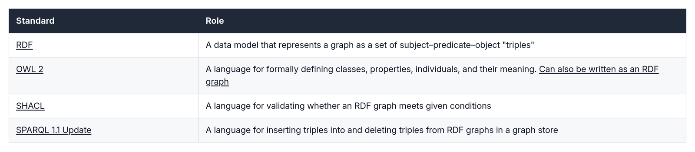
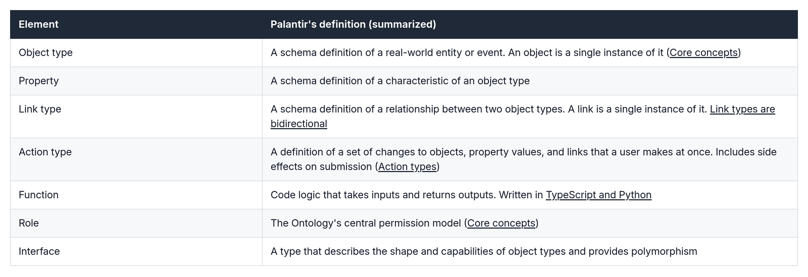
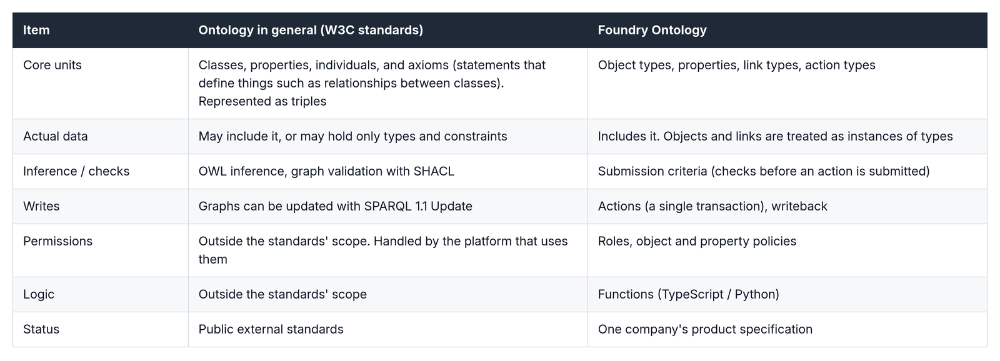
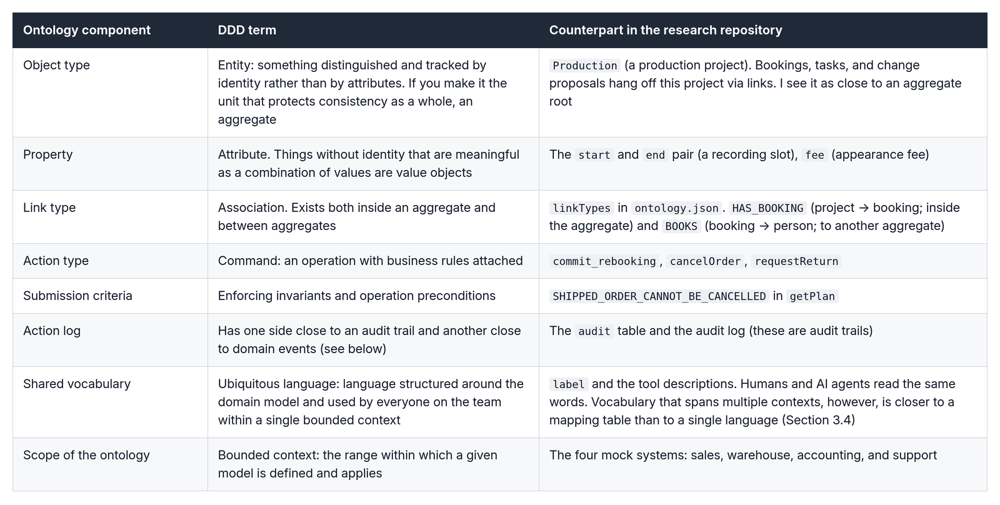
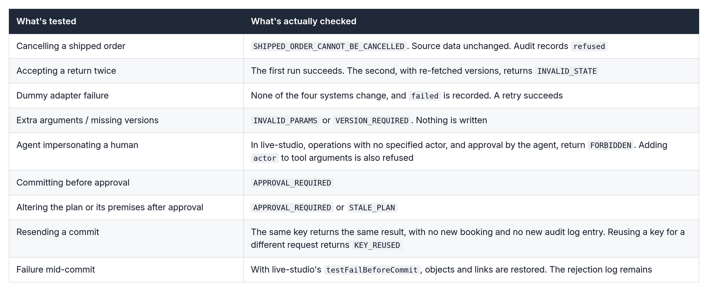
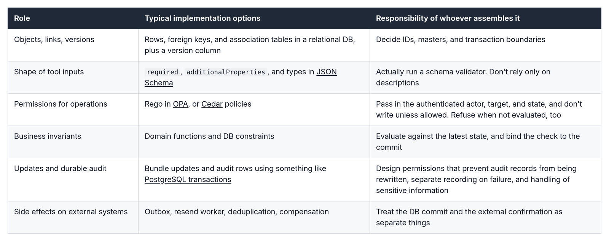

[[COVER BANNER EN - pending]]

# [I explained ontology on PIVOT] Why Palantir's Foundry Ontology can be read as DDD domain modeling

> *This is an English version of my original Japanese article on the Canly Tech Blog, published on November 17, 2026 (JST): [「【PIVOTでオントロジーを解説しました】PalantirのFoundry OntologyはDDDのドメインモデリングとして読めるという話」](https://zenn.dev/canly/articles/121db874319244) (Japanese). Code excerpts are quoted verbatim from my research repository. I've translated the code comments, but UI labels and error messages inside the code are left in Japanese, as in the original. Links marked "(Japanese)" go to Japanese-language sources.*

I'm Takahiro Hagino, CAIO (Chief AI Officer) at Canly.

My third appearance on the business video media outlet "PIVOT" was released on November 14, 2026! This time the theme was "ontology." I talked about how far companies can automate their work with AI, and why they need an ontology to do it. Please watch, like, and share!

https://www.youtube.com/watch?v=_V7IF1XdNLQ

There's an article version of the episode on [the PIVOT website (Japanese)](https://pivotmedia.co.jp/movie/15261).

## Picking up where PIVOT left off, for engineers

PIVOT is a business media outlet, so on the show I deliberately stayed away from technical details. For a general audience, I've [summarized what I said on the show in a note post (Japanese)](https://note.com/haginota/n/nbf04863132cf), along with some follow-up on points raised in the comments.

This article is the technical companion to that. Before the recording, I read through the primary sources on ontology and built demos and experiments in a research repository. Here I write up what I thought through there, in the language of code and specifications.

To be honest, the details I deliberately left out of the show are exactly what I most wanted to write about.

I'll cover these seven topics:

- **Scope of the term**: Ontology in the general sense (RDF / OWL / SHACL / SPARQL) and Palantir's Foundry Ontology use the same word for different scopes
- **Types and instances**: Separating the blueprint layer from the layer of real data as a graph
- **Domain modeling**: Reading ontology in the language of DDD (Domain-Driven Design)
- **Actions**: Reading Foundry's "components that make things happen" by breaking it down into parameters, rules, submission criteria, writeback, and logs
- **Implementation**: How I built the action gate and the connection to LLM agents in the research repository (with code excerpts)
- **Getting closer to production**: Testing, writeback that doesn't duplicate on retry, schema changes, and how to build it with OSS
- **Size of the effect**: How much the "form" of the ontology helped in my own experiments (unpublished and not peer-reviewed)

A few disclaimers first:

- This article reflects my personal views. It is not the official position of PIVOT, Palantir, or my employer. It is also not a partnership or sponsored article.
- I link to sources for facts. I mark my own thinking with phrases like "I think" and "in my view." I checked the sources on November 16, 2026 (JST).
- All demos in the research repository are simulations running on fictional data. They do not represent PIVOT's organization, policies, systems, or business results.

![Side-by-side comparison of what counts as “ontology.” Left: ontology in general (W3C standards), with a type layer (classes, properties, constraints; RDF, OWL, SHACL, SPARQL) and optional actual data (knowledge graph). Permissions and writes to business systems are outside the standards' scope. Right: Foundry Ontology (Palantir), where types, contents (objects and links), and components that make things happen (actions, functions, permissions) are all inside what Foundry calls “ontology.” A dotted line marks the two type layers as the same layer. Footer: not better or worse, a difference in how much gets called by the same name.](https://raw.githubusercontent.com/haginot/sns-media-public/c1065d5f498690b07033bf66e8c2c815a7afc5d1/2026-11-16/zenn-ontology/en/figures/fig1.png)

*Figure 1: The difference in scope between what general ontology and Foundry Ontology call "ontology"*

## 1. First, pinning down what "ontology" refers to

On the show, I used the single word "ontology" for two different things, talking about one right after the other: ontology in the general sense, and Palantir's Foundry Ontology. I think not separating these was part of why a commenter pointed out that "the layers are getting mixed up." So let me separate them first.

If you use one word for two things back to back, it's only natural that the layers sound mixed. As the person who mixed them, I think the criticism is fair.

### 1.1 Ontology in general: types, relationships, and constraints

The definition most often cited in computer science is [Gruber's "an explicit specification of a conceptualization"](https://tomgruber.org/writing/ontolingua-kaj-1993.pdf). [Studer et al.](https://doi.org/10.1016/S0169-023X%2897%2900056-6) restated it as "a formal, explicit specification of a shared conceptualization."

The W3C standards for writing ontologies down each have a separate role.



Here is the show's "dots and lines" example written in Turtle (one of the syntaxes for RDF). I wrote this for illustration, and the values are made up.

*pivot-example.ttl*
```turtle
@prefix ex:   <https://example.org/pivot#> .
@prefix owl:  <http://www.w3.org/2002/07/owl#> .
@prefix rdfs: <http://www.w3.org/2000/01/rdf-schema#> .
@prefix xsd:  <http://www.w3.org/2001/XMLSchema#> .

# Types (schema)
ex:Episode  a owl:Class .
ex:Person   a owl:Class .
ex:features a owl:ObjectProperty ;
    rdfs:domain ex:Episode ;
    rdfs:range  ex:Person .
ex:publishedAt a owl:DatatypeProperty ;
    rdfs:range xsd:date .

# Instances (actual data; values are made up for illustration)
ex:ep001 a ex:Episode ;
    ex:publishedAt "2026-11-14"^^xsd:date ;
    ex:features ex:guest001 .
ex:ep002 a ex:Episode .
```

The technically important point is that `rdfs:range ex:Person` is **not a constraint** saying "whatever features points to must be a Person." Under RDFS and OWL semantics, it means "you may **infer** that whatever features points to is a Person." The [OWL 2 Primer](https://www.w3.org/TR/owl2-primer/) uses domain and range examples to explain that a reasoner can derive the class of an individual. The same Primer also says that OWL 2 is not a database framework, and that it treats a fact that isn't stated not as false but as something that "may simply be missing" (the open-world assumption).

If you want a check like "there must be at least one guest," you write it in SHACL.

*pivot-shapes.ttl*
```turtle
@prefix ex:  <https://example.org/pivot#> .
@prefix sh:  <http://www.w3.org/ns/shacl#> .
@prefix xsd: <http://www.w3.org/2001/XMLSchema#> .

ex:EpisodeShape a sh:NodeShape ;
    sh:targetClass ex:Episode ;
    sh:property [
        sh:path ex:features ;
        sh:class ex:Person ;
        sh:minCount 1 ;
    ] ;
    sh:property [
        sh:path ex:publishedAt ;
        sh:datatype xsd:date ;
        sh:maxCount 1 ;
    ] .
```

I ran validation with pySHACL 0.40.2, both without inference and with RDFS inference.

*Output (showing only the Focus Node and Message lines)*
```text
--- inference=none conforms=False
Focus Node: ex:ep001
Message: Value does not have class ex:Person
Focus Node: ex:ep002
Message: Less than 1 values on ex:ep002->ex:features
--- inference=rdfs conforms=False
Focus Node: ex:ep002
Message: Less than 1 values on ex:ep002->ex:features
```

Without inference, the class check fails because `ex:guest001` has no `a ex:Person` stated. With RDFS inference turned on, "guest001 is a Person" is derived from the range, so that violation goes away. `ex:ep002`, which has no guests at all, fails either way. The same "type information" gives different results depending on whether it acts as inference or as validation.

This difference comes from two different underlying assumptions. OWL rests on the open-world assumption, so when a reasoner sees `ex:ep002` with no guest stated, it does not conclude "there are no guests." It treats the guest as possibly just not written down yet. [SHACL](https://www.w3.org/TR/shacl/) checks whether the data graph being validated satisfies the conditions of the shapes. Whether inference is used alongside it is decided by the processor's settings or by `sh:entailment`. In the run above, I switched inference on and off through the processor's (pySHACL's) settings. And if you write something like `sh:minCount 1`, a missing value is itself a violation.

Most business rules take the latter form. There are conditions that must hold whenever you look (invariants, e.g. "the total cost of confirmed bookings must not exceed the budget") and conditions on whether a given operation is allowed (preconditions, e.g. "an order that has already shipped cannot be canceled"). Neither is about filling in missing facts. Both are checks that give a pass or fail based on the data as it stands.

Treating what isn't written as possibly just not written yet is the honest stance on the inference side. But what business needs is an answer: given the data in hand right now, do we let this through or stop it?

If you write rules as inference, data that doesn't fit the rule may produce a new derived fact instead of a violation. That's exactly what happened in the example above, where `ex:guest001` was inferred to be a Person and the class check passed.

So my view is that business invariants and preconditions are easier to handle when written as validation rather than inference. By validation I mean SHACL, or the submission criteria on actions that we'll look at in Section 4. Inference suits situations where it's fine to fill in facts, such as classification or mapping between vocabularies.

![Inference and validation do different jobs. A small graph of ep001 and ep002 (episodes) and guest001, with `features rdfs:range Person` and `sh:class Person / sh:minCount 1`. Left panel, without inference: guest001 is not stated as a Person and fails the class check; ep002 has zero guests and fails minCount. Right panel, with RDFS inference: guest001 is inferred as a Person from range, so that violation goes away; the minCount failure remains. Footer: OWL doesn't treat unstated facts as false (open-world assumption); write required checks in SHACL. Illustrative example, run with pySHACL 0.40.2.](https://raw.githubusercontent.com/haginot/sns-media-public/c1065d5f498690b07033bf66e8c2c815a7afc5d1/2026-11-16/zenn-ontology/en/figures/fig2.png)

*Figure 2: The same range declaration works as inference in OWL / RDFS and as validation in SHACL*

Graph updates can be written in SPARQL 1.1 Update.

*update.rq*
```sparql
PREFIX ex: <https://example.org/pivot#>
DELETE { ?ep ex:features ex:guest001 }
INSERT { ?ep ex:features ex:guest002 }
WHERE  { ?ep a ex:Episode ; ex:features ex:guest001 }
```

However, what the standard defines here stops at "how to rewrite the triples." **Who may make this update, under what conditions it may run, and how it gets reflected in external business systems** are outside the scope of these standards. SPARQL 1.1 Update's security considerations section does urge implementations to apply their own permission mechanisms, but it doesn't define those mechanisms. Of course, platforms built on OWL or RDF may well have their own separate permission and write mechanisms.

### 1.2 Foundry Ontology: the blueprint, plus the contents and the "components that make things happen"

[Palantir's Core concepts](https://www.palantir.com/docs/foundry/ontology/core-concepts) describes an ontology as "a categorization of the world," and explains that in Foundry it is "the digital twin of an organization." It positions the Ontology as bringing datasets and models together in one place by mapping them to object types, properties, link types, and action types.

The [Ontology overview page](https://www.palantir.com/docs/foundry/ontology/overview) says the Ontology includes both **semantic elements** (objects, properties, links) and **kinetic elements** (actions, functions, dynamic security). The [architecture explainer](https://www.palantir.com/docs/foundry/architecture-center/ontology-system) is more direct: it states explicitly that the Ontology is not a "semantic layer." Its explanation is that nouns (objects) can't represent decisions unless they're paired with verbs (actions).

Here are the building blocks, using the official definitions.



[Core concepts](https://www.palantir.com/docs/foundry/ontology/core-concepts) also shows how these map to datasets: an object type corresponds to a dataset, an object to a row, a property to a column, and a link type to a join. Here too, **types and instances are clearly distinguished**.

### 1.3 Side by side



"Outside the scope" means the standards don't specify it. This isn't a comparison of which is better. I see it as **a difference in where you draw the line around what you call "ontology."**

So is the broader cut the better one? No, that's a separate question. What differs is where the line is drawn, not which one ranks higher.

## 2. Types and instances: "knowledge graph" and "object graph"

![Types and instances are different layers. The upper plate is the type layer (object types, link types, properties): Theme, Episode, and Person, linked by ABOUT / covers and FEATURES / features, with properties publishedAt (publish date) and durationSeconds (length). This is close to “classes and properties” in ontology in general. The lower plate is the instance layer (objects and links): Theme: AI, Episode A, Episode B, Person X, Person Y. What is called a knowledge graph or object graph is mainly this layer. Episodes and people are fictional data.](https://raw.githubusercontent.com/haginot/sns-media-public/c1065d5f498690b07033bf66e8c2c815a7afc5d1/2026-11-16/zenn-ontology/en/figures/fig3.png)

*Figure 3: Object types, link types, and properties (the type layer), and objects and links (the instance layer)*

On the show, I said that "an ontology itself is not a graph" (around 15:02). Here I'll put it more precisely. [An OWL ontology can also be written as an RDF graph](https://www.w3.org/TR/owl2-mapping-to-rdf/), so flatly saying "it is not a graph" went too far. What I meant was that **the type definitions and the graph of actual data you build according to them sit in different layers**.

Even if what I meant was correct, an imprecise way of saying it is still imprecise. This restatement, not my remark on the show, is the correct version.

Also, around 14:47 on the show, I described a graph as "points connected by lines." The graph I mean here is not the graph of a function but [a graph in the graph-theory sense](https://diestel-graph-theory.com/): a pair G=(V,E) of a set of vertices and a set of edges. A viewer pointed this out, and they were right. I wrote about it in more detail in [section 3-1 of my note post (Japanese)](https://note.com/haginota/n/nbf04863132cf).

Palantir's own wording also varies from document to document.

- The July 2023 [white paper for the semiconductor industry](https://www.palantir.com/assets/xrfr7uokpv1b/2T3BgBpe3drnqBaSTCXl6O/bdc9445d10053eb84b3f9487e63fc2d7/Whitepaper_-_Accelerating_Research_and_Development_in_the_Semiconductor_Industry.pdf) has a diagram of a "knowledge graph" that is built through the ontology and placed at the center.
- A [2022 official blog post](https://blog.palantir.com/ontology-finding-meaning-in-data-palantir-rfx-blog-series-1-399bd1a5971b) says you define objects, attributes, and relationships, link them together, and build the "object graph" that the ontology defines.
- The core phrasing in the [product documentation](https://www.palantir.com/docs/foundry/ontology/core-concepts) isn't a graph at all, but a "digital twin of the organization."

I read these as different ways of emphasizing different aspects of the same thing. Here's how I'd organize it:

- The type layer: object types, link types, and properties. Close to the "classes and properties" of an ontology in the general sense.
- The instance layer: objects and links. Viewed as points and lines, this is what gets called a knowledge graph or an object graph.
- The layer that makes things happen: actions, functions, and permissions. It determines under what conditions, by whom, and how the instance layer may be changed.

General discussions of ontology mostly deal with the first two. Foundry calls all three together "the ontology."

While I'm at it: the same blog post uses the phrase "the centralized contract the ontology represents." The context is that if the logic tied to objects is also kept in a changeable form, applications can use that contract more easily. When I said on the show that it's "closer to a contract than to AI memory," that was my own analogy. Palantir's product documentation doesn't explain it with the word "contract." In the product's own vocabulary, it would be permissions, submission criteria, and auditing.

## 3. Reading the ontology as domain modeling

Of all the takes on ontology I read, the one I found most compelling is the view that Foundry's ontology is what software design calls **domain modeling**. Domain modeling is the work of mapping the things and events that come up in a business, along with their relationships and rules, onto the structure of software.

Why did it resonate with me so much? When I asked myself, the answer was simple: the vocabulary of an unfamiliar product became readable in the familiar vocabulary of design. That's the whole of it. Not "the same thing," just "readable as." I intend to keep that distance all the way through.

### 3.1 gura's "reverse domain modeling"

gura worked through Palantir Foundry's official training courses and then wrote an article titled ["The true nature of ontology is 'reverse domain modeling'"](https://x.com/gura105/status/2077153028982133080) (Japanese). The article maps the terms as follows (quoted from the article):

- Object = entity (domain object)
- Link = association between entities
- Action = method / command (an operation with business rules attached)
- Ontology as a whole = domain model

The core of gura's argument is the order of construction. A typical business application is built in the order "(requirements →) model → physical → application." In Foundry, it becomes "(requirements →) physical → model → application." You first gather the data scattered across existing systems, then give it business meaning on top. gura calls this reversal of the process "reverse domain modeling."

The other point is whether you can only read, or also write. The article contrasts data warehouses and BI as "Read Only" with Foundry as "Read & Write." It argues that because writing requires business rules, you need domain modeling, which carries behavior and rules. gura's view is that calling it an "Operational Ontology" (an ontology you can operate on), as distinct from read-only ones, is closer to what it actually is.

In the article's notes, gura adds three caveats:

- What is "reversed" is the order of the process, not how the model is built. The stance of modeling by looking at the real business is the same as in everyday development; only the starting point differs. As support, gura cites the line from Palantir's design guidance: "model the real world, not the source data."
- DDD (domain-driven design) has the concept of a "bounded context." Sales' "order" and accounting's "order" may be different concepts, and attempts to build a single unified model for the whole company tend to break down. gura says they want to check, through real deployment cases, how far Foundry can get past this hard part.
- Reversing the process is not unusual in itself. When rebuilding an application on top of an old database, engineers do "physical → model" all the time. What's new about Foundry, gura says, is not the direction but that it tries to carry this all the way through as a product, company-wide, with writes.

I strongly agree with this view. It lets me explain, in a software engineer's vocabulary, the part I couldn't sum up concisely on the show when asked "What is an ontology?"

### 3.2 Mapping it to DDD terms and to code in the research repository

From here on, this is my own breakdown. I align the DDD terms with the definitions in Eric Evans's [DDD Reference](https://www.domainlanguage.com/ddd/reference/). The right-hand column shows the corresponding pieces in the research repository.



The last row is quickest to see in code. `operational-ontology-demo` holds the "status" of each of the four systems as a separate field.

*demos/operational-ontology-demo/business-engine.mjs (lines 7–12)*
```js
const CONTEXTS = {
  sales: { name: '販売管理', type: 'Order', key: 'orderNo', field: 'status' },
  warehouse: { name: '倉庫・出荷', type: 'Shipment', key: 'shipmentNo', field: 'state' },
  accounting: { name: '請求・会計', type: 'Invoice', key: 'invoiceNo', field: 'state' },
  support: { name: '顧客対応', type: 'Case', key: 'caseNo', field: 'state' },
};
```

An order that is "accepted" in sales may be "shipped" in the warehouse. Even for the same order, what the status means differs from context to context. The ontology doesn't collapse these into a single "order status"; it lays them side by side, connected by links. I named the test exactly that: `four bounded contexts preserve different status meanings and explicit links`.

Which system owns which field is also written down as a table.

*demos/operational-ontology-demo/business-engine.mjs (lines 17–21)*
```js
const AUTHORITY = {
  'Customer.name': 'sales', 'Order.status': 'sales', 'Shipment.state': 'warehouse',
  'Invoice.state': 'accounting', 'Case.state': 'support',
  'Case.assignee': 'ontology', 'Case.notes': 'ontology',
};
```

The only things the ontology itself owns are the support case's assignee and notes. The master for every other value stays in the original system.

The other demo (live-studio; Section 5.5) also checks link types on every write. You cannot create a relationship between a combination of types that isn't in the definition.

*demos/pivot-live-studio/engine.mjs (lines 60–62)*
```js
  insertLink(l){
    const def=ontology.linkTypes.find(t=>t.id===l.type),s=this.get(l.source),t=this.get(l.target);
    requireTrue(def && s.type===def.source && t.type===def.target,'INVALID_LINK','関係の型が定義と一致しません。');
```

### 3.3 Where the analogy stops fitting

The mapping table is handy, but there are places where it doesn't line up.

Wait, though. A table that fills in neatly is not the same as everything overlapping. If anything, the limits of the mapping show up in the rows that don't line up.

- Scope: DDD splits models by bounded context. Foundry's [Core concepts](https://www.palantir.com/docs/foundry/ontology/core-concepts) describes the ontology as the "digital twin of an organization." How much to consolidate into a single model is, as gura cautioned, a question that I think is still unanswered.
- Permissions: DDD is a way of thinking about designing models; it doesn't deal with mechanisms for who may see what. Foundry keeps object and property policies on the ontology side (Section 4.4).
- Writeback: A DDD aggregate usually owns its own data. Foundry actions sometimes write back to the original business systems. As with `AUTHORITY` above, this means changing values whose master lives elsewhere, by going through the ontology.
- Logs and domain events: The DDD Reference describes a domain event as "something happened that domain experts care about" and treats it as part of the domain model. The same document also says that an audit trail can be used for tracing but is usually not suited to being used in program logic. The audit log in the research repository is, in character, this kind of audit trail. Foundry's [Action log](https://www.palantir.com/docs/foundry/action-types/action-log) records successful action submissions as objects, and the docs describe using them as inputs to decision-making workflows as well. In that respect, I read it as a mechanism that can also be used in a way close to domain events.

### 3.4 Not one model for the whole company: designing it as a layer that connects boundaries

I think gura's second caveat (bounded contexts) is the central question when designing an ontology. Build a single company-wide "order" model and you run into bounded contexts. So how should you design an ontology? My answer is to design it **not as the place where you build a company-wide common model, but as the place where you write down the relationships between contexts**. What follows are my design guidelines, which I firmed up while building the research repository.

I feel the pull too: consolidating everything into one company-wide model would be quicker. But isn't that speed just postponing the collisions at the boundaries? Asking myself that is how I arrived at the following guidelines.

What you share is IDs, not models. In the cancellation and return demo, covered in detail in Section 5.3, the sales row holds the shipment number and the invoice number. The warehouse, accounting, and support rows are matched on those numbers and also on the order number. Support is matched on the customer code as well.

*demos/operational-ontology-demo/business-engine.mjs (lines 104–112)*
```js
  #records(orderId) {
    const sales = this.#sources.sales.find(row => row.orderNo === orderId);
    if (!sales) return null;
    const records = {
      sales, warehouse: this.#sources.warehouse.find(row => row.shipmentNo === sales.shipmentNo && row.orderNo === orderId),
      accounting: this.#sources.accounting.find(row => row.invoiceNo === sales.invoiceNo && row.orderNo === orderId),
      support: this.#sources.support.find(row => row.orderNo === orderId && row.customerCode === sales.customerCode),
    };
    return Object.values(records).every(Boolean) ? records : null;
```

All four systems point to the same order, "O-1042." But the name of the status field (`status` in sales, `state` elsewhere), the current value (`accepted` in sales, `shipped` in the warehouse, `issued` in accounting, `open` in support), and the system that holds the master all differ. Matching IDs is not a reason to use the same model. Agree on how IDs correspond, but leave the contents of each model to its owner. What the ontology holds as definitions is this correspondence and the kinds of links.

**What goes into the ontology is the promises that cross boundaries.** Which system holds the master for which value (`AUTHORITY`), which IDs connect things, and what each action requires of multiple systems (`TARGETS`). There's no need to centralize rules that stay closed inside each system. You write down, in machine-readable form, only the promises to keep when crossing a boundary. (In the demo, `AUTHORITY` and `TARGETS` are declarative tables, while the ID connections are written in the `#records` code above.) In DDD terms, think of it as holding the map of context relationships (the Context Map) not as a diagram but as an executable definition.

**Model boundaries and transaction boundaries are different things.** A bounded context is the range within which a given model is defined and applicable. It is not the range you commit together in one go. The range you commit at once is determined by the invariants that must hold at the same time. That's the idea of an aggregate in DDD.

The actions in the research repository include examples of both. live-studio's `commit_rebooking` commits the project, bookings, and tasks together within a single SQLite database. By contrast, the cancellation and return demo's `cancelOrder` spans four contexts. The demo swaps them all at once in memory, but with four real systems, each would be its own transaction boundary. So the action definition becomes the place where you decide "how much to commit together, and from where to reflect changes later and reconcile."

To get closer to production, you make **intermediate states** like "accepted in sales, not yet confirmed as reflected in the warehouse" explicit as business states. You don't silently resend while it's unconfirmed; you reconcile and verify the result. You also decide who recovers, and by what procedure. This design leads into the discussion of retries in Section 6.2.

What you make common is the operating mechanism, not the business model. Even for the same "order," the meaning and constraints differ from company to company. I don't think you can hand out a single, pre-finished ontology and apply it across a whole company or to other companies. What can be made common is the way you write down business types, relationships, actions, permissions, masters, and versions, along with the mechanisms that check, execute, record, and keep safely changing them. The business model itself, I think, is something each company builds through dialogue with the people who know the business.

The same goes for AI agents. AI won't automatically unify the meaning of scattered data for you. You first define where the master for each value lives (`AUTHORITY` in Section 5.3) and what may be done under whose permissions, and then, within that scope, you have the AI propose typed actions. The agent demo in Section 5.5 puts permissions and approval together in this order.

## 4. Breaking down action types

![An action defines how things get changed. Six steps: ① Parameters (input types); ② Submission criteria (who, and in what state; can be submitted only when all are met); ③ Rules (create, modify, delete objects and links / function rules); ④ Applied in a single transaction; ⑤ Writeback and side effects (writeback dataset, business systems / notifications, webhooks); ⑥ Action log (records successful submissions only). A rejection branch from step ②: not met → cannot submit (failures are tracked in action metrics). A permissions rail: roles / object and property policies (cell-level). The author’s view: this whole set of constraints is a “harness” (not a Palantir term). Example: change a flight's aircraft — only if the user is in the flight controllers group and the aircraft is in service.](https://raw.githubusercontent.com/haginot/sns-media-public/c1065d5f498690b07033bf66e8c2c815a7afc5d1/2026-11-16/zenn-ontology/en/figures/fig4.png)

*Figure 4: The flow of an action: parameters → submission criteria → rules → writeback and side effects → action log*

At the center of Foundry Ontology's "components that make things happen" are actions. [Action types](https://www.palantir.com/docs/foundry/action-types/overview) describes an action as "a single transaction that changes the properties of one or more objects, based on user-defined logic." The official example is "Assign Employee," which changes an employee's role. It has the user enter the new role in a form, creates a link to the new manager, notifies both the old and new managers, and validates that only authorized employees, such as those in HR, can run it.

Below, I go through the documentation one component at a time.

You could sum up an action as "a component that makes things happen." But a one-line summary hides what is constrained and how, so I'll break it down here.

### 4.1 Parameters: the action's inputs

[Parameters](https://www.palantir.com/docs/foundry/action-types/parameter-overview) are the inputs to an action type. Each one has a type, and you can set individually whether it appears in the form and whether the user can change it. In terms of LLM function calling, I understand this as the counterpart of the argument schema.

### 4.2 Submission criteria: may this be run?

[Submission criteria](https://www.palantir.com/docs/foundry/action-types/submission-criteria) (in the Japanese original I call these 実行条件, literally "execution conditions"), formerly called validations, are the conditions that decide whether an action may be submitted. Here are the points that struck me as important while reading:

- Conditions are written using three templates: "current user," "parameter," and "execution context." You can use user attributes such as user ID, groups, and organization.
- Conditions can be combined with operators and nested. **An action cannot be submitted unless all of them are met.**
- Submission criteria are separate from the permission to edit the action type itself.
- Even when one object type has several action types, each action type has its own independent submission criteria.

The official example is an airline. An action that changes the aircraft assigned to a flight can be submitted only by users in the flight controllers group, and only while the aircraft is still in service. **Who** and **in what state** are constrained together in a single logical expression.

### 4.3 Rules: what gets changed

[Rules](https://www.palantir.com/docs/foundry/action-types/rules) are the logic that turns parameters into ontology edits and other effects.

- Ontology rules: create, modify, and delete objects. Create and delete many-to-many links. One-to-many and one-to-one links are created by modifying a foreign key property.
- Function rules: call a function that edits the ontology. When you use one, you cannot combine it with other rules. The documentation explains this is because a function alone can handle everything the other rules can do.
- Side effects: notifications and webhooks. Notifications are sent after the edits are applied, but their content is built from the state before the edits. Webhooks send a request to an external system, and you can choose whether they run before or after the edits.

### 4.4 Writeback, permissions, and logs

- Writeback: According to [Action types](https://www.palantir.com/docs/foundry/action-types/overview), the latest object data reflecting user edits is kept in the object type's writeback dataset. The architecture overview also says that actions are written back to operational and edge systems.
- Permissions: Ontology data is protected by [object and property policies, or datasource policies](https://www.palantir.com/docs/foundry/object-permissioning/managing-object-security). These support cell-level control that combines rows and columns.
- Logs: When the [Action log](https://www.palantir.com/docs/foundry/action-types/action-log) is enabled, successful action submissions are recorded as objects. It's a mechanism for answering "who decided what, when, and in what context." The documentation states explicitly that **only successful submissions are recorded, not failures**. Failures are tracked separately, through action metrics.

Broken down this way, the difference from SPARQL Update's "rewriting triples" becomes clear. An action bundles input types, the conditions for submission, the content of the change, side effects on external systems, and recording into a single definition.

### 4.5 "Harness" is my own framing

On the show, I called these constraints a "harness." **This is not a Palantir term. It is my own way of looking at it.** I put that in bold because, more than anything, I want to avoid my phrasing taking on a life of its own as product terminology.

I think the background is how demanding the settings where Palantir has been used are. For example, on July 31, 2025, the U.S. Army [announced an enterprise agreement with Palantir](https://www.army.mil/article/287506/u_s_army_awards_enterprise_service_agreement_to_enhance_military_readiness_and_drive_operational_efficiency). It consolidates 75 contracts (15 prime contracts and 60 related ones) into one, with a term of up to 10 years and a ceiling of up to $10 billion. The announcement notes that this figure is the maximum potential value of the agreement, not a specific payment obligation or commitment.

In settings like national defense, where a wrong operation is not acceptable, I believe you need to constrain what AI and systems are shown and what they are allowed to do, using permissions, submission criteria, and audit logs. I call this standard "defense-grade," and I call the whole set of constraints a "harness." Neither is a Palantir term.

## 5. How I built it in the research repository

![Inside the research repository pivot-ontology. Top row, public data: ① Collect (public data from PIVOT's official YouTube channel); ② Normalize (Episode / MetricsSnapshot); ③ Extract (rules / LLM); ④ Schema (schema.yaml, with provenance: public, owner, derived, computed, external); ⑤ Graph and aggregates (the 212 episodes that are “fully collected AND public for 30+ days”). Below, a simulation on fictional data: Demo 1 operational-ontology-demo (operations spanning four business systems; cancel and return as separate actions); Demo 2 pivot-live-studio (a real Codex agent + human approval); Demo 3 pivot-team-agent-demo (the demo used on the show; runs to a script). At right, pivot-ontology-basis for verification (A plain text / B glossary / C ontology / Z no knowledge; unpublished, not peer-reviewed). Legend: public data, synthetic data, evaluation data.](https://raw.githubusercontent.com/haginot/sns-media-public/c1065d5f498690b07033bf66e8c2c815a7afc5d1/2026-11-16/zenn-ontology/en/figures/fig5.png)

*Figure 5: Structure of the research repository: collecting public data → schema → graph and aggregation → demos (fictional data) → verification*

To prepare for the show, I set up a research repository (pivot-ontology, private for now). It holds two things: an attempt to map the relationships between episodes, people, and themes from public data on PIVOT's official YouTube channel, and several demos of the side that makes an ontology "move."

The first thing I settled was how to keep data apart. The demo ground rules for the show (`demos/pivot-team-agent-demo/CLAIMS.md`) give separate labels to **PIVOT's public YouTube data, synthetic data for internal business operations, and recorded evaluation data**. All the people, internal roles, policies, and amounts in the demos below are fictional.

### 5.1 Schema: recording provenance for each property

I wrote the schema in YAML (`ontology/schema.yaml`). One deliberate choice was giving every property and relation a `provenance`. Here's an excerpt.

*ontology/schema.yaml (excerpt)*
```yaml
relations:
  - {name: PART_OF, from: Episode, to: Series, provenance: derived}
  - {name: HOSTED_BY, from: Episode, to: Person, provenance: derived}
  - {name: FEATURES, from: Episode, to: Person, provenance: derived, note: ゲスト出演}
  - {name: AFFILIATED_WITH, from: Person, to: Organization, provenance: derived}
  - {name: ABOUT, from: Episode, to: Theme, provenance: derived, properties: {weight: float}}
```

There are five kinds of `provenance`: `public` (can be pulled mechanically from YouTube's public data), `owner` (only the channel owner can get it, such as audience retention), `derived` (inferred from public data by an LLM or by rules), `computed` (calculated by traversing the graph), and `external` (from an external source).

Some values, like audience retention, can't be obtained without PIVOT's cooperation. I still put them in the schema from the start, as `owner` fields. The point is to write down **what can and can't be obtained** in the schema itself.

I also ran into a small problem. YAML 1.1 reads bare `ON` and `NO` as booleans. I named the relation for a comment attached to a video `ON`, and the relation name turned into `True`. A structural check script now catches this automatically.

*scripts/validate_schema.py (excerpt)*
```python
    for rel in doc["relations"]:
        rname = rel.get("name")
        if not isinstance(rname, str):
            errs.append(
                f"関係名が文字列でない: {rname!r} — YAML 1.1 の ON/OFF/YES/NO 問題。クォートする"
            )
            continue
```

*Output*
```text
PASS  entities=12 relations=16 computed_kpi=6 version=1.0.0
```

It's nowhere near as expressive as SHACL, but the idea is the same: use a machine to check that the schema keeps its own promises.

### 5.2 Enforcing the denominator of aggregates in code

Once I started collecting public data, sampling bias became a problem right away. The 752 episodes collected so far are a mix of two sets: 340 episodes from May 19, 2026 onward, taken in full from the top of the listing, and 412 earlier episodes selected from the top by view count. Put both in the same table and you get the wrong conclusion that older episodes perform better.

Do older episodes really do better? Wait. They only look stronger because the older side contains nothing but episodes picked from the top by views. The point is not to mistake a sampling bias for performance.

So I restricted in code which episodes can be used in aggregates.

*src/pivot_ontology/viz.py (excerpt)*
```python
    for n in ep_nodes:
        n["mature"] = n["age_days"] >= MATURE_DAYS
        n["sample"] = "complete" if (n.get("date") or "") >= COMPLETE_FROM else "top_views"
        # Only episodes that are both "fully collected AND mature" can count toward aggregate KPIs
        n["countable"] = n["mature"] and n["sample"] == "complete"
```

`COMPLETE_FROM` is `"2026-05-19"`. Aggregates only cover the 212 episodes that fall within the fully collected period and have been public for at least 30 days. This drifts a little from the ontology topic, but I think it's a small, concrete example of **writing down "which data may be used for which decision" as a rule, too**.

### 5.3 The kinetic side: making "cancel" and "return" separate actions

`demos/operational-ontology-demo` demonstrates operations that span four mock systems: sales, warehouse, accounting, and support. It's an in-memory simulation, and the data is fictional.

It encodes, as conditions on actions, the rule I mentioned on the show: "a shipped order can't be cancelled; it's handled as a return." Cancellation (`cancelOrder`) and accepting a return (`requestReturn`) are separate actions. I don't fold them into a single "stop the order" operation that branches internally. Each one has its own set of states it may change and the states it leaves behind.

*demos/operational-ontology-demo/business-engine.mjs (lines 13–16)*
```js
const TARGETS = {
  cancelOrder: { sales: 'cancelled', warehouse: 'cancelled', accounting: 'void', support: 'resolved' },
  requestReturn: { sales: 'return_requested', warehouse: 'return_expected', accounting: 'credit_review', support: 'awaiting_return' },
};
```

Decisions are based on **the latest state in the source systems**, not on a local projection (copy). The comment just above `getPlan` says so too: `Dry run reads latest sources, never a potentially stale projection.` An order can be "accepted" in sales management while it's already "shipped" in the warehouse.

### 5.4 If you build an "action gate" into your own stack

Let me take the cancel/return demo apart a bit more. `getPlan` is read-only plan creation. `execute` is the entry point for writes. **A plan's `ok: true` is not treated as permission to execute that stays valid from then on.** At execution time, the input, the source data versions, and the business conditions are all checked again.

If the plan passed, why not just execute it? That's the tempting thought. But the plan only saw the data as it was when the plan was made. Having passed in the past and being allowed to execute now are completely different things.

#### Narrow the input. If the conditions aren't known, don't let it through

First, `execute` accepts only allowed operation names and arguments. The following is a contiguous excerpt from the source.

*demos/operational-ontology-demo/business-engine.mjs (lines 150–158)*
```js
    const refuse = (code, message) => this.#record(base, 'refused', code, message);
    const ownedAction = action === 'assignCase' || action === 'addCaseNote';
    if (typeof action !== 'string' || (!ownedAction && !Object.hasOwn(TARGETS, action))) return refuse('UNKNOWN_ACTION', '公開されていない業務操作です。');
    if (!validInput) return refuse('INVALID_PARAMS', '業務操作の引数をオブジェクトで指定してください。');
    const allowed = ownedAction ? ['caseId', action === 'assignCase' ? 'assignee' : 'text'] : ['orderId', 'expectedVersions', 'reason'];
    if (Object.keys(input).some(key => !allowed.includes(key))) return refuse('INVALID_PARAMS', '定義されていない引数があります。');
    for (const key of allowed.filter(key => key !== 'expectedVersions')) {
      if (typeof input[key] !== 'string' || !input[key].trim() || input[key].length > 2000) return refuse('INVALID_PARAMS', `${key} は 1〜2,000 文字で指定してください。`);
    }
```

Strings are also checked to be non-empty and no longer than 2,000 characters. `expectedVersions` gets a separate check later to confirm that versions are present for all four source systems. Adding an undefined argument like `refund: true` can't add a refund operation. Whatever the model outputs, the server keeps the entry point narrow.

The business conditions live in `getPlan`.

*demos/operational-ontology-demo/business-engine.mjs (lines 123–129)*
```js
    if (action === 'cancelOrder' && records.warehouse.state === 'shipped') {
      return deny('SHIPPED_ORDER_CANNOT_BE_CANCELLED', '販売管理では受付済みですが、倉庫では出荷済みのため取消できません。');
    }
    const requiredShipment = action === 'cancelOrder' ? 'pending' : 'shipped';
    if (records.warehouse.state !== requiredShipment || records.sales.status !== 'accepted' || records.accounting.state !== 'issued' || records.support.state !== 'open') {
      return deny('INVALID_STATE', action === 'cancelOrder' ? '取消の業務条件を満たしていません。各業務の最新状態を確認してください。' : '返品受付は、出荷済みで未受付の注文が対象です。各業務の最新状態を確認してください。');
    }
```

An action can only proceed from an allowed combination of starting states. Unknown states also return `INVALID_STATE`. `requestReturn` means accepting a return. It doesn't mean the goods have been received or the refund is complete.

Note, however, that this `business-engine.mjs` **only records the actor; it doesn't implement user authentication or role-based authorization**. Checking submission criteria and checking permissions are separate things. The live-studio demo described later does have role checks, but that's also just separation of roles inside a local demo. In production, you'd need to establish an identity-verified actor on the server first, and then check their permission to perform the operation.

#### Compare the versions at read time with the versions at execution time

When a plan is created, `getPlan` builds a record of which version of which row in which system it read from the source data.

*demos/operational-ontology-demo/business-engine.mjs (line 122)*
```js
    base.expectedVersions = Object.entries(records).map(([system, row]) => ({ system, recordId: row[CONTEXTS[system].key], version: row.version }));
```

`execute` compares the versions sent by the client against versions built by re-reading the master data.

*demos/operational-ontology-demo/business-engine.mjs (lines 176–182)*
```js
    const versions = input.expectedVersions;
    if (!Array.isArray(versions) || versions.length !== plan.expectedVersions.length || versions.some(item => !item || typeof item !== 'object' || !Number.isInteger(item.version) || item.version < 1 || typeof item.system !== 'string' || typeof item.recordId !== 'string')) {
      return refuse('VERSION_REQUIRED', '4つの業務データすべての取得時バージョンが必要です。');
    }
    if (!plan.expectedVersions.every(expected => versions.filter(item => item.system === expected.system && item.recordId === expected.recordId && item.version === expected.version).length === 1)) {
      return refuse('STALE_VERSION', '取得後に元システムが更新されました。最新データを再取得して判断してください。');
    }
```

This is optimistic conflict detection. You build the proposal assuming no other operation has come in, then confirm with versions at the end. Because each entry must match exactly once, including the row ID, passing the same row's version twice or leaving one out won't get through.

`STALE_VERSION` doesn't mean "this request is invalid forever." It means "the assumptions behind the decision are out of date." You re-fetch the data and reconsider from the business conditions. In this demo the version check runs before the `plan.ok` check, so if you send an old cancellation proposal after the order has shipped, you get `STALE_VERSION` first.

#### Build the changes somewhere else, then swap them in at the end

Once the version and condition checks pass, the data for all systems is copied, and only the copy is modified.

*demos/operational-ontology-demo/business-engine.mjs (lines 184–190)*
```js
    // Every source write is staged into a detached local store before commit.
    const staged = clone(this.#sources);
    for (const effect of plan.effects) {
      const row = staged[effect.system].find(row => row[CONTEXTS[effect.system].key] === effect.recordId);
      row[effect.field] = effect.after;
      row.version += 1;
    }
```

Fault injection happens before the copy becomes the master.

*demos/operational-ontology-demo/business-engine.mjs (lines 191–198)*
```js
    if (this.#failNext) {
      this.#failNext = false;
      this.#events.push({ id: `BE-${this.#events.length + 1}`, event: 'adapter-failed', origin: 'simulated-adapter', system: 'accounting', target: input.orderId });
      return this.#record(base, 'failed', 'UPSTREAM_UNAVAILABLE', '会計アダプターの模擬障害で処理を中止しました。4つの模擬業務データはすべて未変更です。');
    }
    this.#sources = staged;
    this.reindex();
    return this.#record(base, 'applied', 'OK', action === 'requestReturn' ? '返品受付・入庫予定・会計確認・顧客対応を更新しました。商品の受領と返金は未完了です。' : '4つの業務の取消処理を模擬データへ反映しました。', plan.effects);
```

On success, the switch is a single line: `this.#sources = staged`. This in-memory processing runs synchronously, so no other call can cut in between the version check and the swap. That's why, within this scope, it never leaves a half-applied change behind.

But if you've written to a real warehouse API and the accounting API then goes down, throwing away the copy won't undo anything. The top of the file says so too: `Staging is atomic ONLY inside this in-memory simulator`. **This is not an implementation of distributed transactions.** And the memory disappears when the process exits.

#### The audit log keeps refusals and fault-injection failures, not just successes

Here is the demo's recording function.

*demos/operational-ontology-demo/business-engine.mjs (lines 137–141)*
```js
  #record(base, status, code, message, effects = []) {
    const id = `BA-${String(this.#audit.length + 1).padStart(3, '0')}`;
    this.#audit.push(clone({ ...base, id, sequence: this.#audit.length + 1, status, code, message, effects }));
    return clone({ ok: status === 'applied', status, code, message, effects, auditId: id });
  }
```

`base` holds the operation name, actor, target, and reason, and from the point where source data has been read, `sourceVersions` as well. On success, `effects` holds the before and after values for each changed field. Refusals, failures from fault injection, and successes are appended as `refused`, `failed`, and `applied`, respectively. **The full set of arguments is not stored.** `getPlan`, which only reads to build a plan, isn't audited either.

This "append-only" property applies to the normal execution path. `reset()` can erase the records. It isn't a tamper-resistant, persistent audit system. Also, Foundry's Action log records only successful submissions, so it works differently from this demo.

### 5.5 Connecting an LLM agent: AI proposes, humans approve

![AI proposes, humans approve. An LLM agent (Codex) sits on an ontology plate (definitions of types, relationships, actions) and uses ontology_schema, search_objects, traverse_graph, and get_object. The flow, left as drawn: change plan (proposal) — propose_rebooking; human approval — approve_plan (production lead only; not among the agent's tools); pre-execution check — check_plan (have the premises (versions) changed since approval?); commit — commit_rebooking (applied in one transaction); audit record (keeps both successes and refusals). A dotted loop: premises changed → can't commit → redo the plan. Footer: conditions for execution and who approves are bound by server-side definitions, not by the prompt. Fictional data; no Palantir products are used.](https://raw.githubusercontent.com/haginot/sns-media-public/c1065d5f498690b07033bf66e8c2c815a7afc5d1/2026-11-16/zenn-ontology/en/figures/fig6.png)

*Figure 6: Where the LLM agent sits: it reads the ontology, proposes changes, and nothing is finalized until those changes pass human approval and the submission criteria*

`demos/pivot-live-studio` is a local app. In it, a real LLM agent (it uses a logged-in Codex CLI) explores a knowledge graph of fictional people and shows, drafts a proposal to change the cast, and updates the business state after a human approves. All the people, companies, shows, and business conditions are fictional. As the README also says, this is not an implementation built on Palantir's products.

The types, relationships, and actions are defined in `ontology.json`. Here are the approval and commit actions:

*demos/pivot-live-studio/ontology.json (lines 33–34; the last two entries of the actions array)*
```json
    {"id":"approve_plan","label":"変更案を承認","roles":["producer"],"targets":["RebookingPlan"],"conditions":["expected_version","fresh_dependencies","all_constraints"],"effects":["この案に対する人の承認を保存"]},
    {"id":"commit_rebooking","label":"出演変更を確定","roles":["producer","agent"],"targets":["RebookingPlan","Booking","Production","Task"],"conditions":["human_approval","fresh_dependencies","availability","scoped_consent","budget_with_cancellation_fee","no_booking_conflict"],"effects":["新しい出演予約を作成","企画と費用を更新","台本・サムネイル・説明欄を再確認待ちに変更","全変更と履歴を同一トランザクションで保存"]}
```

Only one role can run `approve_plan`: `producer` (the production lead). The agent can create a plan (`propose_rebooking`) and commit an approved plan (`commit_rebooking`). It cannot approve. It has nine tools: `ontology_schema`, `search_objects`, `get_object`, `traverse_graph`, `get_production`, `evaluate_candidates`, `propose_rebooking`, `check_plan`, and `commit_rebooking` (the `TOOLS` list in lines 10–20 of `agent.mjs`). None of them is an approval tool.

The server-side execution function reads the roles from the action definition and verifies who is executing:

*demos/pivot-live-studio/engine.mjs (lines 131–135)*
```js
    this.db.exec('BEGIN IMMEDIATE');
    try{
      requireTrue(definition,'UNKNOWN_ACTION','未定義の操作です。');
      requireTrue(['producer','agent'].includes(actor),'FORBIDDEN','実行主体を確認できません。');
      requireTrue(definition.roles.includes(actor),'FORBIDDEN','この操作は制作責任者だけが実行できます。');
```

#### Mapping the ontology onto the LLM's tool definitions

It would be inaccurate to say that "everything is auto-generated from the ontology." This implementation has **two definitions: a business definition and a tool definition**.

1. `engine.mjs` loads `ontology.json`. This is the business definition, holding the names of the types, links, operations, roles, and conditions.
2. In `agent.mjs`, the tools handed to the agent are written by hand with `spec(...)`. Their input shapes use JSON Schema format.
3. `dynamicTools: TOOLS` in `thread/start` passes each tool's name, description, and input schema to Codex.
4. When the model calls `ontology_schema`, `invokeTool` returns the loaded `ontology` as is. That is how the model gets the business vocabulary and the names of the conditions.
5. When a call comes in, `validateArgs` checks it and `invokeTool` dispatches it to the right handler. The result goes back to the model as a JSON string.

This is the shape `spec` produces (verbatim):

*demos/pivot-live-studio/agent.mjs (lines 8–9)*
```js
const field = (type,description) => ({type,description});
const spec = (name,description,properties={},required=[]) => ({type:'function',name,description,inputSchema:{type:'object',properties,required,additionalProperties:false}});
```

For example, the commit tool lets the model pass only `planId`. Neither `actor` nor `approvedBy` is among the arguments the model can set.

*demos/pivot-live-studio/agent.mjs (line 19)*
```js
  spec('commit_rebooking','人が同じ案を承認済みで、最新の出演承諾・空き・予算を満たす場合のみ変更を確定。企画・出演予約・費用・制作タスクと履歴を一つのトランザクションで更新する。',{planId:field('string','変更案ID')},['planId'])
```

The tool definition sets `additionalProperties: false`, and `validateArgs` also checks for undefined keys, required keys, and strings, integers, and arrays. However, it is not a general-purpose JSON Schema validator. It is a function that implements only what this demo needs. A rule like "at least one evidence ID" isn't left to the tool description alone. A check in `engine.mjs` enforces it when the proposal is saved.

At the actual call site, the host also fixes who the executor is:

*demos/pivot-live-studio/agent.mjs (lines 45–48)*
```js
      case 'evaluate_candidates':return studio.allOf('Offer').map(o=>studio.evaluate(o.id));
      case 'propose_rebooking':return studio.execute(name,args,{actor:'agent',runId});
      case 'check_plan':return studio.validatePlan(args.planId);
      case 'commit_rebooking':return studio.execute(name,args,{actor:'agent',runId,idempotencyKey:'agent-commit:'+args.planId});
```

If the model adds `actor: "producer"`, the argument check rejects it. On top of that, no approval tool is exposed at all, and `engine.mjs` also checks the role on the approval action. The tool isn't just hidden. The execution side refuses as well.

There is also an important limitation. The `conditions` in `ontology.json` are the **names** of conditions. No executable code is generated from those strings. The actual checks live in the `requireTrue(...)` calls in `engine.mjs`. Tests are needed to keep the schema, the tools, and the execution code from drifting apart. In my view, if you generate input types or tools from the definition, the next improvement is to generate this part too.

Note that this demo uses Codex app-server's dynamic tools. It is not an MCP server implementation. If you move the same design onto MCP, it maps onto the `name`, `description`, and JSON Schema `inputSchema` described in the [MCP tool specification](https://modelcontextprotocol.io/specification/2025-06-18/server/tools). But having a protocol doesn't mean permissions are enforced. The same specification calls for server-side input validation and access control.

#### Tying approval to the saved plan, not to a piece of text

Before approval, a plan can be created even if it doesn't meet the conditions. This keeps "able to propose" separate from "able to execute." Approval and commit both require that the conditions are met.

Is it really okay to let the agent create plans that don't meet the conditions? Yes. What you need to stop is not the proposal. It's the proposal being executed as is.

`fingerprint()` is built from the schema version, the IDs and versions of `Production` / `Booking` / `Offer` / `Task`, and the IDs of all links other than `HAS_PLAN` / `SELECTS`. Links to the plan itself are excluded, so saving a plan does not by itself make its premises stale. On the other hand, this small demo includes all the candidates, so even a change to a candidate that wasn't chosen makes the plan stale.

`planHash` is a hash over the selected candidate, the reasoning, the evidence IDs, the diff, the fingerprint, and so on. It is saved at approval time and compared at commit time. The approval is no longer "someone approved something." It becomes "someone approved this plan, with this content."

*demos/pivot-live-studio/engine.mjs (lines 177–181)*
```js
        if(plan.properties.status==='committed'){result={plan,alreadyCommitted:true,message:'この案はすでに確定済みです。'};}
        else{
          requireTrue(plan.properties.status==='approved'&&plan.properties.approvedBy&&plan.properties.approvedFingerprint===plan.properties.fingerprint&&plan.properties.approvedPlanHash===planHash(plan.properties),'APPROVAL_REQUIRED','制作責任者による、この変更案への承認が必要です。');
          const validation=this.validatePlan(plan.id);requireTrue(validation.fresh,'STALE_PLAN',validation.message);requireTrue(validation.evaluation.feasible,'CONSTRAINT_FAILED','実行時の条件検査に失敗しました。');
          requireTrue(before.properties.status==='needs_rebooking','PRODUCTION_STATE','この企画は再手配待ちではありません。');
```

The diagram below summarizes the execution order in the local demo. The commit doesn't rely on the result of `check_plan`. Inside the commit transaction, it re-checks the approval, the versions of the premises, and the business conditions. A successful change and its audit log go into the same transaction. On failure, the transaction is rolled back and a rejection log is saved separately.


This diagram shows the order of the calls. Figure 6 shows how the roles are divided.

gura's other post, ["The ontology is the lead, and AI plays a supporting role"](https://x.com/gura105/status/2094162061609840667) (Japanese), helped me think about this design. Based on working through the official course, gura sees the ontology as the foundation that makes a business "machine-readable, machine-executable, and machine-verifiable." gura also writes that "what determines how far autonomy can extend is not the model's intelligence, but the supply of verifiability." That is gura's view.

I strongly agree with it. Whether or not the LLM is smart, you check in code that the arguments are correct, that the plan isn't stale, that the right person approved it, and that it isn't being executed a second time. In other words, **you design how much to delegate from what you can verify, not only from what you expect of the model**. That said, this demo guarantees only the conditions that were written down. It does not prove that the casting choice itself is sound, or that the business rules are complete.

This shape, where AI proposes and nothing is committed until it passes the checks, closely resembles the basic pattern Palantir officially describes. The [platform overview](https://www.palantir.com/docs/foundry/platform-overview/overview) explains that in most patterns, AI agents don't make changes directly. Instead they create a "proposal," which a human operator reviews and decides on. It also says that fine-grained permissions on actions act as a "control plane" that limits the data and tools an agent can use. The [AIP Logic](https://www.palantir.com/docs/foundry/logic/overview) docs likewise explain that you can choose whether ontology edits are applied automatically or routed to human review.

An LLM makes judgments that sound plausible in the moment. That's exactly why **you can leave the judgment to the LLM, but the conditions for execution and the approver should be bound by server-side definitions, not by the prompt**. This is what I hope for from the side of an ontology that makes things happen.

### 5.6 The demo on the show: a scripted simulation

The demo I showed in the second half of the show was `demos/pivot-team-agent-demo`. It runs for about four minutes: a cast member cancels, replacement candidates are found, a human approves, and the work is then passed on to the related tasks.

This is **a simulation that runs on fictional data and follows a script**. The demo's ground rules (`demos/pivot-team-agent-demo/CLAIMS.md`) state explicitly that this seven-part demo is not experimental evidence. They also say that the fictional people, rules, schedules, approvals, and sponsor conditions must not be presented as facts about PIVOT. The demo's evaluation screen is built to show "NOT RUN" on purpose, because no real evaluation has been run yet.

When something runs smoothly on screen, it's easy to mistake it for a result. That's exactly why my policy is to make the screen itself say that anything not evaluated has not been evaluated. The better the demo looks, the less room there is to compromise on this.

## 6. Moving toward production: tests, retries, schema changes, and OSS

From here on, I cover the issues that come up when you move the demo closer to a production system. I'll keep what exists in the research repository separate from general design options.

It would be easy if the story could end at "it worked in the demo." But working in a demo isn't proof that it will work in production. It's a list of the things you need to think about for production.

### 6.1 Verifying with tests: make the refusal conditions part of the spec

The research repository includes unit tests that run without calling a real model. One example is the case where, after the cancellation plan has been read, only the warehouse moves to a shipped state. The following is excerpted verbatim from `tests/business-engine.test.mjs`. `run` is a helper that executes with the current versions and overrides only the fields given in the last argument.

*demos/operational-ontology-demo/tests/business-engine.test.mjs (lines 55–68)*
```js
test('outdated planner cannot cancel after a warehouse-only external shipment', () => {
  const runtime = makeBusinessRuntime({ shipmentState: 'pending' });
  const plan = runtime.getPlan('cancelOrder');
  runtime.inject('ship');
  assert.equal(object(runtime, 'SH-804').state, 'pending');
  assert.equal(runtime.snapshot().sources.warehouse[0].state, 'shipped');
  assert.equal(run(runtime, 'cancelOrder', { expectedVersions: plan.expectedVersions }).code, 'STALE_VERSION');
  assert.equal(runtime.getPlan('cancelOrder').code, 'SHIPPED_ORDER_CANNOT_BE_CANCELLED');
  assert.equal(run(runtime, 'cancelOrder').code, 'SHIPPED_ORDER_CANNOT_BE_CANCELLED');
  runtime.reindex();
  assert.equal(object(runtime, 'SH-804').state, 'shipped');
  assert.equal(object(runtime, 'O-1042').status, 'accepted');
  assert.equal(run(runtime, 'requestReturn').ok, true);
});
```

The test deliberately creates a mismatch: the projection still says `pending` while the master says `shipped`. It then checks that executing with the old versions returns `STALE_VERSION`, and that a cancellation with re-fetched versions is refused because the order has already shipped. **A conflict and a business-rule violation are refused for different reasons.**

The tests also cover the following:



I ran the following locally (the comments below summarize the output). These are results from Node.js 24.22.1 on November 16, 2026 (JST). All 9 tests passed in the first suite and all 12 in the second. These results don't include the judgment accuracy of an actual LLM.

```sh
cd demos/operational-ontology-demo
node --test tests/business-engine.test.mjs
# tests 9 / pass 9 / fail 0

cd ../pivot-live-studio
node --test tests/engine.test.mjs
# tests 12 / pass 12 / fail 0
```

Note that there is **no dedicated test** for running a cancellation twice. You can tell from the state conditions in the code that it would be refused, but I keep that separate from "tested." If you resend with the same versions, the version check refuses it. If you re-fetch the updated versions, the business condition refuses it, because the order is no longer in its pre-cancellation state. Unlike the idempotency key below, this does not "return the same successful result as last time."

### 6.2 Retrying writebacks: conflict detection is not the same as idempotency

Idempotency is the property that resending the same request doesn't apply its effect twice. When a response is lost midway, the caller can't tell whether the request failed or succeeded with only the reply lost.

Did it fail, or did it succeed? With no reply, you can't say either way. Should you send it again, and if you do, will it happen twice? That limbo is deeply unsettling.

`expectedVersions` refuses changes based on stale premises. But that alone doesn't tell you whether the previous request succeeded. The in-memory demo's staging also does no more than inject a failure partway through and leave things unapplied. There's no mechanism to deduplicate resent writes to external systems.

live-studio's `execute`, on the other hand, handles an idempotency key and a request hash. After `BEGIN IMMEDIATE`, it checks permissions, and if the key has already been saved, it returns the stored result.

*demos/pivot-live-studio/engine.mjs (lines 130–136)*
```js
    const key=context.idempotencyKey,requestHash=hash({action,args,actor});
    this.db.exec('BEGIN IMMEDIATE');
    try{
      requireTrue(definition,'UNKNOWN_ACTION','未定義の操作です。');
      requireTrue(['producer','agent'].includes(actor),'FORBIDDEN','実行主体を確認できません。');
      requireTrue(definition.roles.includes(actor),'FORBIDDEN','この操作は制作責任者だけが実行できます。');
      if(key){const saved=this.db.prepare('SELECT * FROM idempotency WHERE key=?').get(key);if(saved){requireTrue(saved.request_hash===requestHash,'KEY_REUSED','同じ操作キーを別の要求には使えません。');this.db.exec('COMMIT');return JSON.parse(saved.result);}}
```

`requestHash` is built from `{action,args,actor}`. Sending different content with the same key returns `KEY_REUSED`. On success, the update, the audit record, and the key with its result are saved in the same SQLite transaction.

*demos/pivot-live-studio/engine.mjs (lines 192–196)*
```js
      const output={ok:true,action,...result,affectedIds:affected};
      this.log(action,actor,'succeeded',{args,before:before.properties,after:this.get(PRODUCTION_ID).properties,affectedIds:affected,changes:affected.map(id=>({id,before:objectsBefore.get(id)||null,after:this.get(id)})),message:result.message},runId);
      if(key)this.db.prepare('INSERT INTO idempotency VALUES(?,?,?)').run(key,requestHash,JSON.stringify(output));
      this.db.exec('COMMIT');return output;
    }catch(e){this.db.exec('ROLLBACK');this.log(action,actor,'rejected',{code:e.code||'ERROR',message:e.message,args},runId);return {ok:false,code:e.code||'ERROR',message:e.message};}
```

For the agent's commit call, the key is `agent-commit:` combined with the plan ID. Even without a key, there's a branch that returns `alreadyCommitted` for the same plan once it has been committed. That branch does, however, write a new success log entry. A resend with the same key just returns the stored result, so it adds no audit log entry either.

This mechanism works **within the local DB**. It doesn't implement key retention periods or idempotency across multiple systems. Also, the key and result live in the `idempotency` table; the key itself isn't written into the audit detail.

For external writebacks in production, I would set up a separate design along these lines. From here on these are general options, not a description of Palantir's internal implementation.

- Request identification: give each operation request a unique submission ID / idempotency key, and keep it unchanged across resends. Forbid reusing a key with different arguments. The [IETF draft on the Idempotency-Key header](https://www.ietf.org/archive/id/draft-ietf-httpapi-idempotency-key-header-08.txt) follows this idea too. It is a draft, not a finalized RFC.
- Durable records: store the key, a hash of the normalized request, the processing status, the IDs of external operations already applied, and the result. Put the submission ID in the audit log as well, so you can trace "which attempt of which request" each entry belongs to. Also decide on a policy for excluding or masking sensitive information in the arguments you store.
- Retrying sends: write the local change and the Outbox record in the same DB transaction, and have a worker send to the external system. Confirm that the external side can also deduplicate on the same key. Design it so that even if the response to a send is lost, you can safely check the status and resend.
- Compensation: if only some systems have been updated, design a business operation that "counteracts" the change, which is different from a simple rollback. Some operations can't be undone, such as reversing a refund. When automatic compensation isn't possible, stop processing and hand it to a person. [Garcia-Molina and Salem's Sagas](https://doi.org/10.1145/38713.38742) also deals with the idea of undoing a series of operations through compensating operations.

The version check deals with "the premises of a decision"; the idempotency key deals with "resending the same request." You need both, and neither can replace the other.

### 6.3 Changing the schema: migrate existing plans too, not just data

This demo has version numbers but no general-purpose migration feature. `ontology/schema.yaml` has `version: 1.0.0`, and live-studio's `ontology.json` has `version: 1`. live-studio also separately holds `DATASET_VERSION = 'fictional-v1'`, and if it doesn't match the existing DB, it refuses to open with `DATASET_VERSION_MISMATCH`. That doesn't mean it migrates safely on its own.

Because `fingerprint()` includes the schema version, changing the schema version makes existing plans stale. You can read this as a mechanism for "not silently executing a plan approved under the old rules with the new rules." It does not, however, detect changes where someone forgot to bump the version.

In real operation, I would make changes in the following order. This, too, is a general design proposal.

1. Rather than overwriting an old property to give it a different meaning, add a new property or a new action ID and run them side by side. For links, if you change the source or target type, create a new type. Make new fields optional at first. Because input validation is strict, though, "an addition is always compatible" doesn't necessarily hold.
2. During migration, convert and backfill existing data. For example, if you add a currency to an amount, confirm the unit of the existing amounts before filling them in. Check for broken links and the types of referenced objects as well.
3. Switch over readers and writers, updating not just the UI but also tool definitions, argument validation, policies, execution code, and tests together. Decide whether already-approved plans will be processed under the old version or will require re-proposal and re-approval.
4. Retire the old operations only after confirming they're no longer used. Don't delete old action IDs or old schema versions in past audit records; keep them so their meaning at the time remains readable.

On the Palantir side, [Manage schema changes](https://www.palantir.com/docs/foundry/object-edits/schema-migrations) lists changes to property types, backing data sources, primary keys, and so on as breaking changes. It explains that Object Storage v2 has a mechanism for migrating existing user edits, and that Ontology Manager blocks saving until you define a migration for the affected changes. But this is about migrating user edits on objects. I don't read it as saying that apps, external systems, or an LLM's existing plans automatically become compatible.

### 6.4 If you combine OSS, where does responsibility sit?

The roles covered so far aren't something you can only build with one particular product. If I mapped them onto a typical stack, I'd divide them like this. This is neither a comparison of which is better nor a guess at Palantir's internal implementation.



For example, a version check can detect conflicts from the number of rows affected by `UPDATE ... WHERE id = ? AND version = ?` and roll back the transaction. If the conditions also read multiple related rows, you design for what might change between that read and the update, including locks and isolation levels. A policy engine is a component that decides allow or deny; it doesn't take over authentication or DB transactions for you.

I don't see an ontology as "installing a graph DB." What each piece of data means, who can perform which operations, against what state those decisions are made, and what gets recorded: I think it's about defining those boundaries of responsibility in a shared business vocabulary.

## 7. Where formalization helps: my own experiments (unpublished and not peer-reviewed)


*Figure 7: The difference in size between the effect of providing knowledge and the effect of writing that knowledge in ontology form*

People often ask me, "Does turning things into an ontology make AI agents perform better?" I ran a small test of this question in a separate verification repository (pivot-ontology-basis, private for now). **The results are unpublished and have not been peer-reviewed.** I built the test around a fictional business, using AI agents to put it together.

The key design choice was to **separate the content of the knowledge from the form it is written in**. I took the same items of business knowledge and gave them to the agent in these forms:

- A: a plain-text document
- B: a flat glossary
- C: a formal ontology
- Z: no knowledge provided

Scoring did not use an LLM as a judge. Instead, I checked outputs against answers derived mechanically. The analysis covers 2,117 runs.

Here is what I found:

- **Whether knowledge is provided at all** makes a large difference: the no-knowledge condition scored 25.7 to 49.3 points below the conditions with knowledge.
- The added benefit of **writing the same knowledge in ontology form** was +2.3 points over plain text, and only on high-difficulty tasks involving declarative knowledge such as definitions and decision rules (Experiment I). It was significant in the main analysis (p=0.0027). At standard difficulty, every form scored close to perfect, and there was no difference.
- However, when I re-ran the analysis under more conservative conditions, the gap shrank to about 2.0 points, and after correcting for multiple comparisons it **can no longer be called significant**.
- **For procedural work (Experiment II), the form made no difference.** A well-written prose manual was enough.
- In a separate experiment where I used the ontology as a runtime check (a gate) (Experiment III), the gate stopped all 137 invalid plans on newly prepared tasks before they ran. But the gate on its own was not a substitute for knowledge.

These numbers need careful reading. The 25.7–49.3 points reflect the effect of putting knowledge into a document and providing it in the first place, not the effect of the ontology form. Also, the main analysis (2,117 runs) comes from a single fictional business. The ground rules for the show's demo (`demos/pivot-team-agent-demo/CLAIMS.md`) also specify that numbers such as Experiment III's "stopped 137 plans" must not be applied to PIVOT.

To be honest, the bigger the number, the more tempting it is to read a lot into it. So let me head that off myself up front: these results are unpublished and not peer-reviewed, they come from a single fictional business, and the effect of the form itself is small.

Even so, this is how I read them. **Providing knowledge is what helps first. Formalization helps with the details: boundary judgments, like how to handle exactly day 14 of a "within 14 days" refund window, and pre-execution checks.** I do not think that "turning it into an ontology makes performance jump dramatically."

Here is one external report as well. [The benchmark by Sequeda et al.](https://arxiv.org/abs/2311.07509) reports that GPT-4 answered zero-shot questions over an enterprise SQL database with 16% accuracy, versus 54% when it was represented as a knowledge graph. That is also a single experiment, and it does not mean every business will see the same numbers.

## 8. Limitations and open questions

- **I have not verified Foundry's internals**: Everything I say about Foundry in this article goes only as far as the public documentation. I have not built anything with Foundry. The documentation confirms only that a feature exists. I think that should be read separately from any claimed benefit, such as better accuracy or productivity.
- **Terminology comes from the English docs**: I've based Palantir's terms on the wording in the English documentation. In some cases they may differ from the terms used in the Japanese version.
- **The demos are simulations**: All the demos in the research repository run on fictional data. The guarantee of applying changes to multiple systems at once holds only inside the simulator.
- **The experiment is unpublished and not peer-reviewed**: The effect of the form is small, and it is not significant under a conservative analysis. The results come from a single fictional business.
- **The gap between standards and products**: I don't yet have an answer to how best to connect a blueprint written in RDF / OWL / SHACL with an action-centric system like Foundry. Comparing one product's nouns with another's invites confusion. I think it leads to fewer mix-ups to map each one onto roles, "definition", "connection to real data", "querying", "writing and execution" and "permissions", and compare them there.

## Closing

Partly because of time constraints, my explanation on the show leaned mostly on analogies. In this article I've retold the same story in the language of specifications and code. I hope it gives you material for separating two things: "where the talk is about standards and where it is about one company's product", and "where something is fact and where it is my own view".

Analogies alone aren't enough, and specifications alone don't get the idea across. That's why this article uses both. The thing I personally fear most is feeling that I understand something after seeing only one side of it.

I've written up everything I talked about on the show, plus follow-ups to viewer comments, on [note (Japanese)](https://note.com/haginota/n/nbf04863132cf). The technical companion to the previous Muse episode is [this Zenn article (Japanese)](https://zenn.dev/canly/articles/d108f4bc26ceb7). Please also watch the main PIVOT episode on YouTube.

## References

I checked all sources on November 16, 2026 (JST).

**The show and related articles**

- [PIVOT official YouTube (my third appearance; Japanese)](https://www.youtube.com/watch?v=_V7IF1XdNLQ)
- [PIVOT, "What Is 'Ontology,' the Decisive Move for Enterprise AI Automation? A Semantic Blueprint for Structuring the Tacit Knowledge of Business Operations" (Japanese; title translated)](https://pivotmedia.co.jp/movie/15261)
- [Takahiro Hagino, "The 'Ontology' I Talked About on PIVOT, and What I Couldn't Fit In" (note, Japanese; title translated)](https://note.com/haginota/n/nbf04863132cf)
- [Takahiro Hagino, "\[I Explained Muse on PIVOT\] A Technical Teardown of What Makes Muse Truly Impressive, Beyond What the Show Could Cover" (Zenn, Japanese; title translated)](https://zenn.dev/canly/articles/d108f4bc26ceb7)

**Domain modeling and DDD**

- [gura, "The True Nature of Ontology Is 'Reverse Domain Modeling': I Tried Palantir Foundry to Check" (article on X, July 15, 2026, Japanese; title translated)](https://x.com/gura105/status/2077153028982133080)
- [gura, "Ontology Is the Lead and AI Is the Supporting Role: I Tried Palantir AIP to Check" (article on X, August 31, 2026, Japanese; title translated)](https://x.com/gura105/status/2094162061609840667)
- [Eric Evans, "DDD Reference" (Domain Language)](https://www.domainlanguage.com/ddd/reference/)

**Ontology in general and W3C standards**

- [Thomas R. Gruber, "A Translation Approach to Portable Ontology Specifications," 1993](https://tomgruber.org/writing/ontolingua-kaj-1993.pdf)
- [Rudi Studer, V. Richard Benjamins, Dieter Fensel, "Knowledge Engineering: Principles and Methods," 1998](https://doi.org/10.1016/S0169-023X%2897%2900056-6)
- [W3C, RDF 1.1 Concepts and Abstract Syntax](https://www.w3.org/TR/rdf11-concepts/)
- [W3C, OWL 2 Web Ontology Language Document Overview](https://www.w3.org/TR/owl2-overview/)
- [W3C, OWL 2 Web Ontology Language Mapping to RDF Graphs](https://www.w3.org/TR/owl2-mapping-to-rdf/)
- [W3C, OWL 2 Web Ontology Language Primer](https://www.w3.org/TR/owl2-primer/)
- [W3C, Shapes Constraint Language (SHACL)](https://www.w3.org/TR/shacl/)
- [W3C, SPARQL 1.1 Update](https://www.w3.org/TR/sparql11-update/)
- [Reinhard Diestel, Graph Theory](https://diestel-graph-theory.com/)

**Palantir**

- [Core concepts](https://www.palantir.com/docs/foundry/ontology/core-concepts)
- [Ontology building (overview)](https://www.palantir.com/docs/foundry/ontology/overview)
- [The Ontology system (Architecture Center)](https://www.palantir.com/docs/foundry/architecture-center/ontology-system)
- [Platform overview](https://www.palantir.com/docs/foundry/platform-overview/overview)
- [Link types](https://www.palantir.com/docs/foundry/object-link-types/link-types-overview)
- [Action types](https://www.palantir.com/docs/foundry/action-types/overview)
- [Parameters](https://www.palantir.com/docs/foundry/action-types/parameter-overview)
- [Submission criteria](https://www.palantir.com/docs/foundry/action-types/submission-criteria)
- [Rules](https://www.palantir.com/docs/foundry/action-types/rules)
- [Action log](https://www.palantir.com/docs/foundry/action-types/action-log)
- [Manage object security](https://www.palantir.com/docs/foundry/object-permissioning/managing-object-security)
- [Functions](https://www.palantir.com/docs/foundry/functions/overview)
- [AIP Logic](https://www.palantir.com/docs/foundry/logic/overview)
- [Manage schema changes](https://www.palantir.com/docs/foundry/object-edits/schema-migrations)
- ["Ontology: Finding meaning in data (Palantir RFx Blog Series, #1)," 2022](https://blog.palantir.com/ontology-finding-meaning-in-data-palantir-rfx-blog-series-1-399bd1a5971b)
- ["Accelerating Research and Development in the Semiconductor Industry" (white paper), 2023](https://www.palantir.com/assets/xrfr7uokpv1b/2T3BgBpe3drnqBaSTCXl6O/bdc9445d10053eb84b3f9487e63fc2d7/Whitepaper_-_Accelerating_Research_and_Development_in_the_Semiconductor_Industry.pdf)

**Other**

- [U.S. Army, "U.S. Army Awards Enterprise Service Agreement to Enhance Military Readiness and Drive Operational Efficiency," 2025-07-31](https://www.army.mil/article/287506/u_s_army_awards_enterprise_service_agreement_to_enhance_military_readiness_and_drive_operational_efficiency)
- [Juan Sequeda, Dean Allemang, Bryon Jacob, "A Benchmark to Understand the Role of Knowledge Graphs on Large Language Model's Accuracy for Question Answering on Enterprise SQL Databases," 2023](https://arxiv.org/abs/2311.07509)

**Implementation components (as common options)**

- [Model Context Protocol, "Tools" (2025-06-18)](https://modelcontextprotocol.io/specification/2025-06-18/server/tools)
- [JSON Schema, "object"](https://json-schema.org/understanding-json-schema/reference/object)
- [Open Policy Agent, "Policy Language"](https://www.openpolicyagent.org/docs/policy-language)
- [Cedar Policy Language Reference Guide](https://docs.cedarpolicy.com/)
- [PostgreSQL Documentation, "3.4. Transactions"](https://www.postgresql.org/docs/current/tutorial-transactions.html)
- [J. Jena, S. Dalal, "The Idempotency-Key HTTP Header Field" (IETF Internet-Draft -08)](https://www.ietf.org/archive/id/draft-ietf-httpapi-idempotency-key-header-08.txt)
- [Hector Garcia-Molina, Kenneth Salem, "Sagas," SIGMOD 1987](https://doi.org/10.1145/38713.38742)
