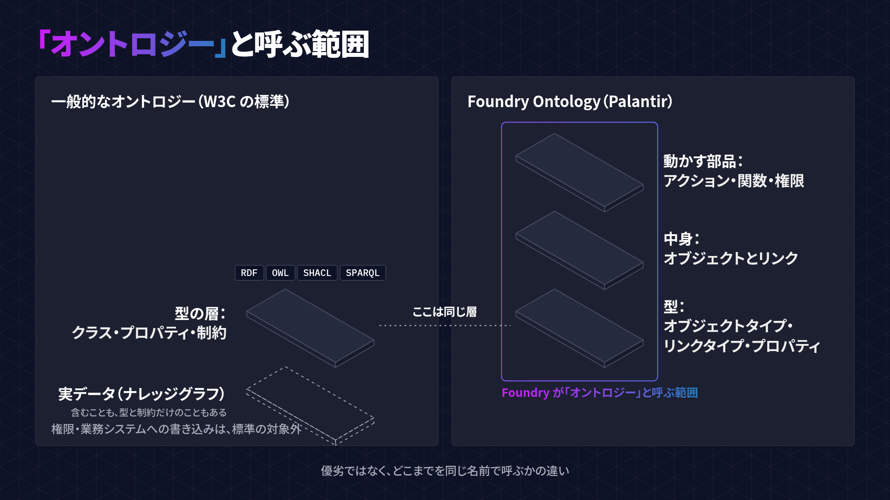
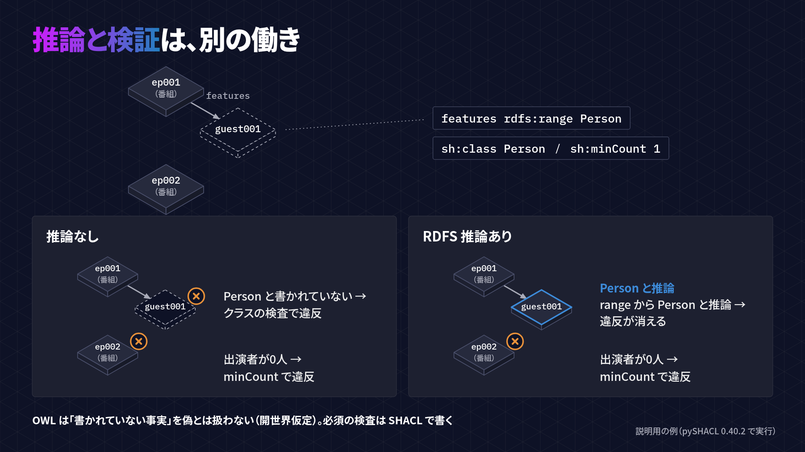
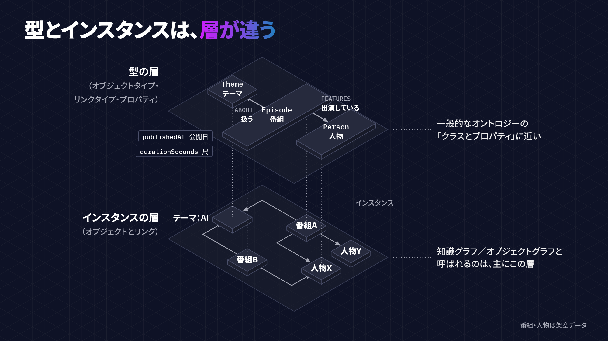
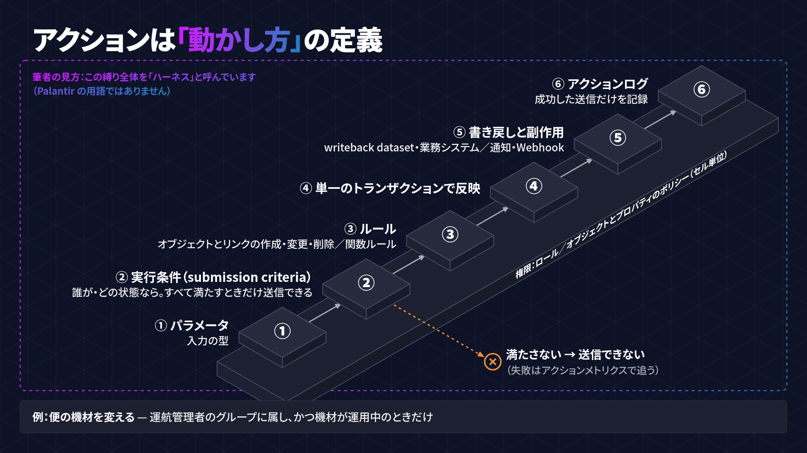
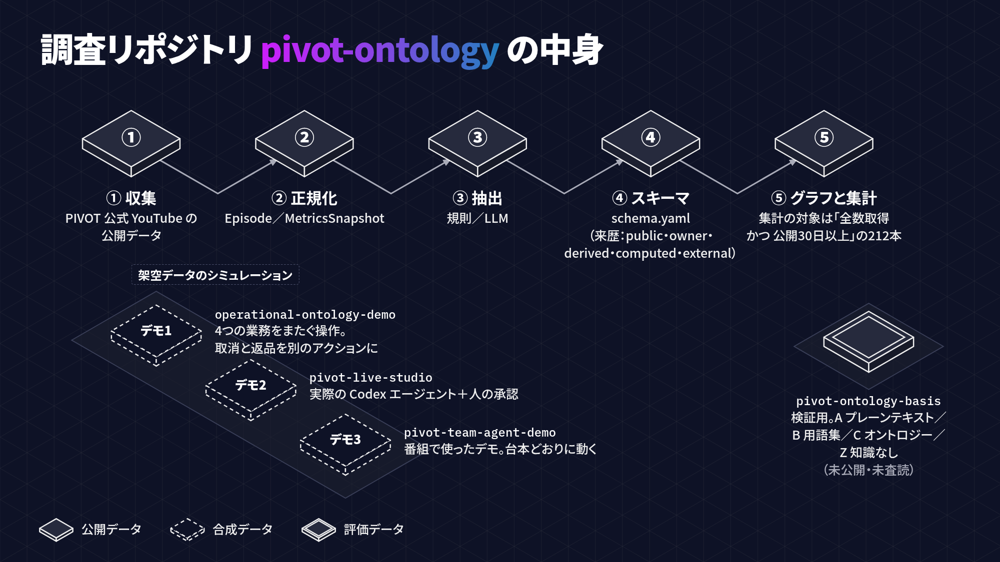
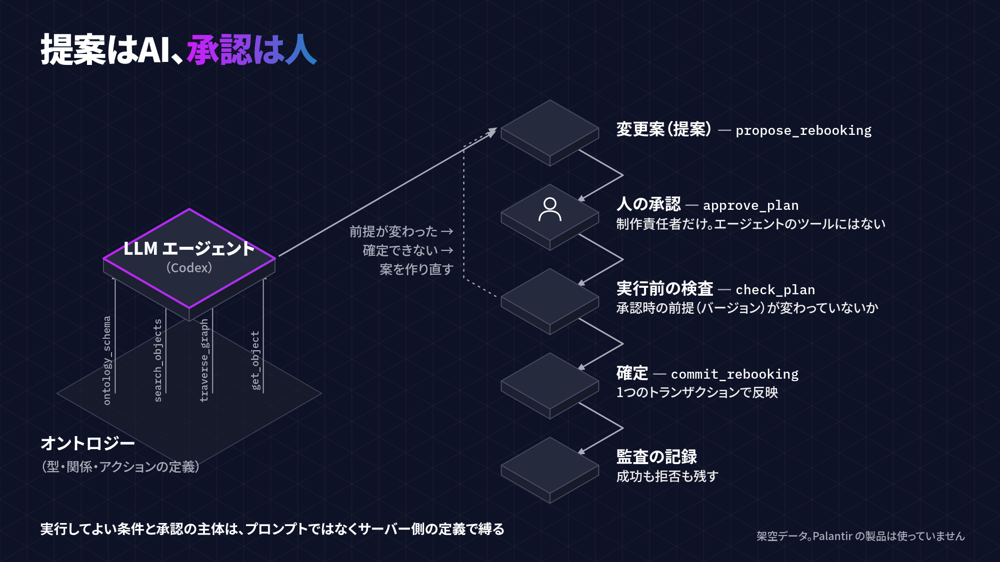
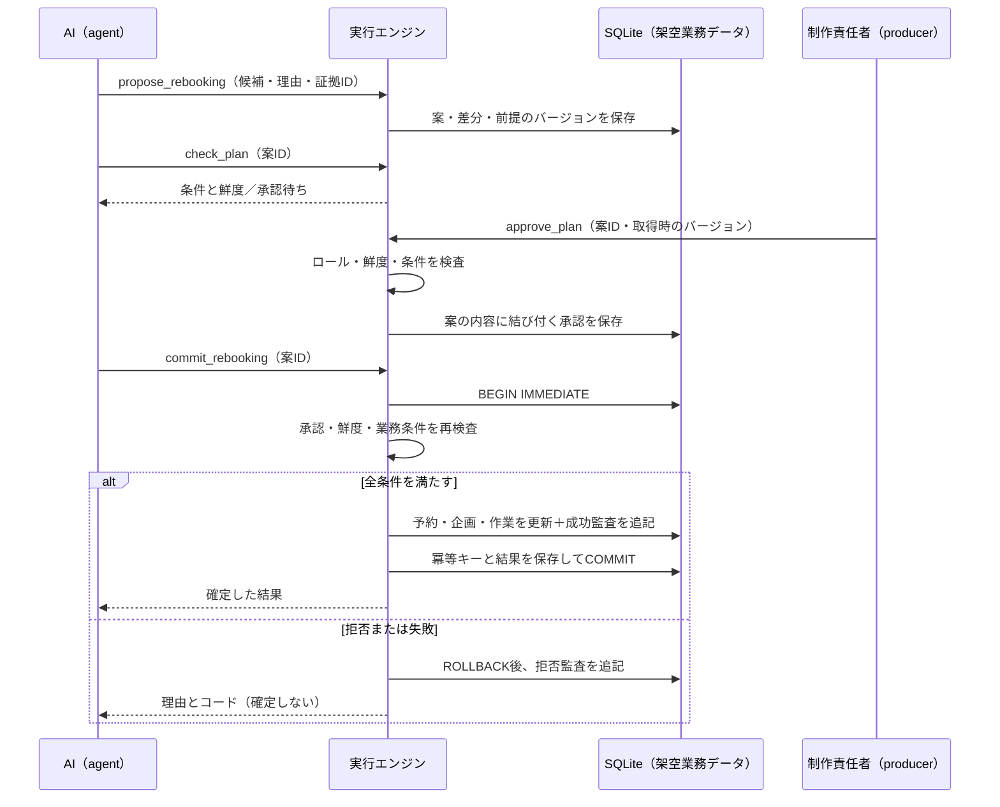
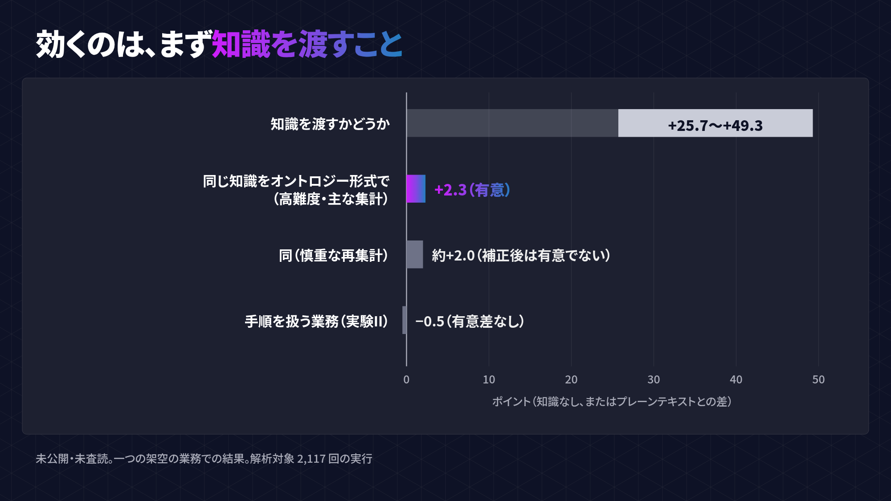

カンリーCAIO（最高AI責任者）の萩野貴拓です。

ビジネス映像メディア「PIVOT」への3回目の出演回が、2026年11月14日に公開されました！ 今回のテーマは「オントロジー」です。企業はAIでどこまで業務を自動化できるのか、そのときなぜオントロジーが要るのかをお話ししました。ぜひ、視聴・いいね・シェアをお願いします！

https://www.youtube.com/watch?v=_V7IF1XdNLQ

番組の記事版は [PIVOT のサイト](https://pivotmedia.co.jp/movie/15261)にあります。

## PIVOTの続きを、エンジニアに向けて

番組はビジネスメディアなので、技術の細部にはあえて触れませんでした。番組で話したことの整理と、コメントでいただいた指摘への補足は、一般の方向けに [note にまとめています](https://note.com/haginota/n/nbf04863132cf)。

この記事はその技術編です。収録の前に、オントロジーまわりの一次資料を読み込み、調査用のリポジトリでデモと検証を作りました。そこで考えたことをコードと仕様の言葉で書きます。

本音を言えば、番組であえて触れなかった細部こそ、私がいちばん書きたかったところ。

扱うのは次の7つです。

- **言葉の範囲**：一般的なオントロジー（RDF / OWL / SHACL / SPARQL）と、Palantir の Foundry Ontology は、同じ言葉で違う範囲を指している
- **型とインスタンス**：設計図の層と、実データのグラフの層を分ける
- **ドメインモデリング**：オントロジーを DDD（ドメイン駆動設計）の言葉で読む
- **アクション**：Foundry の「動かすコンポーネント」を、パラメータ、ルール、実行条件、書き戻し、ログに分解して読む
- **実装**：調査リポジトリで、アクションのゲートと、LLM エージェントとのつなぎ方をどう組んだか（コードの抜粋つき）
- **本番に近づけるなら**：テスト、リトライで二重にしない書き戻し、スキーマの変更、OSS での組み方
- **効果の大きさ**：手元の実験（未公開・未査読）で、オントロジーの「形式」がどこまで効いたか

先にお断りです。

- この記事は私個人の見解です。PIVOT、Palantir、所属組織の公式な見解ではありません。提携やタイアップの記事でもありません。
- 事実には出典へのリンクを付けています。私の考えは「と考えています」「私の見方です」と書き分けます。資料は2026年11月16日（日本時間）に確認しました。
- 調査リポジトリのデモはすべて架空のデータで動くシミュレーションです。PIVOT 社の組織、規程、システム、業務実績を表すものではありません。



## 1. 「オントロジー」が指す範囲を、先にそろえる

番組では「オントロジー」という一つの言葉で、一般的な意味のオントロジーと Palantir の Foundry Ontology という二つのものを続けて話していました。コメントで「層が混ざっている」と指摘されたのは、ここを分けなかったことも一因だと思います。まず、ここを分けます。

同じ言葉で二つのものを続けて話せば、層が混ざって聞こえるのも当然の流れ。混ぜた当人として、もっともな指摘。

### 1.1 一般的なオントロジー：型と関係と制約

情報工学でよく引かれる定義は[Gruber の「概念化の明示的な仕様」](https://tomgruber.org/writing/ontolingua-kaj-1993.pdf)です。[Studer ら](https://doi.org/10.1016/S0169-023X%2897%2900056-6)はこれを「共有された概念化の、形式的で明示的な仕様」と言い直しています。

書き表すための W3C の標準は、役割が分かれています。

| 標準 | 役割 |
|---|---|
| [RDF](https://www.w3.org/TR/rdf11-concepts/) | 主語・述語・目的語の「トリプル」の集合で、グラフを表すデータモデル |
| [OWL 2](https://www.w3.org/TR/owl2-overview/) | クラス、プロパティ、個体と、その意味を形式的に定める言語。[RDF グラフとしても書ける](https://www.w3.org/TR/owl2-mapping-to-rdf/) |
| [SHACL](https://www.w3.org/TR/shacl/) | RDF グラフが条件を満たすかを検証する言語 |
| [SPARQL 1.1 Update](https://www.w3.org/TR/sparql11-update/) | グラフストアの RDF グラフに、トリプルを挿入・削除する言語 |

番組の「点と線」の例を、Turtle（RDF の書き方の一つ）で書くと、こうなります。以下は説明用に書いた例で、値は架空です。

```turtle:pivot-example.ttl
@prefix ex:   <https://example.org/pivot#> .
@prefix owl:  <http://www.w3.org/2002/07/owl#> .
@prefix rdfs: <http://www.w3.org/2000/01/rdf-schema#> .
@prefix xsd:  <http://www.w3.org/2001/XMLSchema#> .

# 型（スキーマ）
ex:Episode  a owl:Class .
ex:Person   a owl:Class .
ex:features a owl:ObjectProperty ;
    rdfs:domain ex:Episode ;
    rdfs:range  ex:Person .
ex:publishedAt a owl:DatatypeProperty ;
    rdfs:range xsd:date .

# インスタンス（実データ。値は説明用の架空のもの）
ex:ep001 a ex:Episode ;
    ex:publishedAt "2026-11-14"^^xsd:date ;
    ex:features ex:guest001 .
ex:ep002 a ex:Episode .
```

技術的に大事なのは、`rdfs:range ex:Person` が「features の先は Person でなければならない」という**制約ではない**という点です。RDFS と OWL の意味論では「features の先にあるものは Person だと**推論**してよい」という意味になります。[OWL 2 Primer](https://www.w3.org/TR/owl2-primer/) は、domain と range の例で、推論器が個体のクラスを導けると説明しています。同じ Primer は、OWL 2 はデータベースの枠組みではなく、書かれていない事実は偽ではなく「単に欠けているだけかもしれない」と扱う（開世界仮定）とも書いています。

「必ず1人は出演者がいること」のようなチェックをしたいなら、SHACL で書きます。

```turtle:pivot-shapes.ttl
@prefix ex:  <https://example.org/pivot#> .
@prefix sh:  <http://www.w3.org/ns/shacl#> .
@prefix xsd: <http://www.w3.org/2001/XMLSchema#> .

ex:EpisodeShape a sh:NodeShape ;
    sh:targetClass ex:Episode ;
    sh:property [
        sh:path ex:features ;
        sh:class ex:Person ;
        sh:minCount 1 ;
    ] ;
    sh:property [
        sh:path ex:publishedAt ;
        sh:datatype xsd:date ;
        sh:maxCount 1 ;
    ] .
```

pySHACL 0.40.2 で、推論なしと RDFS 推論ありの両方で検証してみました。

```text:実行結果（Focus Node と Message の行のみ表示）
--- inference=none conforms=False
Focus Node: ex:ep001
Message: Value does not have class ex:Person
Focus Node: ex:ep002
Message: Less than 1 values on ex:ep002->ex:features
--- inference=rdfs conforms=False
Focus Node: ex:ep002
Message: Less than 1 values on ex:ep002->ex:features
```

推論なしでは、`ex:guest001` に `a ex:Person` が書かれていないので、クラスのチェックで落ちます。RDFS 推論を入れると、range から「guest001 は Person だ」と導かれるので、この違反は消えます。出演者が一人もいない `ex:ep002` は、どちらでも落ちます。同じ「型の情報」でも、推論として効くか、検証として効くかで結果が変わる、ということです。

この差は二つの前提の違いから来ます。OWL は開世界仮定に立つので、出演者が書かれていない `ex:ep002` を見ても、推論器は「出演者がいない」とは結論しません。まだ書かれていないだけかもしれないと扱います。[SHACL](https://www.w3.org/TR/shacl/) は、検証の対象になるデータグラフ（data graph）が、シェイプ（形）の条件を満たすかをチェックします。推論を併用するかどうかは、処理系の設定や `sh:entailment` で決めます。上の実行例では処理系（pySHACL）の設定で、推論のありなしを切り替えました。そして `sh:minCount 1` のように書けば、値が書かれていないこと自体が違反になります。

業務のルールの多くは後者の形をしています。いつ見ても成り立っていなければならない条件（不変条件。たとえば「確定した予約の費用の合計は、予算以下」）と、ある操作をしてよいかの条件（事前条件。たとえば「出荷済みの注文は取り消せない」）です。どちらも足りない事実を補う話ではなく、いまあるデータで合否を出すチェックです。

書かれていないのは、まだ書かれていないだけかもしれない、という推論の側の誠実さ。ただ、業務が求めるのは、いま手元のデータで通すか止めるか、その答え。

推論で書くと、ルールに合わないデータが来たときに、違反ではなく新しい事実が導かれることがあります。上の例で、`ex:guest001` が Person だと推論され、クラスのチェックが通ったのと同じ動きです。

そこで私は、業務の不変条件や事前条件は、推論ではなく検証に書く方が扱いやすいと考えています。検証とは SHACL や、4章で見るアクションの実行条件のことです。推論は、分類や用語の対応づけのように、事実を補ってよい場面に向いています。



グラフの更新は SPARQL 1.1 Update で書けます。

```sparql:update.rq
PREFIX ex: <https://example.org/pivot#>
DELETE { ?ep ex:features ex:guest001 }
INSERT { ?ep ex:features ex:guest002 }
WHERE  { ?ep a ex:Episode ; ex:features ex:guest001 }
```

ただし、ここで標準が定めているのは「トリプルをどう書き換えるか」までです。**誰がこの更新をしてよいか、どの条件なら実行してよいか、外部の業務システムにどう反映するか**は、これらの標準の対象ではありません。SPARQL 1.1 Update も、セキュリティの注意事項の節で、実装側の権限の仕組みを適用するよう促していますが、その仕組み自体は定めていません。OWL や RDF を使う基盤が、権限や書き込みの仕組みを別に持つことは、もちろんあります。

### 1.2 Foundry Ontology：設計図に、中身と「動かすコンポーネント」まで

[Palantir の Core concepts](https://www.palantir.com/docs/foundry/ontology/core-concepts) は、オントロジーを「世界の分類」と書き、Foundry では「組織のデジタルツイン」だと説明します。データセットやモデルを、オブジェクトタイプ、プロパティ、リンクタイプ、アクションタイプに写して、一つにまとめたもの、という位置づけです。

[Ontology の概要ページ](https://www.palantir.com/docs/foundry/ontology/overview)は、オントロジーが**セマンティック要素**（オブジェクト、プロパティ、リンク）と、**キネティック要素**（アクション、関数、動的セキュリティ）の両方を含む、と書いています。[アーキテクチャの解説](https://www.palantir.com/docs/foundry/architecture-center/ontology-system)はもっと直接的で、オントロジーは「セマンティックレイヤー」ではない、と明記しています。名詞（オブジェクト）は動詞（アクション）と組にしなければ意思決定を表せない、という説明です。

構成要素を公式の定義で並べておきます。

| 要素 | Palantir の定義（要約） |
|---|---|
| オブジェクトタイプ | 現実の実体や出来事のスキーマ定義。オブジェクトはその1つのインスタンス（[Core concepts](https://www.palantir.com/docs/foundry/ontology/core-concepts)） |
| プロパティ | オブジェクトタイプの特徴のスキーマ定義 |
| リンクタイプ | 2つのオブジェクトタイプの関係のスキーマ定義。リンクはその1つのインスタンス。[リンクタイプは双方向](https://www.palantir.com/docs/foundry/object-link-types/link-types-overview) |
| アクションタイプ | ユーザーが一度に行う、オブジェクト・プロパティ値・リンクへの変更のまとまりの定義。送信時の副作用も含む（[Action types](https://www.palantir.com/docs/foundry/action-types/overview)） |
| 関数 | 入力を受けて出力を返すコードのロジック。[TypeScript と Python](https://www.palantir.com/docs/foundry/functions/overview) で書く |
| ロール | オントロジーの中心的な権限モデル（[Core concepts](https://www.palantir.com/docs/foundry/ontology/core-concepts)） |
| インターフェース | オブジェクトタイプの形と能力を記述し、多態性を与える型 |

[Core concepts](https://www.palantir.com/docs/foundry/ontology/core-concepts) は、データセットとの対応も示しています。オブジェクトタイプがデータセット、オブジェクトが行、プロパティが列、リンクタイプが結合（join）に当たる、という対応です。ここでも、**型とインスタンスははっきり区別されています**。

### 1.3 並べると

| 項目 | 一般的なオントロジー（W3C の標準） | Foundry Ontology |
|---|---|---|
| 中心の単位 | クラス、プロパティ、個体、公理（クラスどうしの関係などを定める宣言）。表し方はトリプル | オブジェクトタイプ、プロパティ、リンクタイプ、アクションタイプ |
| 実データ | 含むことも、型と制約だけのこともある | 含む。オブジェクトとリンクを型のインスタンスとして扱う |
| 推論・チェック | OWL の推論、SHACL によるグラフの検証 | 実行条件（アクションを送信する前のチェック） |
| 書き込み | SPARQL 1.1 Update でグラフを更新できる | アクション（単一のトランザクション）、書き戻し |
| 権限 | 標準の対象外。使う側の基盤が担う | ロール、オブジェクトとプロパティのポリシー |
| ロジック | 標準の対象外 | 関数（TypeScript / Python） |
| 位置づけ | 外部の公開標準 | 一社の製品の仕様 |

「対象外」は、標準が規定していないという意味です。どちらが優れているか、という比較ではありません。**どこまでを「オントロジー」と呼ぶか、の切り方の違い**だと考えています。

では、広く切ったほうが上なのか。いや、それは別の話。違うのは切った場所で、上下ではない、という話。

## 2. 型とインスタンス：「知識グラフ」と「オブジェクトグラフ」



番組では「オントロジー自体はグラフではない」と言いました（15:02ごろ）。この記事では少し正確に言い直します。[OWL のオントロジーは RDF グラフとしても書ける](https://www.w3.org/TR/owl2-mapping-to-rdf/)ので、「グラフではない」と断定するのは言い過ぎでした。言いたかったのは、**型の定義と、それに沿って作る実データのグラフは、層が違う**ということです。

言いたかった中身が正しくても、言い方が不正確なら、やはり不正確。番組での一言より、こちらの言い直しが正。

また、番組の14:47ごろにはグラフを「点と点を線で結んだもの」と説明しました。ここで言うグラフは関数のグラフではなく[グラフ理論のグラフ](https://diestel-graph-theory.com/)、つまり頂点の集合と辺の集合の組 G=(V,E) です。視聴者の方からいただいた指摘のとおりで、詳しくは [note の3-1節](https://note.com/haginota/n/nbf04863132cf)に書きました。

Palantir 自身の言葉づかいも、資料によって違います。

- 2023年7月の[半導体業界向けホワイトペーパー](https://www.palantir.com/assets/xrfr7uokpv1b/2T3BgBpe3drnqBaSTCXl6O/bdc9445d10053eb84b3f9487e63fc2d7/Whitepaper_-_Accelerating_Research_and_Development_in_the_Semiconductor_Industry.pdf)には、オントロジーを通じて中心に据えて作る「knowledge graph」の図があります。
- [2022年の公式ブログ](https://blog.palantir.com/ontology-finding-meaning-in-data-palantir-rfx-blog-series-1-399bd1a5971b)はオブジェクト、属性、関係を定義して結び、オントロジーが定める「object graph」を作ると書いています。
- [製品ドキュメント](https://www.palantir.com/docs/foundry/ontology/core-concepts)の中心にある言い方は、グラフではなく「組織のデジタルツイン」です。

私は、どれも同じものの別の面を強調した言い方だと読んでいます。整理すると、こうです。

- 型の層：オブジェクトタイプ、リンクタイプ、プロパティ。一般的なオントロジーの「クラスとプロパティ」に近い。
- インスタンスの層：オブジェクトとリンク。これを点と線として見たものが、知識グラフやオブジェクトグラフと呼ばれる。
- 動かす層：アクション、関数、権限。インスタンスの層を、どの条件で、誰が、どう変えてよいかを決める。

一般的なオントロジーの議論は主に上の2つを扱います。Foundry は3つをまとめて「オントロジー」と呼びます。

ついでに、同じブログには、オントロジーが表す「一元化された契約（the centralized contract the ontology represents）」という表現があります。オブジェクトに結びついたロジックも変更できる形にしておけば、アプリケーションがその契約を使いやすくなる、という文脈です。番組で「AIの記憶より契約書に近い」と言ったのは私のたとえで、Palantir の製品ドキュメントは「契約」という語で説明していません。製品の言葉に寄せるなら、権限、実行条件、監査です。

## 3. オントロジーを、ドメインモデリングとして読む

オントロジーについて読んだ整理の中で、私がいちばん共感したのは、Foundry のオントロジーはソフトウェア設計でいう**ドメインモデリング**だという見方です。ドメインモデリングとは、業務に出てくるモノやコト、その関係とルールをソフトウェアの構造に写し取る作業のことです。

なぜそこまで共感したのか。自問して出てきた答えは単純で、見慣れない製品の言葉が、見慣れた設計の言葉で読めたという一点。同じもの、ではなく、あくまで読める、という距離感。そこは最後まで守るつもり。

### 3.1 gura さんの「リバースドメインモデリング」

gura さんは Palantir Foundry の公式学習コースを実際に触ったうえで、[「オントロジーの正体は"リバースドメインモデリング"」](https://x.com/gura105/status/2077153028982133080)という記事を書いています。記事の中の読み替えは次のとおりです（記事からの引用です）。

- オブジェクト = エンティティ（ドメインオブジェクト）
- リンク = エンティティ間の関連
- アクション = メソッド / コマンド（業務ルール付きの操作）
- オントロジー全体 = ドメインモデル

gura さんの論の中心は作る順番です。ふつうの業務アプリは「(要求 → )モデル → 物理 → アプリ」の順に作ります。Foundry では、それが「(要求→)物理 → モデル → アプリ」になっている。散らばった既存システムのデータを先に集め、その上で業務の意味を与える。この工程の逆転を gura さんは「リバースドメインモデリング」と呼んでいます。

もう一つの論点は読むだけか、書けるかです。記事はデータウェアハウスと BI を「Read Only」、Foundry を「Read & Write」と対比しています。そして、書き込みには業務ルールが要るので、振る舞いとルールを持つドメインモデリングが必要になると書いています。読み取り専用のものと区別して「Operational Ontology(=操作できるオントロジー)」と呼ぶのが実態に近いというのが gura さんの見方です。

gura さんは記事の注で3つの補足を書いています。

- 「逆」なのは工程の順番であって、モデルの作り方ではない。現実の業務を見てモデリングする姿勢は普段の開発と同じで、出発点だけが違う。gura さんはその根拠として Palantir の設計ガイドの「ソースデータではなく現実世界をモデル化せよ」という言葉を挙げています。
- DDD（ドメイン駆動設計）には「境界づけられたコンテキスト」という考え方がある。営業の「注文」と経理の「注文」は別の概念かもしれず、全社で一つの統一モデルを作る試みは破綻しやすい。Foundry がこの難所をどこまで越えられるかは、導入事例で確かめたい、としています。
- 工程の逆転そのものは珍しくない。古いデータベースの上でアプリを作り直すとき、エンジニアは日常的に「物理 → モデル」をやっている。Foundry の新しさは向きではなく、それを全社規模で、書き込み付きで、製品としてやり切ろうとしている点だ、としています。

私はこの見方に強く共感しています。番組で「オントロジーとは何か」を短く言い切れなかった部分が、ソフトウェアエンジニアの言葉で説明できるからです。

### 3.2 DDD の言葉と、調査リポジトリのコードで対応させる

ここからは私の整理です。DDD の用語は Eric Evans の [DDD Reference](https://www.domainlanguage.com/ddd/reference/) の定義に合わせます。右の列は調査リポジトリの中で対応するものです。

| オントロジーのコンポーネント | DDD の言葉 | 調査リポジトリでの対応 |
|---|---|---|
| オブジェクトタイプ | エンティティ。属性ではなく、同一性で区別して追い続ける対象。整合性をまとめて守る単位にするなら集約 | `Production`（制作企画）。予約、作業、変更案が、この企画にリンクでぶら下がる。私は集約ルートに近いと見ています |
| プロパティ | 属性。同一性を持たず、値の組で意味を持つものは値オブジェクト | `start` と `end` の組（収録枠）、`fee`（出演料） |
| リンクタイプ | 関連（association）。集約の内側にも、集約どうしの間にもある | `ontology.json` の `linkTypes`。`HAS_BOOKING`（企画→予約。集約の内側）と、`BOOKS`（予約→人物。別の集約へ） |
| アクションタイプ | コマンド。業務ルール付きの操作 | `commit_rebooking`、`cancelOrder`、`requestReturn` |
| 実行条件 | 不変条件と、操作の事前条件の強制 | `getPlan` の `SHIPPED_ORDER_CANNOT_BE_CANCELLED` |
| アクションログ | 監査証跡に近い面と、ドメインイベントに近い面がある（後述） | `audit` テーブルと監査ログ（こちらは監査証跡） |
| 共通の語彙 | ユビキタス言語。一つの境界づけられたコンテキストの中で、チームの全員が使う、ドメインモデルに沿った言葉 | `label` と、ツールの説明文。人も AI エージェントも、同じ言葉を読む。ただし複数のコンテキストをまたぐ語彙は、一つの言語というより対応表に近い（3.4節） |
| オントロジーの範囲 | 境界づけられたコンテキスト。あるモデルが定義され、通用する範囲 | 販売、倉庫、経理、サポートの4つのモックシステム |

最後の行は、コードで見るのがいちばん早いです。`operational-ontology-demo` は、4つのシステムの「状態」を、別々の項目として持っています。

```js:demos/operational-ontology-demo/business-engine.mjs（7〜12行目）
const CONTEXTS = {
  sales: { name: '販売管理', type: 'Order', key: 'orderNo', field: 'status' },
  warehouse: { name: '倉庫・出荷', type: 'Shipment', key: 'shipmentNo', field: 'state' },
  accounting: { name: '請求・会計', type: 'Invoice', key: 'invoiceNo', field: 'state' },
  support: { name: '顧客対応', type: 'Case', key: 'caseNo', field: 'state' },
};
```

販売で「受付済み（accepted）」の注文が、倉庫では「出荷済み（shipped）」かもしれません。同じ注文でも、状態の意味は文脈ごとに違います。オントロジーは、これを一つの「注文の状態」に潰さずに、リンクでつないで並べます。テストの名前も、そのまま `four bounded contexts preserve different status meanings and explicit links` にしました。

どの項目をどのシステムが持つかも、表にしています。

```js:demos/operational-ontology-demo/business-engine.mjs（17〜21行目）
const AUTHORITY = {
  'Customer.name': 'sales', 'Order.status': 'sales', 'Shipment.state': 'warehouse',
  'Invoice.state': 'accounting', 'Case.state': 'support',
  'Case.assignee': 'ontology', 'Case.notes': 'ontology',
};
```

オントロジー自身が持つのは、問い合わせの担当者とメモだけです。ほかの値のマスターは元のシステムに残します。

もう一つのデモ（live-studio。5.5節）では、リンクの型も書き込みのたびにチェックしています。定義にない組み合わせの関係は作れません。

```js:demos/pivot-live-studio/engine.mjs（60〜62行目）
  insertLink(l){
    const def=ontology.linkTypes.find(t=>t.id===l.type),s=this.get(l.source),t=this.get(l.target);
    requireTrue(def && s.type===def.source && t.type===def.target,'INVALID_LINK','関係の型が定義と一致しません。');
```

### 3.3 たとえが合わなくなるところ

対応表は便利ですが、ずれるところもあります。

いや待て、表がきれいに埋まったことと、全部が重なったことは別物。むしろ、読み替えの限界が出るのは、ずれる行のほう、という話。

- 範囲：DDD は境界づけられたコンテキストごとにモデルを分けます。Foundry の [Core concepts](https://www.palantir.com/docs/foundry/ontology/core-concepts) はオントロジーを「組織のデジタルツイン」と説明します。どこまで一つのモデルにまとめるかは、gura さんが留保したとおり、まだ答えが出ていない問いだと私は考えています。
- 権限：DDD はモデルを設計する考え方で、誰が何を見てよいかの仕組みは扱いません。Foundry はオブジェクトとプロパティのポリシーをオントロジーの側に持ちます（4.4節）。
- 書き戻し：DDD の集約はふつう自分のデータを自分で持ちます。Foundry のアクションは元の業務システムへ書き戻すことがあります。上の `AUTHORITY` のように、マスターが外にある値をオントロジー経由で変える形です。
- ログとドメインイベント：DDD Reference はドメインイベントを「ドメインの専門家が気にかける、起きたこと」と書き、ドメインモデルの一部として扱います。同じ文書は監査証跡（audit trail）について、追跡には使えるが、プログラムのロジックに使うにはふつう向かないとも書いています。調査リポジトリの監査ログは、性格としてはこの監査証跡です。Foundry の [Action log](https://www.palantir.com/docs/foundry/action-types/action-log) は成功したアクションの送信をオブジェクトとして記録し、意思決定のワークフローへの入力にも使うよう説明されています。その点では、ドメインイベントに近い使い方もできる仕組みだと私は読んでいます。

### 3.4 全社で一つのモデルにしない：境界をつなぐ層として設計する

gura さんの2つ目の留保（境界づけられたコンテキスト）は、オントロジーを設計するときの中心の問いだと私は考えています。全社で一つの「注文」モデルを作ると、境界づけられたコンテキストとぶつかる。では、オントロジーをどう設計すればよいのか。私は、**全社共通のモデルを作る場所ではなくコンテキストどうしの関係を書く場所として設計する**と答えます。以下は、調査リポジトリを作りながら固めた私の設計の指針です。

全社で一つのモデルにまとめれば話は早い、と言いたくなる気持ちは私も同じ。でも、その早さは、境界でぶつかる分の先送りにすぎないのでは。そう自問して行き着いたのが、次の指針。

共有するのは ID で、モデルではありません。5.3節でくわしく扱う取消・返品のデモでは、販売の行が出荷番号と請求番号を持っています。倉庫・経理・サポートの行はそれらの番号に加えて注文番号でも突き合わせます。サポートは顧客コードも突き合わせます。

```js:demos/operational-ontology-demo/business-engine.mjs（104〜112行目）
  #records(orderId) {
    const sales = this.#sources.sales.find(row => row.orderNo === orderId);
    if (!sales) return null;
    const records = {
      sales, warehouse: this.#sources.warehouse.find(row => row.shipmentNo === sales.shipmentNo && row.orderNo === orderId),
      accounting: this.#sources.accounting.find(row => row.invoiceNo === sales.invoiceNo && row.orderNo === orderId),
      support: this.#sources.support.find(row => row.orderNo === orderId && row.customerCode === sales.customerCode),
    };
    return Object.values(records).every(Boolean) ? records : null;
```

4つのシステムは「O-1042」という同じ注文を指しています。しかし、状態の項目名（販売は `status`、ほかは `state`）も、いまの値（販売は `accepted`、倉庫は `shipped`、経理は `issued`、サポートは `open`）も、マスターを持つシステムも別です。ID が一致することは、同じモデルを使う理由にはなりません。ID の対応は合意するが、各モデルの中身はそれぞれのオーナーに残す。オントロジーが定義として持つのは、この対応と、リンクの種類です。

**オントロジーに書くのは、境界を越える約束。** どのシステムがどの値のマスターを持つか（`AUTHORITY`）、どの ID でつながるか、どのアクションが複数のシステムに何を求めるか（`TARGETS`）。各システムの中だけで閉じるルールまで、中央に集める必要はありません。境界を越えるときに守る約束だけを、機械が読める形で書きます（デモでは、`AUTHORITY` と `TARGETS` は宣言の表ですが、ID のつながりは上の `#records` のコードに書いています）。DDD でいえば、コンテキストの関係を描く地図（Context Map）を、図ではなく実行できる定義として持つイメージです。

**モデルの境界と、トランザクションの境界は別物。** 境界づけられたコンテキストは、あるモデルが定義され、通用する範囲です。一度にまとめてコミットする範囲のことではありません。一度にコミットする範囲は、同時に守るべき不変条件から決めます。DDD でいう集約の考え方です。

調査リポジトリのアクションには両方の例があります。live-studio の `commit_rebooking` は、一つの SQLite データベースの中で、企画、予約、作業をまとめてコミットします。一方、取消・返品の `cancelOrder` は4つのコンテキストにまたがります。デモではメモリ上で一度に差し替えていますが、本物の4システムなら、それぞれが別のトランザクションの境界です。だから、アクションの定義は「どこまでを一緒にコミットし、どこからを後で反映して突き合わせるか」を決める場所になります。

本番に近づけるなら、「販売では受付済み、倉庫への反映は未確認」のような**途中の状態**を業務の状態として明示します。未確認のまま黙って再送せず、突き合わせて結果を確かめます。誰がどの手順で復旧するかも決めます。この設計は6.2節のリトライの話につながります。

共通にするのは業務モデルではなく運用の仕組みです。同じ「注文」でも、会社が違えば意味も制約も違います。あらかじめ完成した一つのオントロジーを配って、全社や他社に当てはめることはできないと私は考えています。共通にできるのは、業務の型、関係、アクション、権限、マスター、バージョンを書く方法と、それをチェックし、実行し、記録し、安全に変え続ける仕組みの方です。業務モデルそのものは、業務を知る人との対話から会社ごとに作るものだと私は考えています。

AI エージェントにとっても同じです。AI は散らばったデータの意味を自動では統一してくれません。どの値のマスターがどこにあるか（5.3節の `AUTHORITY`）、誰の権限で何をしてよいかを先に定義し、その範囲の中で、型の決まったアクションを提案させる。5.5節のエージェントのデモは権限と承認をこの順番で組んでいます。


## 4. アクションタイプを分解する



Foundry Ontology の「動かすコンポーネント」の中心は、アクションです。[Action types](https://www.palantir.com/docs/foundry/action-types/overview) は、アクションを「ユーザーが定義したロジックに基づいて、1つ以上のオブジェクトのプロパティを変える、単一のトランザクション」と説明しています。公式の例は、従業員の役割を変える「Assign Employee」です。新しい役割をフォームで入力させ、新しいマネージャーとのリンクを作り、新旧のマネージャーに通知し、人事部門など、権限のある従業員だけが実行できるよう検証する、という構成です。

以下、ドキュメントをコンポーネントごとに読みます。

アクションを一言で言えば「動かすコンポーネント」。ただ、一言で済ませると、何がどう縛られているのかが見えなくなるので、ここで分解。

### 4.1 パラメータ：アクションの入力

[パラメータ](https://www.palantir.com/docs/foundry/action-types/parameter-overview)はアクションタイプの入力です。型を持ち、フォームに出すか、ユーザーが変えられるかを一つずつ設定できます。LLM の関数呼び出しで言えば、引数のスキーマに当たる部分だと私は理解しています。

### 4.2 実行条件（submission criteria）：実行してよいか

[実行条件](https://www.palantir.com/docs/foundry/action-types/submission-criteria)は、旧称を validations といい、アクションを送信してよいかを決める条件です。読んでいて大事だと思った点を挙げます。

- 条件は「現在のユーザー」「パラメータ」「実行コンテキスト」の3つのテンプレートで書く。ユーザーの ID、グループ、所属組織などの属性を使える。
- 条件は演算子で組み合わせ、入れ子にできる。**すべて満たさないと送信できない。**
- 実行条件はアクションタイプ自体を編集できる権限とは別物。
- 一つのオブジェクトタイプに複数のアクションタイプがあっても、実行条件はアクションタイプごとに独立している。

公式の例は航空会社です。便に割り当てる機材を変えるアクションを、運航管理者のグループに属するユーザーだけが、かつ機材がまだ運用中のときだけ送信できるようにする、というものです。**誰が**と**どの状態なら**を、一つの論理式で縛っています。

### 4.3 ルール：何を変えるか

[ルール](https://www.palantir.com/docs/foundry/action-types/rules)は、パラメータをオントロジーの編集やその他の効果に変換するロジックです。

- オントロジーのルール：オブジェクトの作成、変更、削除。多対多のリンクの作成と削除。一対多・一対一のリンクは外部キーのプロパティを変更して作る。
- 関数ルール：オントロジーを編集する関数を呼ぶ。これを使うときは、他のルールは併用できない。関数だけで他のルールにできることをすべて扱えるためと説明されています。
- 副作用：通知と Webhook。通知は編集が適用されたあとに送られますが、内容は編集前の状態から作られます。Webhook は外部システムにリクエストを送り、編集の前と後のどちらで実行するかを選べます。

### 4.4 書き戻し、権限、ログ

- 書き戻し：[Action types](https://www.palantir.com/docs/foundry/action-types/overview) によると、ユーザーの編集を反映した最新のオブジェクトデータは、オブジェクトタイプの writeback dataset に残ります。アーキテクチャの解説は、アクションが業務やエッジのシステムへ書き戻されるとも書いています。
- 権限：オントロジーのデータは[オブジェクトとプロパティのポリシー、またはデータソースのポリシー](https://www.palantir.com/docs/foundry/object-permissioning/managing-object-security)で守ります。行と列を組み合わせたセル単位の制御に対応します。
- ログ：[Action log](https://www.palantir.com/docs/foundry/action-types/action-log) を有効にすると、成功したアクションの送信がオブジェクトとして記録されます。「誰が、いつ、どんな文脈で、何を決めたか」に答えるための仕組みです。**記録するのは成功した送信だけで、失敗は記録しない**と明記されています。失敗はアクションメトリクスの側で追うという切り分けです。

こうして分解すると、SPARQL Update の「トリプルの書き換え」との違いがはっきりします。アクションは、入力の型、送信してよい条件、変更の中身、外部への副作用、記録までを一つの定義にまとめています。

### 4.5 「ハーネス」は、私の見方です

番組ではこうした縛りを「ハーネス」と呼びました。**これは Palantir の用語ではなく、私自身の見方**です。わざわざ太字にした理由は、私の言い回しが製品の用語として独り歩きするのを、何より避けたいから。

背景には、Palantir が使われてきた現場の厳しさがあると見ています。たとえば米陸軍は2025年7月31日、[Palantir とのエンタープライズ契約を発表](https://www.army.mil/article/287506/u_s_army_awards_enterprise_service_agreement_to_enhance_military_readiness_and_drive_operational_efficiency)しました。75件の契約（元請け15件と関連60件）を1本にまとめ、期間は最長10年、金額は最大100億ドルの上限つきです。発表は、この額は契約の最大の潜在価値であって、特定の支払い義務や約束ではない、と書いています。

国防のように誤った操作が許されない現場では、AI やシステムに何を見せ、何をさせてよいかを、権限、実行条件、監査ログで縛っておく必要がある、と私は考えています。この水準を私は「国防レベル」と表現し、その縛り全体を「ハーネス」と呼んでいます。どちらも Palantir の用語ではありません。

## 5. 調査リポジトリでは、どう組んだか



番組の準備として、調査用のリポジトリ（pivot-ontology。現時点では非公開）を作りました。PIVOT 公式 YouTube チャンネルの公開データから、番組、人物、テーマの関係を一つの地図にまとめる試みと、オントロジーを「動かす」側のデモをいくつか置いています。

データの区別は最初に決めました。番組のデモの約束事（`demos/pivot-team-agent-demo/CLAIMS.md`）では、**PIVOT の公開 YouTube データ、社内業務の合成データ、記録済みの評価データ**を別のラベルで扱います。以下のデモの人物、社内の役割、規程、金額はすべて架空です。

### 5.1 スキーマ：データの来歴を、プロパティごとに書く

スキーマは YAML で書きました（`ontology/schema.yaml`）。工夫したのは、プロパティと関係ごとに `provenance`（来歴）を持たせたことです。抜粋します。

```yaml:ontology/schema.yaml（抜粋）
relations:
  - {name: PART_OF, from: Episode, to: Series, provenance: derived}
  - {name: HOSTED_BY, from: Episode, to: Person, provenance: derived}
  - {name: FEATURES, from: Episode, to: Person, provenance: derived, note: ゲスト出演}
  - {name: AFFILIATED_WITH, from: Person, to: Organization, provenance: derived}
  - {name: ABOUT, from: Episode, to: Theme, provenance: derived, properties: {weight: float}}
```

`provenance` は5種類です。`public`（YouTube の公開データから機械的に取れる）、`owner`（チャンネル所有者だけが取れる。視聴維持率など）、`derived`（公開データから LLM や規則で推定する）、`computed`（グラフを辿って計算する）、`external`（外部ソース）。

視聴維持率のように、PIVOT 社の協力がないと取れない値も、スキーマには最初から `owner` のフィールドとして置いています。**何が取れて、何が取れないか**を、スキーマ自体に書いておくためです。

小さな問題にも一つ遭遇しました。YAML 1.1 は裸の `ON` や `NO` を真偽値として読みます。コメントが動画に付く関係を `ON` と名付けたら、関係名が `True` になりました。いまは構造のチェックスクリプトで機械的に止めています。

```python:scripts/validate_schema.py（抜粋）
    for rel in doc["relations"]:
        rname = rel.get("name")
        if not isinstance(rname, str):
            errs.append(
                f"関係名が文字列でない: {rname!r} — YAML 1.1 の ON/OFF/YES/NO 問題。クォートする"
            )
            continue
```

```text:実行結果
PASS  entities=12 relations=16 computed_kpi=6 version=1.0.0
```

SHACL ほど表現力はありませんが、「スキーマが自分自身の約束を守っているか」を機械で確かめる、という考え方は同じです。

### 5.2 集計の母数を、コードで強制する

公開データを集めると、母集団の偏りがすぐに問題になりました。収集済みの752本は、2026年5月19日以降の340本を一覧の先頭から全数取得したものと、それ以前の412本を再生数上位から選んだものが混ざっています。両者を同じ表に並べると、「古い回ほど成績が良い」という誤った結論が出ます。

古い回ほど強いのか。いや待て、強く見える理由は、古い側には再生数の上位から選んだ回しかないこと。母集団の偏りを成績と読み違えないように、という話。

そこで、集計に使える回をコードで限定しました。

```python:src/pivot_ontology/viz.py（抜粋）
    for n in ep_nodes:
        n["mature"] = n["age_days"] >= MATURE_DAYS
        n["sample"] = "complete" if (n.get("date") or "") >= COMPLETE_FROM else "top_views"
        # 集約KPIの母数になれるのは「全数取得 かつ 成熟」だけ
        n["countable"] = n["mature"] and n["sample"] == "complete"
```

`COMPLETE_FROM` は `"2026-05-19"` です。集計の対象は、全数取得の期間にあり、かつ公開から30日以上たった212本だけです。オントロジーの話から少し外れますが、**「どのデータを、どの判断に使ってよいか」もルールとして書いておく**ことの、小さな実例だと思っています。

### 5.3 キネティック側：「取消」と「返品」を別のアクションにする

`demos/operational-ontology-demo` は、販売、倉庫、経理、サポートの4つのモックシステムをまたぐ操作のデモです。メモリの中で動くシミュレーションで、データは架空です。

番組でも触れた「出荷済みの注文はキャンセルできず、返品として扱う」をアクションの条件として書いています。取消（`cancelOrder`）と返品受付（`requestReturn`）は別のアクションです。一つの「注文を止める」操作にまとめて、中で分岐させることはしません。それぞれが変えてよい状態と、変えた後の状態を持っています。

```js:demos/operational-ontology-demo/business-engine.mjs（13〜16行目）
const TARGETS = {
  cancelOrder: { sales: 'cancelled', warehouse: 'cancelled', accounting: 'void', support: 'resolved' },
  requestReturn: { sales: 'return_requested', warehouse: 'return_expected', accounting: 'credit_review', support: 'awaiting_return' },
};
```

判断に使うのは、**元システムの最新の状態**です。手元のプロジェクション（コピー）ではありません。`getPlan` の直前のコメントにも `Dry run reads latest sources, never a potentially stale projection.` と書いています。販売管理では「受付済み」でも、倉庫では「出荷済み」かもしれないからです。

### 5.4 自分のスタックに「アクションのゲート」を作るなら

先ほどの取消・返品のデモを、もう少し分解します。`getPlan` は読み取りだけの計画作成です。`execute` が書き込みのエントリポイントです。**計画の `ok: true` を、その後ずっと通用する実行許可にはしません。** 実行時には、入力、元データのバージョン、業務条件をもう一度確かめます。

計画が通ったなら、そのまま実行してよいのでは。そう考えたくなるところ。でも、計画が見たのは作った時点のデータだけ。通ったという過去と、いま実行してよいという許可は、まったくの別物。

#### 入力を絞る。条件が分からなければ通さない

まず `execute` で、許可した操作名と引数だけを受けます。次は原文からの連続した抜粋です。

```js:demos/operational-ontology-demo/business-engine.mjs（150〜158行目）
    const refuse = (code, message) => this.#record(base, 'refused', code, message);
    const ownedAction = action === 'assignCase' || action === 'addCaseNote';
    if (typeof action !== 'string' || (!ownedAction && !Object.hasOwn(TARGETS, action))) return refuse('UNKNOWN_ACTION', '公開されていない業務操作です。');
    if (!validInput) return refuse('INVALID_PARAMS', '業務操作の引数をオブジェクトで指定してください。');
    const allowed = ownedAction ? ['caseId', action === 'assignCase' ? 'assignee' : 'text'] : ['orderId', 'expectedVersions', 'reason'];
    if (Object.keys(input).some(key => !allowed.includes(key))) return refuse('INVALID_PARAMS', '定義されていない引数があります。');
    for (const key of allowed.filter(key => key !== 'expectedVersions')) {
      if (typeof input[key] !== 'string' || !input[key].trim() || input[key].length > 2000) return refuse('INVALID_PARAMS', `${key} は 1〜2,000 文字で指定してください。`);
    }
```

文字列は空でなく、2,000文字以内であることもチェックしています。`expectedVersions` は後で、4つの元システムすべてのバージョンがあるかを別にチェックします。`refund: true` のような未定義の引数を足しても、返金という操作を増やすことはできません。モデルが何を出力するかとは別に、サーバーでエントリポイントを狭くします。

業務条件は `getPlan` に置いてあります。

```js:demos/operational-ontology-demo/business-engine.mjs（123〜129行目）
    if (action === 'cancelOrder' && records.warehouse.state === 'shipped') {
      return deny('SHIPPED_ORDER_CANNOT_BE_CANCELLED', '販売管理では受付済みですが、倉庫では出荷済みのため取消できません。');
    }
    const requiredShipment = action === 'cancelOrder' ? 'pending' : 'shipped';
    if (records.warehouse.state !== requiredShipment || records.sales.status !== 'accepted' || records.accounting.state !== 'issued' || records.support.state !== 'open') {
      return deny('INVALID_STATE', action === 'cancelOrder' ? '取消の業務条件を満たしていません。各業務の最新状態を確認してください。' : '返品受付は、出荷済みで未受付の注文が対象です。各業務の最新状態を確認してください。');
    }
```

許可した元の状態の組み合わせからしか進めません。未知の状態も `INVALID_STATE` です。`requestReturn` は返品の受付であり、商品の受領や返金完了ではありません。

ただし、この `business-engine.mjs` は **actor を記録するだけで、利用者の認証やロールによる許可は実装していません**。実行条件のチェックと、権限のチェックは別物です。後述の live-studio にはロールのチェックがありますが、それもローカルデモ内の役割の分離です。本番なら、本人確認済みの実行者をサーバーで確定させてから、操作権限をチェックする必要があります。

#### 取得時のバージョンと、実行時のバージョンを比べる

計画作成時には、`getPlan` が元データから、どのシステムのどの行のバージョンを読んだかを作ります。

```js:demos/operational-ontology-demo/business-engine.mjs（122行目）
    base.expectedVersions = Object.entries(records).map(([system, row]) => ({ system, recordId: row[CONTEXTS[system].key], version: row.version }));
```

`execute` はクライアントから受け取ったバージョンと、マスターを読み直して作ったバージョンとを比べます。

```js:demos/operational-ontology-demo/business-engine.mjs（176〜182行目）
    const versions = input.expectedVersions;
    if (!Array.isArray(versions) || versions.length !== plan.expectedVersions.length || versions.some(item => !item || typeof item !== 'object' || !Number.isInteger(item.version) || item.version < 1 || typeof item.system !== 'string' || typeof item.recordId !== 'string')) {
      return refuse('VERSION_REQUIRED', '4つの業務データすべての取得時バージョンが必要です。');
    }
    if (!plan.expectedVersions.every(expected => versions.filter(item => item.system === expected.system && item.recordId === expected.recordId && item.version === expected.version).length === 1)) {
      return refuse('STALE_VERSION', '取得後に元システムが更新されました。最新データを再取得して判断してください。');
    }
```

これが楽観的な競合検出です。他の操作が入っていないと仮定して案を作り、最後にバージョンで確かめます。行IDも含めて1件ずつ一致することを求めるので、同じバージョンの行を二重に渡したり、一つだけ省いたりしてもチェックに通りません。

`STALE_VERSION` は「そのリクエストが永久に不正」という意味ではなく「判断した前提が古い」という意味です。取り直したデータで、業務条件から考え直します。このデモでは、バージョンチェックを `plan.ok` のチェックより先にしているため、出荷後に古い取消案を送ると、まず `STALE_VERSION` が返ります。

#### 変更案を別の場所に作り、最後に差し替える

バージョンと条件のチェックが通ったら、全システムのデータをコピーし、コピーだけを変更します。

```js:demos/operational-ontology-demo/business-engine.mjs（184〜190行目）
    // Every source write is staged into a detached local store before commit.
    const staged = clone(this.#sources);
    for (const effect of plan.effects) {
      const row = staged[effect.system].find(row => row[CONTEXTS[effect.system].key] === effect.recordId);
      row[effect.field] = effect.after;
      row.version += 1;
    }
```

障害注入は、コピーをマスターにする前に行います。

```js:demos/operational-ontology-demo/business-engine.mjs（191〜198行目）
    if (this.#failNext) {
      this.#failNext = false;
      this.#events.push({ id: `BE-${this.#events.length + 1}`, event: 'adapter-failed', origin: 'simulated-adapter', system: 'accounting', target: input.orderId });
      return this.#record(base, 'failed', 'UPSTREAM_UNAVAILABLE', '会計アダプターの模擬障害で処理を中止しました。4つの模擬業務データはすべて未変更です。');
    }
    this.#sources = staged;
    this.reindex();
    return this.#record(base, 'applied', 'OK', action === 'requestReturn' ? '返品受付・入庫予定・会計確認・顧客対応を更新しました。商品の受領と返金は未完了です。' : '4つの業務の取消処理を模擬データへ反映しました。', plan.effects);
```

成功時の切り替えは `this.#sources = staged` の1行です。このメモリ内の処理は同期的に動くので、バージョンチェックから差し替えまで別の呼び出しが割り込みません。だから、この範囲では中途半端な変更を残さずに済みます。

しかし、実際の倉庫APIへ書いたあとで会計APIが使えなくなったら、コピーを捨てるだけでは戻せません。ファイル冒頭にも `Staging is atomic ONLY inside this in-memory simulator` と書いています。**これは分散トランザクションの実装ではありません。** メモリもプロセス終了で消えます。

#### 監査ログには、成功だけでなく拒否と障害注入の失敗も残す

このデモの記録関数は次のとおりです。

```js:demos/operational-ontology-demo/business-engine.mjs（137〜141行目）
  #record(base, status, code, message, effects = []) {
    const id = `BA-${String(this.#audit.length + 1).padStart(3, '0')}`;
    this.#audit.push(clone({ ...base, id, sequence: this.#audit.length + 1, status, code, message, effects }));
    return clone({ ok: status === 'applied', status, code, message, effects, auditId: id });
  }
```

`base` には操作名、実行者、対象、理由が入り、元データを読んだところからは `sourceVersions` も入ります。成功時の `effects` は変更した項目ごとの前後の値です。拒否、障害注入による失敗、成功をそれぞれ `refused`、`failed`、`applied` として追記します。**引数全体を保存しているわけではありません。** 計画を読むだけの `getPlan` も監査の対象外です。

この「追記のみ」は通常の実行経路の話です。`reset()` は記録を消せます。改ざん耐性のある永続監査基盤ではありません。また、Foundry の Action log は成功した送信だけを記録するので、このデモの仕様とは違います。

### 5.5 LLM エージェントをつなぐ：提案はAI、承認は人



`demos/pivot-live-studio` は、実際の LLM エージェント（ログイン済みの Codex CLI を使います）が、架空の人物と番組の知識グラフを調べ、出演変更の案を作り、人の承認のあとに業務の状態を更新するローカルアプリです。人物、会社、番組、業務条件はすべて架空です。README にも書いていますが、Palantir の製品を使った実装ではありません。

型、関係、アクションは `ontology.json` に書いています。承認と確定のアクションを抜粋します。

```json:demos/pivot-live-studio/ontology.json（33〜34行目。actions 配列の最後の2件）
    {"id":"approve_plan","label":"変更案を承認","roles":["producer"],"targets":["RebookingPlan"],"conditions":["expected_version","fresh_dependencies","all_constraints"],"effects":["この案に対する人の承認を保存"]},
    {"id":"commit_rebooking","label":"出演変更を確定","roles":["producer","agent"],"targets":["RebookingPlan","Booking","Production","Task"],"conditions":["human_approval","fresh_dependencies","availability","scoped_consent","budget_with_cancellation_fee","no_booking_conflict"],"effects":["新しい出演予約を作成","企画と費用を更新","台本・サムネイル・説明欄を再確認待ちに変更","全変更と履歴を同一トランザクションで保存"]}
```

`approve_plan` を実行できるロールは `producer`（制作責任者）だけです。エージェントは、案を作ること（`propose_rebooking`）と、承認済みの案を確定すること（`commit_rebooking`）はできますが、承認はできません。ツールは9つです。`ontology_schema`、`search_objects`、`get_object`、`traverse_graph`、`get_production`、`evaluate_candidates`、`propose_rebooking`、`check_plan`、`commit_rebooking`（`agent.mjs` の10〜20行目の `TOOLS`）。承認のツールはありません。

サーバー側の実行関数はアクションの定義からロールを読み、実行者を確かめます。

```js:demos/pivot-live-studio/engine.mjs（131〜135行目）
    this.db.exec('BEGIN IMMEDIATE');
    try{
      requireTrue(definition,'UNKNOWN_ACTION','未定義の操作です。');
      requireTrue(['producer','agent'].includes(actor),'FORBIDDEN','実行主体を確認できません。');
      requireTrue(definition.roles.includes(actor),'FORBIDDEN','この操作は制作責任者だけが実行できます。');
```

#### オントロジーを、LLM のツール定義にどう写すか

ここは「オントロジーから全部を自動生成している」と書くと不正確です。この実装には**業務定義とツール定義の二つ**があります。

1. `engine.mjs` が `ontology.json` を読み込みます。型、リンク、操作、ロール、条件の名前を持つ業務定義です。
2. `agent.mjs` で、エージェントに渡すツールを `spec(...)` で手書きします。入力の形は JSON Schema 形式です。
3. `thread/start` の `dynamicTools: TOOLS` で、ツール名、説明、入力スキーマを Codex に渡します。
4. モデルが `ontology_schema` を呼ぶと、`invokeTool` は読み込んだ `ontology` をそのまま返します。モデルはそこで業務の語彙と条件の名前を読めます。
5. 呼び出しが来たら `validateArgs` でチェックし、`invokeTool` が実行先へ振り分けます。結果は JSON の文字列としてモデルに返します。

`spec` が作るのは、この形です（原文のままです）。

```js:demos/pivot-live-studio/agent.mjs（8〜9行目）
const field = (type,description) => ({type,description});
const spec = (name,description,properties={},required=[]) => ({type:'function',name,description,inputSchema:{type:'object',properties,required,additionalProperties:false}});
```

たとえば確定のツールはモデルに `planId` だけを渡させます。`actor` や `approvedBy` を、モデルが指定する引数には入れません。

```js:demos/pivot-live-studio/agent.mjs（19行目）
  spec('commit_rebooking','人が同じ案を承認済みで、最新の出演承諾・空き・予算を満たす場合のみ変更を確定。企画・出演予約・費用・制作タスクと履歴を一つのトランザクションで更新する。',{planId:field('string','変更案ID')},['planId'])
```

このツール定義には `additionalProperties: false` があり、`validateArgs` も未定義キー、必須キー、文字列・整数・配列をチェックします。ただし、汎用の JSON Schema 検証器ではなく、このデモで使う範囲だけを実装した関数です。たとえば「証拠IDが最低1件」はツールの説明文だけでなく、`engine.mjs` の提案保存時のチェックで強制します。

実際の呼び先でも、実行者はホスト側で固定します。

```js:demos/pivot-live-studio/agent.mjs（45〜48行目）
      case 'evaluate_candidates':return studio.allOf('Offer').map(o=>studio.evaluate(o.id));
      case 'propose_rebooking':return studio.execute(name,args,{actor:'agent',runId});
      case 'check_plan':return studio.validatePlan(args.planId);
      case 'commit_rebooking':return studio.execute(name,args,{actor:'agent',runId,idempotencyKey:'agent-commit:'+args.planId});
```

モデルが `actor: "producer"` を足しても、引数チェックで拒否されます。そもそも承認ツールを公開しておらず、`engine.mjs` でも承認アクションのロールをチェックします。ツールを隠すだけでなく、実行側でも拒否します。

大事な限界もあります。`ontology.json` の `conditions` は条件の**名前**であって、その文字列から実行コードが生成されるわけではありません。実際の判定は `engine.mjs` の `requireTrue(...)` にあります。スキーマ、ツール、実行コードがずれないように、テストが必要です。定義から入力型やツールを生成するなら、ここを生成対象にするのが次の改善だと私は考えています。

なお、このデモは Codex app-server の動的ツールを使っており、MCP サーバーを実装したものではありません。同じ設計を MCP に載せる場合も、[MCP のツール仕様](https://modelcontextprotocol.io/specification/2025-06-18/server/tools)にある `name`、`description`、JSON Schema の `inputSchema` に写せます。ただしプロトコルがあるだけで権限が守られるわけではありません。同仕様もサーバー側の入力検査とアクセス制御を求めています。

#### 承認を、文章ではなく保存した案に結び付ける

承認前の案は条件未達でも作れます。「提案できる」と「実行できる」を分けるためです。承認と確定では、条件を満たすことを必須にします。

条件を満たさない案まで作れてしまってよいのか。答えはイエス。止めるべきは案を出すことではなく、案がそのまま実行されること。

`fingerprint()` は、スキーマのバージョン、`Production` / `Booking` / `Offer` / `Task` のIDとバージョン、`HAS_PLAN` / `SELECTS` 以外のリンクIDから作ります。案自身へのリンクは除くので、案を保存しただけで前提が古くなることはありません。一方、この小さなデモでは候補全体を含めるので、選ばなかった候補の変更でも案は古くなります。

`planHash` は、選んだ候補、理由、証拠ID、差分、fingerprint などをまとめたハッシュです。承認時に保存し、確定時に比べます。「何かを承認した」ではなく「この内容の案を承認した」にします。

```js:demos/pivot-live-studio/engine.mjs（177〜181行目）
        if(plan.properties.status==='committed'){result={plan,alreadyCommitted:true,message:'この案はすでに確定済みです。'};}
        else{
          requireTrue(plan.properties.status==='approved'&&plan.properties.approvedBy&&plan.properties.approvedFingerprint===plan.properties.fingerprint&&plan.properties.approvedPlanHash===planHash(plan.properties),'APPROVAL_REQUIRED','制作責任者による、この変更案への承認が必要です。');
          const validation=this.validatePlan(plan.id);requireTrue(validation.fresh,'STALE_PLAN',validation.message);requireTrue(validation.evaluation.feasible,'CONSTRAINT_FAILED','実行時の条件検査に失敗しました。');
          requireTrue(before.properties.status==='needs_rebooking','PRODUCTION_STATE','この企画は再手配待ちではありません。');
```

これはローカルデモの実行順序をまとめたものです。`check_plan` の結果に頼らず、確定トランザクションの中で、承認、前提のバージョン、業務条件を再チェックします。成功した変更と監査ログを同じトランザクションに入れます。失敗時はロールバックしたあと、拒否ログを別に保存します。



この図は呼び出しの順番を示しています。図6は役割の分担を示す図です。

gura さんのもう一本、[「オントロジーが主役で AI は脇役」](https://x.com/gura105/status/2094162061609840667)は、この設計を考える手がかりになりました。gura さんは公式コースを触った観察として、オントロジーを、業務を「機械可読・機械実行可能・機械検証可能」にする土台と捉えています。そして「自律の広がりを決めているのは、モデルの知能ではなく、検証可能性の供給量だ」と書いています。これは gura さんの見方です。

私も強く共感します。LLM が賢いかどうかとは別に、正しい引数か、古い案でないか、本人が承認したか、二度目の実行でないかを、コードで確かめる。**どこまで任せてよいかを、モデルへの期待だけでなく、検証できる範囲から設計する**ということです。ただし、このデモが保証するのは書いた条件だけです。出演者選定の妥当性そのものや、業務規程の完全性まで証明したわけではありません。

この「提案はAI、確定はチェックを通してから」という形は、Palantir が公式に書いている基本の形とよく似ています。[プラットフォームの概要](https://www.palantir.com/docs/foundry/platform-overview/overview)は、大半のパターンで AI エージェントは直接変更せず「提案（proposal）」を作り、それを人のオペレーターが確かめて判断する、と説明しています。アクションの細かい権限は、エージェントが使えるデータとツールを制限する「コントロールプレーン」になる、とも書いています。[AIP Logic](https://www.palantir.com/docs/foundry/logic/overview) にも、オントロジーの編集を自動で適用するか、人のレビューに回すかを選べる、という説明があります。

LLM はその場でもっともらしい判断をします。だからこそ、**判断は LLM に任せても、実行してよい条件と承認者は、プロンプトではなくサーバー側の定義で縛る**。私がオントロジーの「動かす側」に期待しているのは、ここです。

### 5.6 番組のデモ：台本どおりのシミュレーション

番組の後半でお見せしたのは、`demos/pivot-team-agent-demo` です。出演者のキャンセルから代わりの候補を探し、人が承認したあと、関連する作業へ連携する流れを約4分で見せるものです。

これは、**架空のデータで、台本どおりに動くシミュレーション**です。このデモの約束事（`demos/pivot-team-agent-demo/CLAIMS.md`）には、7章構成のこのデモは実験の証拠ではない、架空の人物、規程、日程、承認、スポンサーの条件を PIVOT の事実として書かない、と明記しています。同じデモの評価画面は、本番の評価がまだ行われていないため、意図的に「NOT RUN」と表示する作りです。

画面の上でなめらかに動けば、つい成果に見えてしまうもの。だからこそ、評価していないものは評価していないと、画面に書かせておく方針。デモの出来がよいほど、そこは譲れないところ。

## 6. 本番に近づけるなら：テスト、リトライ、スキーマ変更、OSS

ここからは、デモを本番の仕組みに近づけるときの論点です。調査リポジトリにあるものと、一般的な設計の選択肢を分けて書きます。

デモで動いた、で終われたら楽な話。でも、デモで動いたことは本番で動く証明ではなく、本番で考えるべきことの一覧。

### 6.1 テストで確かめる：拒否する条件こそ、仕様にする

調査リポジトリには、実モデルを呼ばずに実行できる単体テストがあります。たとえば、取消案を読んだあとに倉庫だけが出荷状態になったケースです。次は `tests/business-engine.test.mjs` から、そのまま抜粋しました。`run` は現在のバージョンで実行し、最後の引数で指定した項目だけを上書きするヘルパーです。

```js:demos/operational-ontology-demo/tests/business-engine.test.mjs（55〜68行目）
test('outdated planner cannot cancel after a warehouse-only external shipment', () => {
  const runtime = makeBusinessRuntime({ shipmentState: 'pending' });
  const plan = runtime.getPlan('cancelOrder');
  runtime.inject('ship');
  assert.equal(object(runtime, 'SH-804').state, 'pending');
  assert.equal(runtime.snapshot().sources.warehouse[0].state, 'shipped');
  assert.equal(run(runtime, 'cancelOrder', { expectedVersions: plan.expectedVersions }).code, 'STALE_VERSION');
  assert.equal(runtime.getPlan('cancelOrder').code, 'SHIPPED_ORDER_CANNOT_BE_CANCELLED');
  assert.equal(run(runtime, 'cancelOrder').code, 'SHIPPED_ORDER_CANNOT_BE_CANCELLED');
  runtime.reindex();
  assert.equal(object(runtime, 'SH-804').state, 'shipped');
  assert.equal(object(runtime, 'O-1042').status, 'accepted');
  assert.equal(run(runtime, 'requestReturn').ok, true);
});
```

プロジェクションはまだ `pending`、マスターは `shipped` というずれをわざと作っています。そのうえで、古いバージョンでの実行は `STALE_VERSION`、取り直したバージョンでの取消は出荷済みの拒否になると確かめています。**競合と業務違反は違う理由で拒否されます。**

ほかにも、次をテストしています。

| テスト対象 | 実際の確認 |
|---|---|
| 出荷済みの取消 | `SHIPPED_ORDER_CANNOT_BE_CANCELLED`。元データは不変。監査は `refused` |
| 返品受付を2回実行 | 1回目は成功。取り直したバージョンでの2回目は `INVALID_STATE` |
| ダミーのアダプター障害 | 4システムとも未変更、`failed` を記録。リトライは成功 |
| 余計な引数・バージョンの欠落 | `INVALID_PARAMS` または `VERSION_REQUIRED`。書き込まない |
| エージェントが人を名乗る | live-studio で、実行者が未指定の操作と、agent による承認は `FORBIDDEN`。ツール引数への `actor` 追加も拒否 |
| 承認前の確定 | `APPROVAL_REQUIRED` |
| 承認後の案の改変・前提の変更 | `APPROVAL_REQUIRED` または `STALE_PLAN` |
| 確定の再送 | 同じキーでは同じ結果。新たな予約と監査ログを増やさない。キーを別リクエストに流用すると `KEY_REUSED` |
| 確定途中の障害 | live-studio の `testFailBeforeCommit` で、オブジェクトとリンクは元通り。拒否ログは残る |

手元で次を実行しました（下のコメントは出力の要約です）。Node.js 24.22.1、2026年11月16日（日本時間）の結果です。前者は9件、後者は12件が成功しました。ここに実際の LLM の判断精度は含まれていません。

```sh
cd demos/operational-ontology-demo
node --test tests/business-engine.test.mjs
# tests 9 / pass 9 / fail 0

cd ../pivot-live-studio
node --test tests/engine.test.mjs
# tests 12 / pass 12 / fail 0
```

なお、取消を二度実行する**専用のテストはありません**。コードの状態条件から拒否されることは読めますが、テスト済みとは区別します。同じバージョンをそのまま再送すればバージョンチェックで拒否され、更新後のバージョンを取り直しても、取消前の状態でないので業務条件で拒否されます。下の冪等キーのように「前回と同じ成功結果を返す」わけではありません。

### 6.2 書き戻しのリトライ：競合検出と冪等性は違う

冪等性（べきとうせい）とは、同じリクエストを再送しても効果が二重にならない性質です。応答が途中で消えたとき、「失敗した」のか「成功したが返事だけ届かなかった」のかは、呼び出し元には分かりません。

失敗したのか、成功したのか。返事がない以上、どちらとも言えない状態。もう一度送るべきか、送れば二重になるのか。この宙ぶらりんが、何とも落ち着かないところ。

`expectedVersions` は古い前提での変更を拒否します。しかし、それだけでは前回のリクエストが成功したかは分かりません。メモリ内デモの staging も途中で障害を注入して未反映にするだけです。外部への書き込みの再送を重複排除する機能はありません。

一方、live-studio の `execute` は冪等キーとリクエストハッシュを扱います。`BEGIN IMMEDIATE` 後、権限を確かめ、保存済みのキーがあれば結果を返します。

```js:demos/pivot-live-studio/engine.mjs（130〜136行目）
    const key=context.idempotencyKey,requestHash=hash({action,args,actor});
    this.db.exec('BEGIN IMMEDIATE');
    try{
      requireTrue(definition,'UNKNOWN_ACTION','未定義の操作です。');
      requireTrue(['producer','agent'].includes(actor),'FORBIDDEN','実行主体を確認できません。');
      requireTrue(definition.roles.includes(actor),'FORBIDDEN','この操作は制作責任者だけが実行できます。');
      if(key){const saved=this.db.prepare('SELECT * FROM idempotency WHERE key=?').get(key);if(saved){requireTrue(saved.request_hash===requestHash,'KEY_REUSED','同じ操作キーを別の要求には使えません。');this.db.exec('COMMIT');return JSON.parse(saved.result);}}
```

`requestHash` は `{action,args,actor}` から作ります。同じキーで違う内容を送ると `KEY_REUSED` です。成功時には、更新、監査、キーと結果を、同じ SQLite トランザクションで保存します。

```js:demos/pivot-live-studio/engine.mjs（192〜196行目）
      const output={ok:true,action,...result,affectedIds:affected};
      this.log(action,actor,'succeeded',{args,before:before.properties,after:this.get(PRODUCTION_ID).properties,affectedIds:affected,changes:affected.map(id=>({id,before:objectsBefore.get(id)||null,after:this.get(id)})),message:result.message},runId);
      if(key)this.db.prepare('INSERT INTO idempotency VALUES(?,?,?)').run(key,requestHash,JSON.stringify(output));
      this.db.exec('COMMIT');return output;
    }catch(e){this.db.exec('ROLLBACK');this.log(action,actor,'rejected',{code:e.code||'ERROR',message:e.message,args},runId);return {ok:false,code:e.code||'ERROR',message:e.message};}
```

agent の確定呼び出しでは、キーを `agent-commit:` と案IDの組にしています。キーがなくても、確定済みの同じ案には `alreadyCommitted` を返す分岐があります。ただし、この分岐では新しい成功ログが入ります。同じキーの再送なら、保存済みの結果を返すだけなので監査ログも増えません。

これは**ローカルDB内**の仕組みです。キーの保持期限や複数システムの冪等処理まで実装したものではありません。また、キーと結果は `idempotency` テーブルにあり、監査の detail にキー自体が入るわけではありません。

本番の外部書き戻しには、私は次のような設計を別に用意します。ここからは一般的な選択肢であり、Palantir の内部実装の説明ではありません。

- リクエストの識別：1件の操作リクエストに一意の submission ID / 冪等キーを付け、再送でも変えない。違う引数で同じキーを使うのは禁止する。[Idempotency-Key の IETF 草案](https://www.ietf.org/archive/id/draft-ietf-httpapi-idempotency-key-header-08.txt)にも、この考え方があります。草案であって、確定した RFC ではありません。
- 永続記録：キー、正規化したリクエストのハッシュ、処理状態、適用済みの外部処理ID、結果を保存する。監査ログにも submission ID を入れ、「同じリクエストのどの試行か」を追えるようにする。保存すべき引数については、機密情報を除く／伏せる方針も決める。
- 送信のリトライ：ローカルの変更と Outbox への記録を同じDBトランザクションで行い、ワーカーが外部へ送る。外部側も同じキーで重複排除できることを確かめる。送信済みの応答が消えても、安全にステータス確認・再送できる形にする。
- 補償：あるシステムだけ更新済みなら、単純なロールバックとは違う「打ち消す業務操作」を設計する。返金の取消など、取り消せない処理もあります。自動で補償できないときは、処理を止めて人に回す。[Garcia-Molina と Salem の Sagas](https://doi.org/10.1145/38713.38742)も、複数の処理を補償処理で戻す考え方を扱っています。

バージョンチェックは「判断の前提」を、冪等キーは「同じリクエストの再送」を扱います。どちらも必要で、片方で片方を置き換えることはできません。

### 6.3 スキーマを変える：データだけでなく、既存の案も移行対象にする

このデモにはバージョン番号はありますが、汎用の移行機能はありません。`ontology/schema.yaml` は `version: 1.0.0`、live-studio の `ontology.json` は `version: 1` です。live-studio は別に `DATASET_VERSION = 'fictional-v1'` も持ち、既存DBと一致しなければ `DATASET_VERSION_MISMATCH` で開くのを止めます。自動で安全に移行するという意味ではありません。

`fingerprint()` にスキーマのバージョンが入るため、既存の案はスキーマのバージョンを変えると古くなります。これは「旧ルールで承認した案を、新ルールで黙って実行しない」ための仕組みとして読めます。ただし、バージョンを上げ忘れた変更を検知するわけではありません。

実運用なら、私は次の順で変えます。これも一般的な設計案です。

1. 旧プロパティを上書きで別の意味に変えず、新プロパティや新しいアクションIDを追加して併存させる。リンクも始点・終点の型を変えるなら新しい型を用意する。新項目はまず任意にする。ただし厳密な入力チェックがあるので、「追加なら必ず互換」とは限りません。
2. 移行では既存データを変換・バックフィルして埋める。たとえば金額に通貨を足すなら、既存金額の単位を確かめてから埋める。リンクの切れと参照先の型もチェックする。
3. 読む側・書く側を切り替え、画面だけでなく、ツール定義、引数検証、ポリシー、実行コード、テストを一緒に更新する。承認済みの案は旧バージョンで処理するか、再提案・再承認を求めるか決める。
4. 旧操作が使われなくなったことを確認してから廃止する。過去の監査にある旧アクションIDや旧スキーマのバージョンは消さず、当時の意味を読めるように残す。

Palantir の製品についても、[Manage schema changes](https://www.palantir.com/docs/foundry/object-edits/schema-migrations) は、プロパティの型、元データソース、主キーの変更などを破壊的変更に挙げています。Object Storage v2 には既存のユーザー編集を移行する仕組みがあり、Ontology Manager は対象の変更について移行を定義するまで保存を止める、と説明します。ただしこれは、オブジェクトのユーザー編集の移行の話です。アプリ、外部システム、LLM の既存の案まで自動で互換になる、とは読めません。

### 6.4 OSS を組み合わせるなら、責任をどこに置くか

ここまでの役割は特定の製品だけでしか組めないものではありません。一般的なスタックに写すなら、私はこう分けます。優劣の比較でも、Palantir の内部実装の推測でもありません。

| 役割 | 一般的な実装の選択肢 | 組み合わせる側の責任 |
|---|---|---|
| オブジェクト、リンク、バージョン | リレーショナルDBの行・外部キー・関連テーブル・version列 | ID、マスター、トランザクションの境界を決める |
| ツールの入力の形 | [JSON Schema](https://json-schema.org/understanding-json-schema/reference/object) の `required`、`additionalProperties`、型 | スキーマ検証器を実行する。説明文だけに頼らない |
| 操作の権限 | [OPA](https://www.openpolicyagent.org/docs/policy-language) の Rego、または [Cedar](https://docs.cedarpolicy.com/) のポリシー | 認証済みの実行者と対象、状態を渡し、許可しないなら書き込まない。未評価も拒否する |
| 業務の不変条件 | ドメインの関数とDBの制約 | 判定を最新の状態に対して行い、コミットと一体にする |
| 更新と永続監査 | [PostgreSQL のトランザクション](https://www.postgresql.org/docs/current/tutorial-transactions.html)などで、更新と監査行をまとめる | 監査を書き換えられない権限、失敗時の別記録、機密情報の扱いを設計する |
| 外部システムへの副作用 | Outbox、再送ワーカー、重複排除、補償 | DBのコミットと外部の確定は別、と扱う |

たとえばバージョンチェックは、`UPDATE ... WHERE id = ? AND version = ?` の更新行数で競合を検知し、トランザクションを取り消す形にできます。関連する複数行の条件も読むなら、その読み取りと更新の間に何が変わり得るかを、ロックや分離レベルまで含めて設計します。ポリシーエンジンは許可・拒否を決めるコンポーネントであって、認証やDBトランザクションを代わりにしてくれるものではありません。

私は、オントロジーを「グラフDBを入れること」とは捉えていません。どのデータが何を意味し、誰がどの操作をでき、その判断をどの状態に対して下し、何を記録するか。その責任の境界を、共通の業務の言葉で定義することだと考えています。

## 7. 形式化は、どこに効くか：手元の実験（未公開・未査読）



「オントロジーにすると、AIエージェントの性能が上がるのか」は、よく聞かれます。私は、別の検証用リポジトリ（pivot-ontology-basis。現時点では非公開）で、この問いを小さく確かめました。**結果は未公開で、査読も受けていません。** 架空の業務を題材に、AIエージェントを使って組んだ検証です。

設計の要点は**知識の中身と、表現の形式を分ける**ことです。同じ業務知識の項目を次の形に書き分けて渡しました。

- A：プレーンテキストのドキュメント
- B：フラットな用語集
- C：形式的なオントロジー
- Z：知識を渡さない

採点は LLM による判定を使わず、機械で導いた正解との突き合わせで行いました。解析の対象は2,117回の実行です。

結果は次のとおりです。

- **知識を渡すかどうか**の差は大きく、知識なしの条件は知識ありの条件を25.7〜49.3ポイント下回りました。
- **同じ知識をオントロジー形式で書くこと**の上乗せは、定義や判定ルールのような宣言的な知識を扱う、高難度のタスクに限って（実験I）、プレーンテキストに対して+2.3ポイントでした（主な集計で有意、p=0.0027）。標準難度では、どの形式もほぼ満点で差はありませんでした。
- ただし、より慎重な条件で集計し直すと、この差は約2.0ポイントに縮み、多重比較の補正後は**有意とまでは言えなくなります**。
- **手順を扱う業務（実験II）では、形式による差は出ませんでした。** よく書かれた文章のマニュアルで十分でした。
- オントロジーを実行時のチェック（ゲート）として使った別の実験（実験III）では、ゲートが、新しく用意したタスクでの無効な計画137件を、すべて実行前に止めました。ただし、ゲートだけでは知識の代わりにはなりませんでした。

数字の読み方には注意が要ります。25.7〜49.3ポイントは「そもそも知識を文書にして渡す」効果で、オントロジーの形式の効果ではありません。また、主な解析（2,117回の実行）は、一つの架空の業務での結果です。番組のデモの約束事（`demos/pivot-team-agent-demo/CLAIMS.md`）でも、実験IIIの「137件を止めた」などの数字を PIVOT に当てはめないこと、と決めています。

正直に言えば、大きな数字ほど大きく読みたくなるもの。だから先に自分で釘を刺しておくと、未公開・未査読で、一つの架空の業務での結果で、形式そのものの効果は小さい、という話。

それでも私は、次のように受け取っています。**まず知識を渡すことに効果がある。形式化は、返金期限「14日以内」のちょうど14日目をどう扱うかのような境界の判定や、実行前のチェックのような細部で効果がある。** 「オントロジーにすれば性能が飛躍的に上がる」とは考えていません。

外部の報告も一つ挙げておきます。[Sequeda らのベンチマーク](https://arxiv.org/abs/2311.07509)では、GPT-4 に企業の SQL データベースへ zero-shot で質問した正答率が16%、ナレッジグラフとして表した場合は54%だった、とされています。これも一つの実験で、すべての業務に同じ数字が出るという意味ではありません。

## 8. 限界と、まだ答えが出ていないこと

- **Foundry の内部は確かめていない**：この記事の Foundry の説明は、公開ドキュメントの記述までです。私は Foundry を使った実装はしていません。ドキュメントで確かめられるのは「その機能がある」という事実までで、精度や生産性が上がるという便益とは分けて読むべきだと考えています。
- **用語は英語版から**：Palantir の用語は、英語版のドキュメントの言葉をもとに訳しています。日本語版の訳語とは違う場合があります。
- **デモはシミュレーション**：調査リポジトリのデモは、いずれも架空データで動きます。複数システムへの一括反映は、シミュレーターの中での保証だけです。
- **実験は未公開・未査読**：形式の効果は小さく、慎重な集計では有意になりません。一つの架空の業務での結果です。
- **標準と製品の距離**：RDF / OWL / SHACL で書いた設計図と、Foundry のようなアクション中心の仕組みを、どうつなぐのがよいかは、私もまだ答えを持っていません。製品の名詞どうしを比べるより、「定義」「実データとのつながり」「問い合わせ」「書き込みと実行」「権限」という役割に写して比べる方が、取り違えが少ないと考えています。

## おわりに

番組では時間の都合もあって、たとえ中心の説明になりました。この記事では同じ話を仕様とコードの言葉で書き直しました。「どこまでが標準の話で、どこからが一社の製品の話か」「どこまでが事実で、どこからが私の見方か」を切り分ける材料になれば幸いです。

たとえだけでは足りず、仕様だけでも伝わらない。だから、この記事ではその両方。どちらか片方で分かった気になるのが、私自身いちばん怖いところ。

番組で話したことの全体と、コメントへの補足は [note](https://note.com/haginota/n/nbf04863132cf) にまとめています。前回のMuse回の技術編は[こちらのZenn記事](https://zenn.dev/canly/articles/d108f4bc26ceb7)です。PIVOT の本編もぜひ YouTube でご覧ください。

## 参考資料

資料は2026年11月16日（日本時間）に確認しました。

**番組と関連記事**

- PIVOT 公式 YouTube（3回目の出演回） https://www.youtube.com/watch?v=_V7IF1XdNLQ
- PIVOT「企業AI自動化の決定打『オントロジー』とは何か？業務の暗黙知を構造化する意味の設計図」 https://pivotmedia.co.jp/movie/15261
- 萩野貴拓「PIVOTで話した『オントロジー』と、話しきれなかったこと」（note） https://note.com/haginota/n/nbf04863132cf
- 萩野貴拓「【PIVOTでMuseを解説しました】番組では話しきれない、Museの本当はすごい技術解剖」（Zenn） https://zenn.dev/canly/articles/d108f4bc26ceb7

**ドメインモデリングと DDD**

- gura「オントロジーの正体は"リバースドメインモデリング" ─ Palantir Foundry を実際に使って確かめてみた」（X の記事、2026年7月15日） https://x.com/gura105/status/2077153028982133080
- gura「オントロジーが主役で AI は脇役 ─ Palantir AIP を実際に使って確かめてみた」（X の記事、2026年8月31日） https://x.com/gura105/status/2094162061609840667
- Eric Evans, "DDD Reference"（Domain Language） https://www.domainlanguage.com/ddd/reference/

**一般的なオントロジーと W3C の標準**

- Thomas R. Gruber, "A Translation Approach to Portable Ontology Specifications," 1993 https://tomgruber.org/writing/ontolingua-kaj-1993.pdf
- Rudi Studer, V. Richard Benjamins, Dieter Fensel, "Knowledge Engineering: Principles and Methods," 1998 https://doi.org/10.1016/S0169-023X%2897%2900056-6
- W3C, RDF 1.1 Concepts and Abstract Syntax https://www.w3.org/TR/rdf11-concepts/
- W3C, OWL 2 Web Ontology Language Document Overview https://www.w3.org/TR/owl2-overview/
- W3C, OWL 2 Web Ontology Language Mapping to RDF Graphs https://www.w3.org/TR/owl2-mapping-to-rdf/
- W3C, OWL 2 Web Ontology Language Primer https://www.w3.org/TR/owl2-primer/
- W3C, Shapes Constraint Language (SHACL) https://www.w3.org/TR/shacl/
- W3C, SPARQL 1.1 Update https://www.w3.org/TR/sparql11-update/
- Reinhard Diestel, Graph Theory https://diestel-graph-theory.com/

**Palantir**

- Core concepts https://www.palantir.com/docs/foundry/ontology/core-concepts
- Ontology building（概要） https://www.palantir.com/docs/foundry/ontology/overview
- The Ontology system（アーキテクチャセンター） https://www.palantir.com/docs/foundry/architecture-center/ontology-system
- Platform overview https://www.palantir.com/docs/foundry/platform-overview/overview
- Link types https://www.palantir.com/docs/foundry/object-link-types/link-types-overview
- Action types https://www.palantir.com/docs/foundry/action-types/overview
- Parameters https://www.palantir.com/docs/foundry/action-types/parameter-overview
- Submission criteria https://www.palantir.com/docs/foundry/action-types/submission-criteria
- Rules https://www.palantir.com/docs/foundry/action-types/rules
- Action log https://www.palantir.com/docs/foundry/action-types/action-log
- Manage object security https://www.palantir.com/docs/foundry/object-permissioning/managing-object-security
- Functions https://www.palantir.com/docs/foundry/functions/overview
- AIP Logic https://www.palantir.com/docs/foundry/logic/overview
- Manage schema changes https://www.palantir.com/docs/foundry/object-edits/schema-migrations
- "Ontology: Finding meaning in data (Palantir RFx Blog Series, #1)," 2022 https://blog.palantir.com/ontology-finding-meaning-in-data-palantir-rfx-blog-series-1-399bd1a5971b
- "Accelerating Research and Development in the Semiconductor Industry"（ホワイトペーパー）, 2023 https://www.palantir.com/assets/xrfr7uokpv1b/2T3BgBpe3drnqBaSTCXl6O/bdc9445d10053eb84b3f9487e63fc2d7/Whitepaper_-_Accelerating_Research_and_Development_in_the_Semiconductor_Industry.pdf

**その他**

- U.S. Army, "U.S. Army Awards Enterprise Service Agreement to Enhance Military Readiness and Drive Operational Efficiency," 2025-07-31 https://www.army.mil/article/287506/u_s_army_awards_enterprise_service_agreement_to_enhance_military_readiness_and_drive_operational_efficiency
- Juan Sequeda, Dean Allemang, Bryon Jacob, "A Benchmark to Understand the Role of Knowledge Graphs on Large Language Model's Accuracy for Question Answering on Enterprise SQL Databases," 2023 https://arxiv.org/abs/2311.07509

**実装のコンポーネント（一般的な選択肢として）**

- Model Context Protocol, "Tools"（2025-06-18） https://modelcontextprotocol.io/specification/2025-06-18/server/tools
- JSON Schema, "object" https://json-schema.org/understanding-json-schema/reference/object
- Open Policy Agent, "Policy Language" https://www.openpolicyagent.org/docs/policy-language
- Cedar Policy Language Reference Guide https://docs.cedarpolicy.com/
- PostgreSQL Documentation, "3.4. Transactions" https://www.postgresql.org/docs/current/tutorial-transactions.html
- J. Jena, S. Dalal, "The Idempotency-Key HTTP Header Field"（IETF Internet-Draft -08） https://www.ietf.org/archive/id/draft-ietf-httpapi-idempotency-key-header-08.txt
- Hector Garcia-Molina, Kenneth Salem, "Sagas," SIGMOD 1987 https://doi.org/10.1145/38713.38742
