*This is the English version of a post I originally wrote in Japanese for the Canly Tech Blog (カンリー Techブログ), published November 9, 2026: [Japanese original](https://zenn.dev/canly/articles/d108f4bc26ceb7).*

I'm [HAGINO, CAIO at Canly](https://x.com/haginota). On Saturday, November 7, a new episode of a Japanese business TV show I appeared on went live. The show is hugely popular with working professionals in Japan.

When I was on the show in May 2026, I [talked about AI agents and automation, using OpenClaw as the example](https://youtu.be/PeZHAztFgqc?si=hmygu1B6omAXENft). **This time the topic is Muse, Meta's personal AI agent.**

Please watch, like, and share!

## The engineer's cut

To prepare for the recording, I went through everything public about Muse, with a focus on primary sources.

But it's a business show. I aimed my explanations at a general audience, so I left out the technical details on purpose.

After all that research, though, I wanted to talk about it properly. The more I read, the more I appreciated how carefully Muse is designed, and I wanted to share that with someone.

So here we are. Fair warning: this one's long.

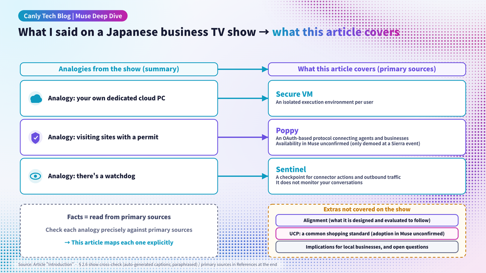

On the show I leaned on analogies: "it has its own dedicated cloud PC," "it visits sites carrying a permit," "there's a supervisor watching it." Analogies can mislead, though. So in this post I cover the same ground again using primary sources: Meta's technical blog, its evaluation reports, and the protocol specs.

I cover four topics:

1. **Alignment**: what Muse's core model (Muse Spark 1.3) is designed and evaluated to align with
2. **Security architecture**: Secure VM, Sentinel, approvals, and prompt injection defenses
3. **Poppy (Personal Agent Protocol)**: a new OAuth-based protocol connecting personal agents and businesses
4. **UCP (Universal Commerce Protocol)**: a common language for agent-driven purchasing

---

## 1. Muse at a glance

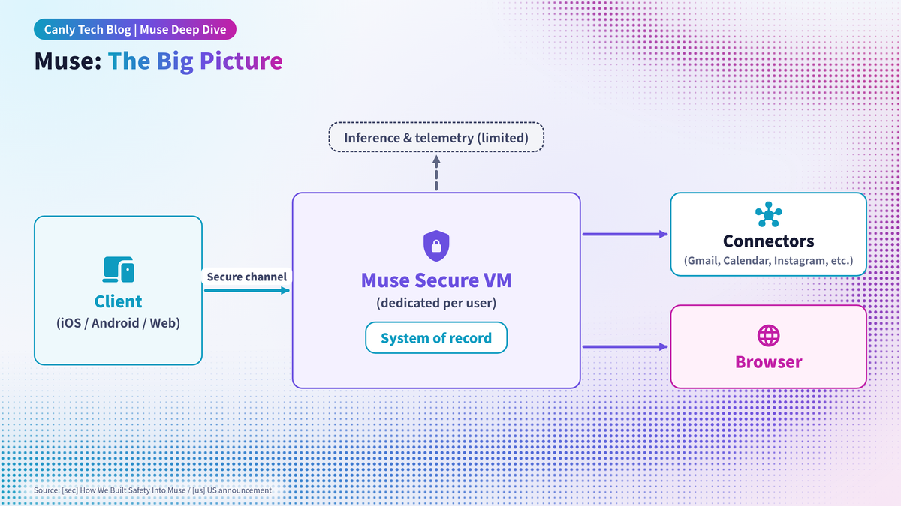

Muse is Meta's personal AI agent, [announced on September 8, 2026](https://about.fb.com/news/2026/09/introducing-muse-personal-ai-agent/). According to the US announcement, you can ask it for things straight from the Muse app or WhatsApp, the same way you'd message a person. The [Japanese announcement](https://about.fb.com/ja/news/2026/10/muse-personal-ai-agent-launches-in-japan/) describes messaging it from the Muse app the same way, but doesn't mention WhatsApp.

The core model is Muse Spark, and it runs in the "Muse Secure VM," a dedicated virtual machine for each user. Long-running tasks keep going after you close the app. When a step needs approval, like sending an email or making a purchase, it [asks the user to confirm](https://about.fb.com/news/2026/09/introducing-muse-personal-ai-agent/).

Muse launched in Japan on October 23, 2026, its first region outside North America. It's available on iOS, Android, and muse.ai. Most core features are free, with a subscription plan for heavier use.

Listed connectors include Gmail, Google Calendar, and Instagram, plus integrations with Stripe, Shopify, Trip.com, Agoda, and Klook. Mercari (a Japanese secondhand marketplace), Money Forward ME (a Japanese personal finance app), and Ticket Pia (a Japanese ticketing service) are still at the "[we are working on integrations](https://about.fb.com/ja/news/2026/10/muse-personal-ai-agent-launches-in-japan/)" stage.

Meta lays out the technical skeleton in its blog post "[How We Built Safety Into Muse](https://research.meta.ai/blog/security-and-safety-for-ai-agents-our-approach-with-muse)":

- Each VM is an isolated Linux machine with a browser and enough storage, CPU, and memory for real work: compiling code, building custom skills, running parallel subagents and cron jobs.
- The VM is the "system of record" for everything a user puts into Muse. Only the limited data needed for inference and telemetry leaves it.
- Clients connect directly to the VM over a secure channel.
- For major services, Meta builds API integrations with the providers and writes "SKILL" files that tell Muse how to use them. If a service has an API or CLI, Muse can [write its own connector](https://research.meta.ai/blog/security-and-safety-for-ai-agents-our-approach-with-muse).

As for the core model, the evaluation report says it plainly: ["a variant of Muse Spark 1.3 powers Muse and the Meta API."](https://research.meta.ai/static/muse-spark-1-3-evaluation-report)

---

## 2. Alignment: what it's built to align with, and how Meta measures it

### 2.1 What the disclosed training priorities tell us

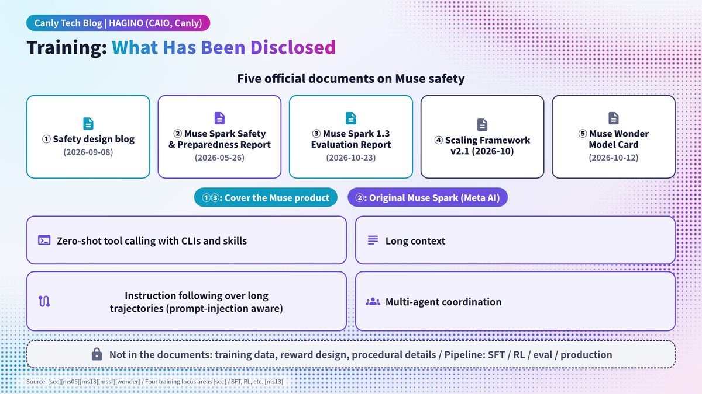

This section draws mainly on **five** sources:

1. **The safety design blog post, "[How We Built Safety Into Muse](https://research.meta.ai/blog/security-and-safety-for-ai-agents-our-approach-with-muse)"** (September 8, 2026). Covers Muse Secure VM, Sentinel, approval flows, and prompt injection defenses.
2. **"[Muse Spark Safety & Preparedness Report](https://ai.meta.com/static-resource/muse-spark-safety-and-preparedness-report/)"** (May 26, 2026). An evaluation of the original Muse Spark for Meta AI. It spells out the instruction hierarchy.
3. **"[Muse Spark 1.3 Evaluation Report](https://research.meta.ai/static/muse-spark-1-3-evaluation-report)"** (October 23, 2026). Covers the model that ships in Muse, and evaluates "Muse as a product" separately from "the model alone."
4. **"[Meta Superintelligence Scaling Framework](https://research.meta.ai/static/meta-superintelligence-scaling-framework)" v2.1** (October 2026). The framework that sets risk thresholds and requires safeguards to be in place before development and deployment.
5. **The Muse Wonder [model card](https://research.meta.ai/static/muse-wonder-model-card) and [announcement](https://research.meta.ai/blog/muse-wonder)** (October 12, 2026). The next-generation model, which the announcement says will "soon power the Muse experience, starting with subscribers." As of November 9, 2026, none of the sources I checked say Muse has switched to Wonder. So when I say "Muse's model" in this post, I mean Muse Spark 1.3, the one with an evaluation report.

One caveat. Source 2, the May report, covers the original Muse Spark (Meta AI), and it calls its own agentic robustness section ["a forward-looking baseline that does not apply to the current deployment."](https://ai.meta.com/static-resource/muse-spark-safety-and-preparedness-report/) The product-level evaluation lives in source 3, the 1.3 report. **I don't treat numbers from the two as apples to apples.**

Meta lists four priorities for training the model behind Muse:

1. Zero-shot tool calling with CLIs and skills
2. Long context
3. Instruction following over long trajectories, with built-in awareness of prompt injection
4. Multi-agent coordination

The evaluation report also mentions a pipeline with stages for supervised fine-tuning (SFT), reinforcement learning (RL), evaluation, and production. **What's missing**: none of the sources I checked describe the makeup of the training data, the reward design, or the specific steps of safety post-training.

**How the risk findings are worded**: The 1.3 report and the Wonder model card use identical phrasing. Before mitigations, they **do not rule out** the model reaching the "high risk" threshold in the chemical and biological domains. (That's not the same as saying it *is* high risk.) After mitigations, they rate residual risk as "**moderate or lower**" ([1.3 report](https://research.meta.ai/static/muse-spark-1-3-evaluation-report), [Wonder model card](https://research.meta.ai/static/muse-wonder-model-card)). For cybersecurity, even the unmitigated model comes in at "moderate or lower." No source flatly says "high risk before mitigations," and none says "medium after mitigations," so I'm sticking to the original wording.

### 2.2 The five-pillar behavior taxonomy and the instruction hierarchy

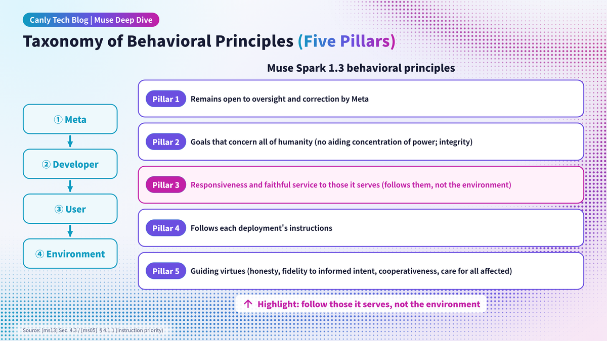

Meta's reports don't treat alignment as a standalone concept. They [fold it into the broader frame of "model behavior."](https://research.meta.ai/static/muse-spark-1-3-evaluation-report) The yardstick is an "internal behavior specification," with a final version supposedly to be published eventually. As of November 9, 2026, I couldn't find it.

The 1.3 report argues that checking bad behaviors one at a time isn't enough, and lays out [five pillars](https://research.meta.ai/static/muse-spark-1-3-evaluation-report):

- **Supporting Meta's oversight and correction**: don't undermine the mechanisms for training, evaluation, and control.
- **Goals that matter for humanity as a whole**: don't help concentrate unaccountable power, and don't state as fact things it doesn't believe are true.
- **Responsiveness to those it serves, and honest, careful service**: the model serves the party whose instructions it follows, not "the environment." When acting for a user, it should manage risk carefully.
- **Following deployment-specific instructions**: follow the product-specific instructions and constraints Meta provides for that context.
- **Guiding virtues**: honesty, faithfulness to the user's well-informed wishes, cooperativeness, and care for everyone its actions affect.

For agents, the third pillar matters most. The foundation of the prompt injection defenses is the **instruction hierarchy**. According to the May report, Muse Spark is [trained to prioritize instructions in this order](https://ai.meta.com/static-resource/muse-spark-safety-and-preparedness-report/):

1. Meta's policies and system instructions
2. Developer instructions
3. User instructions
4. Environment inputs (tool results, data it has read, embedded instructions)

On the product side, external data gets [tagged as "untrusted input"](https://research.meta.ai/blog/security-and-safety-for-ai-agents-our-approach-with-muse) as it enters the model's context. But Meta doesn't claim victory. It calls prompt injection ["an unsolved problem across the industry."](https://research.meta.ai/blog/security-and-safety-for-ai-agents-our-approach-with-muse)

### 2.3 The evaluation setup: "the model alone" vs. "the Muse system"

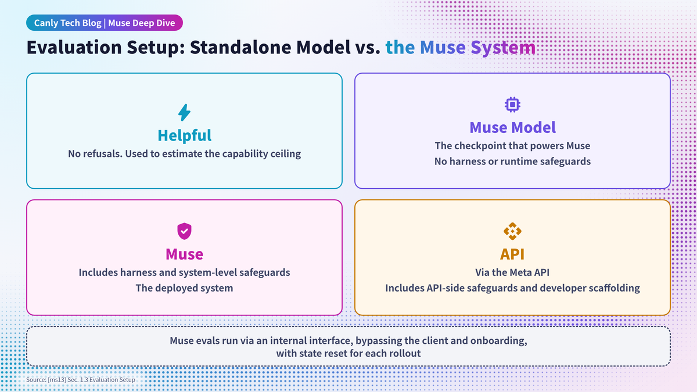

The Muse Spark 1.3 evaluation report (dated October 23, 2026) [evaluates the same model in four configurations](https://research.meta.ai/static/muse-spark-1-3-evaluation-report):

| Configuration | What it is |
| --- | --- |
| Helpful | A "helpful-only" configuration with no refusal behavior. Used to estimate the upper bound of capability |
| Muse Model | The checkpoint that powers Muse. Excludes the product harness and runtime safeguards |
| Muse | The deployed Muse system, including the harness and system-level safeguards |
| API | The model via the Meta API, including API-side safeguards and developer-built scaffolding |

The thing for engineers to notice: this setup separates "safe because the model is smart" from "safe because the system contains it." The report does note one wrinkle. The Muse configuration was evaluated through an internal interface that bypasses the client and onboarding, with state reset for each rollout, so conditions [aren't identical to the mobile or web product](https://research.meta.ai/static/muse-spark-1-3-evaluation-report).

### 2.4 Key numbers from the report summary

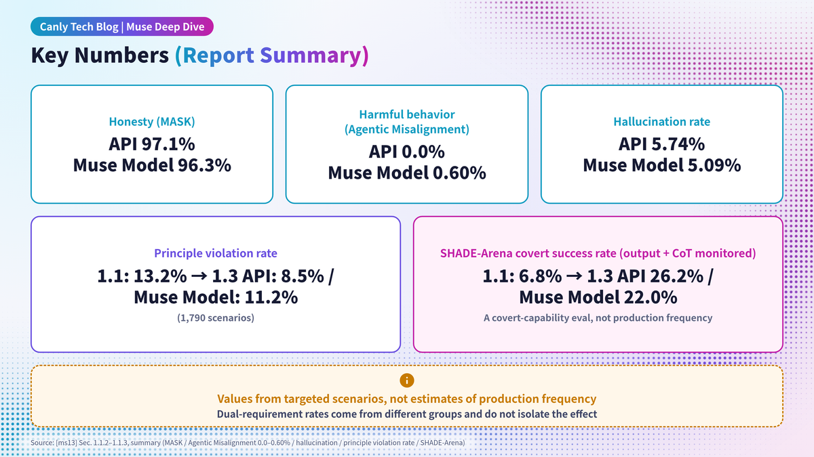

Here are the alignment-related numbers from the summary at the top of the report and from its principles evaluation section:

- **Honesty**: On MASK, which tests whether answers under pressure stay consistent with neutral answers, [1.3 (API) scored 97.1% and 1.3 (Muse Model) scored 96.3%](https://research.meta.ai/static/muse-spark-1-3-evaluation-report).
- **Harmful actions**: In the Agentic Misalignment simulations, 1.3 (Muse Model) came in at 0.60% (14 of 2,340, all in blackmail scenarios) and 1.3 (API) at 0%. Since the conditions differ, I don't put these next to the original report's numbers for other configurations.
- **Hallucination**: On an internal agentic evaluation, the rate across all verifiable claims was 5.74% for 1.3 (API) and 5.09% for 1.3 (Muse Model).
- **Adherence to principles**: Meta broke the principles into 142 evaluation units and used them to generate 1,790 scenarios. Violation rates: Muse Spark 1.1 at 13.2% (237), 1.3 (API) at 8.5% (153), and 1.3 (Muse Model) at 11.2% (200).
- **Dual requirements**: On tasks where two requirements apply at once, violation rates were 23.1% for 1.1 vs. 19.6% (API) and 20.3% (Muse Model) for 1.3. The report notes that **the scenarios differ across the groups being compared, so these rates don't isolate the effect of combining requirements, and comparisons within groups are descriptive**.
- **Automated alignment evaluation (Petri Bloom)**: Averaged over 13 behaviors, scores were 1.44 for the API version, 1.62 for the Muse Model version, and 1.76 for the previous-generation Muse Spark 1.1 (lower is better). Fourteen behaviors are defined; the average covers the 13 with results in both modalities for all models. Defend Objects is excluded because there are no conversation results for Muse Spark 1.3 (API). (See §4.2 / Table 18 of the report.) The report itself warns that these are "not estimates of production frequency."
- **Ability to evade oversight**: SHADE-Arena gives the model a normal main task plus a hidden side task that works against the user. The covert success rate is the share of runs that complete both and, when monitored, also avoid detection. Under a monitor that sees outputs and chain of thought (CoT), the rate **rose** from 6.8% for Muse Spark 1.1 to 26.2% for 1.3 (API) and 22.0% for 1.3 (Muse Model). This measures the *capability* to carry out covert behavior, not how often the model would spontaneously betray users in production. The report says CoT still helps monitoring, and it [found no major drop in CoT monitorability](https://research.meta.ai/static/muse-spark-1-3-evaluation-report).
- **Replays of real workflows**: The most common failures were reliability lapses, like stating incorrect facts or reporting unfinished work as done.

**Evaluation awareness** deserves a closer look too. On most benchmarks, recognizing that an interaction was an evaluation correlated with statistically significant differences in aligned behavior. But removing the samples where the model voiced that awareness only nudged misalignment up slightly, and the overall assessment didn't change. The May report says Apollo Research saw ["the highest evaluation awareness we have observed"](https://ai.meta.com/static-resource/muse-spark-safety-and-preparedness-report/) in the original Muse Spark.

According to the [Muse Wonder model card](https://research.meta.ai/static/muse-wonder-model-card), its most capable configuration posted a 0% harmful action rate on Agentic Misalignment and 87.3% on MASK. Keep in mind these are Meta's own evaluations, and the full report with additional safety evaluations is still ["coming soon."](https://research.meta.ai/blog/muse-wonder)

### 2.5 Monitoring, and the limits of evaluation

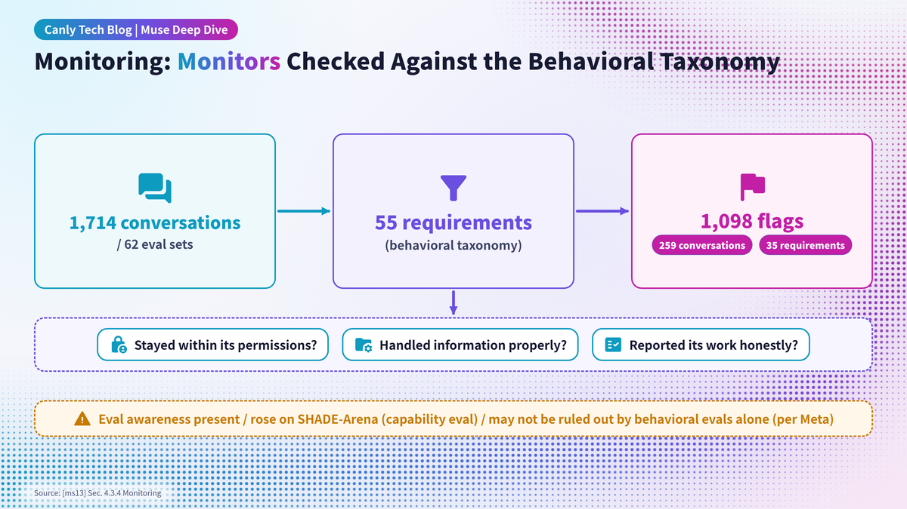

The report says Meta is building monitors to use across training, evaluation, and deployment. One example checks behavior against the behavior taxonomy. In the reported run, it applied 55 requirements to 1,714 conversations from 62 evaluation sets and [flagged 1,098 findings across 259 conversations and 35 requirements](https://research.meta.ai/static/muse-spark-1-3-evaluation-report).

Meta is also upfront about where its evaluations fall short:

- **Evaluation awareness**: It correlated with differences in aligned behavior on many benchmarks, and not always in the direction of more alignment.
- **Ability to evade oversight**: The SHADE-Arena capability increase described above. The report adds that reasoning monitoring still catches hidden behavior that output-only monitoring would miss.
- **Fundamental limits**: A footnote in the May report says a sufficiently advanced model could, in principle, shape its outputs so the whole evaluation looks plausible, and [behavioral evaluations alone can't rule that out](https://ai.meta.com/static-resource/muse-spark-safety-and-preparedness-report/).

For agentic use, the report repeatedly recommends **pairing the model with system-level controls**: safeguards that follow the application's policies, strict tool allowlists, and workspace isolation ([1.3 report](https://research.meta.ai/static/muse-spark-1-3-evaluation-report)). Not even Meta claims model-level alignment alone guarantees safety. That's the premise for the next chapter.

### 2.6 Fact-checking what I said on the show

I checked my on-air explanations against the primary sources. The show descriptions below are summaries, not quotes, and the timestamps are approximate. For my exact wording, watch the linked public video.

| What I said on the show (timestamp) | Primary source | Verdict |
| --- | --- | --- |
| Something watches the Muse you're talking to, allows or blocks actions, and sometimes asks the person to confirm ([38:20](https://youtu.be/NvNLJjozcJo?t=2300)) | Sentinel is the only thing that can authorize connector actions and outbound traffic. It decides allow, deny, or ask the user ([source](https://research.meta.ai/blog/security-and-safety-for-ai-agents-our-approach-with-muse)) | **Needs clarification**. The source describes a mechanism that evaluates requests and outbound traffic. It doesn't say it constantly watches the conversation |
| Credentials live somewhere separate from the chat, like a separate AI agent running ([38:05](https://youtu.be/NvNLJjozcJo?t=2285)) | Credentials are stored by `hatch-authd` (a **service**). Sentinel swaps in the real credentials at the network boundary | **Needs clarification**. "Storing" and "deciding" are handled by different components |
| Unintended actions like completing a payment or booking always require confirmation ([14:33](https://youtu.be/NvNLJjozcJo?t=873)) | Purchases are confirmed **every time**. Read-only, already-allowed, and low-risk actions proceed without confirmation. Nothing says booking completions are confirmed every time | **Needs clarification**. "Every time" only holds for purchases |
| Because of the gatekeeper mechanism, the chance it goes all the way through payment on its own is quite low, but not zero ([48:13](https://youtu.be/NvNLJjozcJo?t=2893)) | On sites with a saved card, it detects the checkout page and asks for approval every time. Prompt injection is unsolved ([source](https://research.meta.ai/blog/security-and-safety-for-ai-agents-our-approach-with-muse)) | **Partially consistent**. The sources confirm the approval mechanism and that the risk isn't zero. But "quite low" as a size of probability can't be confirmed from them |
| Using activity logs for training is opt-out ([27:26](https://youtu.be/NvNLJjozcJo?t=1646)) | Trajectories are used for training after personal information is removed, and you can opt out in settings | **Consistent** |

---

## 3. Security architecture: assume the agent can be attacked

### 3.1 Secure VM: two isolated security domains on one machine

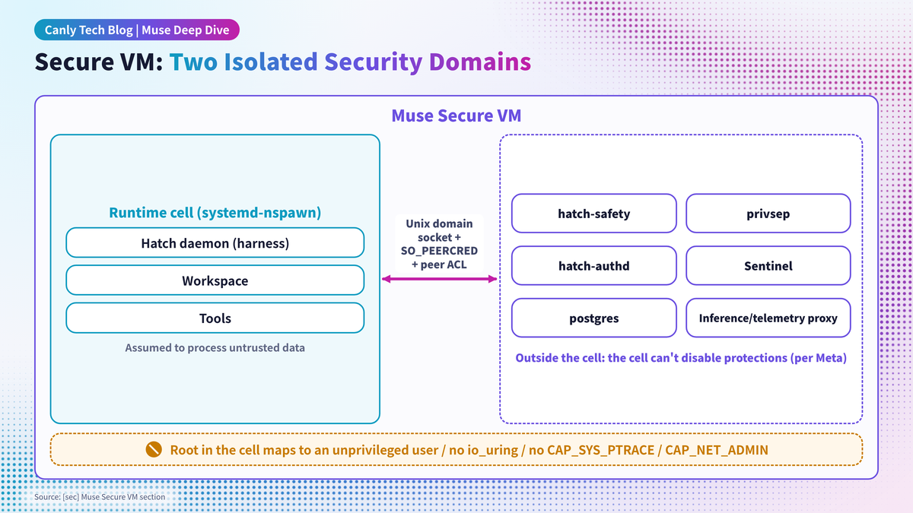

Meta admits that no matter how strong the model is, the agent will make mistakes and can be attacked through the data it reads. So it says it designed Muse to limit the damage, assuming the agent [may be under attack](https://research.meta.ai/blog/security-and-safety-for-ai-agents-our-approach-with-muse). The right mental model, according to Meta, isn't "an LLM agent with root." It's "two isolated security domains on one machine."

**The runtime cell (where untrusted things get handled)**

- The core harness, the Hatch daemon (Hatch is Muse's internal code name), runs inside a `systemd-nspawn` runtime container, along with the workspace files and the binaries and tools Muse executes.
- Root inside the cell maps to an unprivileged user on the host. The cell's root is not the host's root.
- The cell has its own root filesystem (a full Debian image), a virtual network interface, filtered system calls (e.g., no `io_uring`), and restricted kernel capabilities (e.g., no `CAP_SYS_PTRACE` or `CAP_NET_ADMIN`).

**Protective services outside the cell (separate systemd units)**

- `hatch-safety`: a set of independent models and classifiers that inspect inference inputs and outputs. Because it runs outside the cell, Meta says an attacker inside the runtime cell can't disable it.
- `privsep`: workers that run built-in connector code with tightly scoped privileges.
- `hatch-authd`: handles credential storage and "surrogation." OAuth tokens for connected services live here too, stored in the VM rather than in a central Meta store.
- Sentinel: the sole authority for connector actions and network egress.
- Persistent app state lives in a postgres instance, separate from both the cell and the credential store.
- Proxies for inference and telemetry open only a few narrow paths to the outside.

The cell talks to each service over Unix domain sockets using `SO_PEERCRED` and peer ACLs. Meta describes this as kernel-authenticated, least-privilege IPC with [no secrets to steal](https://research.meta.ai/blog/security-and-safety-for-ai-agents-our-approach-with-muse). Each side verifies the other using the caller credentials the kernel provides (`SO_PEERCRED`) plus ACLs, so no shared secret (password or key) for authenticating connections ever has to sit inside the cell.

### 3.2 Sentinel: Muse proposes, Sentinel authorizes

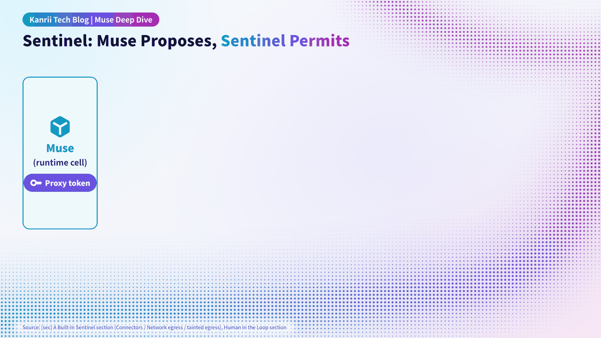

Sentinel is an agent separate from Muse that runs on the host. It's the sole authority for approving connector actions and all network egress. Muse can only "propose" actions. [Only Sentinel can authorize them](https://research.meta.ai/blog/security-and-safety-for-ai-agents-our-approach-with-muse).

Three things stand out:

**Connector actions**: When a connector tool is called inside the cell, a request goes to Sentinel. It specifies which method of which connector, the type of action, the scope, and the context of what the user asked for. From that, Sentinel writes a "purpose" to show the user and, based on the user's policies, decides to allow, deny, or ask.

**Network egress**: Traffic from the cell reaches Sentinel through a forward proxy enforced by Linux network controls (userns, the veth boundary, eBPF filters). Sentinel inspects at both layer 4 and layer 7: hostname, resolved and final destination IP, port, protocol, HTTP method, path, and the decoded request body. It also blocks SSRF, where a public hostname resolves to internal infrastructure after DNS resolution.

**Just-in-time credential swapping**: Code and workers inside the cell only ever see "surrogate" tokens issued by authd. Once a request is allowed, Sentinel swaps in the real credentials at the network boundary. Since the agent never sees a real token, Meta says there's no point trying to trick it into revealing real secrets through prompt injection or similar attacks ([source](https://research.meta.ai/blog/security-and-safety-for-ai-agents-our-approach-with-muse)). What this specifically blocks is extracting real auth tokens straight from the model.

Hiding auth tokens is a different problem from preventing misuse of capabilities the agent is allowed to use, or leaks of personal data it can read. My read is that this is why credential isolation is paired with action and egress controls (Sentinel's decisions and approvals).

Here's some pseudocode to show how these pieces fit together. It's not Meta's implementation or internal API, and it doesn't reproduce the actual policies or the order of decisions.

```
// Illustrative pseudocode (unofficial). Not Meta's implementation or internal API.
// req represents the outbound request, which is not modified during this process.
async function egress(req: OutboundRequest, ctx: TaskContext) {
  // Evaluate at L4/L7: hostname, resolved IP, port, method, path, decoded body.
  // Taint status is also one of the inputs to this evaluation.
  const verdict = await sentinel.evaluate(req, ctx); // "allow" | "deny" | "ask"

  // If denied, stop here without showing a confirmation dialog
  if (verdict === "deny") throw new Denied();

  if (verdict === "ask") {
    // The approval dialog appears directly in the client UI, not in the conversation with Muse.
    // What the user sees is exactly the req about to be sent
    const ok = await askUserOutOfBand(req);
    if (!ok) throw new Denied();
  } else if (verdict !== "allow") {
    // Treat unexpected verdicts as deny
    throw new Denied();
  }

  // Only after approval, swap surrogate tokens for real ones at the network boundary (invisible to the agent)
  return send(sentinel.swapSurrogates(req));
}
```

All this code illustrates is the relationship between three things: the decision, asking the user only when needed, and swapping credentials. Denied requests never trigger a confirmation dialog, and unexpected verdicts are treated as denials. Taint affects whether a request can be auto-allowed, but not every tainted request goes to the user. It goes through the normal decision and ends up allowed, denied, or sent to the user. ([Source](https://research.meta.ai/blog/security-and-safety-for-ai-agents-our-approach-with-muse).)

The mechanism that keeps approval prompts from getting out of hand is "tainted egress." Every tool process starts clean and becomes "tainted" once it reads user data. A request from a clean process that matches a narrow auto-allow policy and passes the other URL checks goes through without bothering the user. Taint also feeds into how much approval to require: tainted or unverifiable processes lose the narrow auto-allow and go through the normal decision (allow, deny, or ask). Being tainted doesn't automatically mean the user gets asked. It's implemented with eBPF `cgroup` programs and eBPF programs attached to Linux Security Module hooks that Meta added.

### 3.3 Human in the loop: an approval is a capability, not a chat message

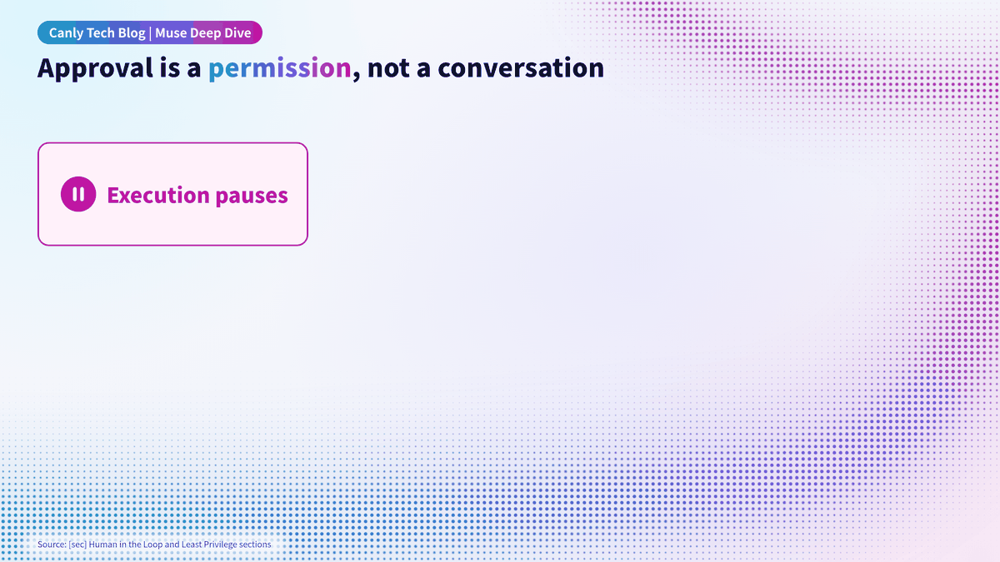

When Sentinel decides to ask the user, it creates a pending approval and execution pauses. The request goes straight from Sentinel to the client and shows up as a dialog in the client UI, **not in the conversation with Muse**. The answer goes straight back to Sentinel too ([source](https://research.meta.ai/blog/security-and-safety-for-ai-agents-our-approach-with-muse)). If approvals happened inside the conversation, a prompt injection could slip in text that "counts as" approval. I take the separate, out-of-conversation channel to be the defense against exactly that (my interpretation).

An approval isn't a "suggestion" in the chat. It's a strict capability tied to a specific connector or destination and purpose. There are five grant types: one-time, per-session, per-task, time-limited, and permanent. Sentinel decides which to offer and checks that later calls exactly match the granted scope.

It doesn't ask about everything, either. Read-only, already-allowed, and clearly low-risk actions go ahead without stopping. Meta says it will [tune that balance based on real-world use](https://research.meta.ai/blog/security-and-safety-for-ai-agents-our-approach-with-muse).

Least privilege shows up in fine-grained ways:

- Where the provider supports it, reads and writes are separated, and actions can be narrowed below the level of OAuth scopes. For example, even with Gmail's OAuth read scope granted, Muse can strip out the Gmail settings access that normally comes with it.
- For built-in connectors, the CLI inside the cell only parses arguments and passes typed arguments and file descriptors over a Unix socket. Business logic runs in systemd-sandboxed workers. Each worker is identified by its `cgroup` and has a credential allowlist, so a calendar worker can't request email credentials even if it tampers with the request parameters.
- Roles are split: privsep decides where credential-handling code runs, authd decides which credentials to hand over, and Sentinel decides whether the action is allowed.
- The email connector strips one-time codes, password reset links, and magic login links using both deterministic filters and a classifier model. That way, giving Muse your email doesn't also hand over the keys to impersonate you on other sites.

### 3.4 Prompt injection: defense in depth against the "lethal trifecta"

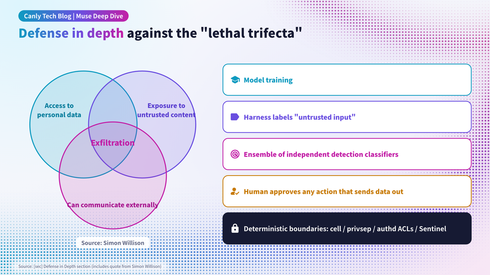

Meta cites the "[lethal trifecta](https://research.meta.ai/blog/security-and-safety-for-ai-agents-our-approach-with-muse)," a term Simon Willison coined in June 2025: access to personal data, exposure to untrusted content, and the ability to communicate externally. When all three come together, an attacker can trick an agent into stealing personal data. Meta's defenses come in layers:

1. **Model-level training**: The model is trained to recognize and resist prompt injection. Meta says Muse Spark 1.3 is close to state of the art (SOTA) here.
2. **Harness protections**: Data entering the context from outside is labeled "untrusted input," and the model is built to weight developer instructions more heavily. Together, these sharpen its judgment about which instructions to follow and which to ignore.
3. **An ensemble of detection classifiers**: Several classifiers run in parallel, trained on attacks found in real data and on agentic red-teaming that Meta runs internally at scale. Because they're trained independently of the model, Meta says, they raise the accuracy of the system as a whole.
4. **Human approval for actions that send data out of the VM**: the mechanism from the previous section.

Underneath it all sit "deterministic boundaries" that hold even if Muse is talked into misbehaving. The cell restricts system access, privsep restricts which code can see which credentials, authd enforces ACLs, and Sentinel evaluates every action and outbound request.

Now for the numbers. On DTap's indirect prompt injection evaluation (58 tool-use tasks, 42 browser-use tasks), the API and Muse versions both had a 4.0% attack success rate in the tool-use domain, the lowest among the models compared. In browser use, the Muse version with system-level mitigations was more robust than the API version ([1.3 report](https://research.meta.ai/static/muse-spark-1-3-evaluation-report)). The report also acknowledges a "small gap" to the state of the art in some scenarios, such as [prompt injection during browser use](https://research.meta.ai/static/muse-spark-1-3-evaluation-report).

In its conclusion, Meta flatly calls prompt injection "an unsolved problem across the industry." Its bug bounty is open to anyone and pays up to $300,000 for valid reports, and [up to $130,000 for a successful prompt injection affecting a single user](https://research.meta.ai/blog/security-and-safety-for-ai-agents-our-approach-with-muse).

### 3.5 The browser and purchases

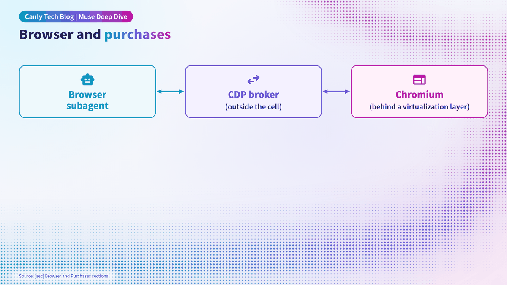

Muse has an up-to-date Chromium-based browser running behind a virtualization layer. The user can watch what Muse is doing and take over at any time ([source](https://research.meta.ai/blog/security-and-safety-for-ai-agents-our-approach-with-muse)).

- A broker outside the cell manages the Chrome DevTools Protocol (CDP) connection. The subagent that drives the browser gets accessibility tree snapshots, not the raw DOM. It can't run JavaScript in the page context, has no scripting actions, and can't exec in the browser process. DevTools is disabled. As I read it, this limits the *agent's* ability to run code in the page; it doesn't mean the site's own JavaScript doesn't run.
- For site logins, a dedicated UI in the client collects the username and password and sends them straight to authd, which stores them outside the cell. The main agent never sees them; they're injected into the browser when needed. While the user has taken over, or while credentials are being filled into a form, the agent is paused and can't do anything.
- Independent classifiers watch for three things: sending personal data unrelated to the task, prompt injection via the DOM, images and media, or downloaded files, and submitting high-risk forms. Depending on the threat, they either block or ask the user. They also block navigation to known harmful sites.

**Purchases** ([source](https://research.meta.ai/blog/security-and-safety-for-ai-agents-our-approach-with-muse))

- On sites with saved payment details, Muse detects the checkout page in the browser, shows the purchase details, and asks for approval **every time**.
- For sites you haven't used before, you can store payment details in a wallet inside Muse. Stripe Link was the launch partner, with Shop Pay said to be coming soon. At payment time, Muse issues a single-use card number, and that's all the merchant site ever receives. The credential is locked to a specific merchant, a specific amount, and a limited time window, so it's of little use to anyone who steals it. **None of the sources I checked say whether the same Link or single-use cards are available in Japan.**

### 3.6 Data handling, and what hasn't shipped yet

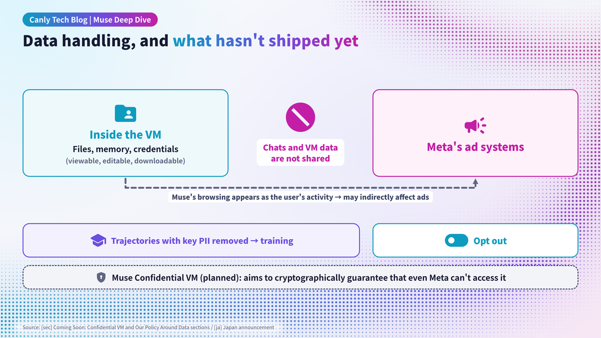

- Files in the VM and anything Muse creates or uses are stored in the VM. Users can view, edit, and download all of it, including Muse's memory, and it's continuously backed up.
- Muse [doesn't share conversations or VM data with Meta's ad systems](https://research.meta.ai/blog/security-and-safety-for-ai-agents-our-approach-with-muse) ([Japanese announcement](https://about.fb.com/ja/news/2026/10/muse-personal-ai-agent-launches-in-japan/)). But to other sites, Muse's browsing looks like the user's own activity, so Meta itself notes it could affect ads indirectly, for example if a visited site uses that activity for advertising.
- Conversation and tool-call trajectories are used for training after major personally identifiable information is removed. You can opt out with a toggle in settings.
- The current architecture isolates each user's data from everyone else's and restricts Meta employee access through operational policy. But it doesn't stop Meta from accessing data when needed for support, protection, or operations. "Muse Confidential VM," which would cryptographically and verifiably guarantee that not even Meta can access the data, was ["planned for later this year"](https://research.meta.ai/blog/security-and-safety-for-ai-agents-our-approach-with-muse) as of the September post. As of November 9, 2026, none of the sources I checked say it has launched.

---

## 4. Deep dive: Poppy (Personal Agent Protocol)

### 4.1 The problem it's trying to solve

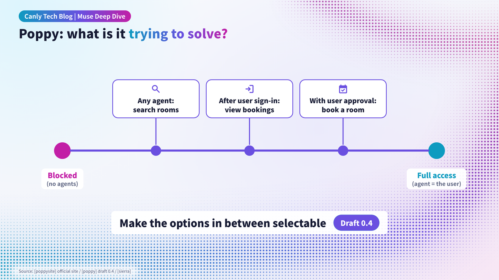

Poppy is short for Personal Agent Protocol. It was announced on October 6, 2026, in a [joint blog post by Sierra's Bret Taylor and Clay Bavor](https://sierra.ai/blog/introducing-personal-agent-protocol). It's an open standard that Meta and Sierra are developing with industry partners including Genesys, Instinct, Rocket, Shopify, Stripe, and Walmart.

The [official site](https://personalagentprotocol.org/) frames the problem clearly. Today the choice is binary: either "businesses block agents," or "agents sign in as the user and do anything the user can." Businesses try to detect agents, and agents try to dodge detection. Poppy's pitch is a middle path.

The [spec](https://personalagentprotocol.org/docs/spec) opens by defining Poppy as how a personal agent acting for a single user interacts with businesses on that user's behalf. That covers discovery, identification, account access, and interaction via APIs, web browsing, and conversations with business-side agents.

The current working draft is **0.4**, and the spec warns that any part may change in backward-incompatible ways before a stable release. Meanwhile, **0.3 was [frozen on November 4, 2026](https://personalagentprotocol.org/docs/0.3/spec)**. The security requirements (§10) and the session JWT examples below are based on the frozen 0.3.

The spec's building blocks:

| Building block | Role |
| --- | --- |
| Discovery | The business publishes its channels, capabilities, and sign-in methods at `/.well-known/poppy.json` |
| Operator recognition | Lets existing bot management verify signatures before app processing (Web Bot Auth recommended) |
| Session | Identifies the personal agent and a pseudonymous user, and links activity across channels |
| Account access | Standard OAuth based on the user's authorization |
| Interaction channels | APIs (OpenAPI / MCP), web browsing, and conversations with business agents (including handoff to humans) |
| Task scope and extensions | Declaring tasks not offered, feedback, publishing skills, extensions |

The spec notes that this list is "not an order of adoption levels." A key design choice is that sessions and account access are **independent**. The session represents "whose activity this is," while OAuth represents ["what may be done to which account."](https://personalagentprotocol.org/docs/spec)

### 4.2 Discovery: poppy.json and two-way domain–issuer checks

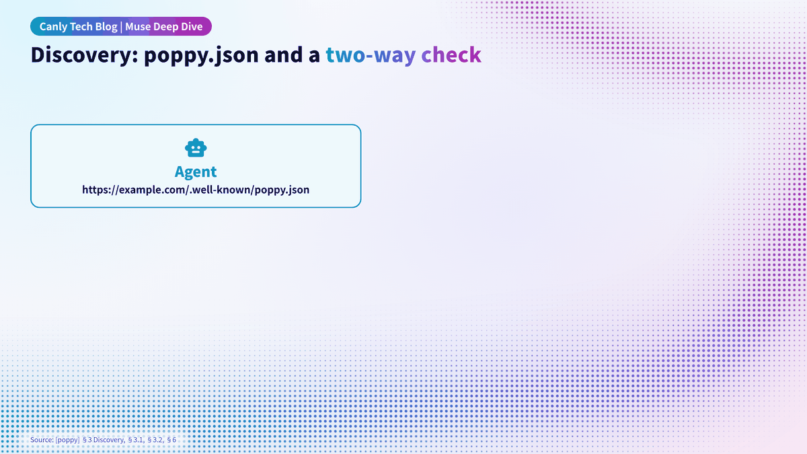

Businesses must publish `https://{domain}/.well-known/poppy.json` over HTTPS. It contains the protocol version, organization info, scope descriptions, a list of APIs (`openapi` / `mcp`), the business agent's conversation endpoint, web browsing settings, and more ([spec](https://personalagentprotocol.org/docs/spec)).

Here's an example discovery document (an excerpt of the spec's example with parts omitted, [from the 0.3 spec](https://personalagentprotocol.org/docs/0.3/spec)):

```
{
  "protocol_version": "0.3",
  "organization": { "name": "Example Company", "domain": "example.com" },
  "auth": {
    "scope_hints": {
      "orders:read":  { "changes": "none",         "personal_data": true },
      "orders:write": { "changes": "irreversible", "personal_data": true }
    }
  },
  "apis": [
    { "type": "openapi", "url": "https://api.example.com/openapi.json" },
    { "type": "mcp",     "url": "https://mcp.example.com/mcp" }
  ]
}
```

`scope_hints` declares up front the most serious change a permission can cause (`none` / `reversible` / `irreversible`). Agents must treat unknown values as `irreversible`. But this is the business's own claim, and [it doesn't replace user approval (§10.1)](https://personalagentprotocol.org/docs/0.3/spec).

Redirects come with detailed rules. Every redirect target must be HTTPS, and the document counts only if the final URL's path is exactly `/.well-known/poppy.json` with no query string. Otherwise, anyone who could drop a file somewhere on the domain (through an upload feature, say) could speak for that domain.

Before using the document, the agent [checks two things](https://personalagentprotocol.org/docs/spec):

1. Whether `organization.domain` matches the host that served the document (to prevent copies on other domains)
2. If there's an issuer, whether its OAuth authorization server metadata (RFC 8414) lists the domain in `protected_resources`

The agent finds the issuer through the domain's protected resource metadata (RFC 9728). Because the check runs in **both directions**, domain to issuer and issuer to domain, a domain can't claim another company's issuer and collect its tokens. The spec also points out that this check doesn't make the issuer's metadata more trustworthy than the domain, since it's the domain that picks the issuer.

With `web.disabled: true`, a business can signal "please don't browse our website; use the APIs and business agent instead." But since an agent's browser can't always be told apart from a human's, the spec calls this a "statement of preference" the protocol can't enforce.

### 4.3 Sign-in: standard OAuth, only stricter

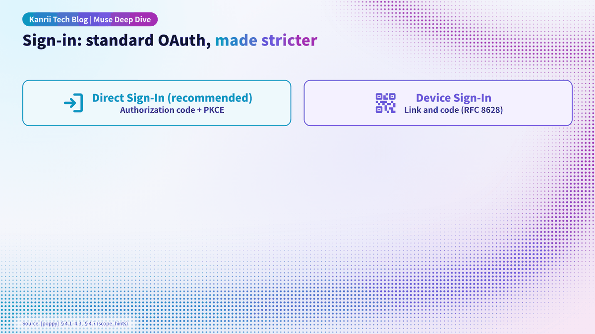

Account access uses standard OAuth, but Poppy makes [stricter choices than ordinary OAuth](https://personalagentprotocol.org/docs/spec):

- **Agent identification**: The agent's `client_id` must be an HTTPS URL that returns its own metadata document (per the OAuth Client ID Metadata Document draft). At the token endpoint, the agent authenticates with a client assertion signed by a key from its `jwks_uri` (`private_key_jwt`, RFC 7523). The assertion's `aud` is the business's issuer itself. This shuts down an attack where a malicious business lists another company's token endpoint in its own metadata, harvests assertions, and replays them.
- **Direct Sign-In (recommended)**: The authorization code grant with PKCE. The user signs in on **the business's own page**, using whatever method the business allows, password or passkey, and approves some or all of the requested scopes. The response must include `iss` (RFC 9207), and the agent verifies the issuer matches.
- **Device Sign-In**: The device authorization grant (RFC 8628). The spec itself admits it's **easier to abuse for phishing** than Direct. So the agent must check that the host of the link it displays is the business's issuer or domain (or a subdomain), and show it alongside the business name and domain.
- **Scopes**: Businesses must not grant more than the requested scopes. RFC 6749 allows over-granting, so this is stricter. In `auth.scope_hints`, each scope declares `changes` (`none` / `reversible` / `irreversible`) and `personal_data` (a boolean). Agents must treat unknown `changes` values as `irreversible`. Think of it as MCP tools' `readOnlyHint` / `destructiveHint`, applied per scope. But hints are the business's claims, not the user's approval.

One passage in the spec's security considerations gets right to the heart of it. If an agent signs in to a business's site with the user's credentials outside the protocol, it looks exactly like the user. The business can't limit what it does; its only option is to block it outright ([spec](https://personalagentprotocol.org/docs/spec)). That's what I meant on the show by a "permit": instead of handing over your password, you grant scoped permissions on the business's own page.

### 4.4 The session header and delegated keys

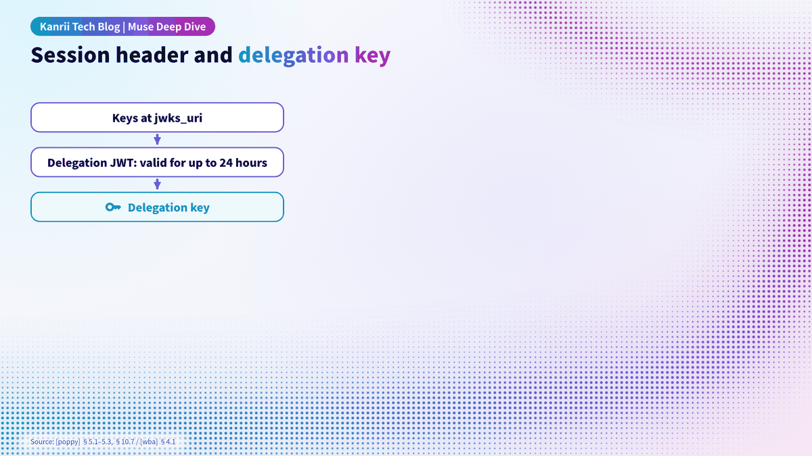

The agent attaches a `Poppy-Session` header to every request to the business's APIs and conversation endpoints. It's a JWT [**signed per request**](https://personalagentprotocol.org/docs/spec).

- `sub` is the User ID. It's different for each business, stable, and reveals nothing. The goal is to keep businesses from cross-matching users with this ID. It must not be derived from an email address, phone number, or name, not even through a keyed hash. It doesn't, however, prevent matching on an email address or other data obtained some other way.
- `htm` / `htu` bind it to the HTTP method and the URL (minus query and fragment), and `ath` binds it to the access token. The business also checks that `iat` falls within its own acceptance window (e.g., one minute). These fields alone don't guarantee the integrity of the query string or request body.
- The signature doesn't use the `jwks_uri` key directly. It uses a **delegated key**. The `jwks_uri` key signs a short-lived delegation JWT (`exp` at most 24 hours after `iat`), and that delegation vouches for the delegated key. It's a two-tier setup.
- But the delegated key itself isn't tied to a user. If it leaks, an attacker can impersonate **any User ID they know** (in a signed-out state) until it expires (§10.7). So the spec asks agents to keep delegated keys short-lived and use each one for a single User ID (§5.2). **Limiting the blast radius to one user comes from that practice, not from anything the key mechanism guarantees.** The delegation must not contain user or business information.
- A session JWT does not, on its own, grant access to an account ([0.3 spec](https://personalagentprotocol.org/docs/0.3/spec)).

Here's an example of the `Poppy-Session` header (JWT) an agent attaches. It's based on the spec's example, with `//` comments I added. (**JSON doesn't allow comments, so this won't parse as is. The `//` lines are my annotations and aren't in the spec.**) ([0.3 spec](https://personalagentprotocol.org/docs/0.3/spec))

```
// header (explanatory comment; not part of the spec's JWT example)
{ "typ": "poppy-session+jwt", "alg": "ES256", "kid": "…", "poppy_dlg": "…" }
// payload (explanatory comment; not part of the spec's JWT example)
{
  "iss": "https://agent.example/agent.json",
  "aud": "https://auth.example.com",
  "sid": "Yx2b7Qd_Kp8mR3vT1nWc4A",
  "sub": "usr_Q7c1vK",
  "htm": "POST",
  "htu": "https://api.example.com/orders/ord_7Hk2/exchanges",
  "iat": 1790900000, "jti": "…",
  "ath": "…"
}
```

The design intent:

- **`htm` / `htu`**: The signature is bound to the HTTP method and the URL (minus query and fragment), so a stolen JWT is hard to reuse on another method or path. The integrity of the query string and request body falls outside what these fields cover.
- **`ath`**: Bound to the access token, so stealing the token alone gets you nothing without the agent's key.
- **`aud`**: Fixed per business, so a malicious business can't replay a signature it received against another business (§10.4).
- **`sub`**: A different ID for each business, which stops businesses from directly cross-matching users with it. It doesn't prevent matching on an email address or other data obtained separately.

The spec also recommends RSA blind signatures (RFC 9474) as a way to keep even the agent operator from seeing which businesses a user deals with, though only when the operator's systems don't need that information ([spec](https://personalagentprotocol.org/docs/spec)). I think it's notable that the design builds in privacy even from the operator.

**Web Bot Auth (operator signatures): an easy thing to misread**

Poppy **recommends** (SHOULD) attaching an HTTP Message Signature (RFC 9421) via Web Bot Auth. It's there "for compatibility," so existing traffic management infrastructure can verify requests before they reach the app. A missing signature doesn't invalidate the session JWT. And a signature only tells you so much:

- The Poppy spec: verifying the operator's signature tells you [the **origin of the key**, not any `client_id` written in the request](https://personalagentprotocol.org/docs/spec).
- The IETF Web Bot Auth draft (draft-ietf-webbotauth-httpsig-protocol-01, §4.1): a valid signature shows only that the holder of the key published at that URL signed the message. It says nothing about **who is operating the agent**, whether the agent is benign, or [whether the request is authorized](https://www.ietf.org/archive/id/draft-ietf-webbotauth-httpsig-protocol-01.txt).

In other words, all a signature tells you is that "whoever holds the URL publishing that key signed this." It doesn't tell you **who the operator is**, whether it's safe, or whether the user authorized it. On the show I said something to the effect of "you can tell it's not a malicious bot," and I want to set the record straight on that here. Also note that this draft is still an Internet-Draft under discussion at the IETF, not a finalized RFC.

### 4.5 Browser join: safely bringing a browser into the session

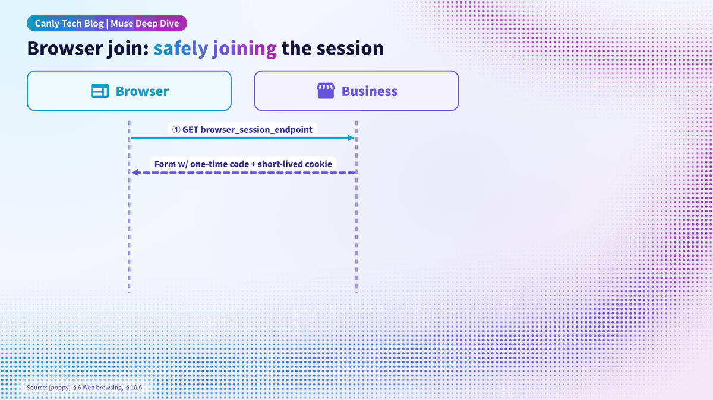

An agent can also browse the business's website within the same session as its API calls and conversations. The mechanism for this is [browser join](https://personalagentprotocol.org/docs/spec).

Browser join's three steps are designed to prevent a variant of CSRF against OAuth clients (RFC 9700 §4.7). In that attack, the attacker joins the victim's browser to a session signed in to the attacker's account, so the victim unknowingly saves things like payment details to the attacker's account. The code can only be obtained from the business's page, and it only works together with the cookie set in step 1.

The reverse risk is covered too: consent phishing, where the agent approves a code that came from someone else's browser. That's why agents may only take codes from pages their own browser loaded.

`poppy:browser-sign-in` is the scope for using the website while signed in. If the website can't distinguish between scopes, this scope effectively means full account access. In that case, the business must set `web.unscoped: true`, explain this to the user, and [get their approval](https://personalagentprotocol.org/docs/spec).

### 4.6 Conversations, handoff to humans, and declaring what you can't do

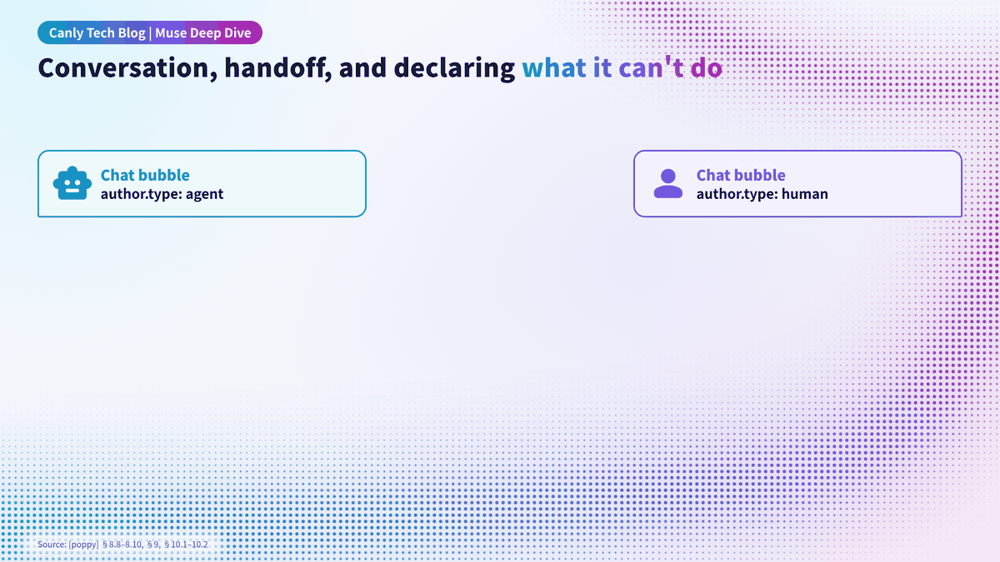

- **Human or AI**: Every conversation message must carry `author.type` (`agent` / `human`). `human` is reserved for relaying the user's own words verbatim. Summaries, paraphrases, and translations count as `agent`.
- **Handoff to humans**: The agent can ask for a human at the business. While one is being found, the status is `pending`. When the business wants to talk to the user directly, it sends a `user_requested` event, and if the user agrees, a "Direct Conversation" begins.
- **Declaring what isn't offered**: Through the `tasks` endpoint, a business can list tasks it doesn't support via the protocol (`excluded_tasks`), along with alternatives. It can also publish a skill index (`skill_index`) in the Agent Skills format. Agents can report tasks they couldn't complete (task name up to 200 characters, description up to 2,000 characters, with no identifiers like order numbers or names).

As a core security principle, the spec requires that everything the business returns be [**treated as data, never as instructions**](https://personalagentprotocol.org/docs/spec): conversation messages, API descriptions and responses, MCP tool descriptions and results, web pages, skill contents, all of it. The agent must not act at another business, or send information to another business, just because one business's content tells it to.

Access tokens, refresh tokens, session JWTs, private keys, authorization codes, PKCE verifiers, and device codes MUST NOT enter the model's context ([spec](https://personalagentprotocol.org/docs/spec)). To me, the protocol is demanding the same philosophy as Muse's "the agent never sees real tokens" design from section 3.2 (my interpretation).

---

## 5. Deep dive: UCP (Universal Commerce Protocol)

### 5.1 What UCP is

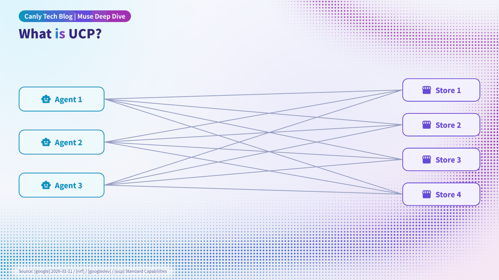

UCP is an open standard for agentic commerce that [Google announced on January 11, 2026, around the National Retail Federation (NRF) annual event](https://blog.google/company-news/inside-google/message-ceo/nrf-2026-remarks/). It was co-developed with Shopify, Etsy, Wayfair, Target, and Walmart, and [more than 20 companies including Adyen, American Express, Mastercard, Stripe, and Visa endorsed it](https://blog.google/products/ads-commerce/agentic-commerce-ai-tools-protocol-retailers-platforms/).

It's designed to work alongside existing protocols like A2A, AP2 (Agent Payments Protocol), and MCP. The goal is to collapse the "N×N" mess of building a separate connection for every agent into [a single integration point](https://developers.googleblog.com/en/under-the-hood-universal-commerce-protocol-ucp/).

The spec is versioned by date; the latest version I checked for this post is [`2026-08-25`](https://ucp.dev/2026-08-25/specification/overview/). There are five standard capabilities:

| Capability | Summary |
| --- | --- |
| Ask | Answers natural-language questions about the business's resources, policies, and services (read-only) |
| Cart | Building a cart before purchase intent is firm |
| Checkout | Creating and managing checkout sessions (including cart management and tax calculation) |
| Identity Linking | Getting authorization to act on the user's behalf via OAuth 2.0 |
| Order | Async notifications across the order lifecycle (shipping, delivery, returns) |

Governance is public in the GitHub MAINTAINERS file. The Shopping Tech Council includes Google, Shopify, Etsy, Target, Microsoft, Stripe, Salesforce, and Wayfair, plus [**people from Meta and Amazon**](https://raw.githubusercontent.com/Universal-Commerce-Protocol/.github/main/MAINTAINERS.md). That's the "council" I mentioned on the show. Amazon's participation, though, doesn't mean Amazon is fine with Muse accessing Amazon.

### 5.2 Profiles and negotiation: only use what both sides support

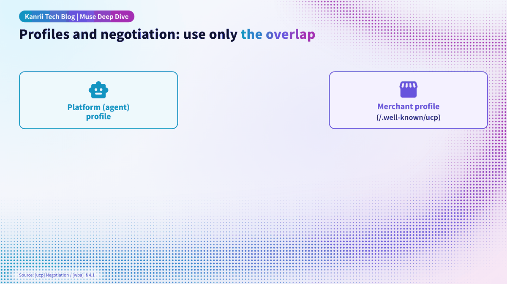

UCP discovery and negotiation [work like this](https://ucp.dev/2026-08-25/specification/overview/):

1. The business publishes a profile at `/.well-known/ucp`. It lists supported versions, services (REST / MCP / A2A / embedded), capabilities, payment handlers, and signing keys (`keys[]`, a JWK Set).

Here's an example business profile. From the spec's example, I kept only REST and MCP, plus checkout and fulfillment. It's an excerpt to show the structure, not a complete profile you could implement (it also omits `payment_handlers`, which the spec requires, and the `keys[]` signing keys). Check the spec for your target version's required fields and validation rules.

```
{
  "ucp": {
    "version": "2026-08-25",
    "services": {
      "dev.ucp.shopping": [
        {
          "version": "2026-08-25",
          "spec": "https://ucp.dev/2026-08-25/specification/overview/",
          "transport": "rest",
          "endpoint": "https://business.example.com/ucp/v1",
          "schema": "https://ucp.dev/2026-08-25/services/shopping/rest.openapi.json"
        },
        {
          "version": "2026-08-25",
          "spec": "https://ucp.dev/2026-08-25/specification/overview/",
          "transport": "mcp",
          "endpoint": "https://business.example.com/ucp/mcp",
          "schema": "https://ucp.dev/2026-08-25/services/shopping/mcp.openrpc.json"
        }
      ]
    },
    "capabilities": {
      "dev.ucp.shopping.checkout": [
        {
          "version": "2026-08-25",
          "spec": "https://ucp.dev/2026-08-25/specification/shopping/checkout",
          "schema": "https://ucp.dev/2026-08-25/schemas/shopping/checkout.json"
        }
      ],
      "dev.ucp.shopping.fulfillment": [
        {
          "version": "2026-08-25",
          "spec": "https://ucp.dev/2026-08-25/specification/shopping/extensions/fulfillment",
          "schema": "https://ucp.dev/2026-08-25/schemas/shopping/fulfillment.json",
          "extends": "dev.ucp.shopping.checkout"
        }
      ]
    }
  }
}
```

2. The platform (the agent side) includes its own profile URI on **every request**: in the `UCP-Agent` header for HTTP, or in the `meta` object for MCP.
3. The business computes the **intersection** of capabilities across both profiles. For each capability, it picks the latest date among the versions both share. If there's no shared version, that capability is dropped. Extensions whose parent capability is gone get pruned, repeatedly, until none are left.

Namespaces use reverse-domain format (`dev.ucp.shopping.checkout` and so on), and a schema URL's origin must match its namespace. But the spec notes this guarantees "provenance," not "trust."

Platform authentication supports API keys, OAuth 2.0, mTLS, and HTTP Message Signatures (RFC 9421). With HTTP Message Signatures, anyone can verify the signature with a public key, which enables "permissionless onboarding" with no prior registration. UCP also interoperates with Web Bot Auth, but the spec says a key resolved via `Signature-Agent` only proves control over that key's origin. It does [not prove control over the `UCP-Agent` profile](https://ucp.dev/2026-08-25/specification/overview/). Same story as section 4.4: the signature doesn't tell you [**who the operator is**](https://www.ietf.org/archive/id/draft-ietf-webbotauth-httpsig-protocol-01.txt).

### 5.3 Checkout state transitions

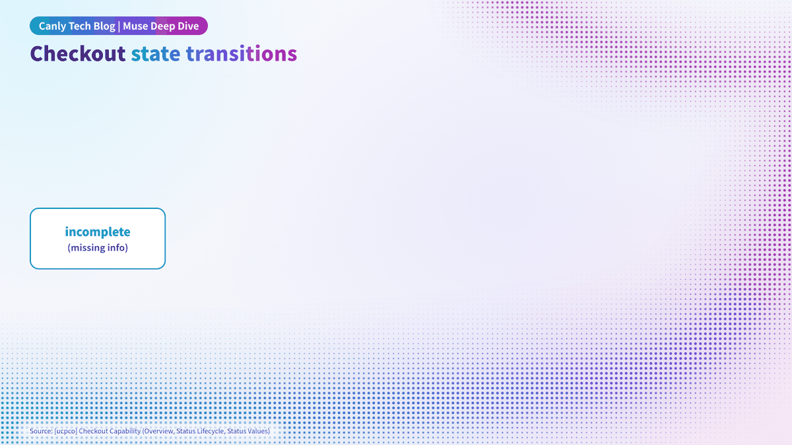

In the Checkout capability (`dev.ucp.shopping.checkout`), the business controls the state. While required information is missing, it's `incomplete`. Once everything needed is there, it becomes `ready_for_complete`, and the platform can call Complete Checkout to finalize. Once accepted, it passes through `complete_in_progress` and becomes `completed` when the order is placed.

If the business needs information the API can't collect (`requires_buyer_input`), or the buyer has to review or approve before ordering for policy or other reasons (`requires_buyer_review`), the state becomes `requires_escalation` and hands off to the buyer via `continue_url` ([Checkout spec](https://ucp.dev/2026-08-25/specification/shopping/checkout/)). `canceled` means the checkout session has been invalidated or has expired, and it can happen from any state. It's not the same as canceling or returning a placed order.

Purchase approval requirements need to be read separately from these state transitions. The top of the spec says checkout must be "finalized manually by the user through a trusted UI unless the AP2 Mandates extension is supported." The guidelines likewise say the agent hands checkout off to a trusted, deterministic UI where the user reviews the details and places the order ([Checkout spec](https://ucp.dev/2026-08-25/specification/shopping/checkout/)). With the AP2 Mandates extension, a mandate proving the user's authorization takes its place (section 5.4) ([overview](https://ucp.dev/2026-08-25/specification/overview/)).

So `completed` means "the order was placed," not "the user personally called the final API." A platform finalizing via the API after the approval requirements are met is not the same as buying without the user's permission. And the business remains the seller (Merchant of Record). The principle that agents can't just go buy things on their own is baked into the protocol too.

### 5.4 Payments: the platform never touches raw card data

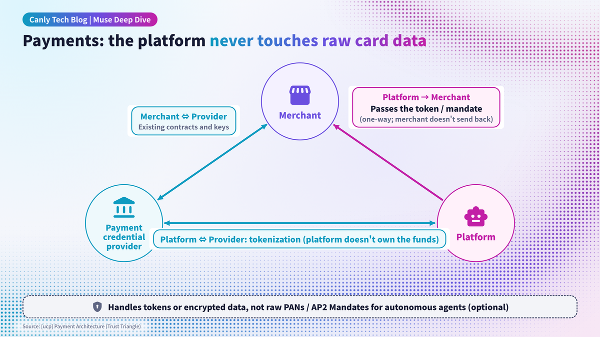

UCP organizes payments as a ["trust triangle"](https://ucp.dev/2026-08-25/specification/overview/):

1. **Business ⇔ payment credential provider**: an existing legal and technical relationship (API keys and contracts)
2. **Platform ⇔ provider**: the platform tokenizes through the provider's interface, but doesn't "own" the funds
3. **Platform → business**: passes the resulting token or mandate and finalizes the order

Credentials flow one way only, from platform to business, and the business must never return credentials in its responses. The platform handles network tokens, encrypted payloads, and mandates, never raw card numbers (PANs).

For cases that need cryptographic proof of user authorization (autonomous agents, high-value transactions), there's an optional **AP2 Mandates extension**. The business signs the checkout terms, and the platform issues a mandate [proving the user's authorization](https://ucp.dev/2026-08-25/specification/overview/).

Muse's single-use cards (section 3.5) and UCP's tokenization share a philosophy: "don't leave payment data worth stealing in the agent's hands." But the former is how Muse's internal wallet is implemented, while the latter is a protocol between platforms and businesses. In my view, they're separate things that happen to point the same way.

### 5.5 How Muse, UCP, and Poppy relate: what's known vs. what's guessed

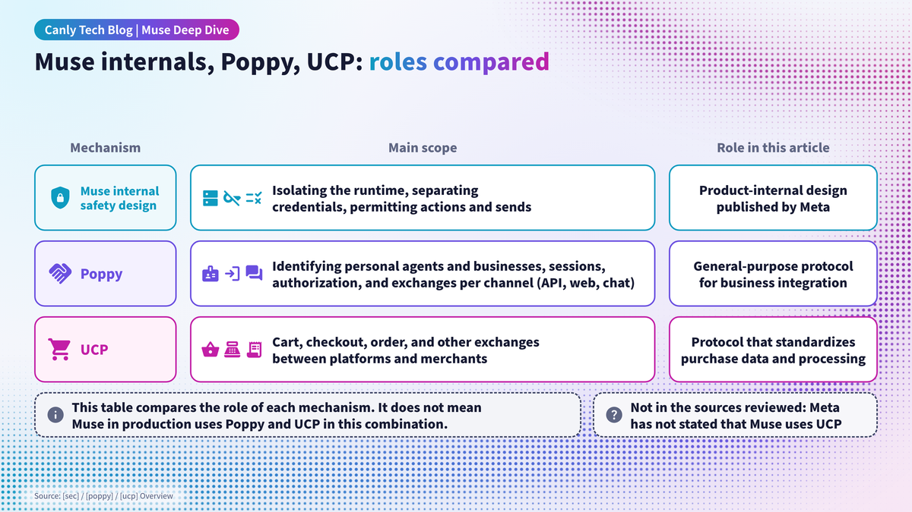

Here's how the three fit together, sorted by how certain each point is.

Sierra describes UCP and Poppy as complementary: UCP specializes in shopping, while Poppy covers ["how an agent identifies itself, gets the user's permission, and interacts with businesses on any kind of task."](https://sierra.ai/blog/poppy) Comparing the roles of all three:

| Mechanism | Main focus | Position in this article |
| --- | --- | --- |
| Muse's internal safety design | Execution isolation, credential separation, authorizing actions and egress | Product-internal design published by [Meta](https://research.meta.ai/blog/security-and-safety-for-ai-agents-our-approach-with-muse) |
| Poppy | Identifying personal agents and businesses, sessions, authorization, interaction over each channel (API, web, conversation) | A general-purpose protocol for business integration ([spec](https://personalagentprotocol.org/docs/spec)) |
| UCP | Cart, checkout, order, and related exchanges between platforms and businesses | A protocol that standardizes purchase data and processing ([spec](https://ucp.dev/2026-08-25/specification/overview/)) |

This table compares roles. It does not show that Muse's production systems actually combine Poppy and UCP this way. Below, I separate the adoption and integration facts I could confirm from combinations that merely follow from the roles.

The only primary source showing Muse and Poppy working together is a demo at a Sierra event, and none of the sources I checked say it's available to the general public ([Sierra](https://sierra.ai/blog/poppy)). None of them describe a production example that actually combines Poppy and UCP, either.

**Confirmed facts**

- Meta is a [co-developer of Poppy](https://sierra.ai/blog/introducing-personal-agent-protocol). People from Meta and Amazon are also [maintainers on UCP's Shopping Tech Council](https://raw.githubusercontent.com/Universal-Commerce-Protocol/.github/main/MAINTAINERS.md).
- The Poppy spec describes serving multiple versions "in the same way as UCP's version selection."
- According to [Shopify's Help Center](https://help.shopify.com/en/manual/online-sales-channels/agentic-storefronts/meta), the Meta channel supports direct checkout by Shopify across Meta surfaces, including Muse. It's shown to customers in 11 countries, including Japan. The store remains the seller, and in-store pickup, local delivery, and pickup points aren't supported as delivery methods. Orders from Muse appear under the "Meta AI and Muse" sales channel.
- Shopify's [Checkout MCP](https://shopify.dev/docs/agents/carts-and-checkout/checkout-mcp) implements UCP's checkout capability (`dev.ucp.shopping.checkout`), at the endpoint `https://{shop-domain}/api/ucp/mcp`.

**Not in the sources I checked (includes speculation)**

- In none of the sources I checked (the [US announcement](https://about.fb.com/news/2026/09/introducing-muse-personal-ai-agent/), the [Japanese announcement](https://about.fb.com/ja/news/2026/10/muse-personal-ai-agent-launches-in-japan/), the technical blog) does Meta say Muse **uses the UCP interface** for Shopify checkout. One third-party analysis says it's ["most likely Shop Pay on UCP"](https://ppc.land/meta-puts-an-ai-agent-that-buys-things-inside-whatsapp-us-only/), but the author hedges with "most likely" themselves, so it's unconfirmed.

**My interpretation**: Read as a division of labor, they line up like this:

- Inside Muse: contain the agent, and keep credentials hidden from it.
- Poppy: agree with the business on whose agent this is and what it's allowed to do.
- UCP: exchange cart, payment, and order information as structured data.

That said, none of the sources I checked define a formal link between the specs (for example, calling UCP checkout within a Poppy session).

---

## 6. What this means for businesses with physical stores

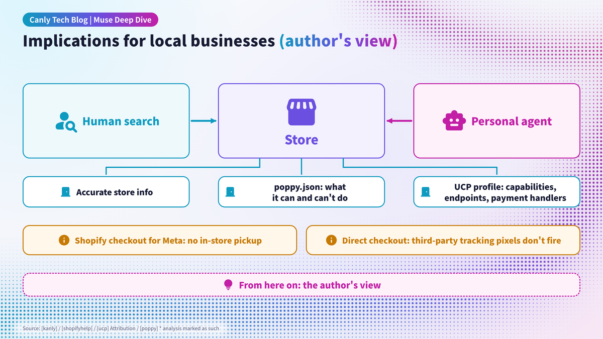

This chapter is my personal take, not Canly's product plan or official position.

At Canly, we offer a service for managing and analyzing store information and reviews in one place across platforms like Google Business Profile (GBP) and Yahoo! Place (Yahoo! Japan's local listings). In Japan this space is usually called MEO (map engine optimization, roughly local SEO).

1. **Store information becomes "input to agents"**: Agents look things up in a browser, query APIs, and ask business agents questions. If business hours, inventory, or booking availability are out of date, that translates directly into wrong actions. In the Muse Spark 1.3 evaluation, one of the most common failures was [stating incorrect facts](https://research.meta.ai/static/muse-spark-1-3-evaluation-report). I expect the value of keeping accurate first-party information in machine-readable form to go up.
2. **More "machine-readable front doors"**: In Poppy, `poppy.json` declares what you can do (APIs, scopes), what you can't (`excluded_tasks`), and how to do it (`skill_index`) ([spec](https://personalagentprotocol.org/docs/spec)). In UCP, `/.well-known/ucp` declares supported capabilities, endpoints, payment handlers, and so on ([spec](https://ucp.dev/2026-08-25/specification/overview/)). I see managing these declarations as a natural extension of centrally managing store information.
3. **The link to physical stores is still thin**: Shopify's direct checkout for Meta [doesn't support in-store pickup or local delivery](https://help.shopify.com/en/manual/online-sales-channels/agentic-storefronts/meta). For connecting online and offline (OMO), I think a big open question is how, and in which protocol, to represent "actions completed at the store," like booking a visit or holding an item.
4. **Measurement changes**: With direct checkout, third-party tracking pixels don't fire ([Shopify](https://help.shopify.com/en/manual/online-sales-channels/agentic-storefronts/meta)). UCP provides an `attribution` field for passing source parameters ([spec](https://ucp.dev/2026-08-25/specification/overview/)). Poppy says that because the session follows the user across APIs, web, and conversation, businesses can [understand behavior across channels](https://personalagentprotocol.org/). "How do we measure store visits and purchases that come through agents?" will be a question store marketers can't dodge.
5. **Permission design becomes the business's job**: It's on the business to correctly declare "irreversible" and "contains personal data" in `scope_hints` ([spec](https://personalagentprotocol.org/docs/spec)). For actions like canceling a reservation or making a payment, where reversibility depends on the service's terms, which scope do you put them in? That design shapes both user peace of mind and how usable your business is for agents.

Picture a restaurant whose regular hours are listed correctly, but whose unscheduled closure today isn't reflected anywhere. An agent might tell someone it's fine to show up. And even if canceling a reservation succeeds, there's no guarantee the same slot can be rebooked. Freshness of store information and how far to allow actions need to be designed together. I think the key will be separating viewing information, creating reservations, and canceling reservations, and scoping permissions by their impact.

---

## 7. Limits and open questions

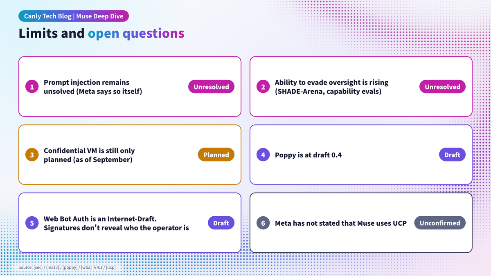

- **Prompt injection isn't solved**: Meta itself calls it "unsolved across the industry" and says [Muse can make mistakes](https://research.meta.ai/blog/security-and-safety-for-ai-agents-our-approach-with-muse). In browser use, some scenarios still show a [gap to the state of the art](https://research.meta.ai/static/muse-spark-1-3-evaluation-report).
- **The ability to evade oversight is rising**: The covert success rate on the SHADE-Arena capability evaluation went up from the previous generation. (It measures capability, not how often misbehavior happens in production.) It's reassuring that CoT monitoring is still considered effective, but as capability grows, monitoring design has to keep pace.
- **Evaluation awareness**: The report itself says the model noticing it's being evaluated is linked to differences in behavior. Evaluation numbers aren't a guarantee of production behavior.
- **Access by Meta**: The current architecture doesn't prevent Meta from accessing data when needed. Confidential VM was still [only planned as of September](https://research.meta.ai/blog/security-and-safety-for-ai-agents-our-approach-with-muse).
- **Protocol maturity**: Poppy is at [draft 0.4](https://personalagentprotocol.org/docs/spec). Web Bot Auth is an Internet-Draft, and a signature only shows that the key holder signed. It doesn't show who the operator is, whether it's benign, or [whether it's authorized](https://www.ietf.org/archive/id/draft-ietf-webbotauth-httpsig-protocol-01.txt). UCP keeps shipping [date-versioned updates](https://ucp.dev/2026-08-25/specification/overview/).
- **What's missing from the sources**: None of the sources I checked describe the specific training procedure, the internals of VM startup and suspension, or the contents of Sentinel's policies and classifier details.
- **How the three relate**: None of the sources I checked describe the path Muse's Shopify checkout takes, or any formal link between Poppy and UCP.

Partly because of time constraints, the show leaned on analogies. I hope this post helps you separate fact from speculation. And please watch the full episode on [YouTube](https://www.youtube.com/watch?v=NvNLJjozcJo).

> Key facts and figures link to their sources in the text. Where the sources don't describe an internal detail, I say "not described in any source I checked" rather than filling the gap with guesses. My own inferences are flagged as my interpretation. Sources were checked as of November 9, 2026 (JST). Poppy is a draft and UCP is a date-versioned spec, so both may change.

---

## Sources

- "Introducing Muse: The World's First Personal AI Agent Built for Everyone," Meta, September 8, 2026. https://about.fb.com/news/2026/09/introducing-muse-personal-ai-agent/
- "Meta Launches Personal AI Agent 'Muse' in Japan" (Japanese), Meta, October 23, 2026. https://about.fb.com/ja/news/2026/10/muse-personal-ai-agent-launches-in-japan/
- "How We Built Safety Into Muse," Tarek Sheasha (Meta Superintelligence Labs), September 8, 2026. https://research.meta.ai/blog/security-and-safety-for-ai-agents-our-approach-with-muse
- "Muse Spark 1.3 Evaluation Report," Meta Superintelligence Labs, October 23, 2026. https://research.meta.ai/static/muse-spark-1-3-evaluation-report
- "Muse Spark Safety & Preparedness Report," Meta, May 26, 2026. https://ai.meta.com/static-resource/muse-spark-safety-and-preparedness-report/
- "Meta Superintelligence Scaling Framework" v2.1, Meta, October 2026. https://research.meta.ai/static/meta-superintelligence-scaling-framework
- "Muse Wonder Model Card," Meta, October 12, 2026. https://research.meta.ai/static/muse-wonder-model-card
- "Muse Wonder," Meta AI Research, October 12, 2026. https://research.meta.ai/blog/muse-wonder
- "Personal Agent Protocol specification (draft 0.4)," Personal Agent Protocol. https://personalagentprotocol.org/docs/spec
- "Introducing Personal Agent Protocol," Bret Taylor and Clay Bavor (Sierra), October 6, 2026. https://sierra.ai/blog/introducing-personal-agent-protocol
- Personal Agent Protocol official website. https://personalagentprotocol.org/
- "Personal Agent Protocol specification 0.3" (frozen November 4, 2026), Personal Agent Protocol. https://personalagentprotocol.org/docs/0.3/spec
- "HTTP Message Signatures for Bots," draft-ietf-webbotauth-httpsig-protocol-01, T. Meunier and S. Major, IETF Internet-Draft, October 2026 (§4.1, §4.4). https://www.ietf.org/archive/id/draft-ietf-webbotauth-httpsig-protocol-01.txt
- "The AI platform shift and the opportunity ahead for retail" (remarks at NRF 2026), Sundar Pichai, Google, January 11, 2026. https://blog.google/company-news/inside-google/message-ceo/nrf-2026-remarks/
- "New tech and tools for retailers to succeed in an agentic shopping era," Google, January 11, 2026. https://blog.google/products/ads-commerce/agentic-commerce-ai-tools-protocol-retailers-platforms/
- "Under the Hood: Universal Commerce Protocol (UCP)," Google Developers Blog, January 11, 2026. https://developers.googleblog.com/en/under-the-hood-universal-commerce-protocol-ucp/
- "Official Specification – Overview" (version 2026-08-25), Universal Commerce Protocol. https://ucp.dev/2026-08-25/specification/overview/
- MAINTAINERS.md, Universal-Commerce-Protocol/.github (GitHub). https://raw.githubusercontent.com/Universal-Commerce-Protocol/.github/main/MAINTAINERS.md
- "Checkout Capability" (version 2026-08-25), Universal Commerce Protocol. https://ucp.dev/2026-08-25/specification/shopping/checkout/
- "Sharing a draft of Personal Agent Protocol," Sierra, October 9, 2026. https://sierra.ai/blog/poppy
- "Selling on Meta," Shopify Help Center. https://help.shopify.com/en/manual/online-sales-channels/agentic-storefronts/meta
- "Checkout MCP," Shopify.dev. https://shopify.dev/docs/agents/carts-and-checkout/checkout-mcp
- "Meta puts an AI agent that buys things inside WhatsApp, US only," PPC Land (third-party outlet covering Juozas Kaziukėnas's analysis; cited as speculation). https://ppc.land/meta-puts-an-ai-agent-that-buys-things-inside-whatsapp-us-only/
