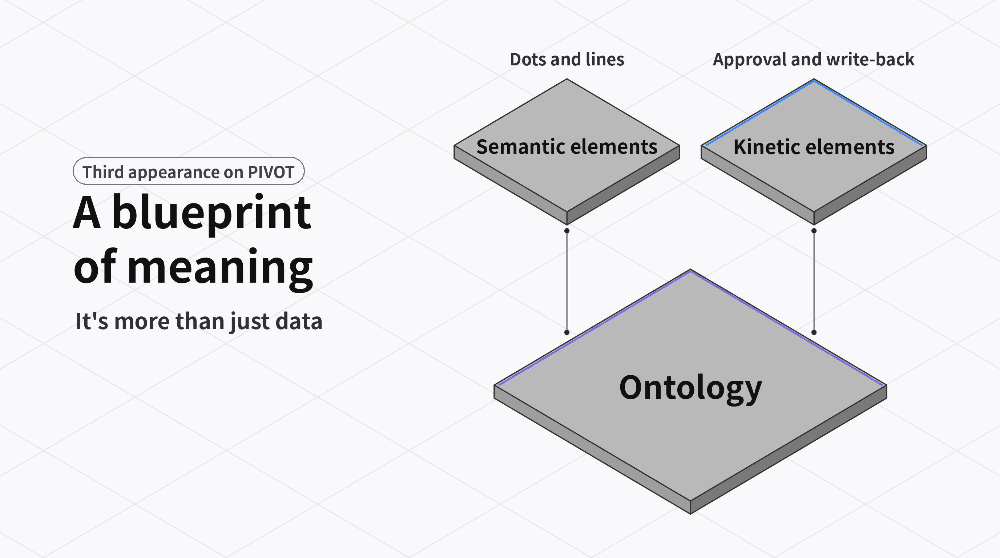
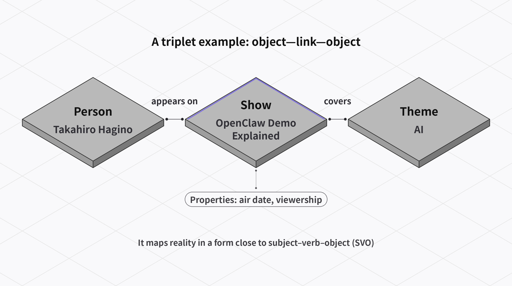
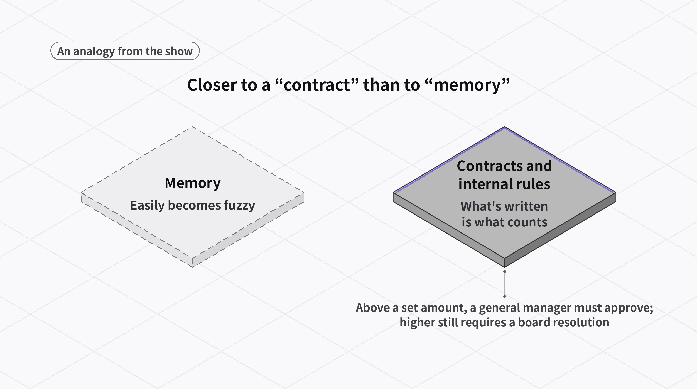
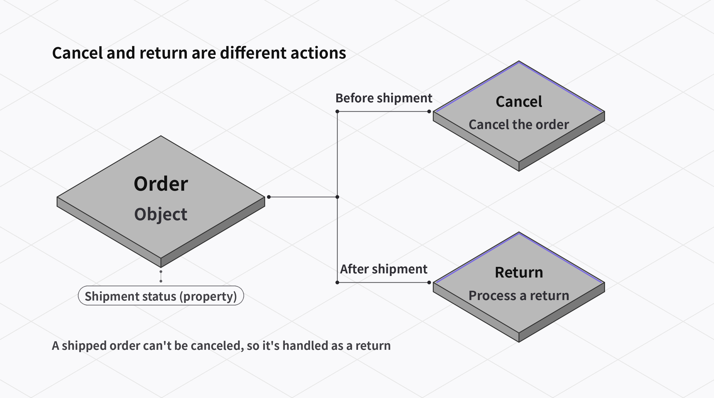

# What I Said About Ontology on Japanese TV, and What I Didn't Get To

> *This is an English version of my original Japanese post on note, [「PIVOTで話した「オントロジー」と、話しきれなかったこと」](https://note.com/haginota/n/nbf04863132cf) (Japanese), published on November 16, 2026 (JST). The figures have been redrawn with English labels. Links marked "(Japanese)" go to Japanese-language sources. For the engineering details, see my companion technical article on the Canly Tech Blog.*

I'm Takahiro Hagino. On November 14, 2026, my [third appearance](https://www.youtube.com/watch?v=_V7IF1XdNLQ) (Japanese) on [a Japanese business TV show](https://pivotmedia.co.jp/movie/15261) (Japanese) went live. The topic was how far companies can automate with AI, and what the "ontology" that keeps coming up in that conversation actually is.

Last time I was on, I talked about Meta's personal AI agent, "Muse." Afterwards I wrote up [what I didn't get to say on the show](https://note.com/haginota/n/nba922eb92cd9) (Japanese) on note. I'd like to do the same this time.

[https://note.com/haginota/n/nba922eb92cd9](https://note.com/haginota/n/nba922eb92cd9)

The comments that came in after the episode went out were sharp. Honestly, some raised points I couldn't fully answer on the spot either. In some places I left things as analogies. In others I oversimplified. In this post, I'll first lay out what I said on the show. Then I'll separate ontology in the general sense from what [Palantir's Foundry Ontology](https://www.palantir.com/docs/jp/foundry/platform-overview/overview) means. Finally, I'll follow up on the questions that came up most in the comments, and I'll keep facts and my own views apart.

A few caveats first.

- This post is my personal view. It is not the official view of the show's producer, Palantir, or my employer. It is not a partnership or sponsored post.
- I summarize what I said on the show. For my exact wording, please watch the episode itself (timestamps are approximate).
- Facts and numbers come with sources. When I'm guessing or giving an opinion, I flag it with phrases like "I think" or "my view is." I checked the sources on November 16, 2026 (Japan time).
- I worked from auto-generated captions for the transcript. I've fixed errors in proper nouns. Where I still need to do a final check against the audio, I've left a draft marker.

Here's the episode.

[https://www.youtube.com/watch?v=_V7IF1XdNLQ](https://www.youtube.com/watch?v=_V7IF1XdNLQ)

[https://pivotmedia.co.jp/movie/15261](https://pivotmedia.co.jp/movie/15261)

*Figure: Key visual. "A blueprint of meaning." "It's more than just data." On top of the ontology base sit semantic elements (dots and lines) and kinetic elements (approval and writeback).*

---

## 1. What I said on the show

Here's roughly what I covered on the show. Everything below is a summary.

### Ontology isn't a new word

The word "ontology" didn't just appear in the last few months. It has long drawn attention as a way to convey the meaning of the words AI handles, the same way we would to a person. I said it's back in the spotlight because companies are now trying to run AI agents accurately and safely (around 03:00 and around 04:07).

On the big shift behind this, I'll stick to facts I've been able to confirm. The [GPT-3 paper](https://arxiv.org/abs/2005.14165) came out in 2020. [ChatGPT was released](https://openai.com/index/chatgpt/) on November 30, 2022, and [GPT-4 was announced](https://openai.com/index/gpt-4-research/) on March 14, 2023. When I mentioned a big shift around 16:10 in the episode, I meant the period when ChatGPT was released.

I have my own history with this, too. I spent about 10 years at BizReach working with the text of resumes and job postings. Matching keywords alone won't tell you the intent behind the words. Plain natural language can't fully hand meaning over to a computer, and that problem has been around for a long time.

### Personal agents and company agents face different conditions

I said this in my [first appearance](https://www.youtube.com/watch?v=PeZHAztFgqc) (Japanese) (the OpenClaw episode, May 19, 2026), and I touched on it again in [this episode](https://www.youtube.com/watch?v=_V7IF1XdNLQ) (around 06:00): as a consumer, I use a personal agent (OpenClaw) for shopping, bookings, and parts of my daily life. As an individual, if it buys the wrong thing or makes a booking I didn't intend, I can sometimes just cancel it later or get in touch with whoever's on the other end.

A company can't work that way. An order nobody placed, or a leak of personal data, becomes a question of trust. More people and more systems are involved, so the setup gets more complex. That's where ontology becomes necessary. That's how I framed it on the show.

On how far adoption has gotten, the show cited a figure of "3% as of the end of last year" (around 05:00). When I checked primary sources afterwards, I did find a survey close to that number. In a press release published on December 19, 2025, [Yano Research Institute](https://www.yano.co.jp/press-release/show/press_id/3991) (Japanese) reported that of 215 companies that said they use generative AI, 3.3% said they were "currently using" AI agents. **That is not 3% of all companies.** The base is companies that already use generative AI. The show also touched on the view that "even as it grows, it will stay below 10%," but I haven't been able to find a source for that. So here I'm sticking to the sourced 3.3%.

### Ontology is a "blueprint of meaning"

At the heart of what I said on the show was this definition (around 07:12):

A blueprint that lets humans and AI share information about the same real world as meaning. A blueprint of meaning.

In practice, you define real-world concepts as objects (dots) and connect them with relationships (lines). Take my first appearance (the OpenClaw episode). Link the person "Takahiro Hagino" to the show "OpenClaw Demo Explained" with "appears on," and his role as a guest becomes visible. Link the show to the theme "AI" with "covers," and that becomes the show's theme.

A set of three like this, close to subject–predicate–object, is sometimes called a triplet. In information technology standards, the [RDF "triple"](https://www.w3.org/TR/rdf11-concepts/) is the equivalent. [Palantir's official terms](https://www.palantir.com/docs/jp/foundry/ontology/core-concepts), which I'll come to later, are different. They don't talk about triples. They use objects, links, and properties.

Objects have properties. For a show, those might be the air date or the viewer count. As you define the properties too, the reality we see gets mirrored in the data structure. In that sense, I said, an ontology is sometimes called a digital twin. [Palantir's documentation](https://www.palantir.com/docs/jp/foundry/ontology/core-concepts) also describes it as ["a digital twin of the organization."](https://www.palantir.com/docs/jp/foundry/ontology/overview)

*Figure: A triplet example. Person "Takahiro Hagino" — appears on → show "OpenClaw Demo Explained" — covers → theme "AI." Properties are air date and viewership.*

For a word with several meanings, I used "Python." In a conversation about programming, it's a language. In a conversation about reptiles, it's a snake. An ontology's job is to write down what a word means in a given context and how concepts relate to each other. That said, one commenter pointed out that this example alone doesn't prove we still need ontology today. I'll come back to that in Section 3.3.

### The blueprint and the actual data graph are different layers

When you connect dots (concepts) with lines (relationships), you get what's called a graph. Depending on the context, it's also called a knowledge graph.

This is the distinction I most wanted to get across on the show. **The blueprint layer and the actual data graph layer are different.** The blueprint says what kinds of things exist and what relationships are possible. You follow it to build a graph of actual people and shows.

On the show, I also said "the ontology itself is not a graph" (around 15:02). I stand by the direction, but I'll put it more precisely here. In [W3C's OWL](https://www.w3.org/TR/owl2-mapping-to-rdf/), an ontology itself can be written out as an RDF graph. So rather than flatly saying "it's not a graph," I think it's better to say that the type definitions and the actual data graph you build from them are different layers.

There's one thing I didn't get to say on the show. In Palantir's Foundry, the word "Ontology" covers this blueprint, the actual data graph, and the components that make things happen. Whether the layers differ is one question. How much you bundle under a single name is another. I'll separate the two in Section 2.

*Figure: On the left, the ontology (types, relations, constraints = the blueprint of meaning). On the right, the instance graph built from it (also called a knowledge graph). An outer outline wraps both, plus the "moving parts" (actions, functions, security), and marks "the scope Foundry collectively calls the 'Ontology.'" The conclusion: "The blueprint and the graph are different layers." Note: "Not the same meaning as the graph of a function."*

A viewer flagged how I used the word "graph" around 14:47. I'll untangle that in Section 3.1.

### Excel can represent an ontology, but it can't guarantee control over actions

At the extreme, you don't even need to build a graph. You can represent an ontology in Excel. Palantir's own explanation maps object types to datasets, objects to rows, and [properties to columns](https://www.palantir.com/docs/jp/foundry/ontology/core-concepts).

But putting meaning into a table doesn't give you control. Take expense reports. Decisions there have to follow internal policies and approval rules. With only a table, nothing guarantees that the system enforces those rules. You're relying on the AI to "check" them every time. On the show, I called this enforcement validation. In Palantir's official terms, it corresponds to ["submission criteria"](https://www.palantir.com/docs/jp/foundry/action-types/submission-criteria), which decide whether an [action](https://www.palantir.com/docs/jp/foundry/action-types/overview) is allowed to run. (They used to be called validations.)

One caveat. Excel does have ["data validation"](https://support.microsoft.com/en-us/office/apply-data-validation-to-cells-29fecbcc-d1b9-42c1-9d76-eff3ce5f7249), which checks the values entered into cells. What's hard to guarantee is something else: **who may do what to external systems, and under which conditions** (control over permissions, transactions, and side effects). I'm not claiming that Excel can't validate anything at all.

I also used an analogy on the show: an ontology is closer to a "contract" than to "AI memory." Memory tends to get fuzzy. With a contract, what's written is what counts, and work proceeds on that basis. The analogy is my own. Palantir's product documentation doesn't use the word "contract." That said, [Palantir's official blog](https://blog.palantir.com/ontology-finding-meaning-in-data-palantir-rfx-blog-series-1-399bd1a5971b) does refer to "the centralized contract the ontology represents." The point there is that if the logic tied to objects is also kept in a form that can be changed, applications can use that contract more easily. In the product documentation's own terms, I think the closest match is permissions, submission criteria, and auditing of changes.

*Figure: My analogy from the show: closer to a "contract" than to "memory." Memory tends to get fuzzy. In contracts and internal rules, what's written is what counts. Above a set amount, a general manager must approve. Above a higher amount, it takes a board resolution.*

### The specialists who structure the work, and the problems nobody planned for

Humans have to decide where to draw the lines: how finely to split concepts, and where to stop splitting. On the show, I introduced the FDE as a specialist role that does this work. As I framed it, one of the core parts of an FDE's job today is to structure frontline work and turn it into an ontology.

I haven't, however, been able to confirm in official sources the causal claim that "Palantir created the FDE role because it knew the ontology would become a competitive advantage." That was my interpretation on the show. [Palantir's 2019 blog post](https://blog.palantir.com/dev-versus-delta-demystifying-engineering-roles-at-palantir-ad44c2a6e87) describes the FDE (a role also called Delta internally) as someone who deploys the platform at the customer's site and solves the customer's problems. As a statement of fact, I'll go no further than this: "building the ontology is one of the core parts of an FDE's job today."

What I described as the role's real strength is judgment on problems nobody planned for, the kind you can't handle by writing every branch into a workflow in advance. For example, an order that has already shipped can't be "canceled." It has to be handled as a "return." Giving the two operations different names isn't enough. You also have to define the rules that go with each one. Good staff carry a "world map" in their heads and use it to adapt on the fly. My view on the show was that if that map can be shared, AI can also see which information to look up and whom to contact.

*Figure: Cancel and return are different actions. The order object's shipment status (a property) decides which applies: cancel before shipment, return after shipment.*

### The demo (a simulation with fictional data)

In the second half of the show, I walked viewers through a hypothetical scenario based on how the show's producer makes its programs. A guest cancels, the system looks for a stand-in, a person approves the choice, and the change then syncs to the related systems. It was a simulation running on fictional data. As I explained it, the graph underneath is machine-readable, and the system suggests candidates by tracing past appearances, topics, and conditions.

The names and amounts were dummy data. They aren't the actual appearance terms of any real person. In principle, you could remove the approval step and let the system run on its own. Even then, if the information it relies on hasn't been updated for the new guest, the follow-up work will go wrong. (On the show, I described that follow-up work as the promotion-related syncing.)

*Figure: A hypothetical scenario with dummy data. Detect a cancellation → trace the graph for candidates → a person approves → sync to related systems (planning data, description field, checking clearance for promo materials, contacting the performer). Dotted line: "Even running autonomously without approval, responsibility remains."*

### Getting started: draw a small map of the work in front of you

You don't need to map the whole company at the start. Begin with the work that's most burdensome, takes longest to decide, or involves the most people and systems. For each piece of work, write down the rules, the data, where the data lives, and the permissions needed to act on it. Once you have a few small maps, they start to connect, and you get closer to a world map.

On the show, I said that individuals and small organizations may not need a formal ontology platform at all. A shared file that every agent reads may be enough. Large companies can't get away with that. In my view, companies now have to decide where ontology-centered platforms fit for them.

On the show, I mentioned Microsoft, Palantir, and Databricks. Here I'll stick to what I could confirm. Microsoft [announced Fabric IQ in preview](https://blog.fabric.microsoft.com/en-us/blog/from-data-platform-to-intelligence-platform-introducing-microsoft-fabric-iq) on November 18, 2025, and announced general availability at [Build in June 2026](https://azure.microsoft.com/en-us/blog/microsoft-build-2026-building-agentic-apps-with-microsoft-fabric-and-microsoft-databases/). However, as of November 16, 2026, [Microsoft Learn](https://learn.microsoft.com/en-us/fabric/iq/ontology/overview) still lists the core "ontology" feature as being in preview. Databricks [announced Genie Ontology](https://www.databricks.com/blog/introducing-genie-one-genie-ontology-and-genie-agents) on June 16, 2026, and [made it generally available](https://www.databricks.com/blog/announcing-ga-genie-ontology) on November 11, 2026. Palantir's own documentation calls its ontology-centered software architecture its [biggest differentiator](https://www.palantir.com/docs/jp/foundry/platform-overview/overview). In Section 2.4, I'll cover how the scope of what each company calls an "ontology" differs.

Any talk of a "scramble" among these companies, or of which one is better, isn't my assessment, and I don't intend to compare them. On the show, I said one company "was the first to offer" this. Whether that's true depends on the criteria, so in this article I'll call it "one of the companies that started early." I also couldn't confirm from public price lists which one costs more or less, so I won't cover pricing here.

When different parts of a company use different tools, a company-wide map is harder to build. On the show, we discussed examples where each department uses a different tool, such as Dify, Claude, or Gemini.

I acknowledged the risk of lock-in on the show as well. Even so, I believe a world map is an important piece of putting agents to work in real business.

*Figure: Small maps for expense reports, orders and returns, and scheduling appearances connect into a world map. Write down the rules, data, systems, and permissions. For individuals and small teams, a file that every agent reads may be enough. For large companies, choosing a platform becomes a real decision (my view).*

---

## 2. What does the "blueprint of meaning" cover?

On the show, I used the single word "ontology" for two different things, one after the other. One is ontology in the general sense, as philosophy and computer science have used it. The other is Foundry Ontology, which Palantir puts at the center of its products. Viewers commented that I was "mixing up the layers," and I think part of the reason was that I didn't keep the two apart. This section treats them separately.

### 2.1 Ontology in the general sense: a blueprint of meaning

A definition often cited in computer science is [Gruber's "an explicit specification of a conceptualization."](https://tomgruber.org/writing/ontolingua-kaj-1993.pdf) [Studer et al.](https://doi.org/10.1016/S0169-023X(97)00056-6) restated it as "a formal, explicit specification of a shared conceptualization." [Guarino et al.](https://link.springer.com/chapter/10.1007/978-3-540-92673-3_0) distinguish the ontology as an artifact from the conceptualization it tries to represent.

There are also standards for writing ontologies down. RDF is [a data model that represents graphs as triples](https://www.w3.org/TR/rdf11-concepts/). OWL is a language for defining classes, properties, and individuals, along with what they mean, and [an OWL ontology](https://www.w3.org/TR/owl2-mapping-to-rdf/) can also be written as an RDF graph. [SHACL](https://www.w3.org/TR/shacl/) is a standard for writing down the constraints an RDF graph must satisfy, and for validating them. Entities and relationships collected as a graph according to the blueprint are called a [knowledge graph](https://arxiv.org/abs/2003.02320). Knowledge graph research covers a lot of ground: data models, querying (SPARQL, for example), validation, and reasoning.

What these standards define is meaning, reasoning, constraints, and queries. Some specs, such as [SPARQL 1.1 Update](https://www.w3.org/TR/sparql11-update/), do update the graph itself. But none of them specify how to write into business systems: transactions, permissions, and control of side effects. When people say "ontology" in the general sense, the core is the blueprint: types, relationships, and constraints.

In my research, I describe two mirror-image errors that distort this debate. The first is the **graph fallacy**: assuming that connected data is an ontology. The second is the **formalism fallacy**: assuming that anything not written in a specific formal language (OWL, for example) isn't an ontology. I think my "dots and lines" explanation on the show came across as leaning toward the first.

### 2.2 Foundry Ontology: the blueprint, plus its contents and moving parts

[Palantir's English documentation](https://www.palantir.com/docs/foundry/ontology/core-concepts) first describes an ontology as "a categorization of the world," then explains that in Foundry it is "the digital twin of an organization." Datasets and models are mapped to object types, properties, link types, and action types, and brought together in one place.

Foundry also **separates types from instances**. An object is one instance of an object type and corresponds to one row in a dataset. A link, likewise, is [one instance of a link type](https://www.palantir.com/docs/foundry/ontology/core-concepts). In Section 1, I wrote that "the blueprint and the graph of real data are different layers." That holds in Foundry too.

What differs is how much the word "ontology" covers. In general, it usually means the blueprint: types, relationships, and constraints. Foundry calls the whole package "the Ontology": the blueprint, its contents (objects and links), and the moving parts (actions, functions, and dynamic security).

As I read it, the name Foundry Ontology covers the graph (the data layer of objects and links) and extends to the execution platform. Here are the official statements I base that reading on:

- It includes both semantic elements (objects, properties, links) and [kinetic elements](https://www.palantir.com/docs/foundry/ontology/overview) (actions, functions, dynamic security)
- It states explicitly that the ontology is [not a "semantic layer"](https://www.palantir.com/docs/foundry/architecture-center/ontology-system). Semantics must be paired with kinetics, and actions are written back to operational and edge systems
- An action is [a single transaction](https://www.palantir.com/docs/foundry/action-types/overview) based on user-defined logic, and the latest state, with edits applied, is kept in a writeback dataset
- [Submission criteria](https://www.palantir.com/docs/foundry/action-types/submission-criteria) (formerly called validations) determine whether an action may run
- Ontology data is protected by [object and property policies](https://www.palantir.com/docs/foundry/object-permissioning/managing-object-security), or by the data source's policies
- Functions are [logic written in TypeScript or Python](https://www.palantir.com/docs/foundry/functions/overview)

A note on the word "graph." Palantir itself describes the ontology as a graph in some materials. Its July 2023 [white paper for the semiconductor industry](https://www.palantir.com/assets/xrfr7uokpv1b/2T3BgBpe3drnqBaSTCXl6O/bdc9445d10053eb84b3f9487e63fc2d7/Whitepaper_-_Accelerating_Research_and_Development_in_the_Semiconductor_Industry.pdf) says the ontology lets you build a "knowledge graph," and an [official blog post](https://blog.palantir.com/ontology-finding-meaning-in-data-palantir-rfx-blog-series-1-399bd1a5971b) refers to an "object graph" defined by the ontology. But the central phrase in the [product documentation](https://www.palantir.com/docs/foundry/ontology/core-concepts) isn't "graph." It's ["the digital twin of an organization."](https://www.palantir.com/docs/foundry/ontology/overview) Both are Palantir's own words, and I read them as emphasizing different sides of the same thing.

Why build the moving parts right in? I think it has to do with how demanding the environments it has been used in are. Palantir is used in defense, among other fields. On July 31, 2025, for example, the U.S. Army [announced an enterprise agreement](https://www.army.mil/article/287506/u_s_army_awards_enterprise_service_agreement_to_enhance_military_readiness_and_drive_operational_efficiency) with Palantir. It consolidates 75 contracts (15 prime contracts and 60 related ones) into one, runs for up to 10 years, and has a ceiling of $10 billion. The announcement also notes that this figure is a ceiling, not a committed payment. In environments like defense, where a wrong action is unacceptable, you have to constrain what AI and systems can see and do, using permissions, submission criteria, and audit logs. I call these constraints, which defense-grade settings demand, a "harness." That isn't Palantir's term; it's my own view.

*Figure: On the left, "ontology in the general sense," the blueprint layer (classes, relations, constraints; standards: RDF / OWL / SHACL), is drawn as a single plate. On the right, "Foundry Ontology" is drawn as three plates. From the bottom: the blueprint (object types, link types, properties), the contents (objects and links), and the moving parts (actions, functions, submission criteria, security, writeback). The three plates remain separate layers, and the outline around them is labeled "what Foundry collectively calls the 'Ontology.'" A dotted line joins the left and right blueprint plates: "This is the same layer."*

### 2.3 Side by side

Here is a rough comparison of the two on the same points. The left column reflects the general view; the right column uses the wording of Palantir's English documentation.

**Ontology in the general sense vs. Palantir's Foundry Ontology**

| Item | Ontology in the general sense (computer science) | Palantir's Foundry Ontology |
|---|---|---|
| What it refers to | An explicit, formal specification of a shared conceptualization | The digital twin of an organization: data and models mapped onto types and integrated |
| Core units | Classes, properties, individuals, axioms; expressed as RDF triples | Object types, properties, link types, action types |
| Does it include instances (real data)? | Sometimes; sometimes it's only types and constraints. A collection of real data is often called a knowledge graph | Yes. Objects and links are treated distinctly, as instances of types |
| Writing and execution | Graphs can be updated with SPARQL 1.1 Update. Business transactions, permissions, and control of side effects are outside the standards' scope | Actions (single transactions), writeback, functions |
| Permissions and security | Outside the standards' scope; handled by the platform that uses them | Dynamic security, such as object and property policies |
| Validation and constraints | OWL axioms and reasoning; SHACL constraint validation | Submission criteria |
| Main standards and sources | W3C's RDF, OWL, SHACL, SPARQL; Gruber, Studer, Guarino | Palantir's product documentation (not an external standard) |

In the table, "outside the scope" means the standards don't specify it. A platform that uses OWL or RDF may, of course, have its own separate mechanisms for writing and permissions.

### 2.4 Microsoft Fabric IQ draws the line differently

For contrast, here's a quick look at the ontology in Microsoft Fabric IQ. The [Microsoft Learn page](https://learn.microsoft.com/en-us/fabric/iq/ontology/overview) is titled "What is ontology (preview)?", and as of November 16, 2026, the feature is still in preview.

According to that page, an ontology binds definitions of entities, properties, relationships, rules, metrics, and so on to existing enterprise data. It doesn't need to be a separate data store. The graph (Graph in Microsoft Fabric) is an "optional runtime layer" for cases where the relationship paths themselves matter. By default, the schema graph built from the ontology doesn't load instance data. When you need the data, the graph can [materialize the related data](https://learn.microsoft.com/en-us/fabric/iq/ontology/overview).

In short, Fabric IQ draws the "ontology" line mainly around the definitions and leaves graph execution as a separate layer you can opt into. Foundry uses "ontology" for the definitions, the contents, and the components that make things happen, all together. Neither approach is better. They just draw the line in different places.

When comparing products, I find there are fewer mix-ups if you don't line up their nouns (object, entity, graph) side by side. Instead, first map each product onto neutral roles: "definitions," "connection to real data," "queries," "writes and execution," and "permissions." Then compare. I also think official documentation can only confirm that a feature exists. Claims about benefits, such as "it improves accuracy or productivity," should be read as a separate matter.

*Figure: How much each product calls an "ontology." Left, [Palantir's Foundry Ontology](https://www.palantir.com/docs/foundry/ontology/core-concepts): definitions (object types, etc.), contents (objects and links), and the components that make things happen (actions, [functions](https://www.palantir.com/docs/foundry/functions/overview), dynamic security) all sit inside one solid box. Right, the [Fabric IQ ontology](https://learn.microsoft.com/en-us/fabric/iq/ontology/overview) (preview): definitions (entities, properties, relationships, rules, metrics) sit in a solid box, with an arrow to existing data labeled "bind (not a separate data store)." The graph sits outside the box in a dotted outline: "Optional runtime layer. Does not load instances by default."*

### 2.5 Matching the show's wording to Palantir's terms

Here I map the words used on the show to Palantir's terms. My starting point is the [Japanese platform overview](https://www.palantir.com/docs/jp/foundry/platform-overview/overview). Many of the Japanese docs carry a note saying they were machine-translated from English and that their accuracy hasn't been verified, so I checked each term against the English version before using it.

Palantir's own one-line summary: the ontology is designed to represent an enterprise's **decisions**, [not just its data](https://www.palantir.com/docs/jp/foundry/platform-overview/overview). A decision can be [broken down into three parts](https://www.palantir.com/docs/jp/foundry/platform-overview/overview):

- **Data**: facts about the real world and the business that give a decision its context. Data is integrated as objects and links.
- **Logic**: organizational and business rules, models, and analyses that act as guardrails.
- **Action**: the "motion" of a decision. Actions control how decisions are carried out in the real world. In Palantir's words, they are the enterprise's "verbs."

The [architecture write-up](https://www.palantir.com/docs/jp/foundry/architecture-center/ontology-system) adds **security** as a fourth element. I see permissions not as an option you bolt on later, but as a component that's there from the start.

*Figure: The three building blocks of a decision: data (objects and links), logic (rules and models), and action (verbs, permissions, and writeback). Under each is a summary of the official question. A note says collaboration is a premise.*

*Figure: Excel (you can attach meaning, but there's no guarantee you can control permissions, transactions, and side effects) versus an ontology made of semantic elements plus kinetic elements, with "submission criteria (validation)." The closing line: "Meaning alone can't fully control what an agent does."*

**How the show put it, and the closest Palantir terms**

| On the show | Closest Palantir term |
|---|---|
| Blueprint of meaning | Close to an ontology in the general sense. Foundry's ontology covers this plus the contents and the components that make things happen (Section 2.2) |
| Object / concept / point | Object type and its instances (objects) |
| Attribute | Property |
| Line / relationship | Link type and link (bidirectional) |
| Triplet / SVO | An analogy for explaining things. The official terms are object, link, and property |
| Graph, knowledge graph | The network of objects and links that forms according to the blueprint. Foundry counts this as part of the ontology too. I keep the layers separate |
| Digital twin | The official docs also describe it as "a digital twin of the organization" |
| Validation, programmatic control, approval rules | Action types, submission criteria (formerly called validation), and permissions |
| The "a contract, not a memory" analogy | My own metaphor. The product docs use the terms permissions, submission criteria, and auditing. The official blog also uses the phrase "centralized contract" |
| Cancellations and returns | Separate action types, each with different rules and side effects |
| The demo's "approve, then sync to each system" | Close to the basic pattern in the official docs: create a proposal, have an operator decide, then commit |

According to the docs, once you've modeled your data, it can also serve as connective tissue across the company (the official docs call this a "business bus") through [APIs and the Ontology SDK](https://www.palantir.com/docs/jp/foundry/platform-overview/overview). Actions also include [side effects](https://www.palantir.com/docs/jp/foundry/action-types/overview) such as notifications.

---

## 3. What I couldn't fully cover on the show

This part fills in the places where I simplified things on the show and responds to points viewers raised in the comments. I took those points not as criticism but as material for making my explanation more accurate. Quoted comments keep the original wording, and I note when I quote only part of one.

### 3.1 Untangling "graph" at 14:47

Around 14:47, the host took "graph" to mean a plot of a function on X and Y axes. I replied that "a graph is points connected by lines." I meant it as a simple opening analogy, but I mixed up two concepts. As @thara6890 rightly pointed out in the comments:

> 14:47 I think a graph on a coordinate plane (a visual representation of the set of ordered pairs that satisfy a function) and a graph in graph theory (a set of nodes and edges) are completely different concepts.
>
> (Though I do think some of the latter can be represented on a coordinate plane.)

I think this explanation is correct. The "graph of y=2x+1" you learn in junior high school is the set of ordered pairs (x, f(x)) that satisfy the function, which appears as a curve on a coordinate plane. The "graph" in a knowledge graph is a [graph in the graph-theory sense](https://diestel-graph-theory.com/): a pair G=(V,E) made up of a set of vertices and a set of edges. It assumes neither coordinates nor continuity.

"Points connected by lines" works as an introduction to the second kind (a graph as a network). But it doesn't make the two the same thing. A function's graph isn't "points connected by lines." It's the set of points itself. My explanation on the show was sloppy here.

I covered the blueprint and graph layers in Sections 1 and 2. Keeping the two concepts apart is not the same as saying you shouldn't use the word "graph" at all.

### 3.2 Ontology, semantics, and causality are different layers

@猛-c4w made this point:

> Aren't you mixing up ontology with semantics, causality, and so on? You're lumping things from different layers together and calling them all ontology!!

There's something to that. In academic terms, you can roughly separate the layers like this:

- **Ontology**: a [formal specification](https://tomgruber.org/writing/ontolingua-kaj-1993.pdf) of [what exists and how things relate](https://link.springer.com/chapter/10.1007/978-3-540-92673-3_0)
- **Semantics**: what words and metrics mean. In BI, the word also shows up in "semantic layer," which centralizes definitions such as "revenue"
- **Causality**: the theory of how outcomes change when you intervene

In my research, I found several artifacts that sit next to ontology and look similar but are different: controlled vocabularies, taxonomies, data schemas, knowledge graphs, semantic layers, digital twins, and others. I don't see them as a single staircase from simple to advanced. Each one answers a different question. A semantic layer answers "How do we calculate this metric?" A digital twin answers "What state is this thing in right now?" An ontology answers "Which kinds of things and relationships do we accept as a shared premise?"

On the show, I talked about "contacting the supplier when inventory drops by half." Strictly speaking, that isn't only about what exists. It's procedural and causal knowledge. In Palantir's terms, it belongs not just in the type definitions but also in logic (functions) and actions.

As I wrote in Section 2, Palantir uses "ontology" as a [broad term](https://www.palantir.com/docs/foundry/architecture-center/ontology-system) that covers the layer of meaning plus contents, motion, and permissions. On the show, I didn't separate the general sense from this broad one. In this article, I write "ontology in the general sense" for the general meaning and "Foundry Ontology" for Palantir's product.

@ksngyz also brought up how this relates to ontology in philosophy (the study of being). Ontology in information science is a different thing that borrowed the philosophical term. The second half of that comment comes very close to a problem I've been thinking about:

> That was a joke, though. I thought the arrival of LLMs had, in a sense, let us bypass the ontology problem from traditional AI research. But it's interesting that once you actually try to roll this out into real enterprise work, the ontology problem stands in the way again. In a way, it's like a game of cat and mouse.

I think the part that only seemed to be bypassed was language understanding. The part you can't fully bypass is responsibility and permissions.

@bghk-g9r's comment is also exactly right: "We have to keep in mind that it is only someone's approximation." An ontology isn't reality itself. It's a model built from a particular point of view. As I see it, you need to state clearly whose approximation it is, and run it so that you can fix it when it drifts from reality (version control and approvals).

### 3.3 Why ontology still matters in the age of LLMs

@nikko8x sent me this counterargument:

> In the old days, before LLMs, computers needed an ontology to understand things. But today's LLMs should be able to tell from context whether "python" means a snake or a programming language. It's hard to think of an example where we still need an ontology.

As a response to the Python example from the show, I think this is fair. Today's LLMs are quite good at resolving ambiguous words from context. That example alone makes a weak case that we still need ontology today.

What I really wanted to get across on the show was **control over actions**, more than avoiding mix-ups in meaning. Who may do what, in which system, under what conditions? We shouldn't leave that to an LLM's on-the-spot judgment alone. The system itself should guarantee it. Concretely, that means permissions, submission criteria and auditing.

Even as language understanding improves, one report found that accuracy on questions about enterprise data went up when the data was provided as a knowledge graph (with an ontology). In [a published benchmark](https://arxiv.org/abs/2311.07509) using GPT-4, asking questions directly over SQL in a zero-shot setting (no examples given) scored 16%, compared with 54% via the knowledge graph. This is a single experiment. It doesn't mean every business task will produce the same numbers. But I think it gives some grounds for saying we can't flatly claim that once the model understands meaning, plain natural language is all you need.

Some of you may ask, "Isn't this just jargon for things we always thought about anyway?" That's half true. What matters isn't the terminology. It's recording the definitions of meaning and the conditions for action in a form people can verify later.

My own experiments point the same way (they're unpublished and not peer-reviewed). Using a fictional business process, I built a test with AI agents. I gave the same business knowledge in three forms: a plain-text document, a glossary, and a formal ontology. I compared these with a condition where no knowledge was given at all. Across the 2,117 runs I analyzed, whether any business knowledge was given made a difference of 25.7 to 49.3 points in score. By contrast, writing the same knowledge as an ontology instead of a plain-text document added only about 2.3 points, and only on tasks involving tricky definitions or decision rules. On step-by-step procedural tasks, I saw no difference. The main analysis was statistically significant. But when I re-ran it under more conservative conditions, the gain shrank to about 2.0 points and could no longer be called significant. This is a result from one fictional business process, and it hasn't been peer-reviewed. Even so, I don't read it as "turning knowledge into an ontology dramatically boosts performance." What helps first is simply providing the knowledge. Formalizing it helps with details such as judging edge cases, and with checks before execution.

### 3.4 The brakes are actions and permissions, not warning labels

You can attach meaning in Excel too. As I noted earlier, what's hard to guarantee there is permissions, transactions and control over side effects.

In [Palantir's official basic pattern](https://www.palantir.com/docs/jp/foundry/platform-overview/overview), an AI agent doesn't change things directly. It drafts a proposal, a person reviews it, and only then is the change committed to the ontology. In the show's demo, the system offered candidates, a human approved one, and the result was then passed on to related systems. I think that flow is close to this pattern. In principle, you could also remove the approval step and let the system run autonomously. If you do, the responsibility that remains belongs to whoever decided to remove that safeguard.

@BullGo-s8c wrote about the limits of Human in the Loop:

> People talk about Human in the Loop, but in the end AI agents can't do everything on their own. All it does is widen the range of tasks you can hand off. But that also means a heavy review burden on humans for the output. And since the reasoning in between is often a black box that you can't always trace back, it raises the question: can you truly take responsibility for something you don't actually understand?
>
> It's like putting an artificial foreign object into the body. I have a feeling that someday there'll be a massive accident that brings society to a standstill.

I accept that we can't see all of the intermediate reasoning. Even so, I think the ontology side can keep a per-action record of what was done, under which permissions and under what conditions, so that it can be audited. That doesn't make the review burden itself go away. I won't claim this problem is solved.

As automation advances, people turn into monitors, and it becomes harder for them to step in when it matters. Bainbridge described this paradox in 1983 as the ["ironies of automation"](https://doi.org/10.1016/0005-1098(83)90046-8). On the show's website, a commenter named とんでもない子 (Tondemonaiko) pointed out the same dynamic:

> Even if the accuracy of "ontology" improves, the basic problem that "AI can make mistakes" will always remain. So I think people who can do the final check will be especially important in government, local authorities and companies. What do you think?
>
> And I think the biggest concern is that, as we keep using AI and AI agents, we may become a society where it's hard to develop "people who can do the final check."
>
> (Tondemonaiko, comment on the show's website, excerpt)

In my view, we'll keep needing people who can do the final check. That's exactly why I think it's important to keep a process in which people judge the proposals, so that their practice at judging never drops to zero. An ontology isn't a device for eliminating mistakes. I see it as closer to a device for deciding in advance how far the damage can spread when something goes wrong, and for keeping a record you can trace afterward.

In [my previous article on Muse](https://note.com/haginota/n/nba922eb92cd9) (Japanese), I wrote that "isolation and permission management are separate issues." The same thinking applies to enterprise ontologies. A request written in a file (a warning label) can't restrict permissions by itself. As I see it, the brakes are the submission criteria and the permission settings.

### 3.5 How to connect small maps, and who maintains them

Many of you also asked whether building the map is too much work in itself, and whether it can be automated.

> Isn't building the ontology map itself way too much work? Can't ontology building be automated? (@雅-f2c, around 2026-11-15, excerpt)

> There was talk about whether humans or AI should build the ontology. I guess you'd have AI do it and have humans check the important parts? (@hiroyukik2588, around 2026-11-15, excerpt)

On the show, I said it depends on your policy: build it under human review, or have AI draw it. If you choose AI, the question of whether the company can take responsibility remains. I think @hiroyukik2588's reading, "AI builds it, and people check the important parts," is close to where the industry is heading now. For example, Databricks describes Genie Ontology as [built by agents and governed by humans](https://www.databricks.com/blog/announcing-ga-genie-ontology). On the research side, there are also [attempts to learn ontologies with LLMs](https://arxiv.org/abs/2307.16648). I won't make a definite call here on whether it can be automated.

Wonderwall, a commenter on the show's website, summed it up as "ontology ≈ business specification" and then asked about differences in granularity:

> So ontology is roughly a business specification.
>
> (omitted)
>
> But how detailed or rough the specs are varies from one business process to another. I still didn't quite understand how you'd even that out.
>
> (Wonderwall, comment on the show's website, excerpt)

When departments define things at different levels of detail, there are several approaches. You can align them under shared higher-level concepts, give them common properties or interfaces, and, where needed, use a shared ontology. Palantir's documentation says that [links across different ontologies](https://www.palantir.com/docs/foundry/object-link-types/link-types-overview) aren't possible, and that in that case you should consider a shared ontology. This is one concrete way to do what I described on the show as "connecting regional maps into a world map."

The worry that locking your definitions into a single product makes it hard to leave is also reasonable. On the show, I acknowledged the lock-in risk that @大江戸太郎-s5o raised. One option, I think, is to keep the blueprint in a form that can also be exported to a standard format. The definitions themselves can be written in standards such as [W3C's RDF](https://www.w3.org/TR/rdf11-concepts/) and [OWL](https://www.w3.org/TR/owl2-mapping-to-rdf/).

However, as we saw in Section 2, the standards cover meaning, constraints and queries (plus graph updates). Even if you can export class and relationship names, the mapping to data, the permissions and the meaning of operations don't come with them. As I see it, you don't judge portability by asking, "Can it be exported to a standard format?" You test it. Export a small slice, rerun the same questions and operations in a different environment, and write down what was lost. Only then, I think, do you know how much you can actually take with you.

(One note to put a number in perspective. The same comment mentioned "a huge digital deficit worth a large share of GDP." According to the [Ministry of Internal Affairs and Communications white paper](https://www.soumu.go.jp/johotsusintokei/whitepaper/ja/r08/html/nd211400.html) (Japanese), Japan's net payments on digital-related trade (the so-called digital deficit) in 2025 were about 6.6 trillion yen. The white paper itself notes that this category also includes trade in services outside the digital field. Comparing it with nominal GDP only gives a rough figure, but by my estimate it's on the order of 1%, not "a large share.")

### 3.6 FDEs, and the "isn't this just office work?" comment

On FDEs, what I could confirm as fact is what I wrote earlier. It's a role that [deploys the platform on site at the customer](https://blog.palantir.com/dev-versus-delta-demystifying-engineering-roles-at-palantir-ad44c2a6e87) and solves their problems. Building ontologies may now be one of the core parts of that job. Tying the origin of the role directly to ontology is only my own interpretation.

@4500-b3b left this comment:

> This is clerical work. Show me ontology in the engineering domain. Nobody's doing that.

I think it's fair to feel that the show's examples, like expense reports and making a TV show, looked like office work. But "nobody is doing this in engineering" isn't accurate. Engineering has a long track record here. Examples include [ISO 15926](https://www.iso.org/standard/29557.html) for plant lifecycle data, the top-level ontology [ISO/IEC 21838-2](https://www.iso.org/standard/74572.html) (BFO), the [Industrial Ontologies Foundry](https://www.industrialontologies.org/) for manufacturing, and the [Asset Administration Shell](https://webstore.iec.ch/en/publication/65628) (IEC 63278-1) for digital twins of equipment. [Palantir's official examples](https://www.palantir.com/docs/jp/foundry/architecture-center/ontology-system) also lean toward engineering: aircraft and flights, [manufacturing plants](https://www.palantir.com/docs/foundry/object-link-types/link-types-overview), work orders and so on.

Next time I write about this, I want to include at least one manufacturing example.

---

## 4. The most common questions in the comments

About two days after release (around 11:00 on November 16, 2026, Japan time), there were 29 [YouTube comments](https://www.youtube.com/watch?v=_V7IF1XdNLQ) (Japanese), including one official pinned comment and one reply, and 2 [comments on the show's website](https://pivotmedia.co.jp/movie/15261) (Japanese). Here I'll just list the most common questions and where this article addresses them. I won't go any further into my reading of individual comments.

- **Who builds the map, and how? Can it be automated?** Sections 3.5 and 3.6.
- **If we have LLMs, don't we no longer need ontology?** Section 3.3. I accept the point that the Python example alone is weak.
- **The layers of terminology are mixed up, and so are the meanings of "graph."** Section 2, Sections 3.1 and 3.2.
- **Even with a human in the loop, what about responsibility and the review burden? Will people who can do the final check still be developed?** Section 3.4.
- **How well does this fit the culture of Japanese workplaces and organizations?** We couldn't go into this in depth on the show. I don't mean to dismiss decisions made through casual conversation or the mood on the ground. But I think the real issue isn't to stop at "AI can't be used here." It's whether we can move toward a form where the reasons behind a decision can be traced later. This is a question I'd rather not rush to answer.
- **Will we get locked into a platform? Can we own this ourselves?** Sections 2.4 and 3.5.

Commenters also asked for some topics to be covered in a future episode or follow-up: the actual building process, integration across departments, what FDEs actually do, and concrete case studies. I haven't been able to cover them fully in this article. I'm taking them as homework.

---

## 5. Summary

Here are three things I hope you'll take away.

1. **An ontology is a blueprint of meaning, and it sits on a different layer from a graph of real data.** Palantir's Foundry Ontology keeps those layers separate, but it still uses the name "Ontology" for all of them together: the blueprint, the contents, and the components that make things happen. Each product draws its own line on what that name covers. "Dots and lines" works as an introduction, but the graph of a function and a graph as a network are two different things.
2. **The brakes are submission criteria and permissions, not memory or written warnings.** You can write down meaning in Excel too. The hard part is guaranteeing who may do what, and under which conditions. You can't get AI errors down to zero. In a company, what comes first is deciding how far a mistake can reach and how it gets recorded.
3. **Don't start with a world map of the whole company.** A small map of one heavy-workload task is enough to start with. For an individual or a small organization, a shared file may be enough. In a large organization, choosing a platform becomes a real decision, but I won't rank the options here.

Thank you to everyone who left comments. Your feedback helped me separate the layers I had blurred together on the show. If I write a follow-up, I'll add it here.

---

## Sources

All sources were checked on November 16, 2026 (Japan time).

- [PIVOT (a Japanese business video show), "What Is an Ontology?" full episode (YouTube, published November 14, 2026; Japanese, title translated)](https://www.youtube.com/watch?v=_V7IF1XdNLQ)

- [PIVOT (a Japanese business video show), "What Is an Ontology?" (Japanese, title translated)](https://pivotmedia.co.jp/movie/15261)

- [Takahiro Hagino, "200,000 YouTube views and No. 1 on PIVOT's weekly ranking. The kind words, the worries that remain, and my answers to the PIVOT comments" (note; Japanese, title translated)](https://note.com/haginota/n/nba922eb92cd9)

- [Palantir, "Platform overview" (Japanese version)](https://www.palantir.com/docs/jp/foundry/platform-overview/overview)

- [Tom Brown et al., "Language Models are Few-Shot Learners," 2020](https://arxiv.org/abs/2005.14165)

- [OpenAI, "Introducing ChatGPT" (November 30, 2022)](https://openai.com/index/chatgpt/)

- [OpenAI, "GPT-4" (March 14, 2023)](https://openai.com/index/gpt-4-research/)

- [PIVOT (a Japanese business video show), "How Much Can OpenClaw Automate?" (published May 19, 2026; Japanese, title translated)](https://www.youtube.com/watch?v=PeZHAztFgqc) / [also](https://pivotmedia.co.jp/movie/14402)

- [Yano Research Institute, "Corporate Survey on the Use of Generative AI" (press release, December 19, 2025; Japanese, title translated)](https://www.yano.co.jp/press-release/show/press_id/3991)

- [W3C, "RDF 1.1 Concepts and Abstract Syntax"](https://www.w3.org/TR/rdf11-concepts/)

- [Palantir, "Ontology core concepts" (Japanese version)](https://www.palantir.com/docs/jp/foundry/ontology/core-concepts)

- [Palantir, "Building the ontology" (Japanese version, title translated)](https://www.palantir.com/docs/jp/foundry/ontology/overview)

- [W3C, "OWL 2 Web Ontology Language Mapping to RDF Graphs"](https://www.w3.org/TR/owl2-mapping-to-rdf/)

- [Palantir, "Action types" (Japanese version)](https://www.palantir.com/docs/jp/foundry/action-types/overview)

- [Palantir, "Submission criteria" (Japanese version)](https://www.palantir.com/docs/jp/foundry/action-types/submission-criteria)

- [Microsoft, "Apply data validation to cells"](https://support.microsoft.com/en-us/office/apply-data-validation-to-cells-29fecbcc-d1b9-42c1-9d76-eff3ce5f7249)

- [Palantir Blog, "Ontology: Finding meaning in data (Palantir RFx Blog Series #1)"](https://blog.palantir.com/ontology-finding-meaning-in-data-palantir-rfx-blog-series-1-399bd1a5971b)

- [Palantir Blog, "Dev versus Delta: Demystifying engineering roles at Palantir" (April 8, 2019)](https://blog.palantir.com/dev-versus-delta-demystifying-engineering-roles-at-palantir-ad44c2a6e87)

- [Microsoft Fabric Blog, "From data platform to intelligence platform: Introducing Microsoft Fabric IQ" (November 18, 2025)](https://blog.fabric.microsoft.com/en-us/blog/from-data-platform-to-intelligence-platform-introducing-microsoft-fabric-iq)

- [Microsoft Azure Blog, "Microsoft Build 2026: Building agentic apps with Microsoft Fabric and Microsoft databases"](https://azure.microsoft.com/en-us/blog/microsoft-build-2026-building-agentic-apps-with-microsoft-fabric-and-microsoft-databases/)

- [Microsoft Learn, "What is ontology (preview)? (Fabric IQ)" (marked as preview as of November 16, 2026)](https://learn.microsoft.com/en-us/fabric/iq/ontology/overview)

- [Databricks, "Introducing Genie, Genie Ontology, and Genie Agents" (June 16, 2026)](https://www.databricks.com/blog/introducing-genie-one-genie-ontology-and-genie-agents)

- [Databricks, "Announcing the GA of Genie Ontology" (November 11, 2026)](https://www.databricks.com/blog/announcing-ga-genie-ontology)

- [Thomas R. Gruber, "A Translation Approach to Portable Ontology Specifications," 1993](https://tomgruber.org/writing/ontolingua-kaj-1993.pdf)

- [Rudi Studer, V. Richard Benjamins, Dieter Fensel, "Knowledge engineering: Principles and methods," Data & Knowledge Engineering 25(1–2): 161–197, 1998, DOI: 10.1016/S0169-023X(97)00056-6](https://doi.org/10.1016/S0169-023X(97)00056-6)

- [Nicola Guarino, Daniel Oberle, Steffen Staab, "What Is an Ontology?," 2009, DOI: 10.1007/978-3-540-92673-3_0](https://link.springer.com/chapter/10.1007/978-3-540-92673-3_0)

- [W3C, "Shapes Constraint Language (SHACL)"](https://www.w3.org/TR/shacl/)

- [Aidan Hogan et al., "Knowledge Graphs," ACM Computing Surveys, 2021](https://arxiv.org/abs/2003.02320)

- [W3C, "SPARQL 1.1 Update" (W3C Recommendation, March 21, 2013)](https://www.w3.org/TR/sparql11-update/)

- [Palantir, "Core concepts" (Ontology, English version)](https://www.palantir.com/docs/foundry/ontology/core-concepts)

- [Palantir, "Ontology building: Overview" (English version)](https://www.palantir.com/docs/foundry/ontology/overview)

- [Palantir, "Ontology system" (Architecture center, English version)](https://www.palantir.com/docs/foundry/architecture-center/ontology-system)

- [Palantir, "Action types: Overview" (English version)](https://www.palantir.com/docs/foundry/action-types/overview)

- [Palantir, "Submission criteria" (English version)](https://www.palantir.com/docs/foundry/action-types/submission-criteria)

- [Palantir, "Manage object security" (English version)](https://www.palantir.com/docs/foundry/object-permissioning/managing-object-security)

- [Palantir, "Functions: Overview" (English version)](https://www.palantir.com/docs/foundry/functions/overview)

- [Palantir, "Accelerating Research and Development in the Semiconductor Industry" (white paper, July 2023)](https://www.palantir.com/assets/xrfr7uokpv1b/2T3BgBpe3drnqBaSTCXl6O/bdc9445d10053eb84b3f9487e63fc2d7/Whitepaper_-_Accelerating_Research_and_Development_in_the_Semiconductor_Industry.pdf)

- [U.S. Army, "U.S. Army Awards Enterprise Service Agreement to Enhance Military Readiness and Drive Operational Efficiency" (July 31, 2025)](https://www.army.mil/article/287506/u_s_army_awards_enterprise_service_agreement_to_enhance_military_readiness_and_drive_operational_efficiency)

- [Palantir, "Ontology system" (Architecture center, Japanese version)](https://www.palantir.com/docs/jp/foundry/architecture-center/ontology-system)

- [Reinhard Diestel, *Graph Theory* (definition G=(V,E))](https://diestel-graph-theory.com/)

- [Juan Sequeda, Dean Allemang, Bryon Jacob, "A Benchmark to Understand the Role of Knowledge Graphs on Large Language Model's Accuracy for Question Answering on Enterprise SQL Databases," 2023](https://arxiv.org/abs/2311.07509)

- [Lisanne Bainbridge, "Ironies of Automation," Automatica, 1983](https://doi.org/10.1016/0005-1098(83)90046-8)

- [Hamed Babaei Giglou, Jennifer D'Souza, Sören Auer, "LLMs4OL: Large Language Models for Ontology Learning," 2023](https://arxiv.org/abs/2307.16648)

- [Palantir, "Link types overview"](https://www.palantir.com/docs/foundry/object-link-types/link-types-overview)

- [Ministry of Internal Affairs and Communications (Japan), *White Paper on Information and Communications*, 2026 edition (digital balance of payments) (Japanese)](https://www.soumu.go.jp/johotsusintokei/whitepaper/ja/r08/html/nd211400.html)

- [ISO/IEC 21838-2:2021 (Basic Formal Ontology)](https://www.iso.org/standard/74572.html)

- [Industrial Ontologies Foundry](https://www.industrialontologies.org/)

- [IEC 63278-1 (Asset Administration Shell)](https://webstore.iec.ch/en/publication/65628)

- [ISO 15926-2:2003 (lifecycle data model for process plants)](https://www.iso.org/standard/29557.html)
