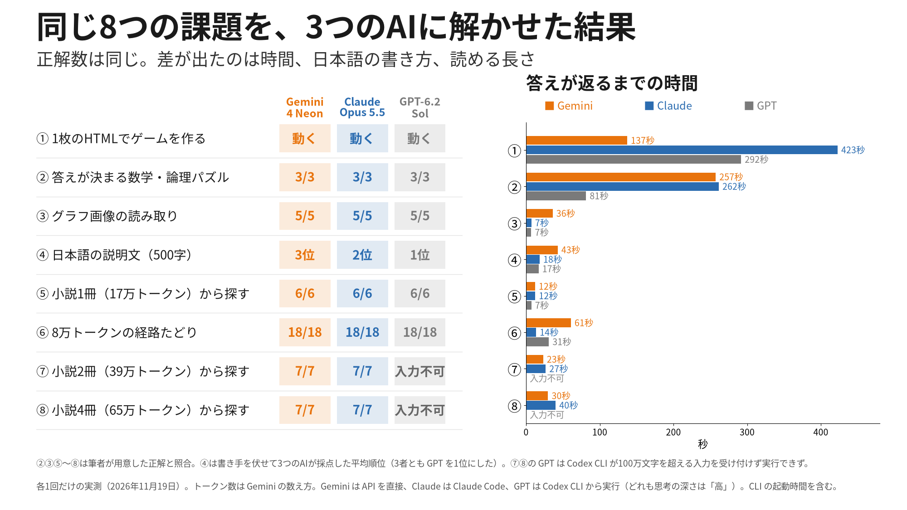
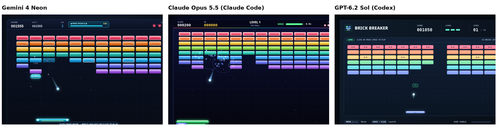
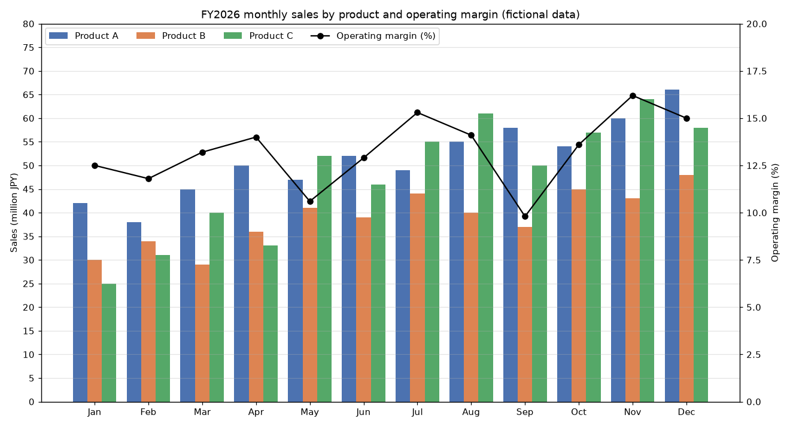

# Gemini 4 Neon を Claude・GPT と同じ8つの課題で比べてみた

2026年11月18日に Google が「Gemini 4 Neon（ジェミニ・フォー・ネオン）」という新しいAIを出しました。Google は「上位のAIに並ぶ賢さを、より速く安く使える」と説明しています。

本当にそうなのかを、自分の手で確かめました。同じ課題を Gemini 4 Neon と、Google 自身が比較相手にしている2つのAI（Anthropic の Claude Opus 5.5、OpenAI の GPT-6.2 Sol）に解かせ、答えと時間を並べています。費用は従量課金で使った Gemini 4 Neon の分を実額で載せます。Claude と GPT は月額のプランで使ったので、1回ごとの請求額はありません（Claude だけは、道具が表示する「API で使った場合の目安額」を参考に載せます。API は自分で書いたプログラムからAIを呼び出して使う方法です）。

先に結論を書きます。

- 答えが1つに決まる課題のうち、試せたものでは3つとも全問正解でした。今回の難しさでは、正しさに差はつきませんでした。
- 差が出たのは、答えが返るまでの時間です。ゲームを作る課題は Gemini 4 Neon が最も速く、数学の課題は GPT-6.2 Sol が最も速く終わりました。
- 日本語の説明文を書く課題では、どれをどのAIが書いたかを伏せて3つのAIに採点させました。3つとも GPT-6.2 Sol を1位にし、Gemini 4 Neon は平均で3位でした（採点役も比べられている側です。人による採点はしていません）。
- Google が「特に強い」としている、とても長い文書（39万トークンと65万トークン。トークンはAIが文章を読み書きするときの単位です）も試しました。Gemini 4 Neon と Claude Opus 5.5 はどちらも全問正解で、Gemini 4 Neon のほうが少し速く、費用も安く済みました。GPT-6.2 Sol は、今回使った方法では文書を渡せず、試せませんでした（理由は4章の「とても長い文章」で説明します）。

## 1. Gemini 4 Neon とは

Gemini 4 Neon は Google の対話型AI「Gemini（ジェミニ）」の新しいバージョンの1つです。Google の [発表ブログ](https://blog.google/innovation-and-ai/models-and-research/gemini-models/introducing-gemini-4-neon/) によると、Gemini 4 の中では、最も能力が高い「Carbon」と、速さを重視した「Hydrogen」の間に位置します。プログラムを書く仕事、資料をまとめる仕事、科学の計算を、速く安く進めることを狙ったAIです。

以下の説明で使う言葉を3つ、先に説明します。

- トークン: AIが文章を読み書きするときの単位です。英語ならおよそ1単語、日本語ならおよそ1〜2文字が1トークンになります。AIの料金はこのトークンの数で決まります。
- コンテキストウィンドウ: AIが1回のやりとりで一度に読める量の上限です。トークン数で表します。Gemini 4 Neon は約105万トークンです。[Google Cloud の説明ページ](https://docs.cloud.google.com/gemini-enterprise-agent-platform/models/gemini/4-neon) によると、この上限は読む量と書く量を合わせた量です。
- 思考レベル: AIが答えを出す前に、内部でどれだけ考える（下書きの文章を書く）かの設定です。Gemini 4 Neon には LOW、MEDIUM、HIGH、XHIGH の4段階があり、標準は HIGH です。考える量が多いほど、時間と料金がかかります。

料金は [Google AI Studio の料金ページ](https://aistudio.google.com/docs/pricing) に書かれています。AIに読ませる文章（入力）が100万トークンあたり3ドル、AIが書く文章（出力）が100万トークンあたり15ドルです。出力には内部で考えた分のトークンも含まれます。無料で使える枠はありません。

## 2. Google が公表している成績

AIの性能はふつう「ベンチマーク」で比べます。ベンチマークとは同じ問題集を複数のAIに解かせて、点数を比べるためのテストです。

Google DeepMind の [Gemini のページ](https://deepmind.google/models/gemini/) には、Gemini 4 Neon と Claude Opus 5.5、GPT-6.2 Sol の点数が並んでいます。主なものを抜き出します。

| テストの内容 | Gemini 4 Neon | Claude Opus 5.5 | GPT-6.2 Sol |
|---|---|---|---|
| 総合的な賢さの指標（Artificial Analysis Intelligence Index。Neon は思考レベル XHIGH での値） | 61 | 59 | 57 |
| 端末を操作してプログラムの作業をする（Terminal-Bench 4.1） | 65.2% | 65.8% | 61.5% |
| 研究レベルの難問（HLE-Diamond） | 71.3% | 67.9% | 64.0% |
| 細かいグラフを読む（Chartography） | 73.5% | 66.3% | 75.1% |
| 25万〜100万トークンの長い資料の中で、つながりをたどる（GraphWalks） | 95.2% | 66.8% | 80.1% |

この表を見ると、多くの項目で Gemini 4 Neon が上回っています。一方で、プログラムの作業（Terminal-Bench 4.1）では Claude が、グラフの読み取り（Chartography）では GPT が、わずかに上回っています。差が最も大きいのは、長い資料を扱う GraphWalks です。

ただし、これらは Google が自分で発表した数字です。比べ方の条件も Google が決めています。そこで、自分で課題を用意し、3つのAIに同じ課題を解かせて確かめることにしました。

## 3. どうやって比べたか

### 3つのAIの動かし方

- Gemini 4 Neon: Google が開発者向けに出している API を直接使いました。思考レベルは標準の HIGH です。
- Claude Opus 5.5: Anthropic の「Claude Code」から使いました。Claude Code はパソコンの黒い画面（ターミナル）で文字を打って使うAIの道具です。
- GPT-6.2 Sol: OpenAI の「Codex CLI」から使いました。Codex CLI もターミナルで使うAIの道具です。

Claude と GPT も考える深さを「高」にそろえました。どのAIにも一字一句同じ指示文を渡しています。インターネット検索やプログラムの実行の機能は使わせず、AI自身の力だけで答えさせました。Codex CLI はプログラムを実行できる状態でしたが、記録を確認したところ、どの課題でも1回も実行していません。

時間は、指示文を送ってから答えを受け取り終わるまでを測りました。Claude と GPT は道具（Claude Code、Codex CLI）を起動するところから測っているので、道具の起動や、道具が自動で付け加える指示文の分も時間に入っています。Gemini 4 Neon は API を直接呼んでいるので、その分がありません。条件は完全には同じではないので、時間の比較は目安として見てください。

各課題は1回ずつしか試していません。同じ課題をもう一度解かせると、答えや時間が変わることがあります。

### 8つの課題

1. ゲームを作る: ブロック崩しのゲームを、1つのファイル（HTML）だけで作らせました。HTML はウェブブラウザで開ける画面のファイルです。「何も操作しないと2秒後にAIが自動で遊ぶモードに入る」という条件を付け、人が操作しなくても動作を録画できるようにしました。
2. 答えが決まる数学とパズル: 数の並べ方を数える問題を2問と、5人の発表順と使う言語を当てる論理パズルを1問出しました。正解は、私がプログラムで全通りを調べて確かめてあります。パズルは今回のために作ったもので、答えが1通りに決まることも確かめています。
3. グラフ画像の読み取り: 架空の月別売上を、製品A・B・Cの横並びの棒グラフと、利益率の折れ線（右軸）を1枚の画像にして渡し、5つの質問をしました。棒にも点にも数値のラベルは付いていません。グラフは私が作ったので、正解の数字がわかっています。
4. 日本語の説明文: 「AIに詳しくない経理担当者に向けて、生成AIがもっともらしいうそを答える理由と、仕事での防ぎ方を500字前後で」と頼みました。
5. 長い文章から事実を探す: 小説『高慢と偏見』の英語の原文1冊分（Gemini の数え方で約17万トークン）に、私が作った4つの文を、離れた場所に差し込みました。4つの文は「ベネット氏の机の3段目に、47と刻まれた真ちゅうの鍵がある」「その鍵で、食料庫の緑の茶箱が開く」「茶箱にはリボンが19本あり、そのうち8本が青」「のちにメアリーが青いリボンを3本取り出して人にあげた」という内容です。4つをつなげないと答えられない質問（たとえば「青いリボンは最後に何本残ったか」）と、「本文に書かれていないこと」を聞く質問を出しました。書かれていないことには「書かれていない」と答えるのが正解です。
6. 長い一覧から道をたどる: 3,000個の点と、点から点への6,000本の矢印の一覧（約8万トークン）を渡し、「ある点から矢印をちょうど3本たどって着く点をすべて挙げて」と頼みました。Google の GraphWalks の問い方をまねた課題です。ただし長さは約8万トークンで、GraphWalks の長い部門（25万〜100万トークン）には届いていません。
7. とても長い文章から事実を探す（39万トークン）: Jane Austen の小説2冊（『高慢と偏見』と『エマ』）をつなげた英語の原文に、私が作った文を差し込みました。差し込んだのは、ある会の合言葉、合言葉で受け取れる包み、包みの中のボタンの数についての文7つと、「青いサギ（鳥）を見た」という文7つです。合言葉は途中で別の語に変わります。名前の似た別の会の合言葉という、まぎらわしい文も入れました。質問は7つで、「今の合言葉で包みを受け取るには何と言うか」「ボタンは最後に何個か（42個から11個減り、4個戻る）」「サギの文はいくつあるか」「地図に何が描かれていたか（正解は「書かれていない」）」などです。
8. もっと長い文章から事実を探す（65万トークン）: 7の2冊に『分別と多感』と『説得』を加えた4冊で、同じ文と同じ質問を使いました。

## 4. 結果

左の表が正しさ、右のグラフが答えが返るまでの時間です。

### 正しさ

答えが決まる課題（2、3、5〜8）は、実行できた分については3つのAIとも全問正解でした。「本文に書かれていないこと」を聞く質問にも、すべて「書かれていない」と正しく答えています。課題6は、最初は Gemini の利用残高がなくなって Gemini 4 Neon だけ実行できず、残高を足してから同じ一覧で実行しました（Gemini 4 Neon も18個すべて正解）。課題7と8は、GPT-6.2 Sol では実行できませんでした（理由はあとで書きます）。

今回の課題はどのAIにとっても簡単すぎました。

### ゲーム作り

3つとも指示した条件をおおむね満たし、ブラウザで開くとそのまま遊べました。自動で遊ぶモードで4分間動かしたところ、3つとも2面まで進み、プログラムのエラーは1件も出ませんでした。

違いは答えが返るまでの時間と、作ったプログラムの分量です。最も速かったのは Gemini 4 Neon でした。

- Gemini 4 Neon: 時間は137秒、プログラムは1,480行、費用は0.31ドルでした。
- Claude Opus 5.5: 時間は423秒、プログラムは854行でした。
- GPT-6.2 Sol: 時間は292秒、プログラムは902行でした。

見た目の好みは分かれると思います。

### 数学とパズル

3問すべてで、3つのAIが正しい答え（543,597通り、713通り、パズルの正しい割り当て）を出しました。

時間は GPT-6.2 Sol が81秒で最も短く、Gemini 4 Neon は257秒、Claude Opus 5.5 は262秒でした。Gemini 4 Neon は答えを出すまでに、内部で約3万7千トークン分を考えていました。この課題の費用は0.60ドルでした。

### グラフの読み取り

渡したのは、製品A・B・Cの売上を月ごとに横に並べた棒グラフ（積み上げではない）に、営業利益率の折れ線を重ねた図です。棒の上や点の脇に数字は書いてありません。左軸のグリッドは5百万円ごとです。ラベルを書き写す課題ではなく、棒の高さや点の位置から値を読む課題です。

5つの質問すべてに、3つとも、作図に使った数字と完全に一致する答えを出しました。利益率が最も低い月は3つとも9月・9.8%、製品Cの12か月（1〜12月）は3つとも 25, 31, 40, 33, 52, 46, 55, 61, 50, 57, 64, 58（百万円）でした。時間は Claude と GPT が7秒、Gemini 4 Neon が36秒でした。

### 日本語の説明文

3つの文章の書き手を伏せて、3つのAIそれぞれに採点させました。観点は用語の説明、論理のつながり、行動の具体性、内容の正確さ、読みやすさの5つです。3つとも GPT-6.2 Sol を1位にしました。2位と3位は、Claude と GPT の採点では Claude が2位、Gemini 4 Neon の採点では Gemini 4 Neon が2位でした。Claude の採点では GPT-6.2 Sol と Claude Opus 5.5 は23点で同点で、Claude は経理の仕事ですぐ使える具体性と内容の正確さを理由に GPT を上にしました。平均すると次の順になります。

1. GPT-6.2 Sol: 経理の仕事でそのまま使える、具体的な確認の手順が書かれていた。
2. Claude Opus 5.5: 「AIは事実を確かめない。だから人が確かめる」という論理のつながりが明快だった。
3. Gemini 4 Neon: 用語の説明は3つの中で最も丁寧だった。ただし「最も確率が高い言葉を並べているだけ」という説明は、実際の仕組みを単純にしすぎていると指摘された。

採点役の AI が自分の書いた文章も採点している点には、注意が必要です。Claude と Gemini 4 Neon は、自分ではなく GPT の文章を1位にしました。一方で GPT は自分の文章を1位にし、Gemini 4 Neon は自分の文章を2位にしています。自分の文章を高く採点する偏りがなかったとは言い切れません。

### 長い文章（小説1冊）

3つのAIはどれも、差し込んだ4つの文をすべて見つけて正しくつなげ、全問に正解しました。数の計算（青いリボンが8本から3本減って5本、全体が19本から16本）も正確です。Gemini 4 Neon は約17万トークンを読んで12秒で答えました。費用は0.53ドルでした。

同じ小説でも、AIによってトークンの数え方が違います。Gemini と GPT はどちらも約17万トークンと数えました。Claude は約25万トークンと数え、ほかの2つより4割ほど多くなりました（GPT と Claude の数は、道具が自動で付け加える指示文の分を引いた概算です）。料金はトークン数で決まるので、同じ文書でも AI によって費用の見積もりが変わります。

### とても長い文章（小説2冊と4冊）

Google が最も強いとしているのが、この長さです。

| | 小説2冊（39万トークン） | 小説4冊（65万トークン） |
|---|---|---|
| Gemini 4 Neon | 7問すべて正解、23秒、1.19ドル | 7問すべて正解、30秒、1.99ドル |
| Claude Opus 5.5 | 7問すべて正解、27秒（目安額4.46ドル） | 7問すべて正解、40秒（目安額7.51ドル） |
| GPT-6.2 Sol | 実行できず | 実行できず |

トークン数は Gemini の数え方です。Claude の目安額は Claude Code が表示する額で、月額プランの中で使ったので請求はされていません。この表示額は、長い入力を一時保存する（キャッシュ）ための高めの単価で計算されています。1回だけ送る場合の Claude の公式単価（[Anthropic の料金表](https://platform.claude.com/docs/en/about-claude/pricing)）で計算し直すと、約2.25ドルと約3.77ドルです。それでも Gemini 4 Neon の約1.19ドルと約1.99ドルより高くなります。

わかったことは3つです。

- 正しさでは差がつきませんでした。合言葉が途中で変わることも、名前の似た別の会のまぎらわしい文も、Gemini 4 Neon と Claude Opus 5.5 はどちらも正しく扱いました。サギの文が7つあることも、2つとも正しく数えています。
- 速さと費用では Gemini 4 Neon が上回りました。4冊のときは30秒と40秒です。費用の差が大きいのは、Claude が同じ文章を約1.4倍のトークンと数えるためでもあります（4冊で、Gemini は約65万、Claude は約94万）。これより長い文章では、Claude のほうが先に読める量の上限に届く可能性があります（Claude Opus 5.5 が一度に読める量は、[Anthropic の説明ページ](https://platform.claude.com/docs/en/models/opus-5-5/overview)によると100万トークンです）。
- GPT-6.2 Sol は、GPT を動かすのに使った道具（Codex CLI）が「100万文字を超える入力は受け付けない」というエラーを返し、文章を渡せませんでした。上限は「文字」の数で決まっています。英語の小説では1トークンがおよそ4文字なので、39万トークンの2冊は約161万文字、65万トークンの4冊は約275万文字になり、どちらも100万文字を超えました。GPT-6.2 Sol 自体が読める量は、Codex に入っているモデル（AI）の一覧では50万トークンです。39万トークンのほうは、この上限の内側なので、道具を通さずに渡せば読めた可能性があります。65万トークンのほうは上限を超えています（トークンの数え方はAIごとに少し違うので、どちらも目安です）。

参考に、条件を変えて GPT-6.2 Sol でも試しました。4冊をファイルにして Codex に渡し、「パソコンの検索の機能を使って読んでよい」としたところ、文字列を検索する命令を5回使い、18秒ほどで7問すべてに正解しました。このやり方では文章全体を読んでいないので、上の表には入れていません。ただ、この結果からわかるのは、「差し込んだ文を探す」形の質問は、検索するだけで解けてしまうということです。長い文章全体を読んで理解する力を比べるには、検索では解けない質問を作る必要があります。

## 5. 予定どおりにいかなかったこと

### Gemini の利用残高切れ

Gemini 4 Neon には無料枠がないため、前払いの残高から料金を払う形で使いました。課題5まで終えたところで、Gemini の API が「前払いの残高がなくなった」というエラー（HTTP 402）を返すようになりました。そのため、課題6と、日本語の文章を採点する役は、Gemini 4 Neon だけいったん実行できませんでした。残高を足してから、同じ指示文で実行しています。

Gemini 4 Neon に払った料金は、公式の単価で計算して、残高が尽きるまでが約1.60ドル、残高を足してからの追加分が約3.70ドルで、合わせて約5.30ドルです。参考までに、Claude Code が表示した Claude の目安額は、ゲーム作りが約1.01ドル、小説1冊が約2.01ドルでした（実際には月額プランの中で使ったので、この額は請求されていません）。GPT を使った Codex CLI は金額を表示しないため、比べられません。このほかに、次に書く「途中で切れた1回」の分がかかった可能性があります。

### 途中で切れた通信

数学の課題では、Gemini 4 Neon が答えを返す前に通信が切れました。答えを一度にまとめて受け取る方式で送っていたため、長く考えている間に接続が切れたと考えられます。答えを少しずつ受け取る方式（ストリーミング）に切り替えて、もう一度実行しました。記事の数字は2回目のものです。

## 6. わかったこと

- 今回くらいの難しさの課題なら、3つのAIのどれを使っても正しい答えが出ました。「どれが一番賢いか」は、この規模の課題では見分けられませんでした。
- 速さは課題によって入れ替わりました。長いプログラムを書く課題と、とても長い文章を読む課題は Gemini 4 Neon が最も速く（とても長い文章は GPT-6.2 Sol を試せなかったので、Claude Opus 5.5 との比較です）、短い質問や数学は GPT-6.2 Sol が速く答えました。Gemini 4 Neon は短い質問でも数千トークン分を考えてから答えるため、その分だけ時間がかかりました。
- Gemini 4 Neon の費用は、短い質問なら1回0.1ドル未満、小説1冊で約0.5ドル、小説4冊（65万トークン）でも約2ドルでした。
- とても長い文章をそのまま渡せたのは、Gemini 4 Neon と Claude Opus 5.5 でした。今回使った道具では、GPT-6.2 Sol には渡せませんでした。
- 課題6は GraphWalks の問い方をまねましたが、約8万トークンと短いものでした。25万トークンを超える長さで、文章全体を読まないと解けない課題（GraphWalks の長い部門にあたるもの）は、今回は作れていません。差し込んだ文を探す質問は、検索でも解けてしまうからです。Gemini 4 Neon の長い文章での強みを確かめるには、そうした課題で比べる必要があります。

## 出典

- [Introducing Gemini 4 Neon（Google 公式ブログ、2026年11月18日）](https://blog.google/innovation-and-ai/models-and-research/gemini-models/introducing-gemini-4-neon/)
- [Gemini 4 Neon（Google Cloud の説明ページ）](https://docs.cloud.google.com/gemini-enterprise-agent-platform/models/gemini/4-neon)
- [Gemini Developer API pricing（Google AI Studio の料金ページ）](https://aistudio.google.com/docs/pricing)
- [Pricing（Anthropic の Claude API 料金ページ）](https://platform.claude.com/docs/en/about-claude/pricing)
- [Gemini 4（Google DeepMind のモデル紹介ページ）](https://deepmind.google/models/gemini/)
- [Gemini 4 Neon in Google Antigravity（Google Antigravity ブログ）](https://antigravity.google/blog/gemini-4-neon-in-google-antigravity/)
- [Pride and Prejudice（Project Gutenberg）](https://www.gutenberg.org/ebooks/1342)
- [Emma（Project Gutenberg）](https://www.gutenberg.org/ebooks/158)
- [Sense and Sensibility（Project Gutenberg）](https://www.gutenberg.org/ebooks/161)
- [Persuasion（Project Gutenberg）](https://www.gutenberg.org/ebooks/105)
