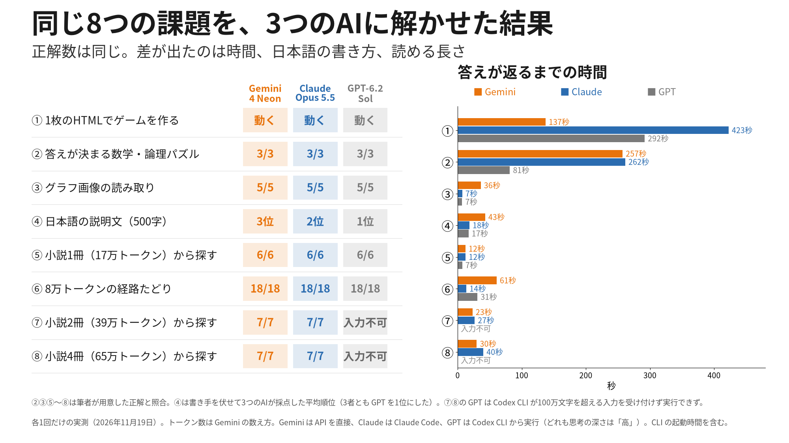
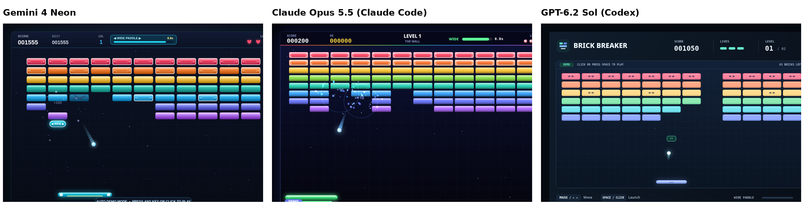
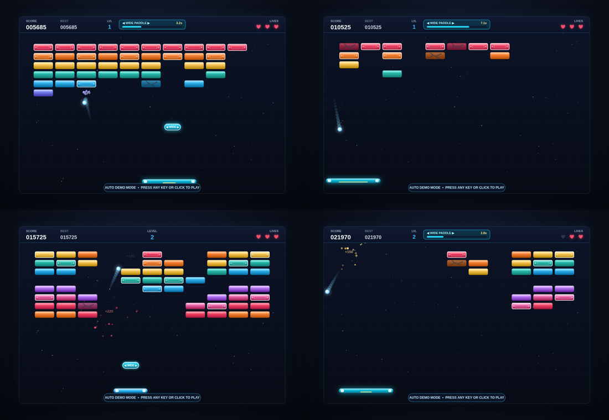
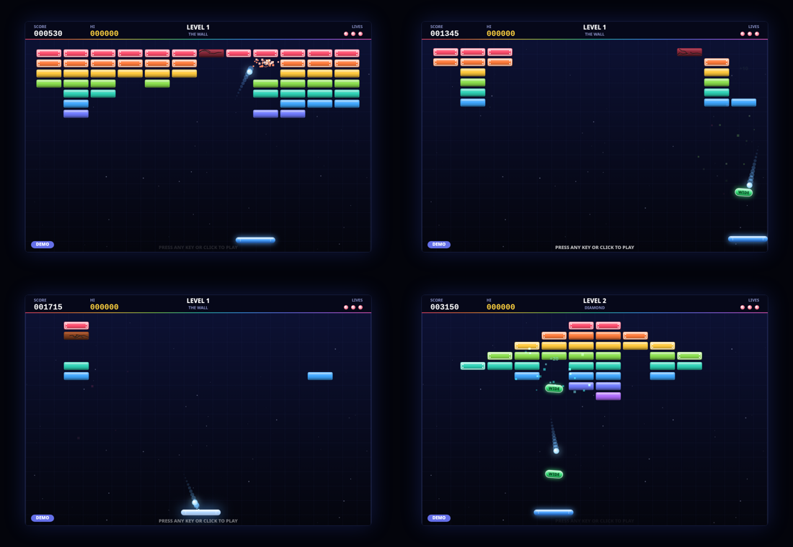
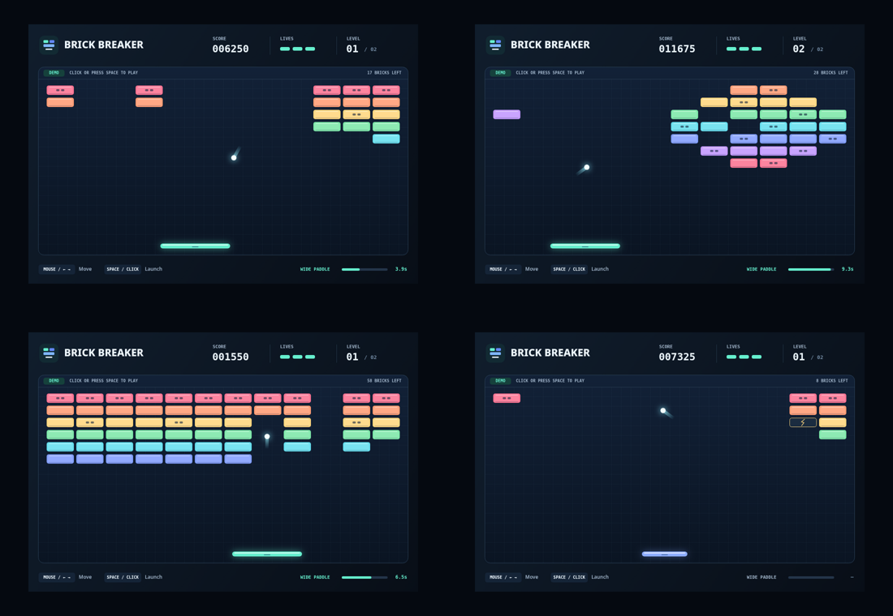
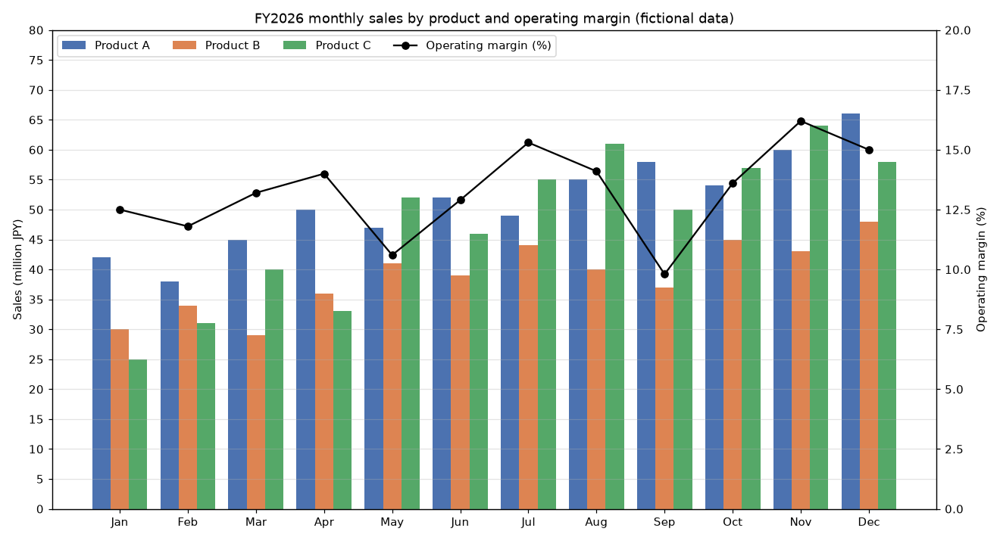

2026年11月18日に Google が出した Gemini 4 Neon を、同じ8つの課題で Claude Opus 5.5（Claude Code 経由）と GPT-6.2 Sol（Codex CLI 経由）と比べました。一般向けのまとめは note に書いたので、この記事ではどんなリクエストを送り、どう採点し、いくらかかり、どこで失敗したかを、手順を追える粒度で書きます。プロンプトの全文と正解データの作り方は付録に載せました。

結論を先に書きます。

- 正解が決まる課題（数学・論理、グラフ読み取り、17万トークンの文書検索、8万トークンのグラフ探索、39万・65万トークンの超長文検索）は、実行できたものは3モデルとも満点でした。各課題1回ずつの実行で、正答率に差はつきませんでした。
- 39万・65万トークンの超長文は、Neon（23.2s / 29.8s、$1.19 / $1.99）と Opus（26.6s / 40.1s）がどちらも7/7でした。GPT-6.2 Sol は、Codex CLI が 1,048,576 文字を超える入力を拒否したため渡せていません。
- 差は壁時計時間（実際に経過した時間）と思考トークン量に出ました。HTML のゲーム生成は Neon が137秒で最速、数学は GPT-6.2 Sol が81秒で最速でした。課題3・4の短い課題では、Neon は思考レベル HIGH のまま4〜5千トークン考え、36〜43秒かかりました。ほかの2つは7〜18秒でした。
- Neon の費用は成功したリクエストの合計で $5.300 でした（各リクエストの usage と公式単価から計算し、丸める前の値を足したもの。AI Studio の請求画面とは照合していません。全リクエストで `cachedContentTokenCount` は返らず、キャッシュ分は0として計算しています。通信が切れた課題2の1回目の分は含みません）。内訳は、1回目の実行（疎通確認と課題1〜5）が $1.596、残高を足したあと（14時52分以降）の実行が $3.704 です。後者は、疎通確認 $0.0006、1回目に HTTP 402 で送れなかった2リクエスト（課題6 $0.391、課題4の採点役 $0.130）、新しく足した課題7・8（$1.190、$1.993）です。採点役の費用は下の表に入っていないので、表の Neon の費用を足すと $5.169 になります。

## 1. 公式仕様の確認

一次情報は次の5ページです。この節の仕様とベンチマークの数字は、ここから取りました。実測の時間・トークン数・費用は、実行のたびに残したログ（`raw/` と `results.md`）の値です。Opus の単価は、この5ページではなく [Anthropic の料金ページ](https://platform.claude.com/docs/en/about-claude/pricing) の値です。

- [Google 公式ブログ（2026年11月18日）](https://blog.google/innovation-and-ai/models-and-research/gemini-models/introducing-gemini-4-neon/)
- [Google Cloud のモデルページ](https://docs.cloud.google.com/gemini-enterprise-agent-platform/models/gemini/4-neon)
- [Gemini Developer API の料金](https://aistudio.google.com/docs/pricing)
- [Google DeepMind の Gemini ページ（ベンチマーク表）](https://deepmind.google/models/gemini/)
- [Google Antigravity ブログ](https://antigravity.google/blog/gemini-4-neon-in-google-antigravity/)

API を使う側から見て重要な点をまとめます。

| 項目 | 値 |
|---|---|
| モデル ID | `gemini-4-neon`（GA、2026-11-18） |
| トークン上限 | 入力と出力で共有の 1,048,576。1セグメントの出力は最大 65,536 |
| long decode | Interactions API と `generateContent`（`v1beta1`）では、`continuation_token` を追って出力を「1,048,576 − 入力」まで延ばせる |
| 思考レベル | `LOW` / `MEDIUM` / `HIGH`（既定）/ `XHIGH`。`thinking_budget` や `MINIMAL` を指定すると 400 |
| サンプリング | `temperature`・`top_p`・`top_k` は無視される（temperature 1.0 固定） |
| キャッシュ | 暗黙キャッシュのみ（4,096トークン以上）。明示的なキャッシュは未対応 |
| 料金 | 入力 $3.00 / 出力（思考トークン込み）$15.00 / キャッシュ読み $0.15（いずれも 1M トークンあたり）。無料枠なし。入力の長さによる段階料金の記載はなし（2026年11月19日に料金ページで確認） |
| 知識カットオフ | 2026年3月 |

サンプリングの設定が temperature 1.0 に固定されているので、同じリクエストでも結果は実行のたびに変わります。この記事の数字は各1回の実測です。

Google が公開したベンチマーク表では、Neon は多くの項目で Claude Opus 5.5 と GPT-6.2 Sol を上回っています。一方で、端末を操作してプログラムの作業をする Terminal-Bench 4.1（65.2% vs Opus 65.8%）と、細かいグラフを読む Chartography（73.5% vs GPT 75.1%）では下回っています。差が最も大きいのは、長い文脈の中でグラフをたどる GraphWalks の 256k〜1M（Neon 95.2%、Opus 66.8%、GPT 80.1%）です。いずれも Google 自身の発表値です。

## 2. 実行環境と呼び出し方

### Gemini 4 Neon（API 直）

エンドポイントは Gemini Developer API（`generativelanguage.googleapis.com`）の `v1beta` です。仕様表に出てくる `v1beta1` は Google Cloud（Vertex）側の API のバージョンで、今回は使っていません。最初は `generateContent` を非ストリーミングで呼んでいましたが、途中から `streamGenerateContent?alt=sse` に切り替えました（理由は「5. 失敗したこと」に書きます）。リクエストボディは最小限です。

```json
{
  "contents": [{ "role": "user", "parts": [
    { "inline_data": { "mime_type": "image/png", "data": "<base64>" } },
    { "text": "<prompt>" }
  ]}],
  "generationConfig": { "thinkingConfig": { "thinkingLevel": "HIGH" } }
}
```

画像を渡すのは課題3だけです。`maxOutputTokens` は指定していません。どの応答も1セグメント（65,536トークン）に収まり、`finishReason` は `STOP` でした。そのため `continuation_token` による long decode は今回は起きておらず、検証もしていません。

ランナー（リクエストを送り、応答と usage を記録するスクリプト）の中心部分です。API キーはファイルから読み、ヘッダーに載せるだけで、ログには出しません。

```python
URL = "https://generativelanguage.googleapis.com/v1beta/models/gemini-4-neon:streamGenerateContent?alt=sse"
req = urllib.request.Request(URL, data=json.dumps(body).encode(),
        headers={"Content-Type": "application/json", "x-goog-api-key": KEY})
t = time.time(); ttft = None; text = []; usage = {}
with urllib.request.urlopen(req, timeout=1200) as resp:
    for raw in resp:
        line = raw.decode().strip()
        if not line.startswith("data:"):
            continue
        ev = json.loads(line[5:])
        usage = ev.get("usageMetadata", usage)          # 最後のイベントの値が最終値
        for c in ev.get("candidates", []):
            for p in c.get("content", {}).get("parts", []):
                if p.get("text") and not p.get("thought"):
                    ttft = ttft or time.time() - t
                    text.append(p["text"])
```

費用は `usageMetadata` から計算しました。思考トークン（`thoughtsTokenCount`）は出力単価で課金されるので、出力側に足します。

```python
inp    = usage["promptTokenCount"]
cached = usage.get("cachedContentTokenCount", 0)
out    = usage["candidatesTokenCount"] + usage.get("thoughtsTokenCount", 0)
cost   = (inp - cached) * 3e-6 + cached * 0.15e-6 + out * 15e-6
```

### Claude Opus 5.5（Claude Code 2.1.317）

Max プランでログインした Claude Code を、`-p` を付けたヘッドレス（対話画面を開かない実行）で使いました。プロンプトは標準入力で渡しています。`--tools ""` でツールをすべて外し、画像を読む課題3だけ `Read` を許可しました。

```bash
claude -p --model claude-opus-5-5 --effort high --output-format json --tools "" < prompt.txt
```

`--output-format json` の結果から、`modelUsage`（実際に使ったモデル名）、`usage`（入力・キャッシュ・出力・思考トークン）、`total_cost_usd` を取りました。Max プランなので `total_cost_usd` は実際の請求ではなく、Claude Code が表示する API 換算額です。

### GPT-6.2 Sol（Codex CLI 0.169.0）

ChatGPT のサブスクリプションでログインした Codex CLI を使いました。既定の推論の深さは `low` だったので、他の2つに合わせて `high` を明示しています。

```bash
codex exec --skip-git-repo-check -m gpt-6.2-sol \
  -c 'model_reasoning_effort="high"' -s read-only --json - < prompt.txt
# 課題3だけ: -i chart.png を追加
```

Codex にはツールを外すオプションがないため、プロンプトで「コードを実行しない」と指示しました。そのうえで `--json` のイベントログから `command_execution` を数え、全課題で0回だったことを確認しています。トークン数は `turn.completed` の `usage` から取りました。Codex CLI の出力には金額が出ません。

### 共通の条件

- 3者に一字一句同じプロンプトを渡し、課題ごとに3者を同時に走らせました。
- 各課題1回ずつです。時間は CLI の起動を含む壁時計時間です。
- CLI は課題ごとに空の作業ディレクトリで起動し、ほかのファイルを読めないようにしました。
- XHIGH は使っていません（予算を考えて後回しにしているうちに残高が尽きました）。

## 3. 課題と採点方法

| # | 課題 | 採点 |
|---|---|---|
| 1 | 1つの HTML で遊べるブロック崩し（要件9項目。2秒操作がなければ AI が遊ぶデモモードに入る） | Playwright＋Chrome で開き、1・6・15・30秒の画面を記録し、さらに4分間動かして2面への到達と `pageerror` を確認。30秒の動画も撮ったが、このリポジトリには入れていない。記事に載せているのは images/ の静止画 |
| 2 | 1〜10 の並べ替え p で、すべての i について \|p(i) − i\| ≠ 1 となるものの数／1〜8 の並べ替えで \|p(i) − i\| が1でも2でもないものの数／5人×5言語の論理パズル（全文は付録） | ビットマスク DP で正解を計算（543,597 / 713）。パズルは全通り（5!×5!）を調べて解が1つだけであることを確認 |
| 3 | 数値ラベルなしの横並び棒グラフ＋折れ線（二軸）の読み取り5問 | 作図に使った配列と照合 |
| 4 | 経理担当者向けの日本語説明文（450〜550字） | 書き手を X/Y/Z に伏せ、Claude と GPT に5観点×5点で採点させる |
| 5 | 『高慢と偏見』全文（Project Gutenberg）に、離れた4か所へ文を差し込み、6問 | つなげないと解けない問い、計算、「書かれていない」が正解の問い、章の最初の文の引用 |
| 6 | 3,000ノード・6,000辺の有向グラフ（約8万トークン）で、始点からの距離がちょうど3のノードを列挙 | BFS で正解を計算し、F1 で採点（GraphWalks を小さくまねた課題） |
| 7 | 『高慢と偏見』＋『エマ』（1,610,610文字、Neon で 385,994 トークン）に14文を差し込み、7問 | 更新された合言葉、合言葉を使う多段の問い、数の計算（42−11+4=35）、名前の似たおとり、「書かれていない」、blue heron の文の数（7）、出てくる順番 |
| 8 | 7の2冊＋『分別と多感』＋『説得』（2,746,143文字、653,922 トークン）、同じ14文・同じ7問 | 7と同じ |

課題5の正解は差し込み位置の直前にある章見出しをプログラムで探して確かめました。章の最初の文の引用も原文と一字一句照合しています。

表の `pageerror` はページ内で処理されなかった JavaScript の例外を Playwright が知らせるイベントです。ビットマスク DP はすでに使った数の集合をビット列で表して数え上げる動的計画法です。BFS は幅優先探索のことで、始点に近いノードから順にたどります。F1 は回答したノードの集合と正解の集合の一致度を表す指標（適合率と再現率の調和平均）で、1.0 は過不足なく一致したことを表します。

## 4. 結果



| # | モデル | 時間 | 入力 tok | 出力 tok（うち思考） | 費用 | 結果 |
|---|---|---|---|---|---|---|
| 1 | Neon | 137.2s | 280 | 20,344（2,421） | $0.306 | 動作OK、1,480行、4分で2面到達 |
| 1 | Opus 5.5 | 422.7s | 3,170 | 49,633（31,940） | 換算 $1.01 | 動作OK、854行、4分で2面到達 |
| 1 | GPT-6.2 Sol | 291.8s | 17,609 | 13,096（4,635） | — | 動作OK、902行、2分で2面到達 |
| 2 | Neon | 257.3s | 394 | 39,993（37,339） | $0.601 | 3/3 |
| 2 | Opus 5.5 | 261.5s | 3,326 | 32,356（31,201） | 換算 $0.67 | 3/3 |
| 2 | GPT-6.2 Sol | 81.4s | 16,319 | 3,544（2,779） | — | 3/3 |
| 3 | Neon | 36.1s | 1,273 | 4,536（4,416） | $0.072 | 5/5 |
| 3 | Opus 5.5 | 7.2s | 13,295 | 557（317） | 換算 $0.07 | 5/5 |
| 3 | GPT-6.2 Sol | 7.0s | 18,727 | 177（90） | — | 5/5 |
| 4 | Neon | 42.9s | 196 | 5,576（5,281） | $0.084 | 3位（515字） |
| 4 | Opus 5.5 | 18.4s | 3,068 | 1,625（1,124） | 換算 $0.05 | 2位（541字） |
| 4 | GPT-6.2 Sol | 17.0s | 17,598 | 604（202） | — | 1位（506字） |
| 5 | Neon | 12.2s | 171,324 | 1,226（1,051） | $0.532 | 6/6 |
| 5 | Opus 5.5 | 12.4s | 250,093 | 712（400） | 換算 $2.01 | 6/6 |
| 5 | GPT-6.2 Sol | 7.2s | 187,971 | 140（0） | — | 6/6 |
| 6 | Neon | 60.8s | 79,963 | 10,074（9,546） | $0.391 | 18/18（F1 1.0）※チャージ後に実行 |
| 6 | Opus 5.5 | 13.6s | 78,178 | 1,171（727） | 換算 $0.64 | 18/18（F1 1.0） |
| 6 | GPT-6.2 Sol | 30.9s | 77,615 | 1,205（1,003） | — | 18/18（F1 1.0） |
| 7 | Neon | 23.2s | 385,994 | 2,135（1,929） | $1.190 | 7/7 ※チャージ後に実行 |
| 7 | Opus 5.5 | 26.6s | 558,209 | 1,027（648） | 換算 $4.46 | 7/7 |
| 7 | GPT-6.2 Sol | — | — | — | — | 入力不可（CLI の文字数上限） |
| 8 | Neon | 29.8s | 653,922 | 2,052（1,833） | $1.993 | 7/7 ※チャージ後に実行 |
| 8 | Opus 5.5 | 40.1s | 936,580 | 1,068（808） | 換算 $7.51 | 7/7 |
| 8 | GPT-6.2 Sol | — | — | — | — | 入力不可（CLI の文字数上限） |

Claude と GPT の入力トークンには、CLI が自動で付けるシステム指示（Claude は約3千、Codex は約1.6〜1.7万）が含まれます。Codex の入力のうち 13,696〜16,512 トークンは、毎回キャッシュから読まれていました。



課題1のデモモードを4分間動かしたときの画面です（左上から1・2・3・4分後）。上から Gemini 4 Neon、Claude Opus 5.5、GPT-6.2 Sol です。





### 読み取れること

**思考トークンの使い方が違う。** 課題2では、Neon と Opus がどちらも3万トークン以上考え、約260秒かかりました。GPT-6.2 Sol は2,779トークンの思考で同じ正解を出し、81秒で終わっています。一方で課題3・4のような短い課題では、Neon は HIGH のまま4〜5千トークン考え、Opus と GPT は数百〜千トークン程度で済ませています。課題5（17万トークンの読解）では Neon の思考は1,051トークンで、時間も Opus とほぼ同じ（12.2秒と12.4秒）でした。Neon の既定は HIGH なので、短い問い合わせが多い用途なら `LOW` や `MEDIUM` を試す価値があります（今回は試していません）。

**長いコード生成は Neon が速い。** 課題1では、Neon が最も長いファイル（46KB、1,480行）を最も短い時間で返しました。Opus は思考に約3.2万トークン使い、423秒かかっています。出力トークン数を時間で割ると、Neon は約148 tok/s（20,344 ÷ 137.2）でした。この値は思考を含む全出力から計算しているので、純粋な生成速度ではありません。

**トークナイザーの違いで費用の見積もりが変わる。** 同じ小説1冊が Neon では 171,324 トークン、GPT では約17.1万トークン（187,971 から Codex の指示の分、約1.7万を引いた概算）、Claude では約24.7万トークンでした。Neon でこの1冊を読ませる費用は、入力だけで 171,324 × $3/1M = $0.514 です。

**日本語の伏せ採点。** Claude と GPT の採点はどちらも GPT > Opus > Neon、Neon の採点は GPT（22点）> Neon（21点）> Opus（20点）でした。Claude の採点では GPT と Opus が23点で同点で、Claude 自身が、経理の実務ですぐ使える具体性と内容の正確さを理由に GPT を上位にしました。3者とも GPT を1位にしています。平均順位は GPT 1.0、Opus 2.33、Neon 2.67 です。Neon の文章は、用語の説明（生成AI、ハルシネーション、一次情報）が3つの中で最も丁寧でした。一方で「確率が最も高い言葉を計算して並べているだけ」という説明は実際の仕組みを単純にしすぎているとして、3者とも減点しています（Neon 自身も「やや単純化しすぎ」と書いています）。採点役が自分の文章も採点しているので偏りの可能性はあります。Opus と Neon は自分ではなく GPT を1位にしましたが、GPT は自分を1位に、Neon は自分を2位にしています。自己びいきがなかったとは言い切れません。

**超長文（課題7・8）では Neon が速く安い。正しさは Opus と同じ。** 65万トークン（Neon の数え方）の入力で、Neon は29.8秒・$1.99、Opus は40.1秒でした。Opus の API 換算額 $7.51 は、Claude Code が1時間キャッシュの書き込み単価で計算した表示額で、実際の請求ではありません。同じ4冊を Claude は 936,580 トークンと数え、Neon の約1.43倍でした。Neon の思考はどちらも2千トークン弱で、出力の費用は課題7で約2.7%（2,135 × $15/1M = $0.032、$1.190 に対して）、課題8で約1.5%（2,052 × $15/1M = $0.031、$1.993 に対して）です。費用のほぼすべては入力です（課題8は 653,922 × $3/1M = $1.962）。

Opus の表示額は検算できます。Opus 5.5 の公式単価は入力 $4/1M、出力 $20/1M、1時間キャッシュの書き込み $8/1M、キャッシュの読み出し $0.20/1M です（[Anthropic の料金ページ](https://platform.claude.com/docs/en/about-claude/pricing)）。Claude Code は長いプロンプトを1時間キャッシュに書き込むので、課題8の表示額は 935,929 × $8/1M ＋ 649 × $0.20/1M ＋ 1,068 × $20/1M ≒ $7.51 になります。これは「1回だけ送る」用途には不利な計算です。API でキャッシュを使わずに送った場合の試算は、課題7が (558,209 × $4 ＋ 1,027 × $20)/1M ≒ $2.25、課題8が (936,580 × $4 ＋ 1,068 × $20)/1M ≒ $3.77 です。この条件で比べても、Neon（$1.19、$1.99）のほうが安くなります。理由は2つあります。入力単価が $3 と $4 で違うことと、同じ本文を Claude のトークナイザーが約1.43倍多く数えることです。

**GPT-6.2 Sol は CLI の入力上限で止まった。** Codex CLI 0.169.0 は、標準入力のプロンプトが 1,048,576 文字を超えると、モデルを呼ぶ前に次のエラーで終了しました。

```text
Error: turn/start: turn/start failed: Input exceeds the maximum length of 1048576 characters. (code -32602),
data: {"input_error_code":"input_too_large","max_chars":1048576,"actual_chars":1611628}
```

Codex のモデル一覧（`~/.codex/models_cache.json`）では、gpt-6.2-sol の `context_window` は 500,000 トークンです。課題7は Neon の数え方で約39万トークンなので、モデル自体には入る可能性があります。止めたのは CLI の文字数上限で、OpenAI の API を直接呼べば結果は変わるかもしれません。今回はサブスクリプションの範囲で実行しているので、API は試していません。

**参考：検索を使えば、差し込み型の問いは安く解ける。** 課題8の本文を `novels.txt` として作業ディレクトリに置き、「シェルで読んでよい」としてCodex を実行しました。Codex は `rg -in 'Thornbury|Pelham Lending|silver buttons|blue heron|...' novels.txt` などを5回実行し、約18秒・入力 74,417 トークンで 7/7 でした。表の条件（全文をプロンプトに入れる）とは違うので、比較には入れていません。ただ、差し込んだ文を探す問いでは長文の読解力は測れない、ということははっきりしました。

## 5. 失敗したこと

### 非ストリーミングの長考で接続が切れた

課題2の1回目は非ストリーミングの `generateContent` で送りました。`urlopen` が HTTP 応答の先頭を待つ途中で、`http.client.RemoteDisconnected`（相手が応答を返さずに接続を閉じた）になりました。切れるまでの経過秒数は記録していません（タイムアウトは900秒に設定していました）。どこで切れたか（途中のプロキシか、サーバー側か）は特定できていません。

`streamGenerateContent?alt=sse` に変えて再実行すると、240秒後に最初の本文が届き、257秒で完了しました。この240秒は、ランナーが記録した `time_to_first_text_s` です。思考トークンではない、本文テキストが初めて付いたイベントの到着時刻です。最初の SSE イベントがいつ届いたか、思考中に usageMetadata だけの空イベントが流れていたかはわかりません。ランナーは本文の到着時刻しか記録しておらず、生の SSE も残していないためです。ストリーミングが切れるのを防げた理由は、この記録だけでは特定できません。それでも、思考が長くなるリクエストは最初からストリーミングにしておくのが安全です。

1回目がサーバー側で最後まで処理され、課金されたかどうかはわかりません。2回目と同じ量なら、最大で約 $0.60 です。

### 前払い残高が尽きた（HTTP 402）

Gemini Developer API の前払い（プリペイド）残高で実行していました。前払いは先に入金した額の範囲でだけ使える支払い方式です（AI Studio の課金設定で選べます）。この残高は前日に800円を入れたもので、音声合成など別の用途とも共用していたため、今回の比較を始めた時点の残り額は確認できていません。13時21分（日本時間）以降のリクエストには、すべて次の応答が返ってきました。

```json
{ "error": { "code": 402,
  "message": "Your prepayment credits are depleted. Please go to AI Studio ...",
  "status": "RESOURCE_EXHAUSTED" } }
```

課題6と、課題4の採点役の2リクエストが送れませんでした。402 を受けた時点で Neon への呼び出しを止め、残高を足したあと（14時52分）に1トークン級の呼び出しで 200 が返ることを確かめてから、その2リクエストを同じプロンプトで実行しました。課題6は Claude と GPT に渡したものと同じファイル（prompts/graphwalk.txt）です。前払い方式は残高を超えて課金されない代わりに、残高が尽きると使っている途中でも止まります。長い評価を回す前には、必要な額を見積もって残高を確かめておく必要があります。

## 6. この比較の限界

- **各課題1回だけ。** Neon はサンプリングを固定できないので、正しい比較には同じ課題を何回も回して分布を見る必要があります。
- **課題が簡単すぎた。** 正解が決まる課題はどのモデルも満点で、能力の差は測れていません。Google が最も差を主張している長い文脈（25万トークン超の GraphWalks）に近い規模は課題7・8で試しましたが、問いは差し込んだ文を探す形です。検索で解ける問いなので、文章全体をたどる力は測れていません。40万トークン級のグラフ探索を作れば GraphWalks に近づきますが、Neon だけで1回 $1.2 以上かかり、今回の予算では見送りました。
- **呼び出し方が違う。** Neon は API を直接呼び、Claude と GPT はエージェント CLI 経由で呼んでいます。CLI のシステム指示や起動時間が時間とトークン数に入っています。時間の差にはネットワークや混雑の影響も含まれます。
- **思考レベルの対応は名前で合わせただけ。** Neon の HIGH、Claude の high、Codex の high が同じ深さである保証はありません。
- **日本語の採点は LLM 同士。** 人間による採点はしていません。
- **課題5の小説は有名な作品。** 差し込んだ4文は架空なので記憶では答えられません。ただし、章の最初の文を引用する問いは、記憶でも答えられた可能性があります。

## 7. 再現するには

スクリプト一式は [GitHub リポジトリ（2026-11-20/gemini-4-neon-compare）](https://github.com/haginot/sns-media-public/tree/a2636a1ebac308454dd9aca6b6b5dedc62f6eef2/2026-11-20/gemini-4-neon-compare) に置いています。プロンプトの全文と正解データの作り方は付録に載せています。作業フォルダの構成は次のとおりです（API キーは含みません）。

```text
prompts/        各課題のプロンプト（3者共通）
data/           正解データ（chart_truth.json、graphwalk_truth.json、ultralong_{a,b}_truth.json）と小説の加工版
build_ultralong.py  課題7・8のプロンプト生成
verify_math.py  課題2の正解計算（ビットマスク DP）
verify_puzzle.py 課題2のパズルの解が1つだけであることの確認
gem.py          Gemini ランナー（SSE、usage と費用を記録）
run_cli.py      Claude Code / Codex CLI ランナー（モデル名・usage・コマンド実行の有無を記録）
render.py / longplay.py  Playwright で HTML を開き、画面を保存する（動画と shots/ の個別画面はリポジトリに含めていない。公開している静止画は images/）
raw/            全モデルの生の出力とメタ情報、402 の応答
```

費用は実行前に countTokens API（無料）で入力トークンを数えて見積もりました。課題7は 385,994 × $3/1M = $1.158、課題8は 653,922 × $3/1M = $1.962 と見積もり、実際は思考と出力を足して $1.190 と $1.993 でした。

## 付録：プロンプトと正解データの作り方

### 課題2（数学・論理）のプロンプト全文

```text
Solve the following three problems by reasoning only. Do not run code, do not use any tools, and do not search. Show a brief derivation for each, then give the final answers on the last three lines in the form "ANSWER 1: ...", "ANSWER 2: ...", "ANSWER 3: ...".

Problem 1. How many permutations p of {1, 2, ..., 10} satisfy |p(i) - i| != 1 for every i? (That is, no number is placed in a position adjacent to its own.)

Problem 2. How many permutations p of {1, 2, ..., 8} satisfy |p(i) - i| is neither 1 nor 2 for every i?

Problem 3. Five people (Aoi, Ben, Chika, Daiki, Emi) give talks in slots 1-5 (one per slot). Each uses a different language: Python, Rust, Go, Java, Swift.
 (a) Aoi presents immediately before the Python presenter.
 (b) Ben presents neither first nor last, and does not use Python or Go.
 (c) The Go presenter presents earlier than both the Swift presenter and the Java presenter.
 (d) Chika presents later than Ben.
 (e) Exactly one person presents between Emi and Chika.
 (f) Daiki's slot number is odd.
 (g) The Rust presenter and the Swift presenter are not in adjacent slots.
 (h) The Swift presenter's slot number is even.
 (i) The Java presenter presents immediately after the Python presenter.
Give the full assignment (slot: person, language) for slots 1-5.
```

問題1の条件は、各数 i を位置 p(i) に置く並べ替えとして見たとき、数 i を自分の隣の位置（i−1 か i+1）に置かない、というものです。隣り合う2つの値が連続しない並べ替え（Hertzsprung の問題、OEIS A002464）とは別の問題です。正解は次のビットマスク DP で数えました。

```python
from functools import lru_cache
def count(n, bad):
    @lru_cache(None)
    def f(i, mask):           # i: 次に決める位置, mask: 使用済みの値の集合
        if i == n: return 1
        return sum(f(i + 1, mask | 1 << j) for j in range(n)
                   if not mask >> j & 1 and abs(j - i) not in bad)
    return f(0, 0)
count(10, (1,))    # 543597
count(8, (1, 2))   # 713
```

パズルは5人の並び（5!）と5言語の割り当て（5!）の14,400通りをすべて調べ、条件をすべて満たすのが「1: Daiki/Go、2: Aoi/Swift、3: Emi/Python、4: Ben/Java、5: Chika/Rust」の1通りだけであることを確かめました。

### 課題1（HTML）のプロンプト全文

```text
Create a complete, playable "Brick Breaker" game as a single self-contained HTML file (inline CSS and JavaScript only; no external libraries, fonts, images, or network requests).
Requirements:
- Canvas rendering at 960x640, crisp on high-DPI screens.
- Paddle controlled by mouse and by left/right arrow keys; space bar launches the ball.
- At least 6 rows of colored bricks; some bricks take 2 hits and visibly change when damaged.
- Particle effects when bricks break, and a short screen shake on each brick hit.
- Score, lives (3), and level display. Level 2 uses a clearly different brick layout.
- One power-up type that falls from broken bricks (for example a wider paddle), with a visible timer.
- A title screen. IMPORTANT: if there is no user input for 2 seconds, start an automatic demo mode in which the AI controls the paddle and plays the game, so the game can be recorded unattended.
- Sound effects generated with the Web Audio API (only after a user gesture).
Output only the HTML code in a single ```html code block, with no explanation.
```

### 課題3（グラフ）のプロンプト全文

```text
Look at the attached chart image and answer. Read values from the chart as precisely as you can (the gridlines are every 5 million JPY on the left axis).
1. Which month has the highest total sales (A+B+C)? Give the total.
2. What is Product B's sales in July?
3. In which month is the operating margin lowest, and what is its value?
4. List every month in which Product C's sales are higher than Product A's.
5. Estimate Product C's sales for all 12 months, Jan to Dec, as a comma-separated list of 12 numbers.
Answer numbered 1-5, concisely. Do not use tools other than viewing the image.
```

グラフは matplotlib で描きました。A・B・C の12か月の売上と利益率は、配列で直接決めています（chart_truth.json）。渡した画像と形式は、次の「課題3のグラフの元データ」に載せています。

### 課題4（日本語）のプロンプト全文

```text
社内の経理担当者（AIやプログラミングの知識はほとんどない人）に向けて、「生成AIが、もっともらしいうそを自信ありげに答えてしまうのはなぜか。日々の仕事でどう防げばよいか」を説明する文章を、日本語で500字前後（450〜550字）で書いてください。
条件:
- 専門用語を使う場合は、初めて出てきたところで必ず短く説明する
- たとえ話は使わない
- 「なぜ起きるか」→「どう防ぐか」の順に、論理のつながりがわかる構成にする
- 防ぎ方は、経理の仕事で今日から実行できる具体的な行動を3つ挙げる
- 見出しや箇条書きは使ってよい
本文のみを出力してください。
```

### 課題5（長文）の質問部分

本文は Project Gutenberg の『Pride and Prejudice』（電子書籍番号 1342）の本文部分です。段落の10%、45%、70%、92%の位置に、次の4文を差し込みました。

```text
Mr. Bennet kept a small brass key in the third drawer of his library desk; it was engraved with the number 47.
Mrs. Hill once remarked to the cook that the brass key from the library desk was the only key that opened the green tea chest in the pantry.
Inside the green tea chest, Kitty had secretly hidden exactly nineteen ribbons, eight of which were blue.
Some weeks afterwards, Mary quietly took three of the blue ribbons out of the green tea chest and gave them to the curate's daughter.
```

```text
Below is the full text of a novel, into which a few extra sentences have been inserted. Read it and answer using ONLY the text provided (do not rely on your memory of the novel, do not use tools or search).

Questions:
1. What number is engraved on Mr. Bennet's brass key, and where is the key kept?
2. According to the text, what does that key open?
3. How many ribbons were in that container originally, and how many of them were blue?
4. After the event described later in the text, how many blue ribbons and how many ribbons in total remain in the container? Show the arithmetic.
5. What color is the ribbon tied to the brass key? If the text does not say, answer "not stated".
6. Quote, word for word, the first sentence of the chapter in which the sentence about the key's engraving appears, and give that chapter's number.

Answer in English, numbered 1-6, concisely.
=== TEXT START ===
（本文）
=== TEXT END ===
```

採点に使った正解は次のとおりです（言い回しの違いは許容し、数と固有名詞が合っていれば正解としました）。

1. 47、書斎の机の3段目の引き出し　2. 食料庫の緑の茶箱　3. 19本、うち青8本　4. 青5本（8−3）、全部で16本（19−3）　5. not stated　6. 第4章（Chapter IV）の最初の文 "When Jane and Elizabeth were alone, the former, who had been cautious in her praise of Mr. Bingley before, expressed to her sister how very much she admired him."（原文と一字一句照合）

### 課題3のグラフの元データ

渡した画像は次の1枚です。生成スクリプトはリポジトリに残っていませんが、画像そのものを確認しました。



形式は、製品A・B・Cの売上を月ごとに横に並べた棒グラフ（積み上げではない）に、右軸で営業利益率の折れ線（点付き）を重ねた二軸の図です。棒の上にも、折れ線の点の脇にも、数値ラベルは付いていません。左軸の目盛りとグリッドは5百万円ごと、右軸の目盛りは2.5%ごとです。したがってこの課題は、ラベルの転記ではなく、棒の高さや点の位置から値を読む課題です。

正解は作図に使った値そのものです。グリッドに乗らない値（利益率の9.8%や、製品Cの25、31など）も含め、3モデルとも全値が作図値と完全一致したので、誤差の幅は設けていません。

```json
{"A": [42, 38, 45, 50, 47, 52, 49, 55, 58, 54, 60, 66],
 "B": [30, 34, 29, 36, 41, 39, 44, 40, 37, 45, 43, 48],
 "C": [25, 31, 40, 33, 52, 46, 55, 61, 50, 57, 64, 58],
 "margin": [12.5, 11.8, 13.2, 14.0, 10.6, 12.9, 15.3, 14.1, 9.8, 13.6, 16.2, 15.0]}
```

3モデルの問3（利益率が最も低い月とその値）と問5（製品Cの12か月）の回答は、次のとおり一致しています。

- 問3: 3モデルとも September（9月）、9.8%。Neon は "approximately 9.8%"、Opus は "about 9.8%"、GPT は "9.8%" と書いています。
- 問5: 3モデルとも `25, 31, 40, 33, 52, 46, 55, 61, 50, 57, 64, 58`（百万円）。作図値と同一です。

### 小説への差し込みスクリプト

```python
t = open("pp.txt", encoding="utf-8").read()
t = t[:t.find("*** END OF THE PROJECT GUTENBERG")]   # ライセンス部分を除く
paras = t.split("\n\n")
needles = [(0.10, S1), (0.45, S2), (0.70, S3), (0.92, S4)]   # S1〜S4 は上の4文
idx = {int(len(paras) * p): s for p, s in needles}
out = []
for i, p in enumerate(paras):
    out.append(p)
    if i in idx:
        out.append(idx[i])          # その段落の直後に1文を差し込む
doc = "\n\n".join(out)
```

### 課題6のグラフ生成スクリプト

```python
import random, collections
random.seed(20261119)
N, E = 3000, 6000
nodes = list({"%06x" % random.getrandbits(24) for _ in range(N * 2)})[:N]
edges = set()
while len(edges) < E:
    a, b = random.sample(nodes, 2)
    edges.add((a, b))
edges = list(edges); random.shuffle(edges)
adj = collections.defaultdict(list)
for a, b in edges:
    adj[a].append(b)
def bfs(s):
    d = {s: 0}; q = collections.deque([s])
    while q:
        u = q.popleft()
        for v in adj[u]:
            if v not in d:
                d[v] = d[u] + 1; q.append(v)
    return d
for s in nodes:   # 条件を満たす最初のノードを始点にする
    d = bfs(s)
    if 12 <= sum(k == 3 for k in d.values()) <= 18 and sum(k == 2 for k in d.values()) >= 5:
        break
```

注意: `nodes` は集合から作ったリストです。Python の文字列のハッシュは起動のたびに変わる（`PYTHONHASHSEED`）ので、今回の実行ではこの並び順を固定していませんでした。`edges = list(edges)` も文字列タプルの集合から作ったリストなので、辺の並びもハッシュに依存します。そのあとの `random.shuffle(edges)` は、並びが違うリストを混ぜることになり、結果の辺の順序は毎回変わります。そのため、`nodes` を `sorted(...)` にするだけでは、同じ辺の順序にも同じ始点にもなりません。このスクリプトをそのまま実行しても、同じ辺リストと始点 f2b1ce は再現できません。同じ課題を再現するには、今回実際に使った辺リストそのものを共有して使う必要があります（約100KB）: [prompts/graphwalk.txt](https://github.com/haginot/sns-media-public/blob/a2636a1ebac308454dd9aca6b6b5dedc62f6eef2/2026-11-20/gemini-4-neon-compare/prompts/graphwalk.txt)。新しく作る場合は、`nodes = sorted(...)` に加えて `edges = sorted(edges)` にしてから shuffle するか、`PYTHONHASHSEED=0` を指定してください。

### 課題4の採点プロンプト（3つの回答の前に置いた部分）

```text
次の3つの文章X・Y・Zは、同じ依頼に対する回答です。書き手は伏せてあります。
依頼: 「社内の経理担当者（AIやプログラミングの知識はほとんどない人）に向けて、生成AIがもっともらしいうそを自信ありげに答えてしまうのはなぜか、日々の仕事でどう防げばよいかを、500字前後（450〜550字）で。専門用語は初出で説明、たとえ話は使わない、なぜ→どう防ぐの順で論理がつながる構成、経理で今日から実行できる具体的な行動を3つ。」
経理担当者の立場で読み、次の観点ごとに1〜5点で採点し、最後に総合順位をつけてください: (1) 用語の説明（説明なしの専門用語がないか）(2) 論理のつながり (3) 行動の具体性 (4) 内容の正確さ (5) 読みやすさ。各観点の理由は1行で。ツールは使わないでください。
最後の行は「RANKING: 1位, 2位, 3位」の形式（例: RANKING: Y, X, Z）。
```

Claude の採点の合計点は X（GPT）23点・Z（Claude）23点・Y（Neon）20点で、X と Z は同点です。Claude は採点文の中で、経理の実務ですぐ使える具体性と内容の正確さを理由に X を上位にしています。GPT の総合順位は X 1位・Z 2位・Y 3位でした（GPT は観点ごとの点を付けたうえで順位を出しました）。

### 課題1の描画と判定の手順

生成された回答から html のコードブロックを取り出し、Playwright（Python）で Chrome を起動して開きました。

```python
b = await p.chromium.launch(executable_path="/usr/bin/google-chrome")
ctx = await b.new_context(viewport={"width": 1100, "height": 760},
                          record_video_dir="shots/vid_" + model)
pg = await ctx.new_page()
pg.on("pageerror", lambda e: errs.append(str(e)))      # 処理されなかった例外
pg.on("console", lambda m: errs.append(m.text) if m.type == "error" else None)
await pg.goto("file://" + path)
for t in (1, 6, 15, 30):                                # 開始からの秒数で画面を保存
    ...
```

そのあと別のページで開き直し、何も操作せずに30秒ごとに8回（4分間）画面を保存しました。このとき撮った30秒の動画と、1・6・15・30秒の個別画面は、このリポジトリには含めていません。記事に載せている静止画は images/apps_triptych.png（15秒時点の3画面）と images/long_gemini_grid.png、long_claude_grid.png、long_codex_grid.png（1〜4分後）です。「動作OK」は、(1) `pageerror` とコンソールのエラーが0件、(2) 操作なしで自動デモが始まりボールとパドルが動く、(3) 4分以内に画面の表示が Level 2 になる、の3つを満たしたことを指します。要件9項目を1つずつ操作して確かめたわけではありません（たとえば効果音や矢印キー操作は確認していません）。

### 課題7・8（超長文）の差し込み文と質問

本文は Project Gutenberg のミラー（gutenberg.pglaf.org）の電子書籍 1342（高慢と偏見）、158（エマ）、161（分別と多感）、105（説得）の本文部分です。各冊の間に `* * * * *` の区切りを入れて連結し、全体の段落数に対する割合の位置に次の14文を差し込みました。差し込んだ固有名詞（Thornbury、Pelham、Ashcombe、Harrowgate、heliotrope、larkspur、primrose、blue heron、copper kettle）は、元の4冊に1回も出てこないことを `grep -ci` で確認しています。

```text
0.03  A blue heron was seen standing in the shallows near the copper kettle bridge.
0.06  The ledger of the Thornbury Lending Society records that its strongbox could be opened only with the code word heliotrope.
0.15  Someone remarked that the blue heron had come back to the copper kettle bridge.
0.21  The Pelham Lending Society, a rival club, kept its own strongbox, and its code word was primrose.
0.29  At dawn the blue heron stood again beneath the copper kettle bridge.
0.37  Mr. Ashcombe, the steward, noted that anyone who gives the Thornbury Lending Society's current code word may collect the sealed parcel kept behind the counter of the Harrowgate post office.
0.44  The children counted ripples while a blue heron waited by the copper kettle bridge.
0.52  When the sealed parcel from the Harrowgate post office was finally opened, it held exactly forty-two silver buttons and a folded map.
0.59  A blue heron rose slowly from the reeds by the copper kettle bridge.
0.68  Captain Ashcombe later removed eleven of the silver buttons from that parcel to have them reset by a jeweller.
0.73  Once more a blue heron was noticed at the copper kettle bridge, quite still.
0.81  A later entry in the Thornbury Lending Society's ledger records that at Michaelmas the code word was changed from heliotrope to larkspur.
0.93  The jeweller returned four of the reset silver buttons to the parcel a fortnight afterwards.
0.97  Late in the autumn a blue heron was still to be found at the copper kettle bridge.
```

```text
Below are the full texts of several novels, joined one after another, into which some extra sentences have been inserted. Answer using ONLY the text provided. Do not rely on memory of the novels, and do not use tools, code, or search.

Questions:
1. What is the Thornbury Lending Society's code word at the latest point described in the text, and what was it before?
2. To collect the sealed parcel, which code word would you have to give, and where exactly is the parcel kept?
3. How many silver buttons are in the parcel at the end of all the events described? Show the arithmetic step by step.
4. What was the Pelham Lending Society's code word?
5. What was drawn on the folded map? If the text does not say, answer "not stated".
6. Exactly how many separate sentences mention a blue heron? Give the number.
7. In the order of the text, which comes first: the opening of the sealed parcel, or the change of the Thornbury code word?

Answer in English, numbered 1-7, concisely.
=== TEXT START ===
（本文）
=== TEXT END ===
```

採点に使った正解は次のとおりです（data/ultralong_{a,b}_truth.json。言い回しの違いは許容しました）。

1. 最新は larkspur、その前は heliotrope　2. larkspur、Harrowgate 郵便局のカウンターの奥　3. 42−11+4=35　4. primrose（おとり）　5. not stated　6. 7　7. 小包の開封が先

問い2には設計上のあいまいさがあります。小包は0.52の位置で開封済みで、合言葉が変わるのは0.81なので、「開封前に受け取るなら当時の heliotrope」とも読めます。私は「最新の時点の合言葉」を正解としましたが、heliotrope と答えても誤りとは言い切れません。実際の回答は、Neon・Opus（課題7・8）と参考の Codex（ファイル＋rg）のすべてが larkspur で、場所も全員が正解でした。heliotrope と答えたモデルはなかったので、7/7 という採点はどちらの解釈でも変わりません。

### 課題6（グラフ探索）の作り方

`random.seed(20261119)` で6桁の16進数のノード ID を3,000個作り、重複のない有向辺を6,000本ランダムに引きました。始点は、ノードを順に調べて、距離3のノードが12〜18個、距離2のノードが5個以上になった最初のノード（f2b1ce）です。正解は通常の BFS で求めました（距離2が7個、距離3が18個）。プロンプトは辺の一覧の前に次の指示を置いたものです。

```text
Below is a directed graph given as a list of edges "A -> B" (an edge goes from A to B). Do not write or run code, do not use tools; work it out by reading the list.

Task: Perform a breadth-first search starting from node f2b1ce, following edges in their direction. Return the set of nodes whose shortest distance from f2b1ce is EXACTLY 3 (not less than 3).

Output format: first a short explanation of the nodes at distance 1 and 2, then on the final line: "FINAL ANSWER: " followed by the distance-3 node IDs separated by commas.
```

## 出典

- [Introducing Gemini 4 Neon（Google 公式ブログ）](https://blog.google/innovation-and-ai/models-and-research/gemini-models/introducing-gemini-4-neon/)
- [Gemini 4 Neon（Google Cloud のモデルページ）](https://docs.cloud.google.com/gemini-enterprise-agent-platform/models/gemini/4-neon)
- [Gemini Developer API pricing](https://aistudio.google.com/docs/pricing)
- [Claude API pricing（Anthropic）](https://platform.claude.com/docs/en/about-claude/pricing)
- [Gemini 4（Google DeepMind）](https://deepmind.google/models/gemini/)
- [Gemini 4 Neon in Google Antigravity](https://antigravity.google/blog/gemini-4-neon-in-google-antigravity/)
- [Pride and Prejudice（Project Gutenberg）](https://www.gutenberg.org/ebooks/1342)
- [Emma（Project Gutenberg）](https://www.gutenberg.org/ebooks/158)
- [Sense and Sensibility（Project Gutenberg）](https://www.gutenberg.org/ebooks/161)
- [Persuasion（Project Gutenberg）](https://www.gutenberg.org/ebooks/105)
